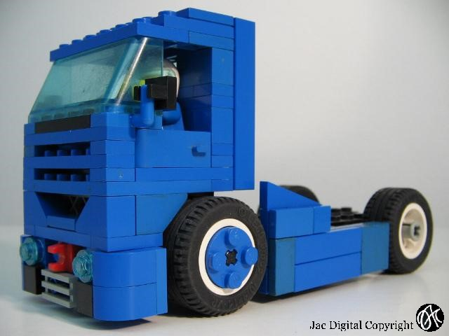
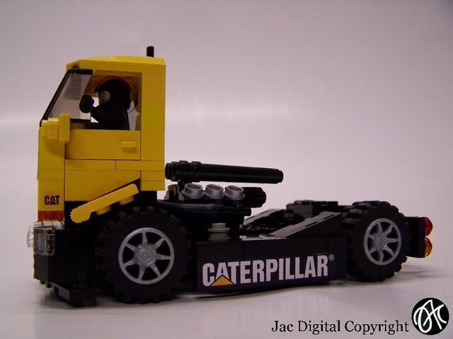
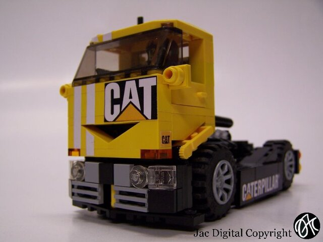
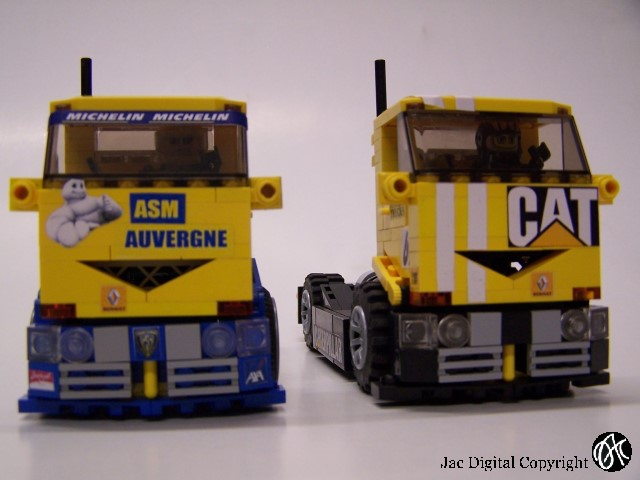
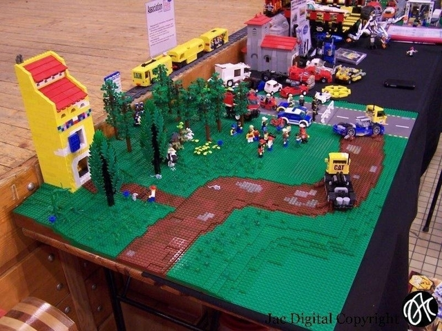
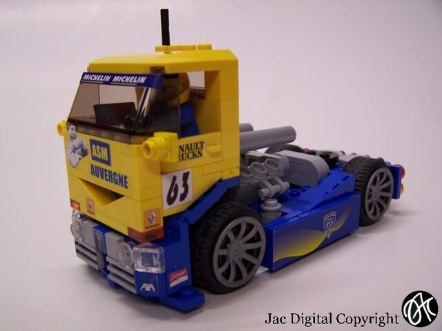
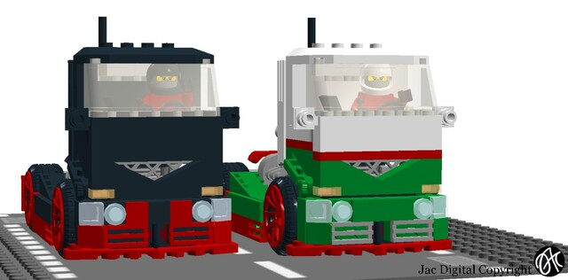
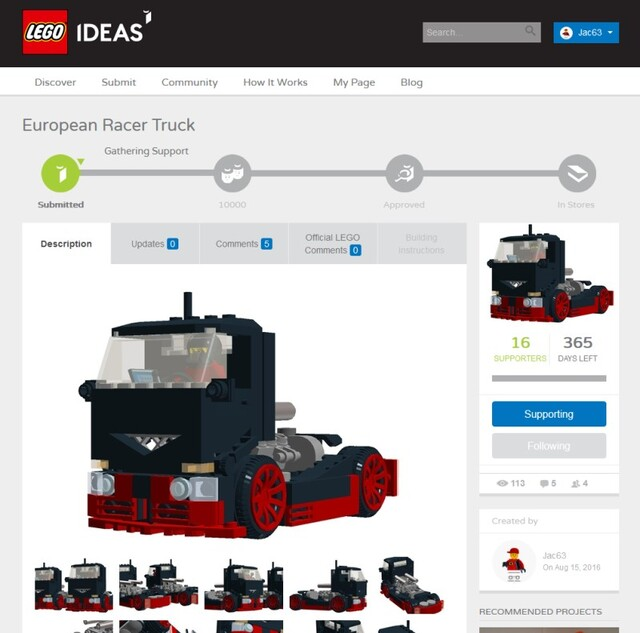

Description et construction de mes deux camions de course préférés. Et puis dans la foulée, présentation d’une version noire et rouge pour "Lego Idea".

Fort de l’expérience que j’ai eue pour la création de ma première boite ([voir le team TCS avec un Volvo](http://photos.freelug.org/main.php/v/JAC/Notices/TCS/)), j’ai été contacté pour un nouveau projet concernant un tracteur Renault. Après plusieurs essais qui ne m’ont pas réellement satisfait, j’ai mis un peu le projet de côté. Plus tard, le team n’ayant pas donné plus de suite à cette création, j’ai abandonné la construction. Mais l’idée d’un camion de course Renault restait ancré dans mon esprit, avec dans la tête le montage de la cabine si particulière des séries "Premium".

C’est donc grâce à toutes ces connaissances acquises sur les courses de camion que j’ai pu mettre au point un châssis très fonctionnel, avec un moteur en position centrale, le radiateur de refroidissement placé sous la cabine, des réservoirs d’eau pour les freins, une sellette qui sert de lest mais qui est conservée, un petit réservoir de carburant avec juste ce qu’il faut pour une épreuve de course et un beau carénage profilé. La cabine est équipée en réalité de deux sièges baquets. Par manque de place, j’en ai simulé qu’un mais un bel écran tactile d’ordinateur permettra au pilote d’ajuster le moteur au plus juste par rapport à la typologie du circuit.

Sur un châssis que j’avais fait en noir, je trouvais qu’une cabine en jaune sortirait bien. C’est plus tard que m’est venue l’idée de faire les bandes blanches à la Gordini et de décorer ce nouveau camion aux couleurs de Caterpillar, grâce à des planches d’autocollants que j’avais conservé. Effectivement, les modèles Renault Gordini sont sortis sous 3 teintes : bleu avec deux bandes blanches, blanc avec deux bandes bleues et jaune avec deux bandes blanches. Les deux dernières étant les moins connues.

Pour le diorama que j’ai présenté en [novembre 2013 à Randan](http://photos.freelug.org/main.php/v/JAC/Exposition/2013/Randan/), je me disais que, un camion ça ne suffisait pas et que ça irait mieux avec 2 ! Ça permet d’imaginer un duel entre 2 pilotes, une vraie course quoi. Vu que je suis en Auvergne j’ai eu l’idée de faire la deuxième version en bleu et jaune, cette fois aux couleurs de l’ASM Auvergne. Je ne suis pas du tout les manifestations sportives de ce club, mais les couleurs collaient très bien. Donc après quelques récupérations de sponsor et une petite recherche de pièces, j’ai pu faire le deuxième bolide. C’était en novembre et c’est que aujourd’hui que je vous le présente, comme quoi tout arrive. Plus tard viendra le diorama complet, enfin, de la taille d’un module. Mais trêve de blabla, voilà enfin quelques photos........

Pour cette deuxième version, j’ai un peu modifié le moteur. J’aime bien cette façon de mettre les pots d’échappement, mais les pièces que j’avais utilisées sur la version "Caterpillar" n’étaient pas bien solides. J’ai donc imaginé un meilleur système pour cette version. J’ai aussi remplacé la sellette par un petit aileron. Ce n’est pas non plus ce qui se fait en course, mais j’ai trouvé le petit rendu un peu loufoque sympa.

Depuis l’existence du système "Lego Idea", je cherche un modèle à présenter à ce concours. Après avoir analysé plusieurs de mes constructions en me disant pas ça, pas ça, pas ça, il me vient l’idée de tester le jeu avec mes camions de courses. Pour éviter de faire de la publicité sur le site, je choisis de créer complètement un camion avec le logiciel virtuel "LDD". Les couleurs noire et rouge se marient très bien, ce sera donc de cette couleur que je vais le présenter au site. Le montage se fait très vite car j’ai juste eu à transcrire ce que j’ai en vrai. En plus je peux séparer les éléments et faire quelques modifications. Les logiciels de création ont un énorme avantage, on peut tester les couleurs sans passer du temps à fouiller les caisses de pièces en se demandant si on aura tout ce qu’il nous faut. Du coup, voici un petit duel entre le team "Blacred" et "Octan"......

Le projet est en ligne, il n’y a plus qu’à espérer avoir le nombre de votes nécessaire à la validation Lego. 10000 ça fait beaucoup mais j’aurai tenté. Merci à vous tous pour la lecture et votre participation.

Le lien ci-dessous est valable pour 365 jours à partir de ce 15 août 2016. La durée peut être étendue à partir de 5000 votes il me semble.....

[Lego Idea European Racer truck](https://ideas.lego.com/projects/150422)
