Aujourd’hui je vous propose la review du set 75105 dans la gamme _Star Wars_ : **Millennium Falcon**.

Ce set sorti en 2015 au prix de 159,99 € est composé de 1329 pièces, soit un ratio prix/pièce de 12 centimes d’€.

Le set contient sept minifigs.

[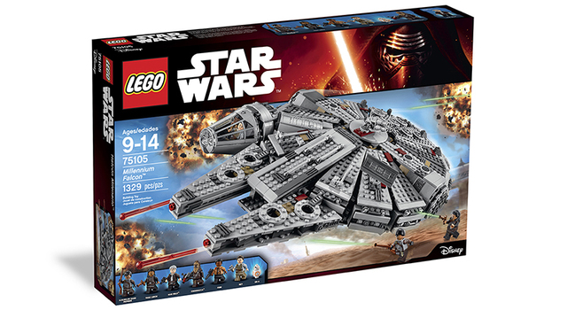](https://www.freelug.org/IMG/jpg/MF75105_box_mini.jpg)

Le packaging de la boite est très réussi, avec Kylo Ren présent sur toute la gamme 2015-2016 puis le _Millennium Falcon_ mis en scène sur la planète Jakku.

[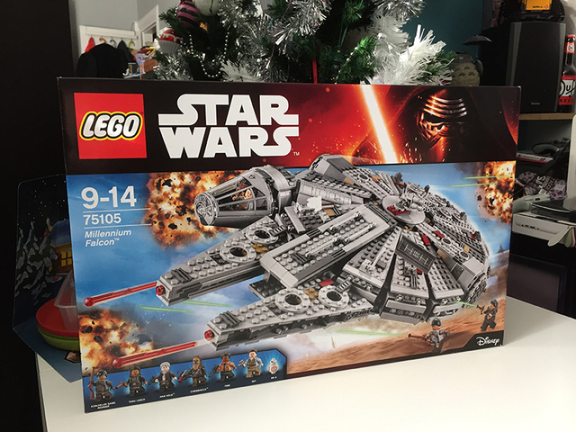](https://www.freelug.org/IMG/jpg/MF75105_01_mini.jpg)

La boite contient treize sachets :

**–** Un sachet contenant l’épaisse notice et la planche d’autocollants (beurk)  
**–** Deux sachets numérotés "1"  
**–** Deux sachets numérotés "8"  
**–** Sept sachets numérotés "2", "3", "4", "5", "6", "7" et "9"  
**–** Un sachet contenant des grandes plaques et le tube bleu pour le réacteur

[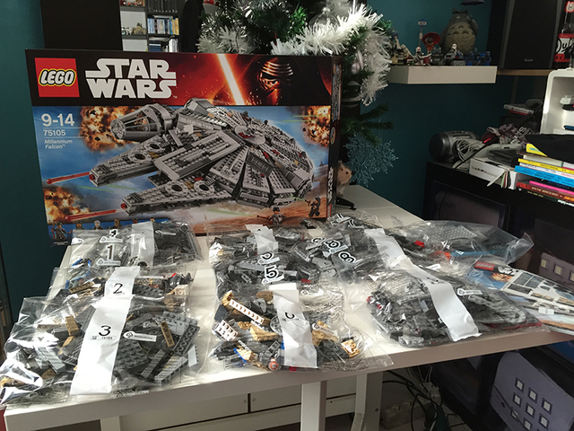](https://www.freelug.org/IMG/jpg/MF75105_02_mini.jpg)

Minifigure _[Kanjiklub Gang Member](http://brickset.com/minifigs/sw673/Kanjiklub-Gang-Member)_, très belle sérigraphie pour cette fig sur le torso (recto/verso) et sur les jambes

[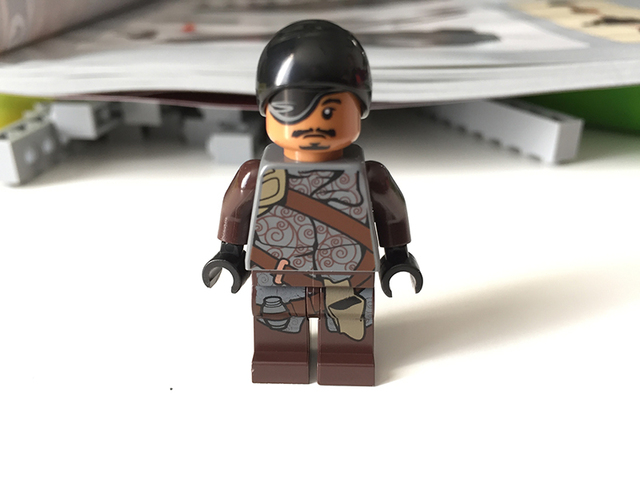](https://www.freelug.org/IMG/jpg/MF75105_Fig_01_mini.jpg)

Le verso de la minifig, très belle réalisation des lanières et de la pochette. Pas de visage alternatif pour cette tête.

[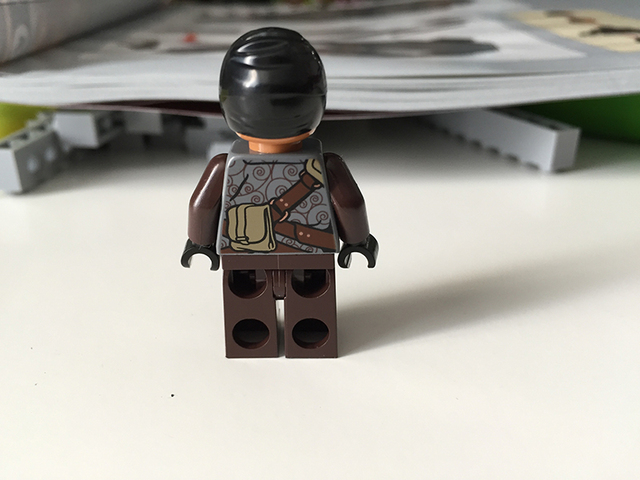](https://www.freelug.org/IMG/jpg/MF75105_Fig_02_mini.jpg)

Le travail sur la fig de _[Tasu Leech](http://brickset.com/minifigs/sw674/Tasu-Leech)_ est plus banal.

[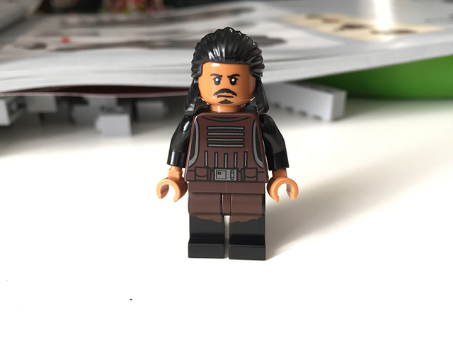](https://www.freelug.org/IMG/jpg/MF75105_Fig_03_mini.jpg)

Visage alternatif "énervé" et verso du torso sérigraphié.

[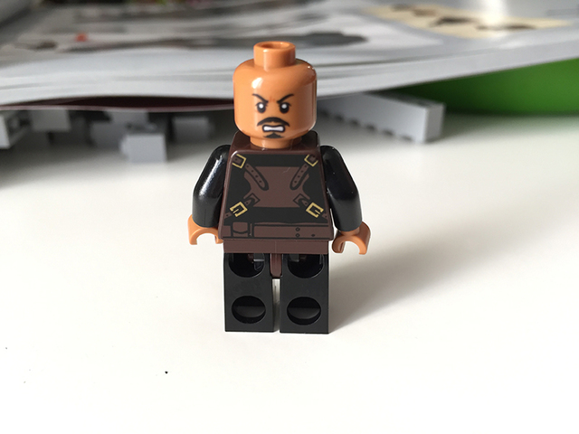](https://www.freelug.org/IMG/jpg/MF75105_Fig_04_mini.jpg)

Très belle réalisation sur _[Han Solo](http://brickset.com/minifigs/sw675/Han-Solo-\(75105\))_ version cheveux grisonnants. Le rendu de la chemise et du blouson qui ont vécu est très bien réalisé. Le visage est lui aussi superbement travaillé et rend honneur au gentil vaurien qui a roulé sa bosse depuis de trop nombreuses années dans la galaxie.

[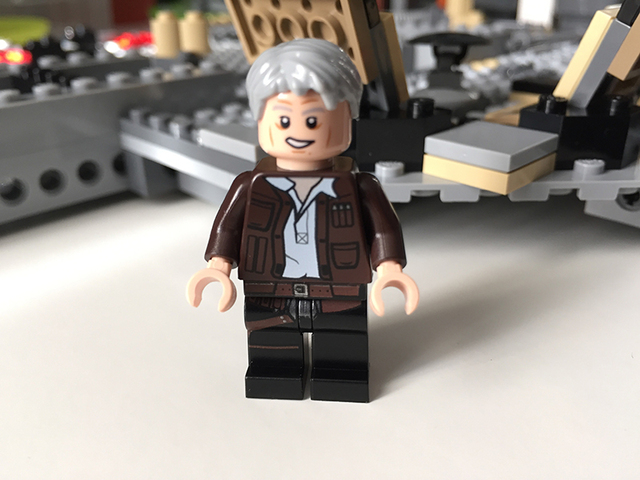](https://www.freelug.org/IMG/jpg/MF75105_Fig_05_mini.jpg)

Visage alternatif et verso du torso.

[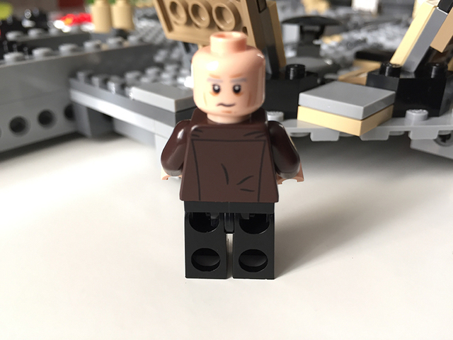](https://www.freelug.org/IMG/jpg/MF75105_Fig_06_mini.jpg)

_[Chewbacca](http://brickset.com/minifigs/sw532/Chewbacca-\(Dark-Tan-fur\))_ dans sa nouvelle livrée, le poids des âges ne se fait pas sentir contrairement à son meilleur ami. Les cartouchières couleurs alu recto/verso et la nouvelle arbalète.

[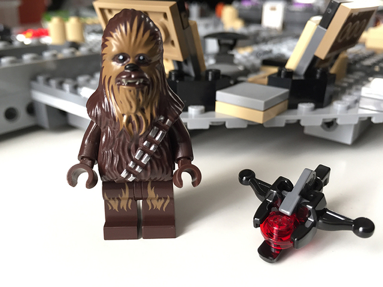](https://www.freelug.org/IMG/jpg/MF75105_Fig_07_mini.jpg)

Chewie de dos.

[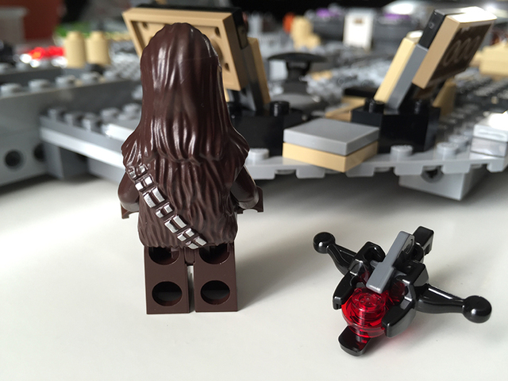](https://www.freelug.org/IMG/jpg/MF75105_Fig_08_mini.jpg)

_[Finn](http://brickset.com/minifigs/sw676/Finn)_ équipé de son blouson marron, la sérigraphie est sympa mais rien d’extraordinaire.

[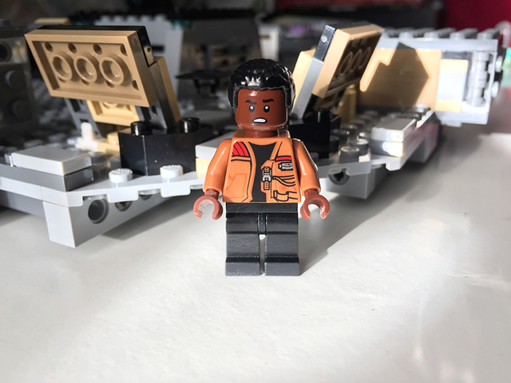](https://www.freelug.org/IMG/jpg/MF75105_Fig_09_mini.jpg)

Visage alternatif "énervé".

[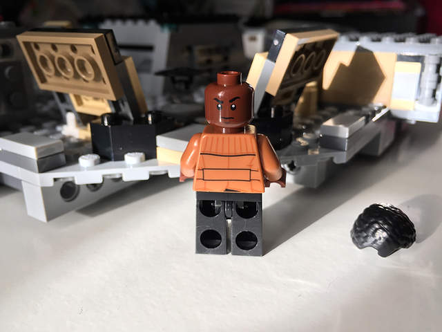](https://www.freelug.org/IMG/jpg/MF75105_Fig_10_mini.jpg)

_[Rey](http://brickset.com/minifigs/sw677/Rey)_ une des plus belles réalisations du set avec la fig du Membre du Gang Kanjiklub. Très belle sérigraphie du torse se continuant sur les jambes.

[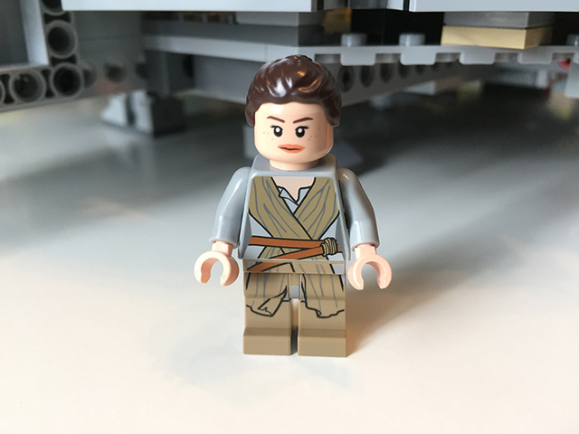](https://www.freelug.org/IMG/jpg/MF75105_Fig_11_mini.jpg)

Visage alternatif et sérigraphie du verso du torse, on regrette que le verso des jambes n’ait pas subi le même traitement que le recto.

[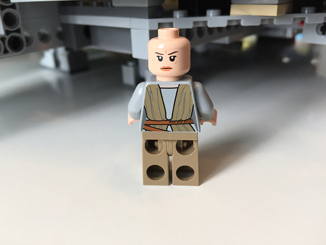](https://www.freelug.org/IMG/jpg/MF75105_Fig_12_mini.jpg)

Enfin voici _[BB-8](http://brickset.com/minifigs/sw661/BB-8)_, la star de cette nouvelle trilogie. Belle réalisation ici aussi

[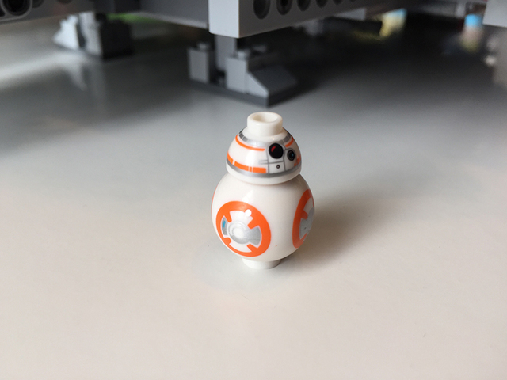](https://www.freelug.org/IMG/jpg/MF75105_Fig_13_mini.jpg)

On commence l’assemblage par la structure à base de briques Technic.

[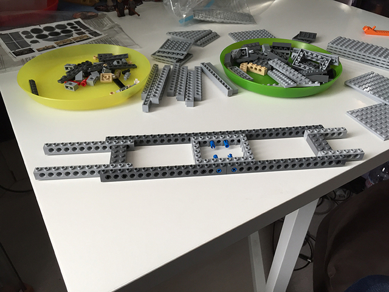](https://www.freelug.org/IMG/jpg/MF75105_03_mini.jpg)

Une fois la base montée on s’attaque au plancher.

[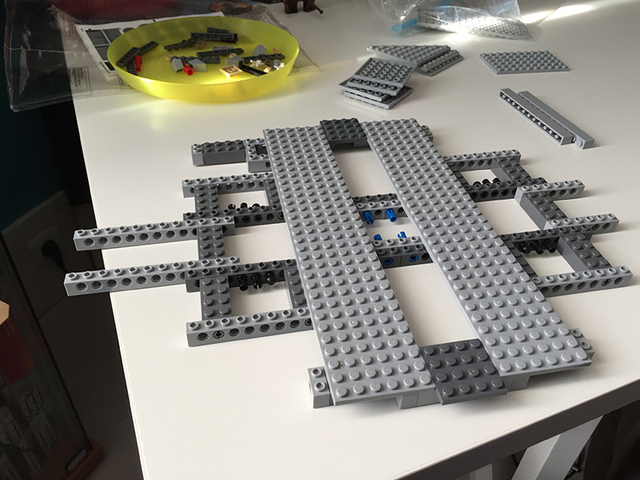](https://www.freelug.org/IMG/jpg/MF75105_04_mini.jpg)

Plancher posé.

[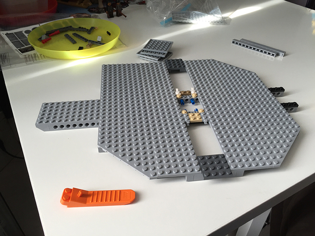](https://www.freelug.org/IMG/jpg/MF75105_05_mini.jpg)

A la fin du sachet 1 on peux commencer à monter la structure.

[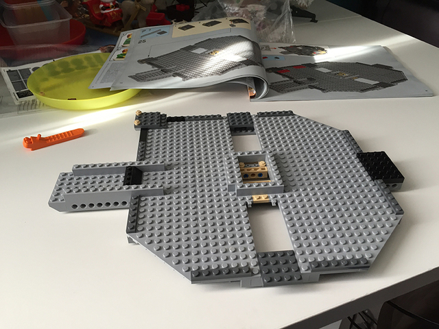](https://www.freelug.org/IMG/jpg/MF75105_06_mini.jpg)

Fin du sachet 2, certains aménagements intérieur ont fait leur apparition.

[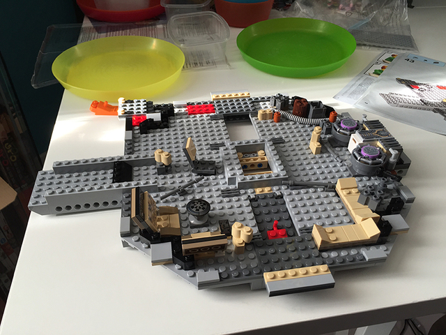](https://www.freelug.org/IMG/jpg/MF75105_07_mini.jpg)

L’aménagement continue d’avancer à la fin du sachet 3

[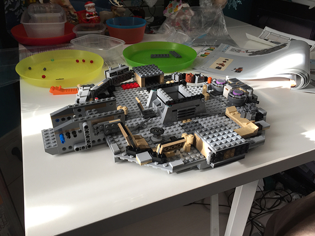](https://www.freelug.org/IMG/jpg/MF75105_08_mini.jpg)

Après avoir fini le sachet 4 et 5, les cloisons et le poste de pilotage du MF sont posés.

[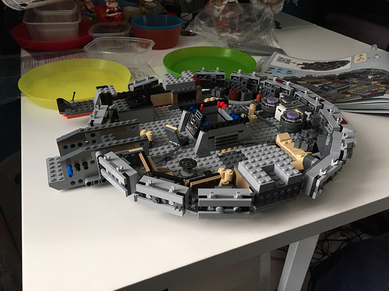](https://www.freelug.org/IMG/jpg/MF75105_09_mini.jpg)

A la fin du sachet 6 les côtés (capsules de sauvetage) sont en place.

[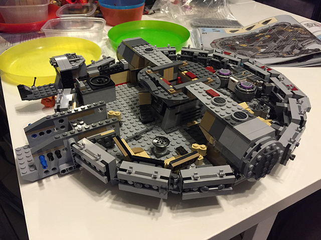](https://www.freelug.org/IMG/jpg/MF75105_10_mini.jpg)

Les tourelles blaster supérieure et inférieure sont en place après avoir fini le sachet 7.

Fin du sachet 8, la partie supérieure du MF est finie.

[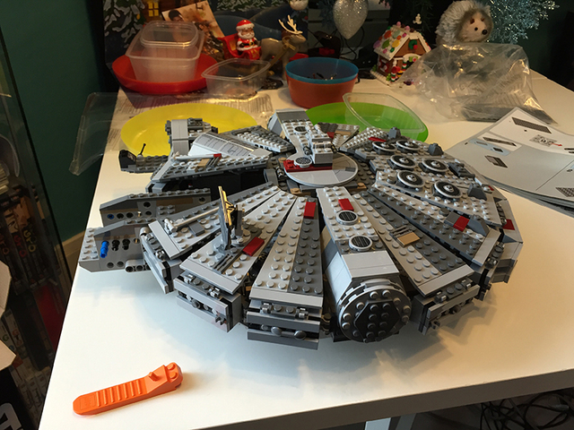](https://www.freelug.org/IMG/jpg/MF75105_12_mini.jpg)

Le cockpit et le nez de l’appareil sont maintenant en place une fois le sachet 9 terminé.

[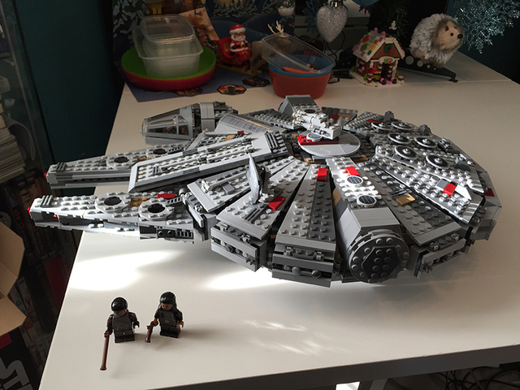](https://www.freelug.org/IMG/jpg/MF75105_13_mini.jpg)

Voici les extra parts de ce set.

[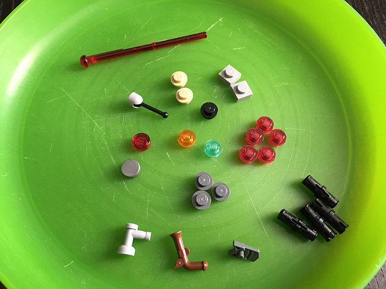](https://www.freelug.org/IMG/jpg/MF75105_16_mini.jpg)

Petite mise en situation du _Millennium Falcon_ fermé et ouvert.

[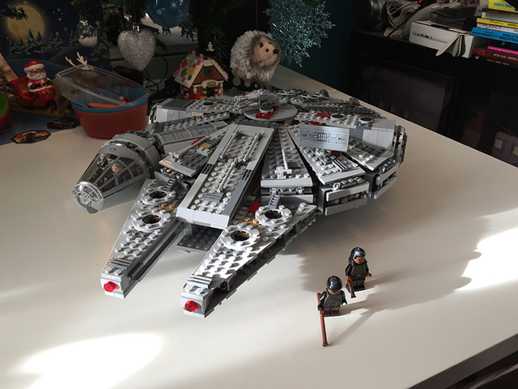](https://www.freelug.org/IMG/jpg/MF75105_14_mini.jpg)

[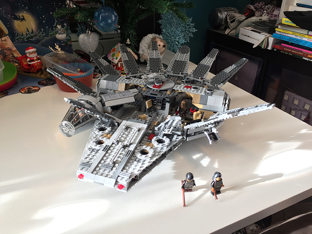](https://www.freelug.org/IMG/jpg/MF75105_15_mini.jpg)

**AVIS :**

Ce _Millennium Falcon_ 2015 sauce The Force Awaken est une belle réussite, il reprend les composantes du set [7965](http://brickset.com/sets/7965-1/Millennium-Falcon) en les améliorant. Bref une belle réussite pour ce set agrémenté de sept très belle figurines. Un must have pour les fans de la licence.

**BONUS :**

Voici un GIF animé réalisé avec les photos prises pour cette review.

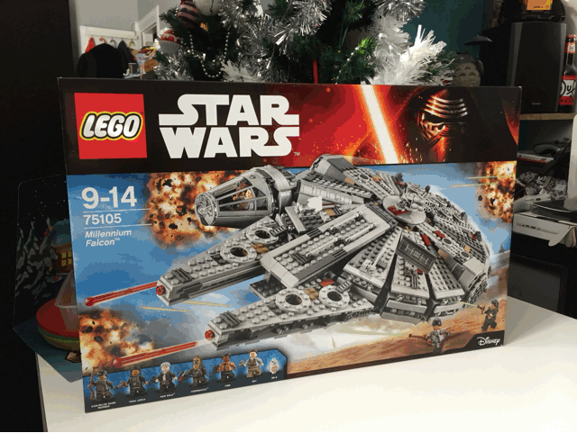
