Le tenon fait partie, au même titre que la minifigurine et la brique 2x4, de l’ADN du produit LEGO. Comment le décrire ? Le définir ? Et surtout comment comprendre son compagnon méconnu dans la connexion tenon-tube : l’antistud.

## Le tenon

Le tenon (stud, knob, bump...) fait partie de l’ADN du produit LEGO (au même titre que la minifigurine et la brique 2x4). Comment le décrire ? Le définir ? En interrogeant les fans, et en compilant les réponses, la définition suivante est née :

_Elément de connexion constitué d’une protubérance en forme de cylindre aplati, portant la mention LEGO sur le dessus, présent sur la face supérieure de nombreuses pièces._

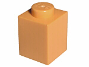

La définition est complète mais le tenon à plusieurs visages. Elle convient assez bien au **tenon plein (angl. Solid)** qui orne l’écrasante majorité des briques et plaques, mais d’autres tenons existent que nous allons détailler.

## Le tenon creux (angl. Hollow ou Recessed)

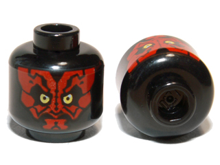

C’est un tenon évidé mais qui présente un fond (avec la mention LEGO). Il est emblématique de la gamme Technic (1977) mais il a depuis fait son chemin dans la gamme System. En particulier la jumper plate n’a jamais connu depuis sa naissance (1978) que le tenon creux et les tenons latéraux des pièces SNOT sont des tenons creux.

La cavité a un diamètre de 3,2mm permettant de recevoir les éléments barres (angl. bar, rod) parfois appelés aussi éléments 318.

En fait, les tenons pleins sont, eux aussi, creux, mais la cavité se situe sous le tenon, à l’intérieur de la pièce. Vous pouvez le constater facilement sous les plaques et briques non modifiées.

Lors du moulage des pièces, le plastique se contracte au refroidissement d’autant plus que l’épaisseur de matière est importante. Le fait de mouler un tenon creux permet de contrôler plus facilement son retrait et donc la précision dimensionnelle.

Dans le cas de la brique Technic, le trou d’axe latéral ne permet plus de faire un tenon creux par l’intérieur - la contrainte technique est source d’innovation.

## Le tenon ouvert (angl. Open)

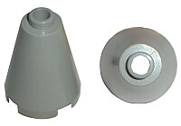

Il apparut très tôt, en particulier sur une petite pièce que les enfants risquaient d’avaler : la brique 1x1 ronde. Afin d’éviter les risques d’étouffement, le tenon plein de cette pièce fut remplacé dès 1976 par un tenon ouvert laissant passer l’air à travers toute la pièce. Par la force des choses, le tenon ne porte plus la mention LEGO.

Cette modification du tenon offre de nouvelles possibilités de montage en insérant une barre pour consolider des montages ou des tubes flexibles pour créer des courbes.

Le tenon latéral de la brique « machine à laver » est un tenon ouvert.

## Le tenon ouvert-bloqué (angl. Blocked Open)

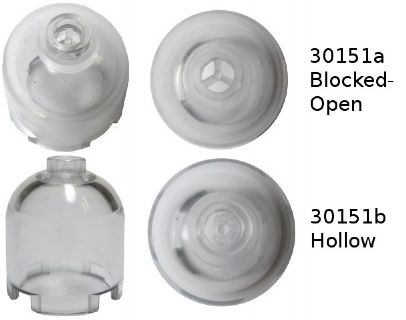

Le tenon bloqué est un tenon ouvert barré d’une croix à trois branches. Une barre insérée dans le tenon creux trouvera une butée qui limitera la profondeur de son insertion. Le fait de bloquer le tenon ouvert permet de retrouver la qualité du tenon creux tout en conservant la possibilité d’une circulation d’air. On trouve ce tenon en particulier sur les pièces « tête de minifig » mais aussi sur les cônes et dômes 2x2.

## Le tenon raboté

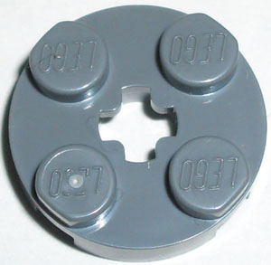

Les briques et plaques rondes 2x2 possèdent 4 tenons qui sont tous légèrement rabotés sur leur bord extérieur pour épouser l’arrondi de la pièce. Cette modification ne semble pas porter à conséquence sur le clutch power (pouvoir d’assemblage) ou être l’origine de montages originaux. Elle n’est d’ailleurs pas reprise dans les descriptions de pièces (dénominations LEGO et Bricklink).

D’autres pièces possèdent des tenons "amputés" de façon similaire d’une fraction de leur disque comme les tenons de [cadre de porte](http://alpha.bricklink.com/pages/clone/catalogitem.page?P=30179#T=C) pour permettre l’insertion des portes et volets ou les tenons du [cylindre de moteur Technic](http://alpha.bricklink.com/pages/clone/catalogitem.page?P=2850#T=C)

## Tenons inattendus

On s’attend, globalement, à trouver le tenon au sommet des pièces. La relation entre le tenon et l’orientation des pièces, à l’image de celle de l’œuf et de la poule, est en réalité plus complexe et à double sens. Car si la relation était simple dans les années 50, l’apparition des pièces SNOT a tout remis en cause. Quelle est la « bonne » orientation de cette équerre ? Il n’y en a pas, ou plutôt il y en a plusieurs.

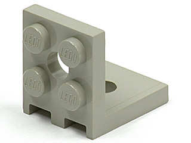

Mais d’autres pièces présentent des tenons encore plus déroutants. Par exemple, on s’attend à trouver les tenons sur une surface plane, mais des pièces Technic (axe, cheville) et de nombreux accessoires minifig (barres) présentent un tenon isolé à l’extrémité d’une structure fine et allongée.

|  |  |  |  |  |
| --- | --- | --- | --- | --- |
| 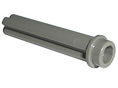 | 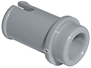 | 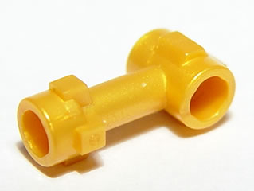 | 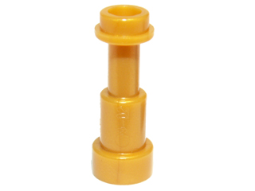 | 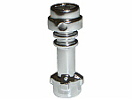 |

D’autres tenons inattendus :

|  |  |  |  |
| --- | --- | --- | --- |
| 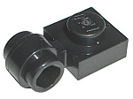 | 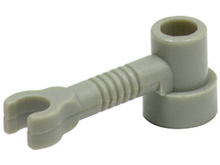 | 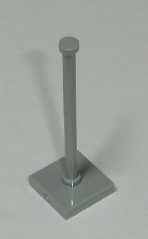 | 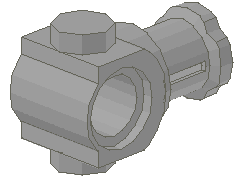 |

## Antistud

Nous venons d’étudier d’un peu plus près le tenon. Mais pour établir une connexion, il faut un contre-élément : c’est l’antistud.

_Ensemble des éléments physiques  
en contact avec le tenon  
dans le but de le maintenir en place,  
créant ainsi le "clutch power"._

Pour comprendre l’antistud, il faut revenir à la création de la brique 2x4. En 1949, la brique était vide et l’emboîtement ne tenait que grâce aux parois latérales. Pour des pièces (brique, plaque...) de petites tailles (1x1, 1x2) les parois latérales constituent l’essentiel de l’antistud mais pour des pièces plus grandes comme la brique 2x4, d’autres éléments doivent venir renforcer la résistance de l’emboîtement.

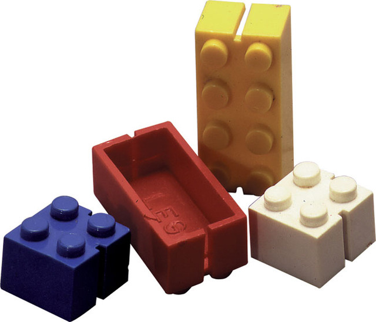

## Briques sans système tubulaire de 1953

Ainsi la brique 2x4, après plusieurs essais, reçut officiellement en 1958, date du dépôt de brevet, des antistuds sous la forme de tubes (système tubulaire – angl. Tube , Tubular system). Les pièces plus étroites pour leur part reçurent des antistuds sous la forme de barres (celles-là même qui peuvent s’emboîter dans le tenon creux). C’est l’ensemble tenon et tube (angl. stud-and-tube) qui permet aujourd’hui à la société LEGO de défendre (sans succès) sa propriété intellectuelle sur la brique de construction.

[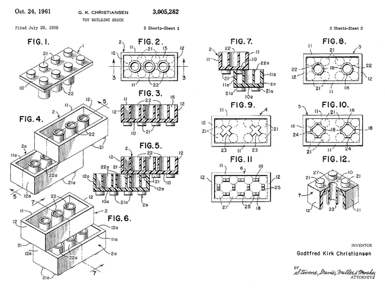](https://www.freelug.org/IMG/gif/antistud2.gif)

_Un dessin du dépôt de brevet américain décrivant le système tubulaire  
ainsi que d’autres antistuds (croix et cabochons)._

Notons que l’antistud sous la forme de croix fût employé par la société LEGO de façon restreinte aussi bien dans le temps (les années 1970) que dans l’espace (marché italien) pour les pièces basiques de la gamme Minitalia.

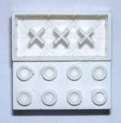

Il va sans dire que les antistuds, autant qu’ils améliorent la bonne tenue des montages, limitent les possibilités d’emboîtement, en particulier en empêchant les montages décalés (c’est-à-dire fractionnaire du module). Un exemple bien connu est celui de la tile (plaque lisse) 1x2 qui ne comporte pas d’antistud, contrairement à la brique 1x2. Ainsi elle peut s’emboîter librement en translation sur un tenon isolé.

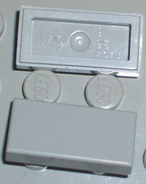

L’histoire de l’antistud aurait pu s’arrêter là, mais l’innovation a continué à écrire l’histoire. A ce titre intéressons-nous à un cas intermédiaire : la jumper plate. Elle peut être décrite comme une tile 1x2 avec un seul tenon centré. Elle a existé sous différentes versions dont deux sont instructives en ce qui concerne l’antistud.

|  |  |
| --- | --- |
| 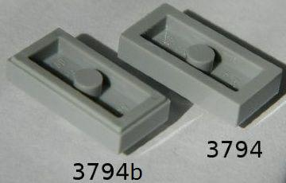 | 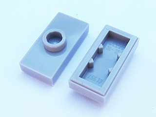 |

Les premières versions (BL 3794/b) présentaient un antistud classique sous la forme d’une barre. La version moderne (2013 – BL 15573) présente un ensemble d’indentations : le porteur de tenon (angl. Stud holder). Dans le premier cas, le montage AZMEP (décalage d’un demi module) est possible mais uniquement sur un tenon creux alors que dans le second cas, le montage AZMEP est possible sur tous types de tenons. Ce nouveau type d’antistud est apparu depuis 2008 sur des pièces 1x2 variées comme la brique 1x2x2, la slope 45 2x1 double et triple.

## Antistud inattendus

Tout comme les tenons, les antistuds sont attendus sous les pièces. Mais comme nous l’avons déjà vu avec les tenons, ce concept d’orientation est très subjectif. Un antistud finalement très bien connu est le trou de cheville que l’on trouve sur le côté des briques Technic ou même des pièces Technic studless comme les beams et liftarms.

|  |  |
| --- | --- |
| 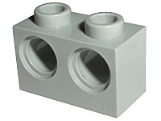 | 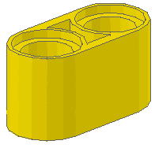 |

D’autres antistuds inattendus :

|  |  |  |  |
| --- | --- | --- | --- |
| 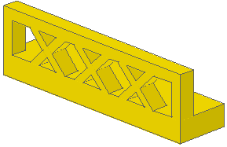 | 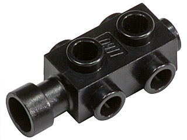 |  | 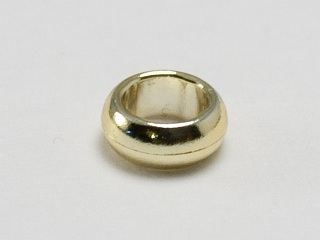 |

## Pièces inattendues

La brique machine à laver ayant deux tenons et deux antistuds,  
elle peut aussi être vue comme une brique 2/3

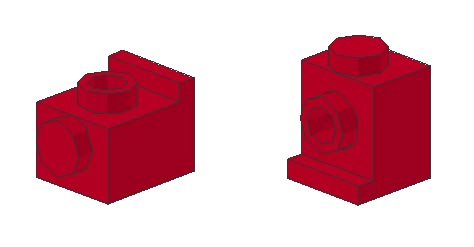

Pour la même raison, la brique 1x2x2/3  
peut être vue comme une brique 1x1x7/3

|  |  |
| --- | --- |
|  | 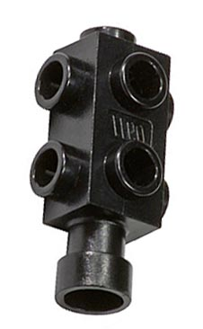 |

Les accessoires de figurines suivants (télescope, flasque, mégaphone) habituellement connectés via leur barre peuvent aussi être employés comme des briques 1x1x5/3. La technique est courante avec le télescope.

|  |  |  |
| --- | --- | --- |
|  | 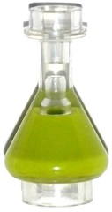 | 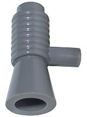 |

La bouteille peut être employée comme brique 1x1x2.

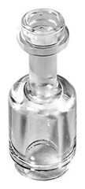

## Conclusion

Le tenon est le plus ancien des éléments de connexion et sans doute le plus reconnaissable du jeu de construction LEGO. Il en est l’ADN même. Mais en s’y attardant on se rend compte qu’il a plusieurs visages et, qu’avec son contre-élément, l’antistud, il a fait et fera l’objet de nombreuses d’innovations sources de créativité.
