Aujourd’hui je vous propose la review du set 21026 dans la gamme _Architecture_ : **Venice**.  
Ce set sorti en 2016 au prix de 29,99 € est composé de 212 pièces, soit un ratio prix/pièce de 14 centimes d’euros.

[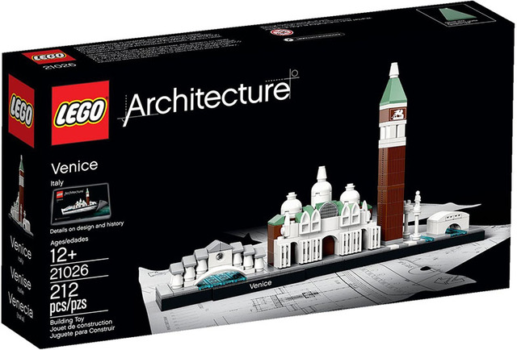](https://www.freelug.org/IMG/jpg/Venice_box_mini.jpg)

The LEGO Company à donc décidé de faire évoluer sa gamme _Architecture_ en nous proposant des mini dioramas composés de plusieurs monuments emblématiques d’une ville. Voyons tout de suite si le pari est réussi ou pas.

La boite revêt le traditionnel habit noir de la gamme _Architecture_, c’est sobre et classe.

[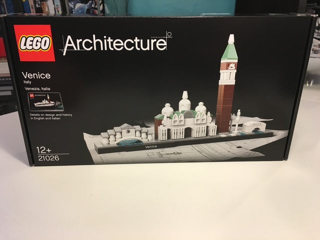](https://www.freelug.org/IMG/jpg/Venice_01.jpg)

Au dos on découvre les différents monuments qui composent le diorama, avec des photos des vrais édifices.

[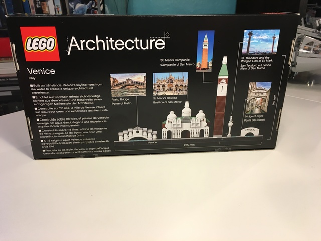](https://www.freelug.org/IMG/jpg/Venice_02.jpg)

Ce set est composé de trois sachets et d’un manuel d’instructions. Ce dernier a une finition impeccable et luxueuse avec un dos carré.

[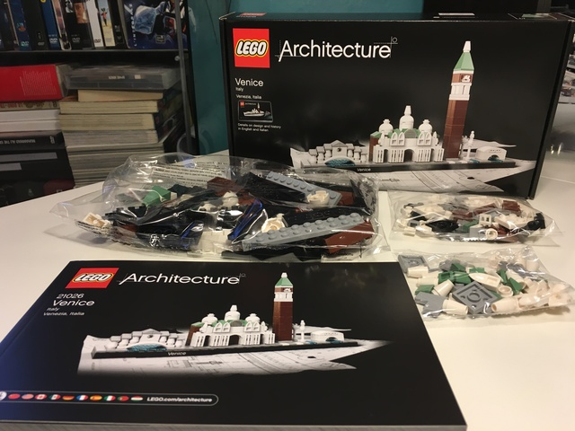](https://www.freelug.org/IMG/jpg/Venice_03.jpg)

Le diorama fera donc 32x4 tenons, vous voyez ici la base montée avec la tile sérigraphiée " **_Venice_** ".

[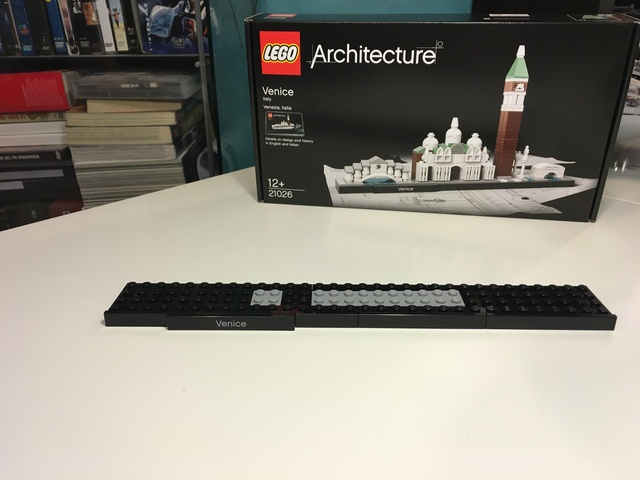](https://www.freelug.org/IMG/jpg/Venice_04.jpg)

Le sol composé, entre autre, de tiles grises, blanches et bleues translucide.

[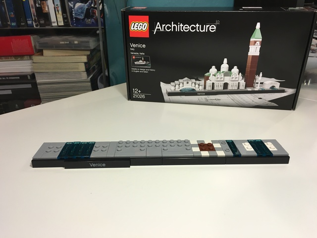](https://www.freelug.org/IMG/jpg/Venice_05.jpg)

Voici les deux premiers édifices, le _Ponte di Rialto_ et la _Basilica di San Marco_.

[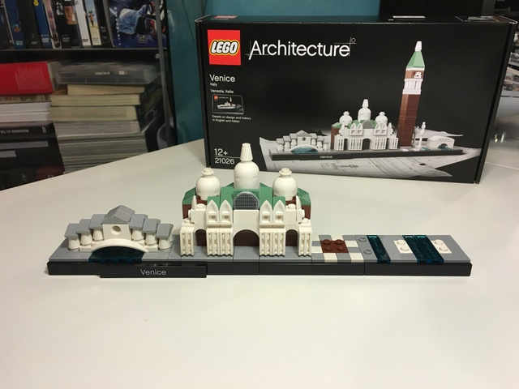](https://www.freelug.org/IMG/jpg/Venice_06.jpg)

Les trois autres monuments sont maintenant en place, le _Campanile di San Marco_, les colonnes _San Teodoro e il Leone Alato di San Marco_ et enfin le _Ponte del Sospiri_.

[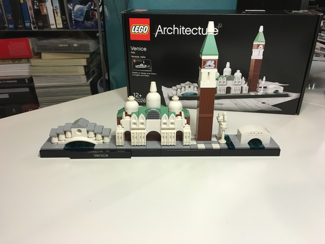](https://www.freelug.org/IMG/jpg/Venice_07.jpg)

Le diorama vu sous des angles différents.

[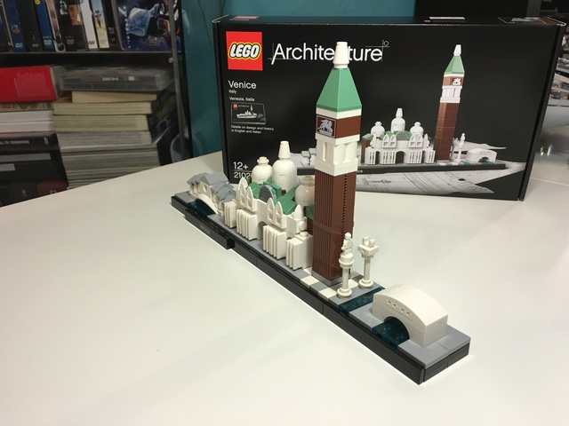](https://www.freelug.org/IMG/jpg/Venice_08.jpg)

[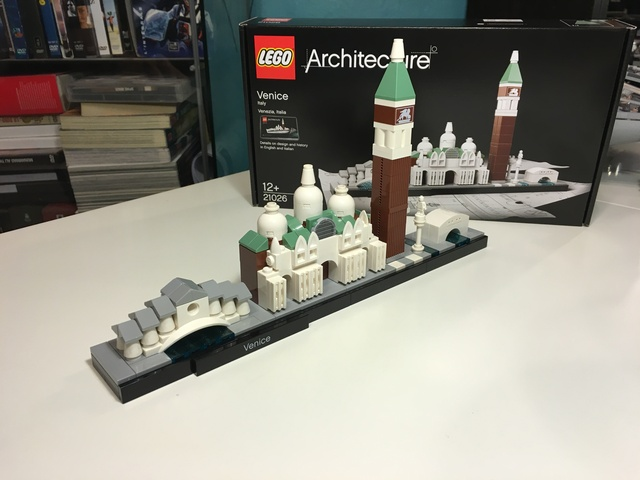](https://www.freelug.org/IMG/jpg/Venice_09.jpg)

Peu d’extra parts dans ce set.

[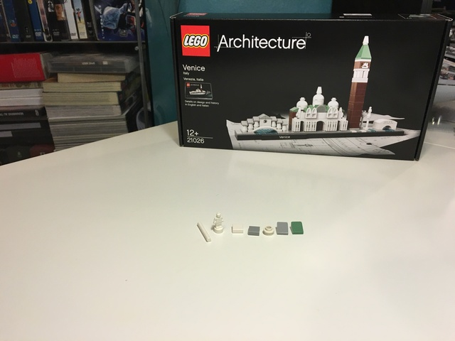](https://www.freelug.org/IMG/jpg/Venice_10.jpg)

**AVIS :**

LEGO réussi le pari de "réinventer" sa gamme _Architecture_ en exploitant l’idée de diorama. Au final je trouve le rendu vraiment bon et la gamme s’en trouve re-dynamisée. J’ai vraiment hâte de voir sortir un set sur Paris.

**BONUS :**

Comme d’habitude, voici un GIF animé réalisé avec la totalité des photos prises pour cette review.

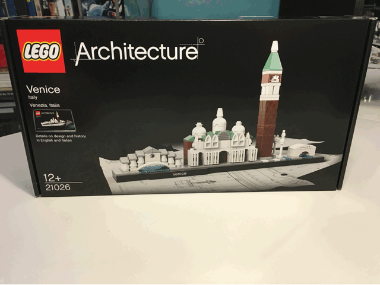
