Aujourd’hui je vous propose la review du set 70331 dans la gamme _Nexo Knights_ : **Ultimate Macy**.  
Ce set sorti en 2016 au prix de 9,99 € est composé de 101 pièces, soit un ratio prix/pièce de 10 centimes d’euro.

[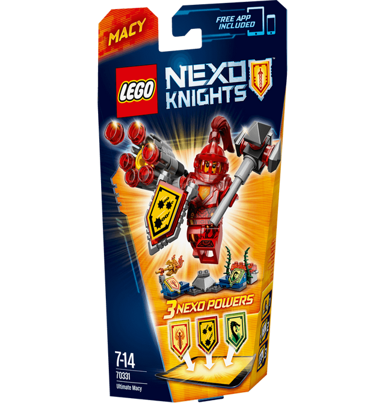](https://www.freelug.org/IMG/png/UltimateMacy_box.png)

Lancée début 2016, _Nexo Knights_ est une nouvelle gamme made in LEGO :

> Voyage dans un monde de chevaliers high-tech et de monstres de lave avec un magicien numérique pour une nouvelle aventure passionnante !

Les sets sont couplés à un jeu vidéo pour smartphone/tablette, les blasons contenus dans les boites LEGO permettent d’avoir différents pouvoirs dans le jeu.

**ATTENTION :** Cette review sera très proche à celle du set [_Ultimate Clay_](/articles/2219/) parue précédemment sur le site, en effet le contenu des boites est assez similaire. Cette review a surtout pour but de découvrir une minifig différente afin de vous faire une idée de cette nouvelle gamme.

* * *

Le visuel de la boite reprend bien le thème "chevalier high-tech" avec ses couleurs jaune et bleue.  
Sur le bas de la boite on voit les trois Nexo Powers contenus dans le set et qui permettront de jouer dans le jeu vidéo. Le visuel est complètement dans le ton de cette nouvelle gamme, LEGO a réussi son coup de ce côté-là.

[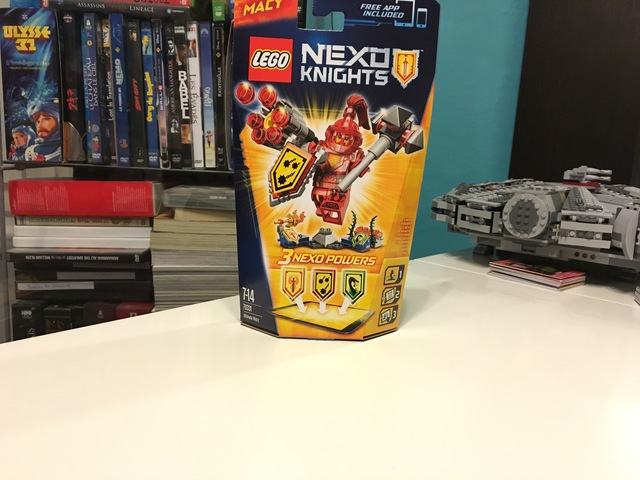](https://www.freelug.org/IMG/jpg/UltimateMacy_01.jpg)

Le dos du set apporte un visuel du set monté et une grande partie est dédié au jeu vidéo et au matériel avec lequel il est compatible. Le verso du set fait bien triste à cause de cet encart.

[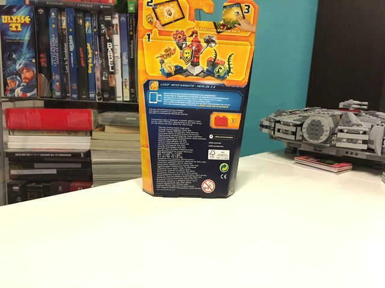](https://www.freelug.org/IMG/jpg/UltimateMacy_02.jpg)

Une fois ouvert, le set contient deux sachets non numérotés et une notice de construction.

[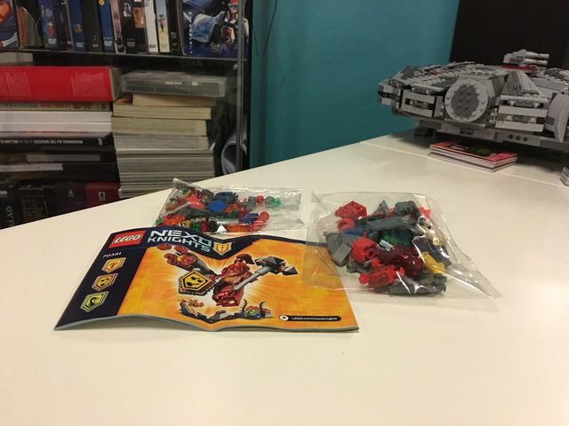](https://www.freelug.org/IMG/jpg/UltimateMacy_03.jpg)

La chose se confirme, les minifigs _Nexo Knights_ sont une réussite, celle de _Macy_ n’échappe pas à la règle. On peux quand même noter un petit raté sur l’alignement des lignes entre le bas du torse et les jambes.

[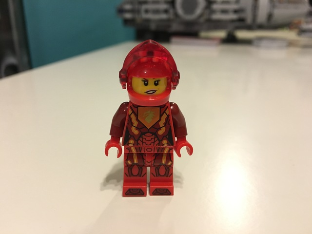](https://www.freelug.org/IMG/jpg/UltimateMacy_05.jpg)

_Macy_ avec son heaume translucide abaissé.

[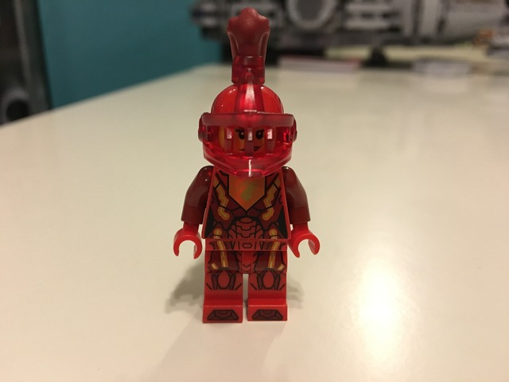](https://www.freelug.org/IMG/jpg/UltimateMacy_04.jpg)

Puis avec son armure, elle aussi translucide, sa masse d’arme et son bouclier contenant un des trois blasons du set (blasons sérigraphiés sur pièces translucides). La masse d’arme est vraiment réussie, et confirme elle aussi que les armes de cette gamme ont des proportions plus que généreuses.

[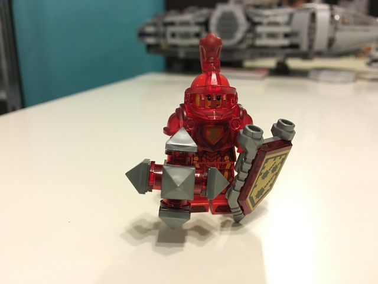](https://www.freelug.org/IMG/jpg/UltimateMacy_06.jpg)

De dos on peut apprécier le visage alternatif "énervé" et ainsi que la sérigraphie toujours aussi réussie.

[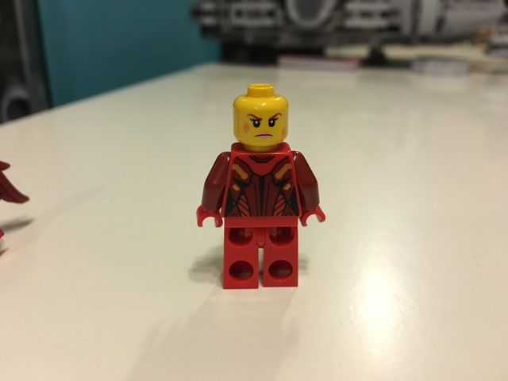](https://www.freelug.org/IMG/jpg/UltimateMacy_07.jpg)

Le dos de l’armure comprend toujours les 4 tenons permettant de fixer l’arme supplémentaire.

[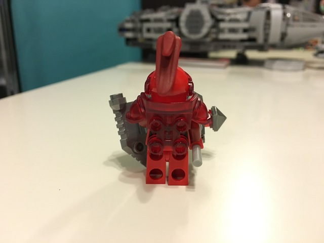](https://www.freelug.org/IMG/jpg/UltimateMacy_08.jpg)

_Macy_ équipée de sa Gatling plus que dissuasive.

[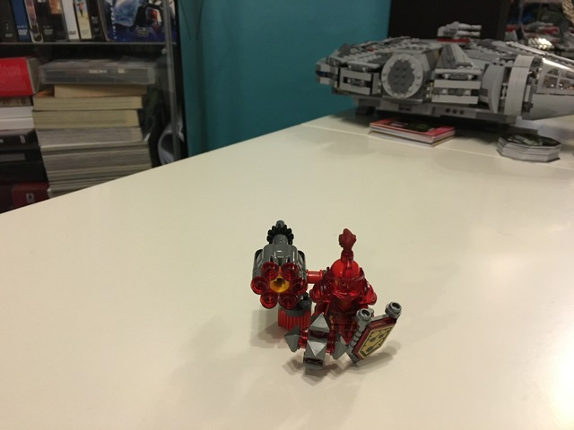](https://www.freelug.org/IMG/jpg/UltimateMacy_12.jpg)

Mise en situation recto/verso du set terminé.

[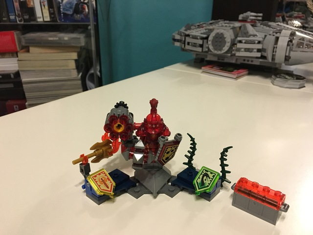](https://www.freelug.org/IMG/jpg/UltimateMacy_18.jpg)

[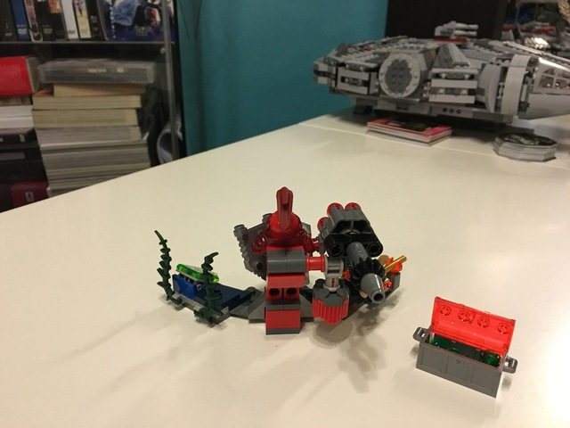](https://www.freelug.org/IMG/jpg/UltimateMacy_19.jpg)

_  
Ultimate Clay_ et _Ultimate Macy_ côte à côte ([vous pouvez relire la review du set _Ultimate Clay_](/articles/2219/)).

[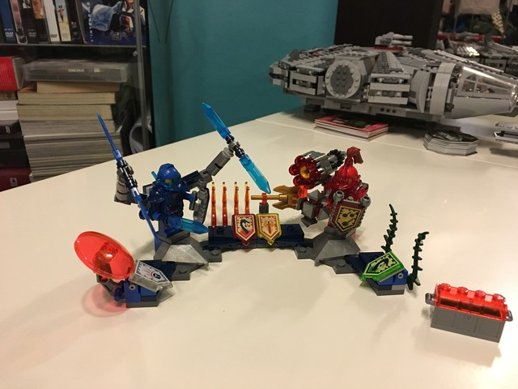](https://www.freelug.org/IMG/jpg/UltimateMacy_20.jpg)

* * *

**AVIS :**

Alors que j’avais un avis négatif quand cette gamme a été annoncée par LEGO, je la trouve plutôt réussie et cohérente avec l’univers créé et voulu par l’entreprise Danoise.  
Personnellement les sets ne m’intéressent pas plus que ça, par contre les Minifigures sont une vraie réussite et il n’est pas exclu que je les collectionne.

**BONUS :**

Comme d’habitude, voici un GIF animé réalisé avec la totalité des photos prises pour cette review.

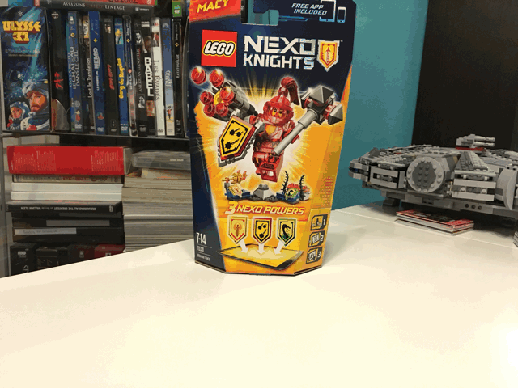
