Aujourd’hui je vous propose la review du set 71230 dans la gamme _Dimensions_ : **Fun pack : Doc Brown**.  
Ce set sorti en 2016 au prix de 14,99 € est composé de 69 pièces, soit un ratio prix/pièce de 22 centimes d’euro.  
Ce set est un _Fun Pack_ (ou _Level Pack_) du jeu [_LEGO Dimensions_](http://www.lego.com/fr-fr/dimensions) sorti en 2015.

[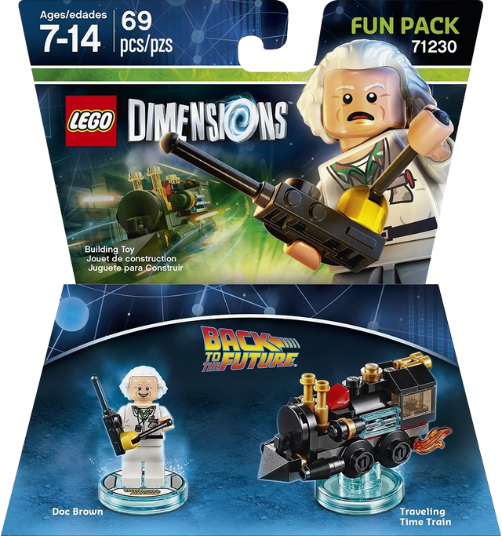](https://www.freelug.org/IMG/png/DimensionsBttF_2_box.png)

Avant de commencer, il faut savoir qu’il n’y a pas de notice de construction dans les _Level Pack_, le livret fournit les instructions rudimentaires du fonctionnement des socles à puce RFID. Vous pouvez vous rendre sur le site LEGO à [_cette adresse_](https://wwwsecure.us.lego.com/fr-fr/service/buildinginstructions/search#?search&theme=10000-20229), avec le numéro du set (ici 71230), afin de récupérer les instructions de montage. Enfin sachez que le modèle de ce _Level Pack_ a trois versions de construction différentes.

J’ai choisi pour cette review de construire la version classique du _Traveling Time Train_ (le modèle que l’on voit sur la boite).

De plus je n’ai pas le jeu _LEGO Dimensions_, l’achat de ce pack est du à la présence de _Doc Brown_, minifigure que je n’avais pas et qui possède ici une chevelure exclusive.

* * *

On retrouve le packaging des _Fun Pack_ en forme de "X". Sont représentés sur la boite, la minifig de _Doc Brown_ et le mini véhicule dans sa forme "classique"

[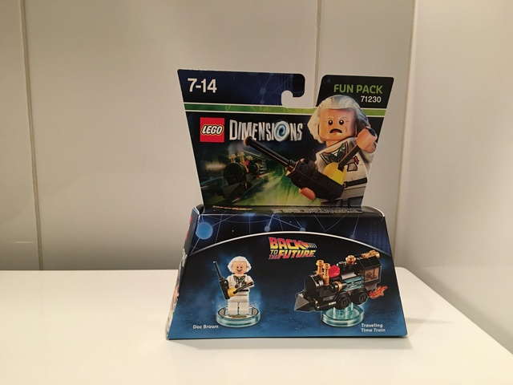](https://www.freelug.org/IMG/jpg/DimensionsBttF_2_01.jpg)

Au dos on peut voir les trois modèles qu’il est possible de monter.

[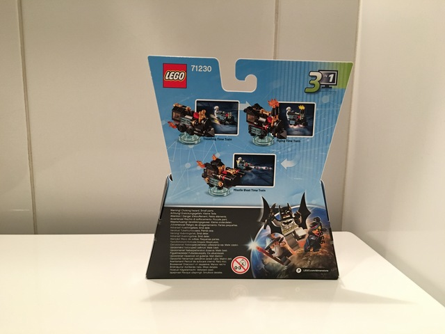](https://www.freelug.org/IMG/jpg/DimensionsBttF_2_02.jpg)

Ce _Level Pack_ contient deux sachets de briques et une notice de d’instruction pour le jeu _LEGO Dimensions_.

[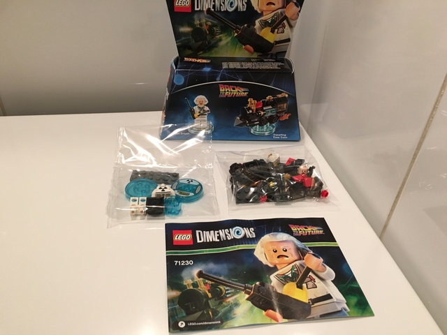](https://www.freelug.org/IMG/jpg/DimensionsBttF_2_03.jpg)

La minifigure de _Doc Brown_ sur son socle RFID sérigraphié à son nom. Belle sérigraphie sur le torso et visage bien détaillé.

[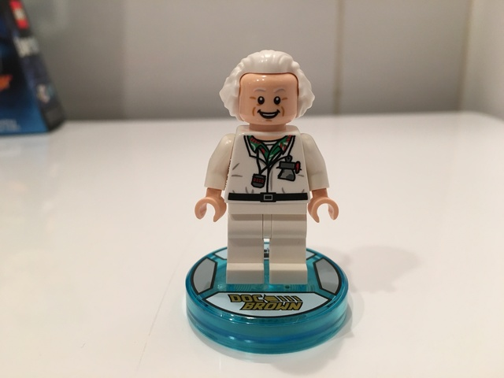](https://www.freelug.org/IMG/jpg/DimensionsBttF_2_04.jpg)

Le dos du torso lui aussi joliment fini et le visage alternatif du _Doc_ est vraiment réussi

[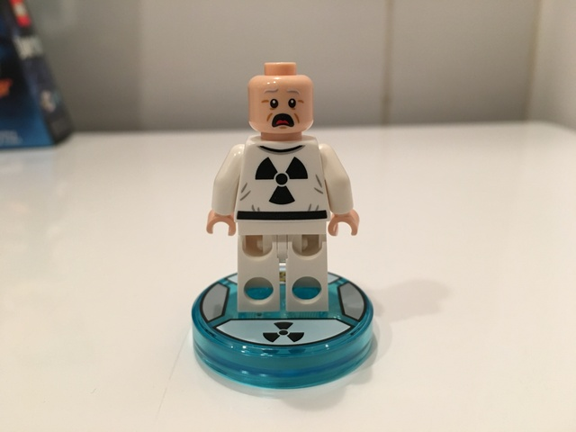](https://www.freelug.org/IMG/jpg/DimensionsBttF_2_05.jpg)

On commence le mini _Traveling Time Train_.

[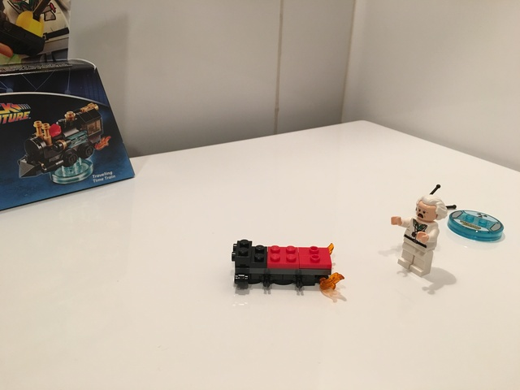](https://www.freelug.org/IMG/jpg/DimensionsBttF_2_06.jpg)

En bon inventeur, _Doc_ peaufine lui-même sa machine.

[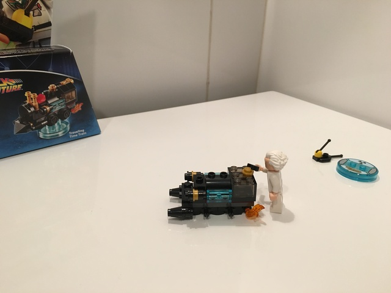](https://www.freelug.org/IMG/jpg/DimensionsBttF_2_07.jpg)

Fini, plus qu’à installer le train sur son socle.

[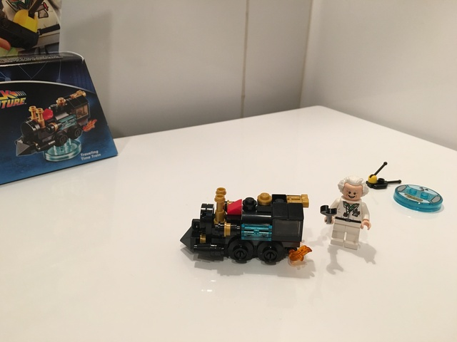](https://www.freelug.org/IMG/jpg/DimensionsBttF_2_08.jpg)

Une belle photo pour immortaliser tout ça.

[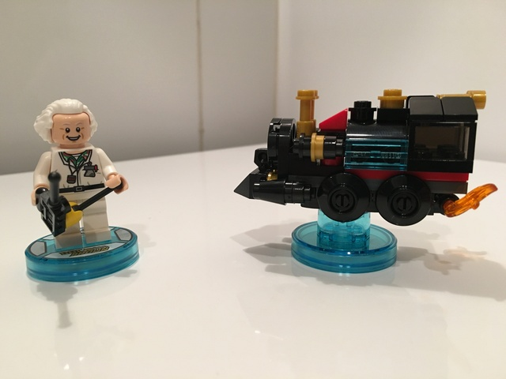](https://www.freelug.org/IMG/jpg/DimensionsBttF_2_09.jpg)

* * *

**AVIS :**

Encore un _Fun Pack_ acheté uniquement pour une fig (en l’occurrence, _Doc Brown_). Il faut avouer que LEGO réussit le pari de vendre des pack même aux gens qui ne jouent pas au jeu en incorporant pas mal de minifigs exclusives.

**BONUS :**

Voici un GIF animé réalisé avec les nombreuses photos prises pour cette review.

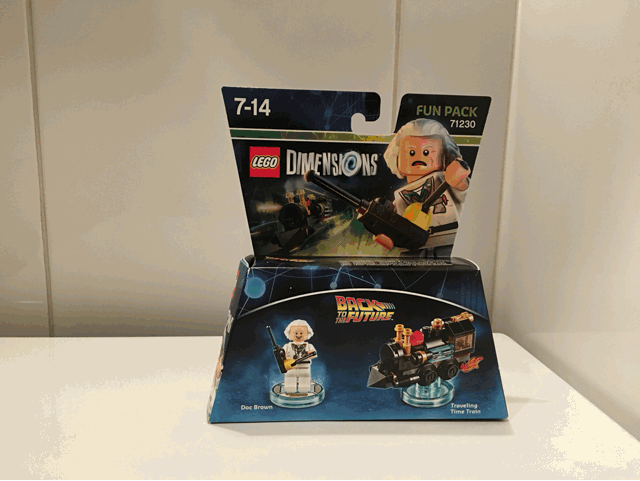
