**–** "Il n’y a plus de saisons ma brave dame !  
**–** Vous avez raison mon bon monsieur, de mon temps à Noël on avait de la neige !  
**–** D’ailleurs regardez ce que je viens de dégoter en solde...  
**–** Ohh... une déneigeuse LEGO City ! C’est certain qu’avec ce temps-là, on ne va pas en avoir trop besoin.  
**–** Mais dites-moi ? Il vaut quoi ce set 60038 ?  
**–** Ouvrons-le et voyons voir ensemble l’intérieur de cette boîte. "

Le set 60083 est sorti en 2015,  
**–** Nombre de pièces : 196 (dont 16 plates round 1x1 blanches censées représenter la neige — ou le sel selon les illustrations)  
**–**  ?ombre de minifigs : 1  
**–** Prix S@H : 19,99€ (13,99€ soldé) soit un rapport prix/pièce de 10,2cts (ou 7,14cts dans mon cas)

[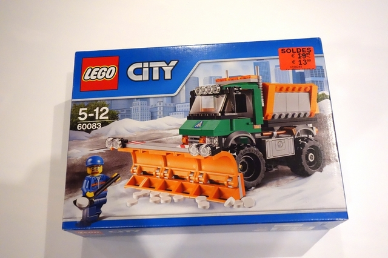](https://www.freelug.org/IMG/jpg/60083_-_Deneigeuse_City_001.jpg)

**60083 - Box Front**

L’emballage est classique au possible avec le fond bleu et le logo de la gamme City bien reconnaissable. Le visuel nous promet un bon gros camion.

[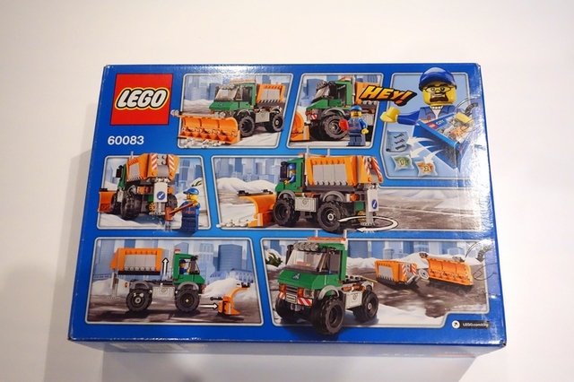](https://www.freelug.org/IMG/jpg/60083_-_Deneigeuse_City_002.jpg)

**60083 - Box back**

L’arrière fait dans les standards également avec la présentation des différentes fonctions de jouabilité du set, la possibilité d’enlever la lame déneigeuse, de déposer la benne à sel, de faire tourner la saleuse, et de prendre un bon café chaud en compagnie de notre ami le chauffeur.

[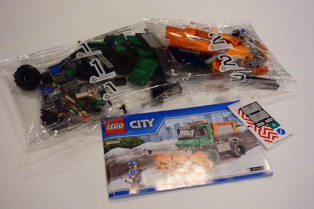](https://www.freelug.org/IMG/jpg/60083_-_Deneigeuse_City_003.jpg)

**60083 - sachets**

A l’intérieur, 2 sachets numérotés, une épaisse notice de 82 pages pour 46 étapes de montage dont certaines sont encore subdivisées en sous-étapes. Je vous rappelle que le set ne contient QUE 196 pièces. Une petite planche de stickers complète l’ensemble, je ne les poserai pas pour cette revue, ils n’apportent pas grand-chose.  
On a une petite sensation de vide à l’ouverture, si on compare avec le set [75137 - Carbon Freeze Chamber (Star Wars)](/articles/2211/) dont la boîte fait exactement la même taille.

[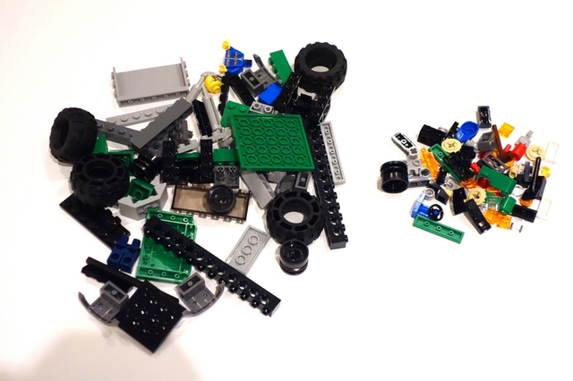](https://www.freelug.org/IMG/jpg/60083_-_Deneigeuse_City_004.jpg)

**60083 contenu sachet 01**

Le sachet 1 contient de quoi monter le châssis du camion et la minifig. Beaucoup de petites pièces quand même.

[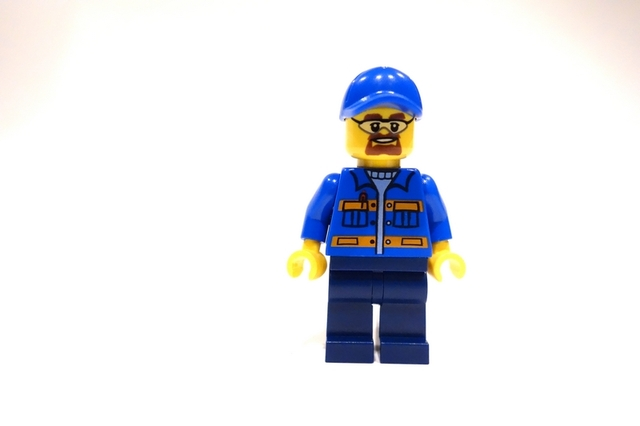](https://www.freelug.org/IMG/jpg/60083_-_Deneigeuse_City_016.jpg)

**60083 - Minifig**

Rien d’extraordinaire pour cette minifig, le torse représentant une veste bleue avec des bandes orange, ouvert sur un pull à col roulé, est utilisé dans de nombreux sets City.  
Pourtant, selon Bricklink cette combinaison casquette, tête, torse et jambes en dark blue semble être unique à ce set. Ouais... pour le moment rien de neuf sous le soleil (je vous rappelle qu’on attend toujours la neige).

[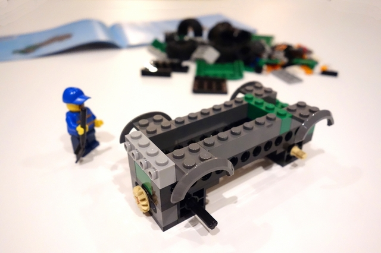](https://www.freelug.org/IMG/jpg/60083_-_Deneigeuse_City_005.jpg)

Etape 15. On sent que le bestiau va être sacrément costaud. Le système d’engrenage qui va permettre de faire tourner la saleuse est mis en place.

[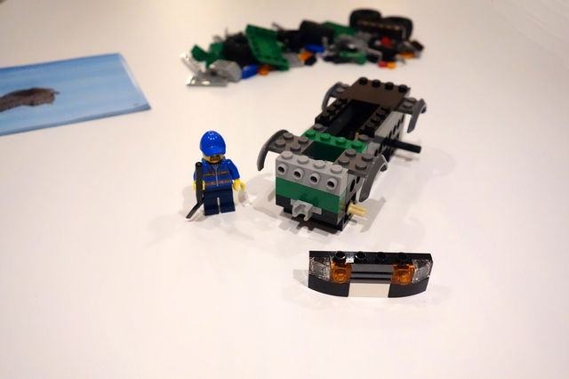](https://www.freelug.org/IMG/jpg/60083_-_Deneigeuse_City_006.jpg)

Montage de la calandre en SNOT, on commence à y être habitués avec les véhicules de cette gamme. Les premiers stickers devraient apparaître ici.

[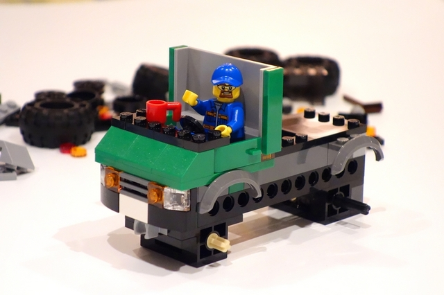](https://www.freelug.org/IMG/jpg/60083_-_Deneigeuse_City_007.jpg)

Etape 30, c’est l’apparition de la traditionnelle tasse qui accompagne tous les conducteurs de camion dans l’univers City.

[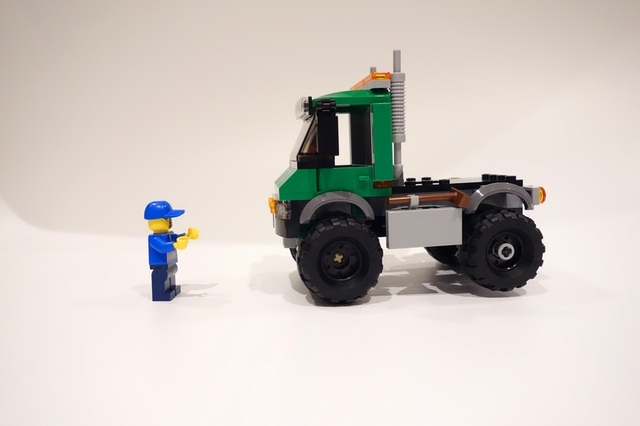](https://www.freelug.org/IMG/jpg/60083_-_Deneigeuse_City_008.jpg)

Fin du premier sachet, nos soupçons sont confirmés, c’est du massif !

[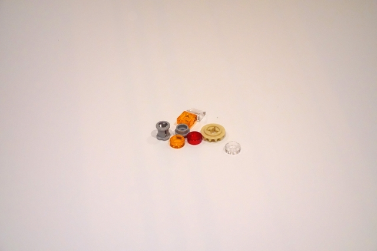](https://www.freelug.org/IMG/jpg/60083_-_Deneigeuse_City_009.jpg)

Quelques pièces en rab, rien d’extraordinaire.  
On va pouvoir ouvrir le second sachet...

[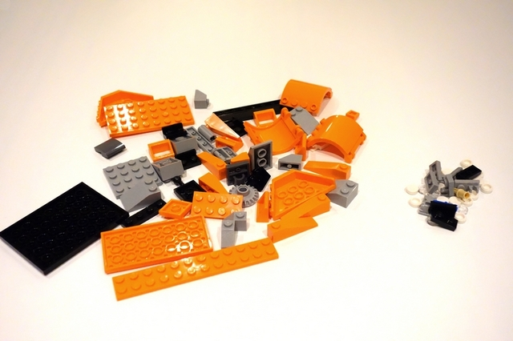](https://www.freelug.org/IMG/jpg/60083_-_Deneigeuse_City_010.jpg)

... qui va nous permettre de monter la benne à sel et la lame déneigeuse.

[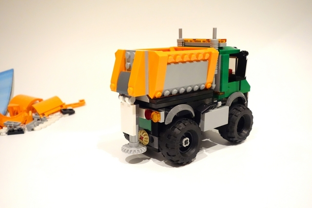](https://www.freelug.org/IMG/jpg/60083_-_Deneigeuse_City_011.jpg)

La construction de la benne est classique, on assemble en fait une base de wagonnet de mine qui est habillé de slopes.  
Finalement cet habillage en slopes orange et light bluish grey permet de donner un peu de volume et de relief à la benne. Dommage par contre qu’on ne trouve pas de système de chargement/déchargement de la benne sur le camion.

Le système de salage est également mis en place et se raccorde avec la roue dentée fixée au châssis du camion. Petite jouabilité qui fera certainement son effet chez les plus jeunes.

[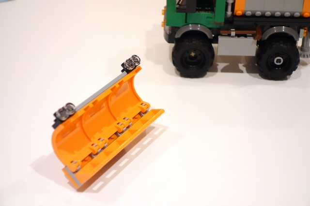](https://www.freelug.org/IMG/jpg/60083_-_Deneigeuse_City_012.jpg)

On termine par la lame. Elle est à l’image du camion, massive.  
On comprend les designers de LEGO, la pièce panel round utilisée pour la réaliser est vraiment idéale pour un tel accessoire, elle change des pièces utilisées pour la déneigeuse du set [Winter 10229](https://www.freelug.org/spip.php?article10229). Par contre elle est clairement hors échelle pour un véhicule de cette taille.

[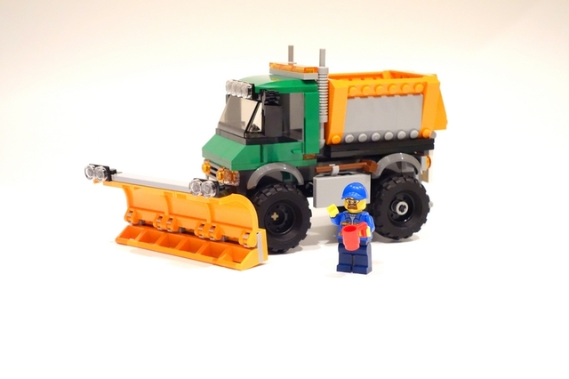](https://www.freelug.org/IMG/jpg/60083_-_Deneigeuse_City_013.jpg)

Au final qu’avons-nous : un camion de 8 de large (les grosses roues dépassent), haut sur pattes... heuu... sur roues, plutôt court — deux tenons de plus au niveau de la benne l’auraient certainement mieux équilibré.  
Le code couleur, vert/orange, est étonnant, y avait-il des surplus de pièces restants de la gamme Arctic ?  
La construction est des plus simples, le set est conseillé pour les 5-12 ans sur la boîte.

Comme vous l’aurez deviné, je ne suis pas convaincu par ce set. J’essayerai peut-être de le modifier pour tenter une amélioration, mais sinon, les pièces rejoindront mon vrac sans aucun remord.
