Aujourd’hui je vous propose la review du set 75136 dans la gamme _Star Wars_ : **Droid Escape Pod**.  
Ce set sorti en 2016 au prix de 29,99 € est composé de 197 pièces, soit un ratio prix/pièce de 15 centimes d’euros.

C’est déjà la troisième version de la capsule de sauvetage qui transporte le duo _C-3PO_ et _R2-D2_ sur _Tatooine_. Contrairement au précédent set qui était fourni avec deux _Stormtrooper_, LEGO "innove" en fournissant ici deux _Jawa_ différents.

* * *

Le visuel de la boite reprend une image du film original en fond. Le bandeau du haut est constitué des logos LEGO et _Star Wars_ et du masque de _Kylo Ren_.  
La capsule de sauvetage et les minifigs sont intégrées dans un décor de dunes de sable propre à _Tatooine_. Comme pour le reste de la gamme 2016, l’ensemble est plutôt réussi.

[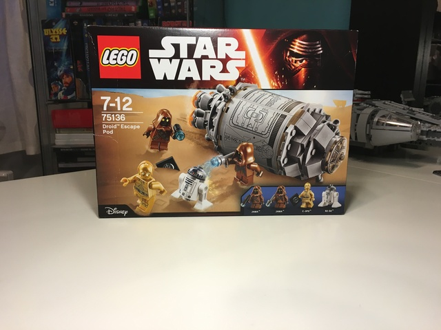](https://www.freelug.org/IMG/jpg/DroidEscapePod_01.jpg)

Au verso plusieurs vignettes avec les éléments de jouabilité du set, une photo des armes et des plans de la _Death Star_ ainsi qu’un simili plan sur console "vidéo".

[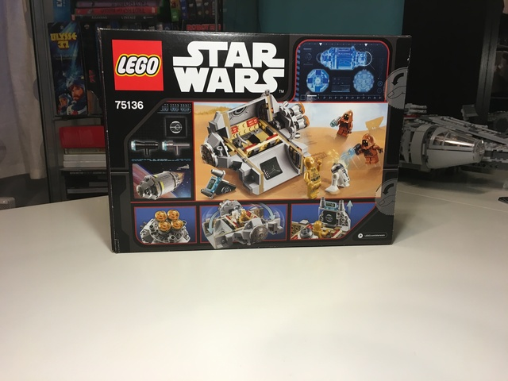](https://www.freelug.org/IMG/jpg/DroidEscapePod_02.jpg)

Une fois ouvert, le set contient deux sachets numérotés, une notice de construction et une impressionnante planche de stickers par rapport à la taille du set.

[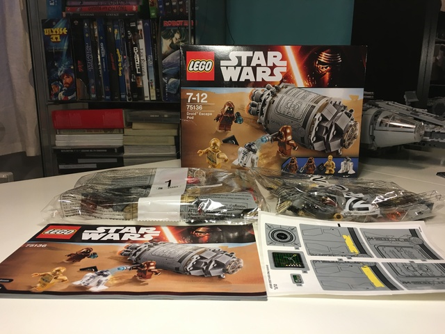](https://www.freelug.org/IMG/jpg/DroidEscapePod_03.jpg)

Les stickers sont au nombre de sept, dont quatre vraiment énorme.

[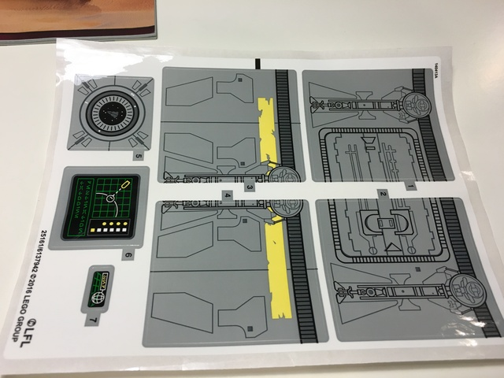](https://www.freelug.org/IMG/jpg/DroidEscapePod_04.jpg)

La minifig de [_R2-D2_](http://brickset.com/minifigs/sw527a/R2-D2-\(Flat-Silver-Head-Dark-Blue-Printing-Lavender-Dots\)) est une version exclusive à ce set. Rien de particulier à dire tant les versions se ressemblent.

[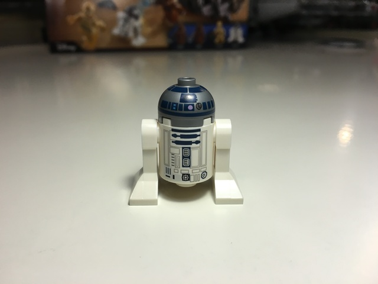](https://www.freelug.org/IMG/jpg/DroidEscapePod_05.jpg)

De dos, aucune sérigraphie n’est présente hormis sur le dôme.

[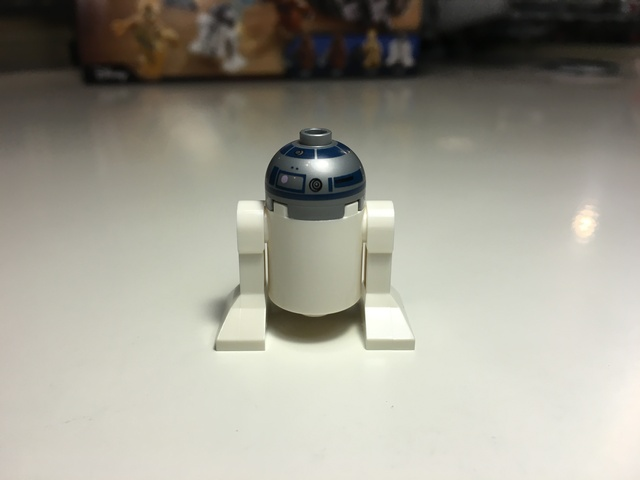](https://www.freelug.org/IMG/jpg/DroidEscapePod_06.jpg)

La fig de [_C-3PO_](http://brickset.com/minifigs/sw700/C-3PO-Colorful-Wires-Decorated-Legs-\(75136\)) (exclusive au set) est très bien réalisée avec son impression argent sur la jambe droite, LEGO réussit à détailler toujours mieux ce petit droid au fil des années.

[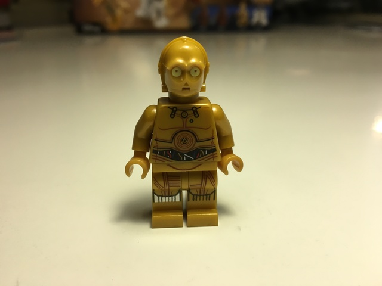](https://www.freelug.org/IMG/jpg/DroidEscapePod_07.jpg)

De dos la sérigraphie est là aussi très fine et comprend de nombreux détails.

[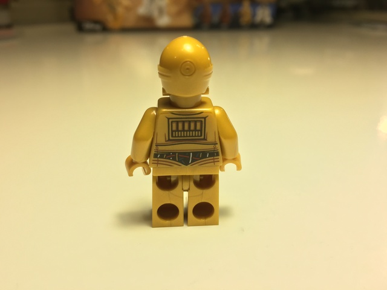](https://www.freelug.org/IMG/jpg/DroidEscapePod_08.jpg)

Le premier [_Jawa_](http://brickset.com/minifigs/sw590/Jawa-with-Gold-Badge) sans son capuchon. Sérigraphie vraiment réussie, décidément les designers LEGO adorent les pochettes sur les minifigs

[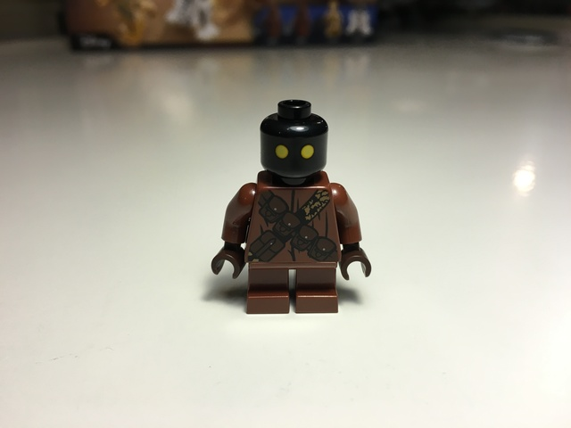](https://www.freelug.org/IMG/jpg/DroidEscapePod_09.jpg)

Le petit _Jawa_ avec son capuchon.

[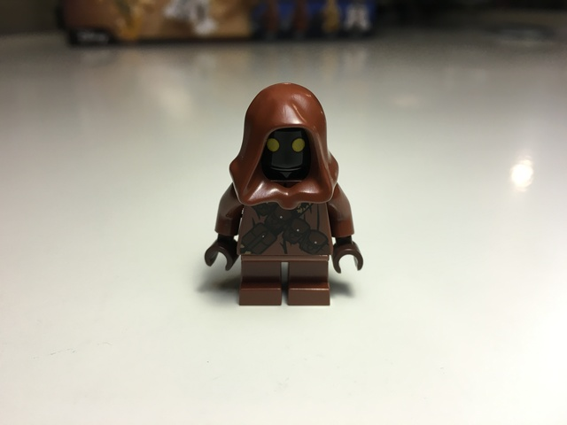](https://www.freelug.org/IMG/jpg/DroidEscapePod_10.jpg)

De dos on aperçoit une boucle et la continuité de la sangle en peau qui commence sur le devant du torso.

[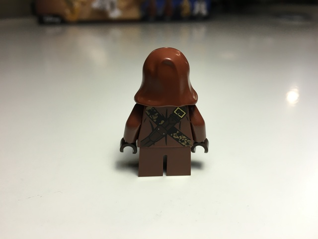](https://www.freelug.org/IMG/jpg/DroidEscapePod_11.jpg)

Le deuxième [_Jawa_](http://brickset.com/minifigs/sw560/Jawa) avec un torso différent, c’est toujours agréable de voir que dans un set à 30 euros, les quatre minifigures sont différentes.

[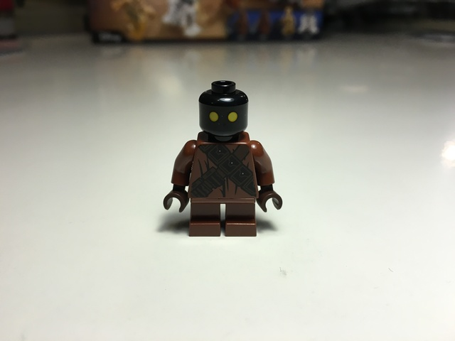](https://www.freelug.org/IMG/jpg/DroidEscapePod_12.jpg)

Capuchon en place.

[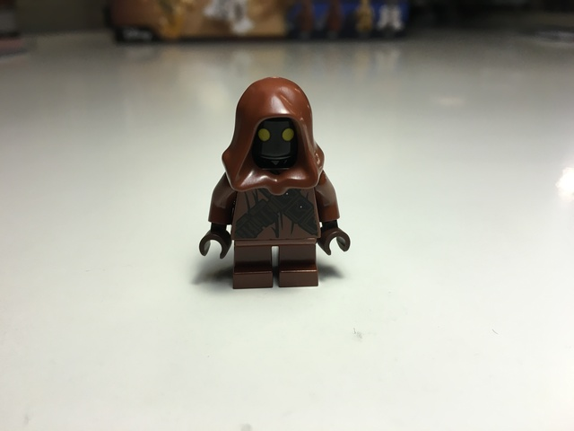](https://www.freelug.org/IMG/jpg/DroidEscapePod_13.jpg)

De dos on retrouve une boucle métallique et encore des pochettes.

[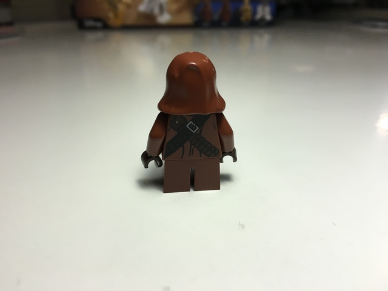](https://www.freelug.org/IMG/jpg/DroidEscapePod_14.jpg)

D’entrée de jeu on colle des stickers.

[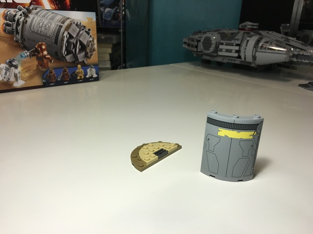](https://www.freelug.org/IMG/jpg/DroidEscapePod_15.jpg)

Montage très agréable avec diverses techniques.

[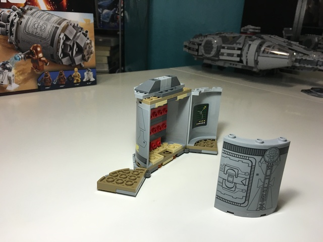](https://www.freelug.org/IMG/jpg/DroidEscapePod_16.jpg)

A la fin du sachet 1 la capsule est déjà bien avancée.

[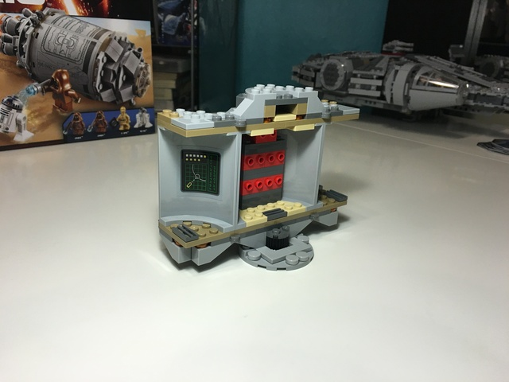](https://www.freelug.org/IMG/jpg/DroidEscapePod_17.jpg)

On referme les trappes pour agrémenter le haut de la capsule.

[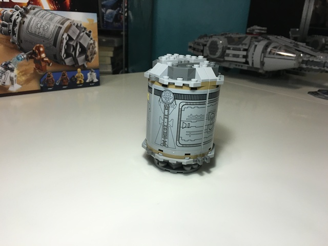](https://www.freelug.org/IMG/jpg/DroidEscapePod_18.jpg)

Après l’extérieur on aménage l’intérieur.

[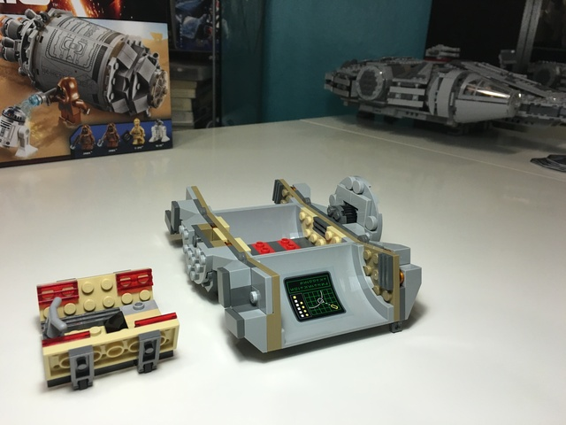](https://www.freelug.org/IMG/jpg/DroidEscapePod_19.jpg)

Une petite photo d’une des deux pièces sérigraphiées du set (l’autre étant le hublot), une tile 2x2 noire qui représente les plans de la _Death Star_.

[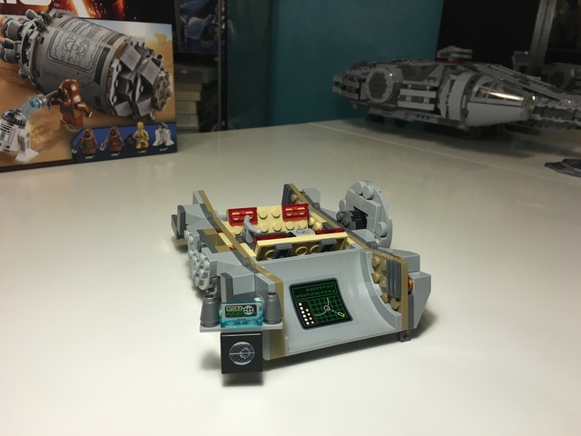](https://www.freelug.org/IMG/jpg/DroidEscapePod_20.jpg)

Le montage précédent, inséré dans son logement.

[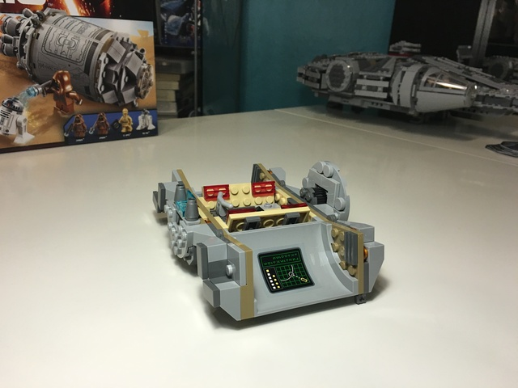](https://www.freelug.org/IMG/jpg/DroidEscapePod_21.jpg)

Enfin, on finit le montage par les réacteurs.

[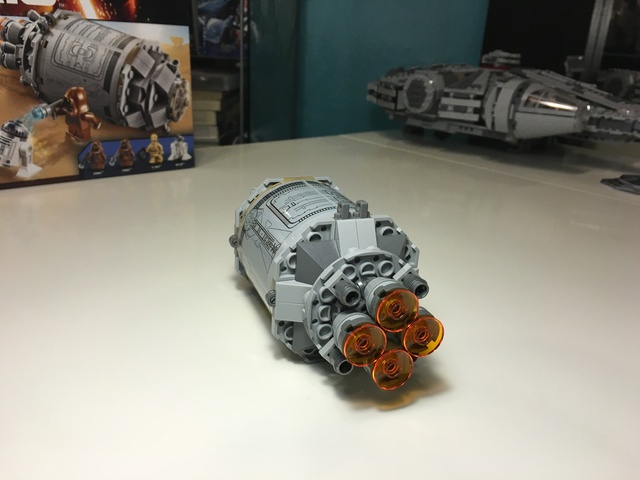](https://www.freelug.org/IMG/jpg/DroidEscapePod_22.jpg)

Voilà la capsule terminée avec nos pauvres droids à l’intérieur.

[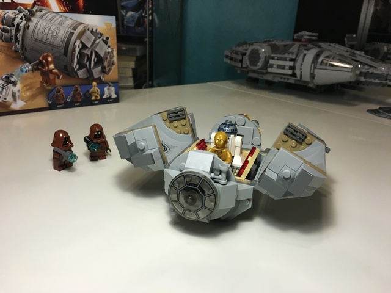](https://www.freelug.org/IMG/jpg/DroidEscapePod_23.jpg)

Un petit GIF montrant le mécanisme de fermeture de la capsule (cliquez sur l’image pour voir l’animation).

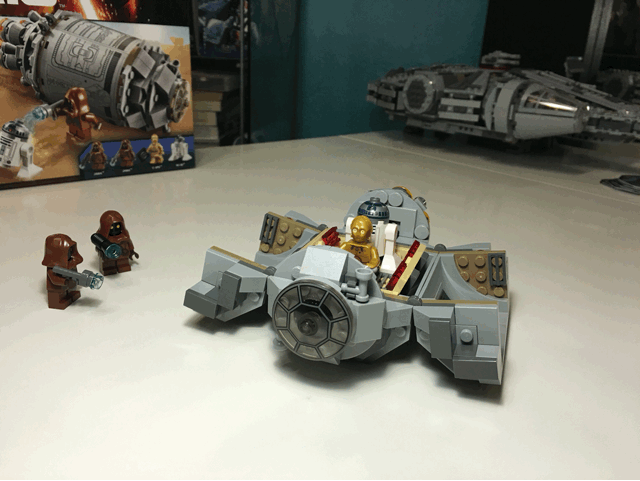

**AVIS :**

Si l’on fait abstraction des énormes stickers, cette nouvelle version de cet Escape Pod est une réussite tant au niveau de la construction que de la jouabilité. Bref, je ne suis vraiment pas déçu de mon achat.

**BONUS :**

Voici un GIF animé réalisé avec la totalité des photos prises pour cette review (cliquez sur l’image pour voir l’animation).

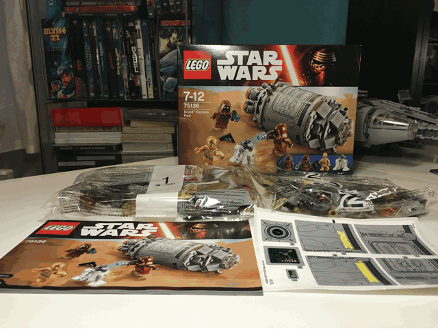
