Cet article va vous présenter cette animation et même vous faire découvrir ses coulisses.

## Une mosaïque particulière

Une mosaïque consiste à reproduire à l’aide de pièces de couleurs variées des dessins ou photographies sous une forme pixelisée. Il existe plusieurs techniques de mosaïques (plaques à plat, briques sur le côté, cheese slope...) et de nombreux logiciels permettant de les créer ([Pictobrick](http://www.pictobrick.de/de/pictobrick.shtml), [Mosaïc Maker](http://www.lugnet.com/cad/mosaic/), [Bricksaïc](http://www.bong69.com/site/pages/software.php), ou [Photobricks](http://www.photobricksapp.com/fr/index.html))

Nous allons vous décrire ici l’animation mosaïque développée par Simon Pinta. Elle a parcouru la France de Strasbourg à Bordeaux en passant par Paris et Lyon.

## Déroulement

Pour le public cela commence simplement avec des feuillets, chacun décrivant un losange à reproduire avec des briques 2x2 et 2x4 en respectant un motif de couleur.

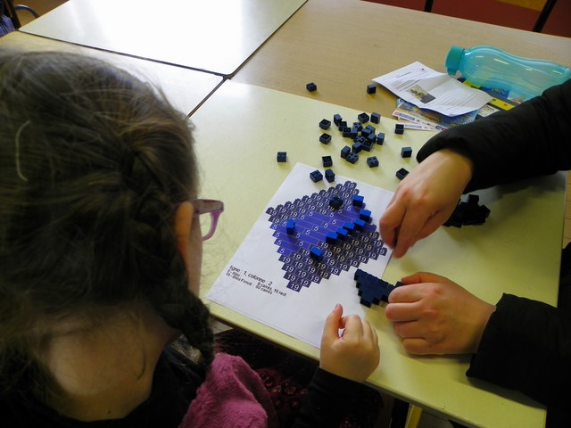

Ces feuillets sont déterminés par le logiciel de mosaïque créé par Simon à partir de l’image fournie par l’organisateur de l’exposition. Ainsi, en général, à part ces deux personnes, on ne connait pas le résultat final de la mosaïque : le public est donc encouragé à participer et tente de deviner le sujet de la fresque au fur et à mesure du montage.

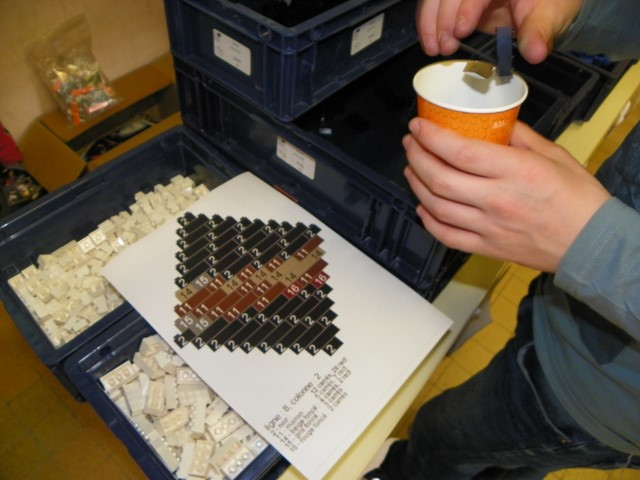

Chaque losange est haut de 19 rangées (18.24cm) et large de 20 tenons (16cm) équivalent à 100 briques 2x2. Cette taille est un bon compromis entre la facilité (l’animation est accessible aux enfants à partir de 5 ans) et une progression rapide du montage de la mosaïque (en fonction de l’affluence, une mosaïque de 2mx2m est montée en une petite journée).

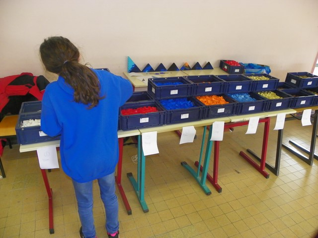

**Mosaïque en cours de montage - Première rangée**

Chaque losange n’est donc qu’un seul des éléments qui constitue la mosaïque complète, que l’on appelle aussi "fresque". Ce sont les animateurs qui procèdent au montage de la fresque avec les losanges constitués par le public.

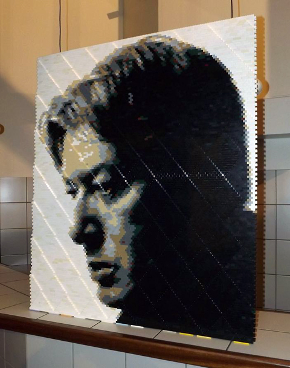

**Une fresque en noir et blanc**

Pour donner une idée de taille et de nombre de pièces, une fresque de 1m80 de haut sur 1m60 de large comporte donc l’équivalent de 200 losanges, équivalent à 20.000 briques 2x2. (comme on utilise aussi des briques 2x4, le nombres de pièces est plus proche de 15.000 mais cela est variable)

Pour profiter pleinement de la fresque, il est recommandé de prendre du recul. Il est aussi possible de regarder la fresque à travers l’écran d’un smartphone (ou d’une tablette, d’un appareil photo numérique) car la pixellisation de la mosaïque y est adoucit.

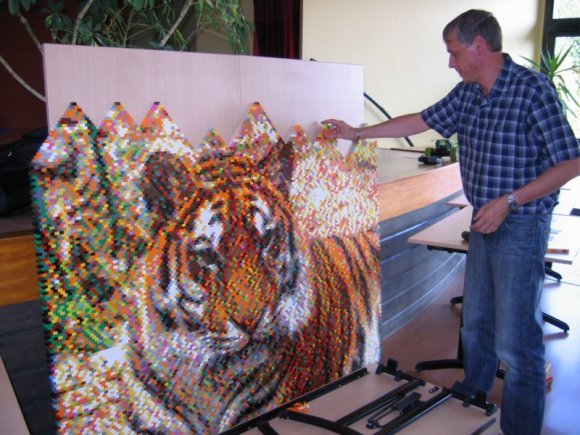

**Simon devant une mosaïque en cours de montage à Domjean en 2010**

Chaque feuillet porte des coordonnées ligne / colonne permettant de placer les losanges depuis la ligne 1 et la colonne 1 (en bas à gauche) jusqu’à la dernière ligne en haut. On utilise des demi-losanges pour les bords de la fresque (ligne et colonne 0)

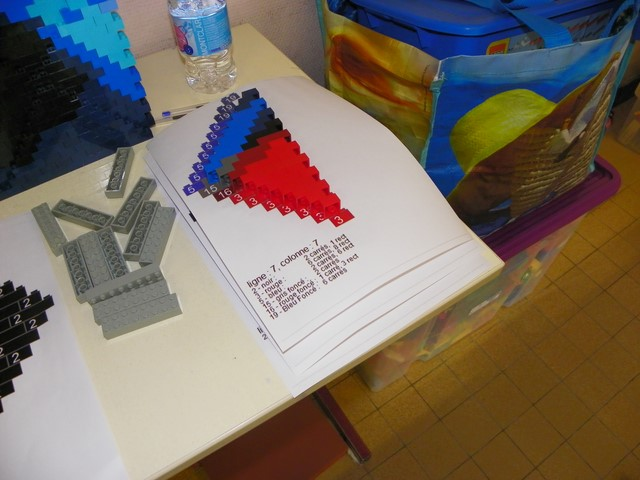

**Un demi losange (bord latéral droit, colonne 7)**

En l’absence d’un support spécifique destiné à maintenir la fresque à l’arrière pour l’empêcher de basculer (plateau, cloison,...) les losanges sont décalés d’un tenon vers l’arrière à chaque changement de niveau permettant de connecter des renforts en briques au dos de la fresque.

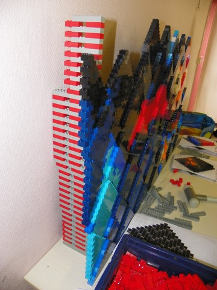

**Aperçu des renforts au dos de la fresque en cours de montage**

Pour des raisons évidentes de stabilité, on ne peux pas utiliser des briques 1x2 et 1x4 pour les grandes fresques.

Pour faciliter l’emboîtement des losanges, on utilise un maillet (marteau en caoutchouc). C’est une technique très largement employée pour les maquettes de grandes tailles comme les sculptures et les personnages visibles dans les parcs LEGOLAND.

A l’issue du montage, après la fermeture au public, les fresques sont démontées entièrement puis les briques sont triées par couleur. C’est un travail fastidieux mais plus rapide que le montage et qui peut même être agréable si il est effectué à plusieurs ! Les mêmes briques pourront alors servir de nouveau pour une fresque différente lors de la prochaine exposition.

## Les couleurs

Les couleurs utilisées dépendent évidemment de la photographie de départ mais une vingtaine sont habituellement employées : ce sont les couleurs les plus courantes (disponibles par exemple sur [BrickLink](http://alpha.bricklink.com/pages/clone/catalogitem.page?P=3003#T=C)) même si certaines restent difficile à se procurer en grande quantité.

A chaque couleur est associée un numéro. Ces numéros permettent de mieux faire la concordance avec les couleurs des feuillets. En effet certaines couleurs peuvent être confondues : gris et beiges, noir et couleurs foncées...

|  |  |  |  |
| --- | --- | --- | --- |
| 1 | Blanc | 11 | Marron |
| 2 | Noir | 12 | Vert fluo (lime) |
| 3 | Rouge | 13 | Vert foncé |
| 4 | Jaune | 14 | Beige foncé (dark tan) |
| 5 | Bleu | 15 | Gris foncé |
| 6 | Rose (bright pink) | 16 | Rouge foncé |
| 7 | Vert | 17 | Gris clair |
| 8 | Orange | 18 | Violet foncé (dark purple) |
| 9 | Bleu clair (medium blue) | 19 | Bleu foncé |
| 10 | beige clair (tan) | 20 | Azur (medium azur) |
|  |  | 21 | Sable vert (sand green) |

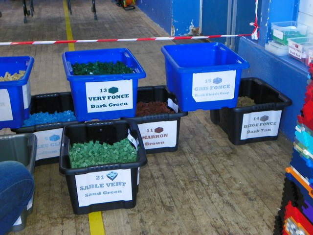

**Quelques bacs de briques marqués du nom et du numéro de couleur.**

On retrouve donc sans surprise les couleurs "classiques" mais aussi des couleurs claires et foncées couvrant un large spectre de nuances.

Regrouper les pièces nécessaires à la création des plus grandes fresques nécessite aussi bien du temps, de l’argent que des sources variées (Pick a Brick, LUGBulk, BrickLink, vide-grenier, ensembles du commerces...).

## Galerie

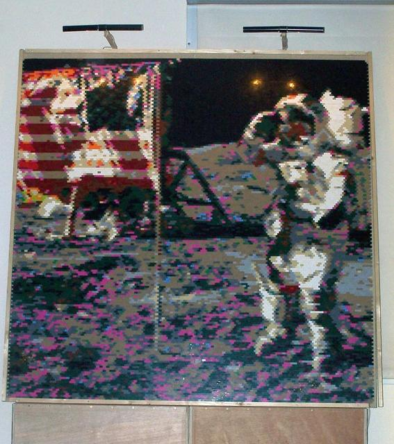

**La fresque à La ville du bois en 2011**

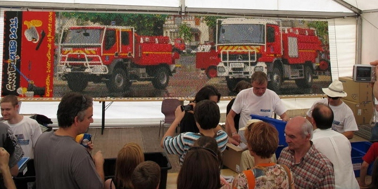

**Une fresque géante à Fana’briques en 2011**

[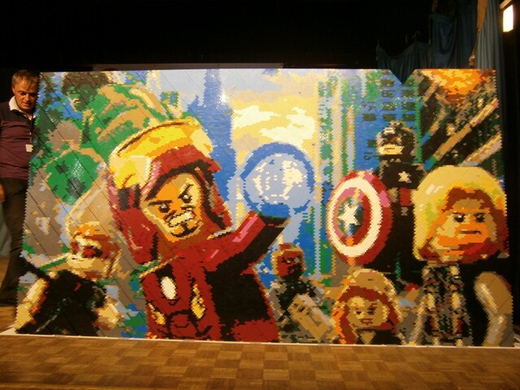](https://www.freelug.org/IMG/jpg/P9230076_2_.jpg)

**Veneux-les-sablons en 2012**

[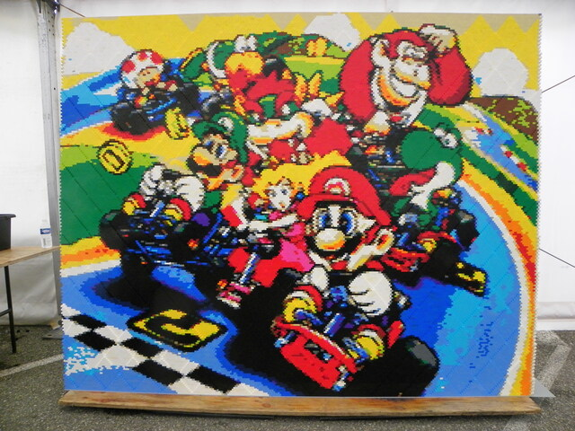](https://www.freelug.org/IMG/jpg/MosaiqueDiemoz2015.jpg)

**Diémoz 2015**

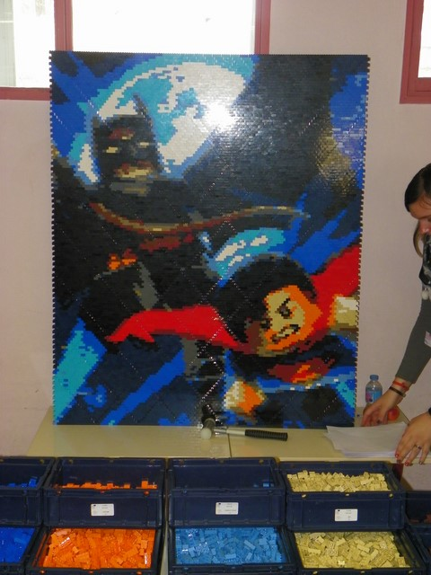

**Fontaines sur Saône et Villeurbanne 2016**

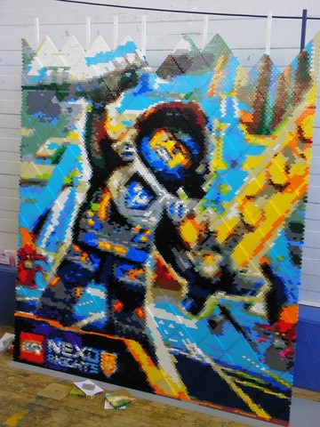

**Marcillat en Combrailles 2016**

[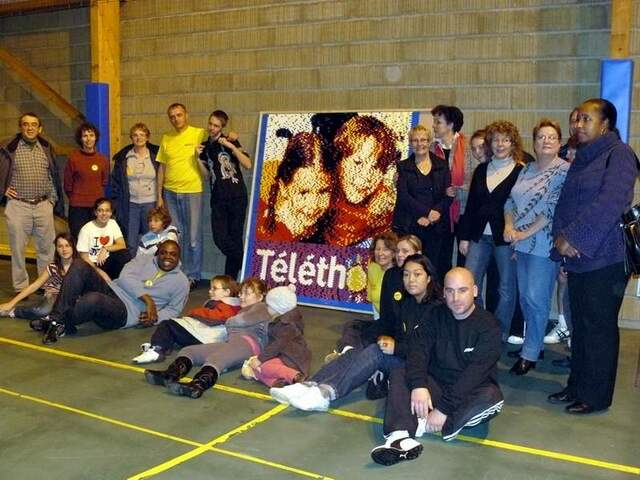](https://www.freelug.org/IMG/jpg/image_4.jpg)

**Livret de l’animateur**
