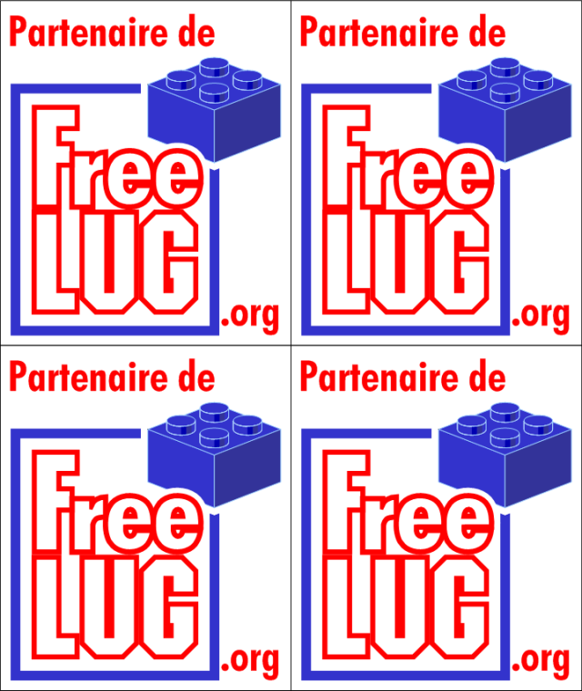

## Ordre du jour

**–** Approbation de l’expo que veut faire Jac (Exposition automobile à Pouilly les Nonains)  
**–** Mode de commande/répartition des commandes bulk  
**–** Comissaire aux comptes dans freelug ?  
**–** Affichette "Partenaire de [www.FreeLUG.org](/)" à apposer dans les points de vente partenaires (ajout d’une mention)  
**–** Visite LEGOLAND : présentation par Didier des infos receuillies  
**–** LEGOWORLD 2004 : répartition des responsabilités  
**–** Création de LUG régionaux comme par exemple RALUG

## Séance

_Début de la réunion à 20h10_

**Présents** :  
Pascal Brugier  
Loys Bailly  
Jean-Louis Bergamo  
Erik Amzallag  
Gaël Frazier  
Gilles Michelleti  
Didier Malon  
Yann Laurent  
Marc Schikele  
Pascal Bréard

**Excusés** :  
Philippe Label

## Approbation de l’expo que veut faire Jac (Exposition automobile à Pouilly les Nonains)

Le CA donne son accord à Jac pour exposer au nom de l’association FreeLUG.

## Mode de commande/répartion des commandes bulk

Le mode opératoire suivant a été décidé :

**–** Article 1  
La vente des pièces en vrac dite BULK SERVICE est exclusivement réservée au  
membres de FreeLUG à jour de cotisation au moment de leur commande.  
**–** Article 2  
La commande est au minimum de 100 pièces par taille et couleur.  
Dans le cas où la mutualisation est possible avec d’autres membres de  
l’association, cette commande pourra être un multiple de 25 pièces.  
**–** Article 3  
Les produits ne doivent pas être utilisés sous une autre marque, ou sous le  
nom d’une autre compagnie.  
**–** Article 4  
Les produits ne doivent pas être utilisés à des fins commerciales.  
Remarque : le bon de commande devrait faire acceptation des conditions de vente de LEGO (pas de revente, modification, etc.).  
**–** Article 5  
La commande doit être réglée par chèque à l’ordre de FreeLUG et être reçu en boite postale le dernier jour de l’offre. Joindre une impression de la commande avec le chèque. Prévoir un délai de 2 jours mini pour l’acheminement du courrier (la poste).  
**–** Article 6  
La commande est limitée dans un premier temps à une ou des séries de brick (un choix de briques défini par FreeLUG ).  
Cette offre sera étendue au fur et à mesure de l’avancement du projet.  
**–** Article 7  
Les frais de port entre le dépôt LEGO et la France, ainsi que le transport vers les régions seront à payer dans un second temps, par chèque, à l’ordre de FreeLUG. La remise des pieces se fera uniquement après acquittement des frais de port.  
**–** Article 8  
Qui dit commande groupée dit livraison centralisée. A ce titre l’ensemble de la commande sera livré sur un point central et sera ensuite ventilé vers les correspondants régionaux afin de réduire les frais de port. Si il n’y a pas de correspondant regional, la commande sera envoyée directement à l’acheteur final.  
**–** Article 9  
LEGO ne pouvant garantir la disponibilité des produits au moment de la préparation des commandes, les produits non livrés donneront lieu à un remboursement de l’association sur le trop percu (frais de port finaux déduits).  
**–** Article 10  
Les commandes se font en remplissant et imprimant le fichier tableur mis a disposition au moment de l’offre. Celui-ci devra être renvoyé signé et accompagné du règlement adéquat pour être valide. Toute commande incomplète, mal remplie ou illisible ne sera pas traitée.  
**–** Article 11  
Tout manquement de respect à cette charte entrainera l’exclusion définitive du membre des commandes suivantes.

Les responsables sont Pascal Brugier + Gilles Michelleti.

## Commissaire aux comptes dans freelug ?

Pas nécessaire dans une asso loi 1901 qui n’est pas déclarée d’utilité publique.

## Affichette "Partenaire de [www.FreeLUG.org](/)" à apposer dans les points de vente partenaires (ajout d’une mention)

Pas de rajout de mention. juste "partenaire de .."

## Visite LEGOLAND : presentation par Didier des infos receuillies

Pas d’info pour le moment. la nièce de Didier Malon doit se renseigner cette semaine.

## LEGOWORLD 2004 répartition des responsabilités

Didier veut bien continuer à faire l’interface avec l’organisation De Bouwsteen. Repartition par type de projet MOC (train, ville , chateau, SW, mindstorms ..) à définir via un appel à volontaire sur freelug-adh après reprise de contact avec l’organisation du LW.

## Création de LUG régionaux comme par exemple RALUG

Le CA demande à Denis Huot qu’il s’explique par écrit de manière précise sur ce qu’il souhaite faire. Les discussions commenceront ensuite. Didier Malon se charge du mail.

_Fin de la réunion à 21h53_
