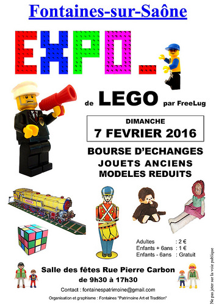
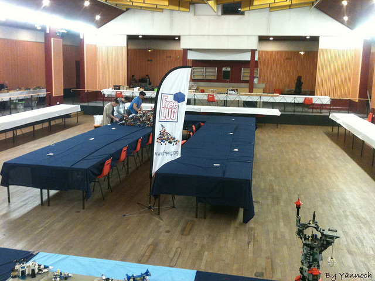
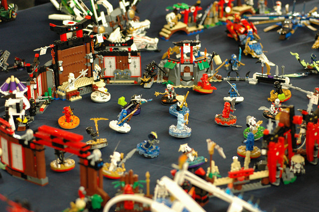
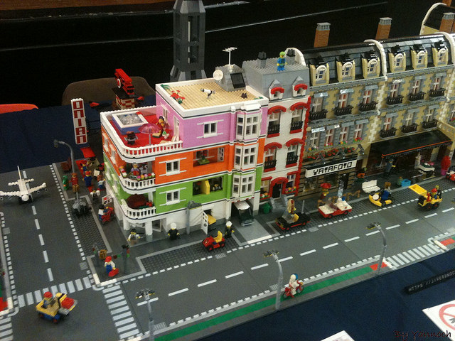
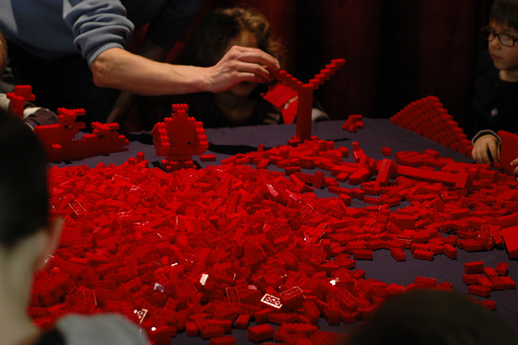
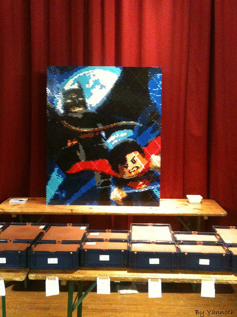
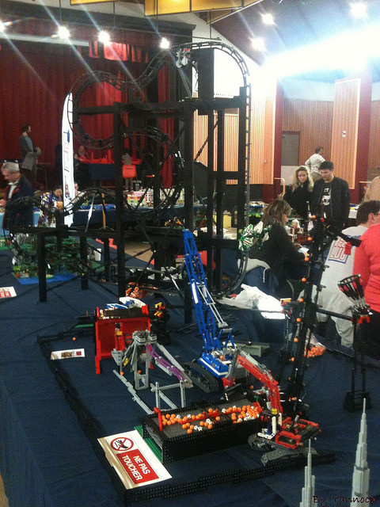
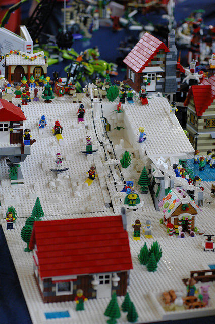
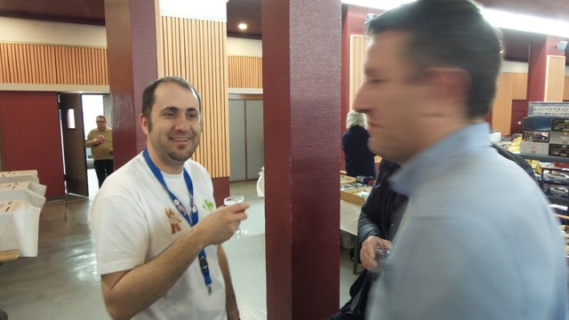

Les organisateurs de cette bourse aux jouets avaient pris contact avec FreeLUG lors de la dernière exposition à [Bourgoin Jallieu](/articles/2003/) en Janvier 2015. Nous avions convenu de venir exposer nos créations et collection sur une journée lors d’une bourse aux jouets.

**Bourse aux jouets Fontaines sur Saône**

Après plusieurs mois de préparatif, le grand jour arrive, et pour une modeste exposition, nous avons les moyens : 17 exposants, de nombreux thèmes, des ateliers de construction et une mosaïque.

Nous nous étions donnés rendez-vous le samedi en début d’après-midi, après une rapide visite au LEGO Store de Lyon, afin de préparer les tables.

**Les tables sont prêtes**

Il faut dire que j’affectionne particulièrement ce genre d’événement. Après avoir organisé la [Briqu’Expo Diemoz](/articles/2121/), cela fait du bien de revenir à une taille plus modeste. Cela permet de privilégier les contacts humains, avec les autres exposants, les visiteurs et organisateurs.

D’ailleurs pour cette édition, nous avons eu la chance d’accueillir de nombreux nouveaux exposants ! Et les nouveaux ont assuré, avec des dioramas très variés !

**La collection Ninjago de Sophie et Johan**

**La Rue Jérôme**

**Les briques à disposition pour construction libre**

**La mosaïque**

**Rollercoaster et Grands Bidules à Balles**

**Le village de Noël de Fabrice**

Une journée très agréable, avec petit déj, apéro, repas, bref tout ce qu’il faut pour faire de cette exposition un moment convivial !

Pour finir, je tiens à remercier les organisateurs qui nous ont très bien accueillis. Ce fut une excellente journée !

Plus de photos disponibles sur la galerie [ici](https://flic.kr/s/aHskqspPv7). (Photos de Xavier Duvert et moi-même)

Yannick/Yannoch06

* * *

J’aime beaucoup ce genre d’expositions. Le cadre est agréable, notamment du fait du plus petit volume de la salle et du bruit moins élevé. On est moins "écrasés". Et puis les "nouveaux" peuvent plus facilement prendre leurs marques, avant d’aller sur de plus grosses expositions.

De plus cet événement a suscité beaucoup d’enthousiasme auprès des exposants (ils furent nombreux à vouloir venir et à venir) mais aussi auprès des visiteurs (très nombreux également).  
Pour ma part je fus séduit par la qualité des présentations et la bonne ambiance entre les exposants et avec l’association organisatrice. Nous avons été très bien reçus et il me semble que le résultat restera un bon souvenir pour tous.

Le patron a manifestement beaucoup apprécié un certain stand... jdcjdr

Jérôme (jivé69)

* * *

Pour notre première expo, nous pouvons dire que nous avons apprécié : l’échange avec les autres AFOL, les visiteurs, la bonne ambiance et l’organisation. Nous avons également appris comment préparer une expo (comment transporter nos sets et Mocs, trouver des pièces, etc.)

Pour résumer : petite expo bien sympathique avec de la bonne humeur, les sourires des visiteurs (interactions avec les jeunes et moins jeunes) en voyant tous ces LEGO. A refaire et merci pour l’accueil parmi vous.

Sophie et Johan (TitLego05 et Tigrounette)

* * *

Très bonne "petite" exposition, ce qui permet de profiter différemment des exposants et des visiteurs.  
Beaucoup de visiteurs très curieux et sympas. Personnellement j’ai eu le droit à beaucoup de questions sur notre passion...  
La réception de l’association qui organisait était au top avec un très bon repas le midi.  
Comme toujours, d’excellents échanges avec les autres exposants qu’ils soient novices ou confirmés.

Bonne petite journée, rendez-vous à la Briqu’Convention de Villeurbanne.

Pierrouk

* * *

Une petite expo qui fait du bien : la proximité avec le public, les échanges entre AFOLs, des créations très diverses, une ambiance familiale, détendue, vraiment un très bon dimanche. Et comme toujours la mosaïque et les caisses de briques, ça fait toujours plaisir. A refaire !

Bertrand / Fa

* * *

Voilà un format d’expo qui changeait un peu et qui nous sort de nos habitudes. Une expo sur une journée et où il n’y a pas que des LEGO. Eh bien oui, la bourse aux jouets était l’événement qui a amené nos chers AFOLs à exposer !

Malgré une journée très pluvieuse et très grise, nous voilà dans une salle assez vieillotte mais très chaleureuse avec tous son parquet, ses tons bois et rouges. Ça met tout de suite dans l’ambiance. On sent qu’on va passer un bon dimanche !

Les copains sont là, les tables pour les exposants AFOLs sont disposées (pour la grande majorité) au centre de la salle. Superbe mise en valeur donc. Tout autour de la salle quelques table LEGO mais surtout des jouets anciens à la vente : petites voitures vintages, maquettes, playmobils, mecanos, miniatures ferroviaires... Une belle époque que l’on a sous nos yeux ! On est vraiment dans l’ambiance ! Avec ça, le petit verre de blanc à la place du café matinal, des hôtes forts sympathiques et un repas copieux et excellent ! On en avait oublié cette pluie battante de dehors tellement l’intérieur de la salle était chaleureusement animé et baignait sans une ambiance cosy et familiale !

Merci à nos hôtes, merci à l’orga (Yannick, Fabrice et les autres...) et merci à mon copain Fa avec qui on a bien rigolé ! J’ai passé un excellent dimanche !

Julien / Zed
