Aujourd’hui je vous propose la review du set 75132 dans la gamme _Star Wars_ : **First Order Battle Pack**.  
Ce set sorti en 2016 au prix de 16,99 € est composé de 88 pièces, soit un ratio prix/pièce de 15 centimes d’euros.

[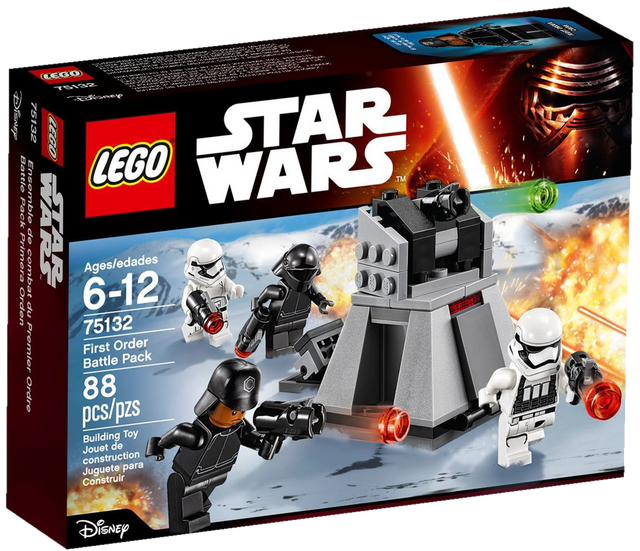](https://www.freelug.org/IMG/png/FirstOrder_box.png)

Pour rappel les _Battle Pack_ sont des sets entre 15 et 17 euros contenant un petit véhicule, souvent anecdotique, et surtout quatre minifigures. Ce sont donc des sets très intéressants pour se constituer une troupe/armée à "bon prix".

* * *

Le visuel de la boite reprend une image du film original en fond. Le bandeau du haut est constitué des logos LEGO et _Star Wars_ et du masque de _Kylo Ren_.  
La tourelle et les minifigs sont intégrées dans le décor enneigé de la base/planète _Starkiller_. L’ensemble, comme le reste de la gamme 2016, est plutôt réussi.

[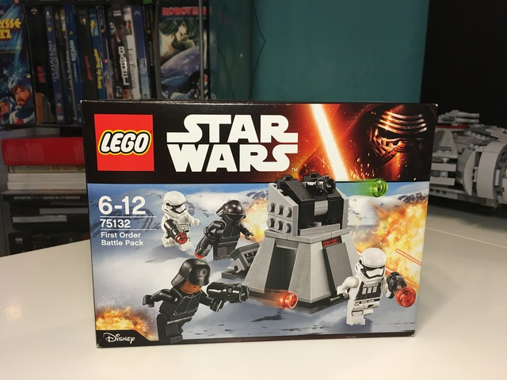](https://www.freelug.org/IMG/jpg/FirstOrder_01.jpg)

Au verso plusieurs vignettes avec les éléments de jouabilité du set, une photo des armes ainsi qu’un simili plan sur console "vidéo".

[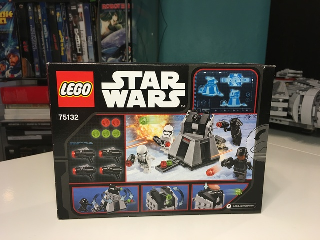](https://www.freelug.org/IMG/jpg/FirstOrder_02.jpg)

La boite contient deux sachets et une notice de construction.

[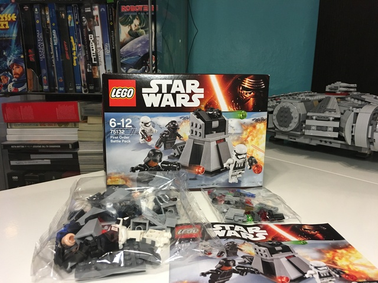](https://www.freelug.org/IMG/jpg/FirstOrder_03.jpg)

La première minifig est un [_First Order Stormtrooper_](http://brickset.com/minifigs/sw667/First-Order-Stormtrooper) dont la sérigraphie bicolore ainsi que le casque sont vraiment réussis.

[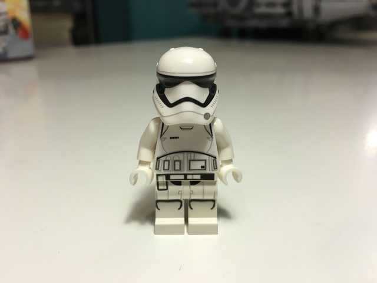](https://www.freelug.org/IMG/jpg/FirstOrder_04.jpg)

Alors que dans le film il est bien dit que les _Stormtrooper_ ne sont plus des clones, LEGO nous ressert l’éternel visage des _CloneTrooper_. Il serait bien que la firme se renouvelle un peu.

[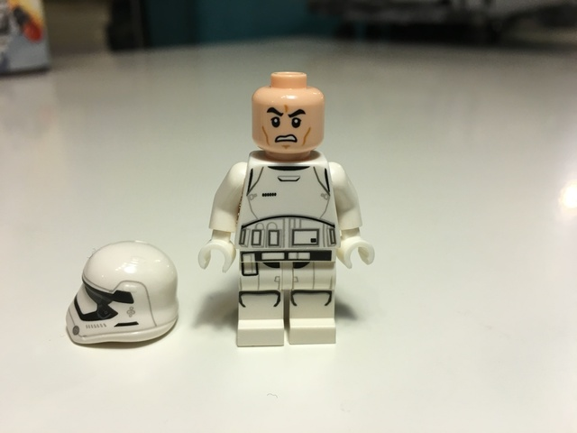](https://www.freelug.org/IMG/jpg/FirstOrder_05.jpg)

De dos la sérigraphie bicolore est là aussi très fine et bien réalisée.

[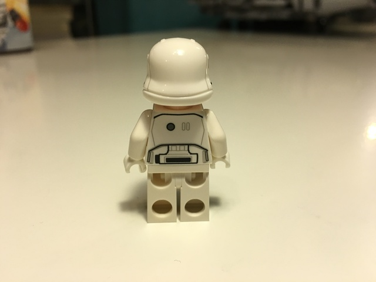](https://www.freelug.org/IMG/jpg/FirstOrder_06.jpg)

Le [_First Order Stormtrooper Heavy Artillery_](http://brickset.com/minifigs/sw695/First-Order-Stormtrooper-Heavy-Artillery-\(75132\)) est lui affublé d’un harnais du plus bel effet, et pour ne rien gâcher cette fig est exclusive à ce set.

[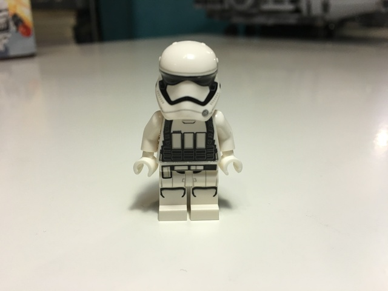](https://www.freelug.org/IMG/jpg/FirstOrder_07.jpg)

Au dos on retrouve les bretelles du harnais qui se croisent dans le dos, la réalisation est toujours impeccable. Pas de photo sans casque vu que le visage est le même que pour l’autre _Stormtrooper_ inclus dans le set.

[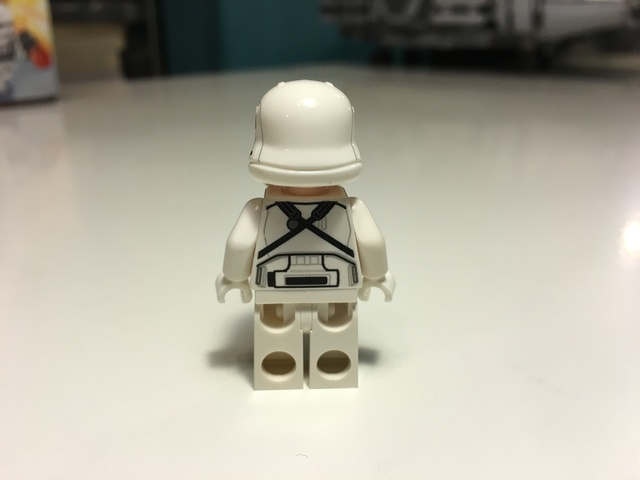](https://www.freelug.org/IMG/jpg/FirstOrder_09.jpg)

Pour la minifig du [_First Order Crew Member_](http://brickset.com/minifigs/sw694/First-Order-Crew-Member-Helmet-with-Insignia-\(75132\)) c’est le minimum syndical. On pourra quand même apprécier le visage "noir" (ça change un peu des éternels visages chair de l’univers _Star Wars_) et l’insigne argent sur le casque.

[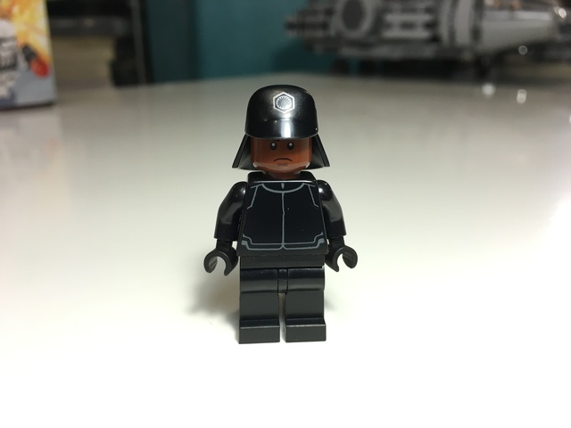](https://www.freelug.org/IMG/jpg/FirstOrder_10.jpg)

De dos, c’est le minimum aussi, enfin au moins il y a de la sérigraphie.

[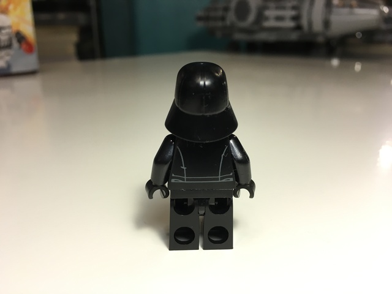](https://www.freelug.org/IMG/jpg/FirstOrder_11.jpg)

Le deuxième [_First Order Crew Member_](http://brickset.com/minifigs/sw671/First-Order-Crew-Member-\(Light-Flesh-Head\)) a exactement le même corps, seul changent le visage et le casque.

[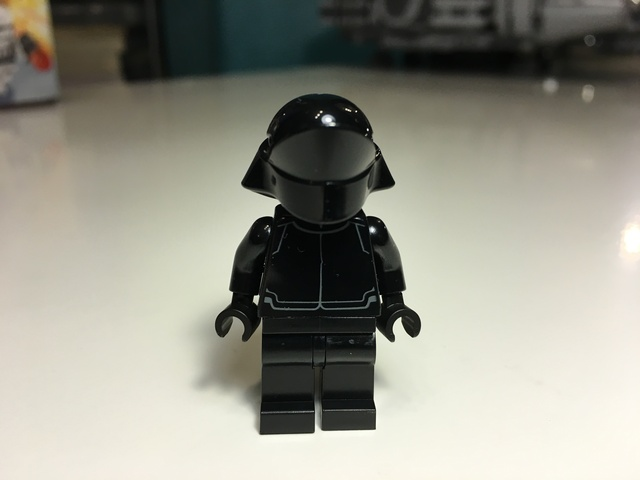](https://www.freelug.org/IMG/jpg/FirstOrder_12.jpg)

Visage couleur chair pour cette fig.

[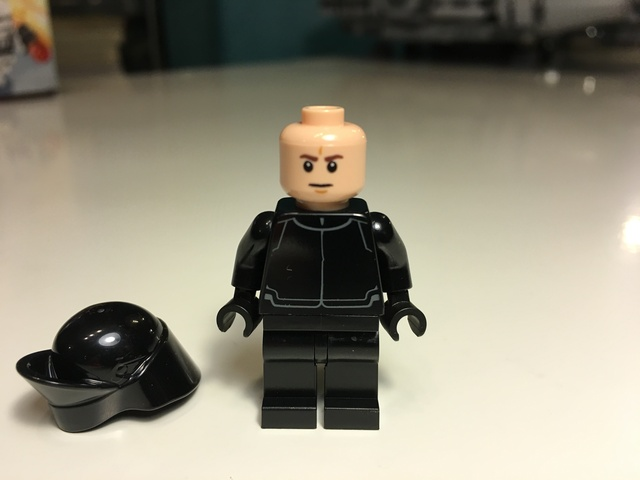](https://www.freelug.org/IMG/jpg/FirstOrder_13.jpg)

De dos, toujours la même chose.

[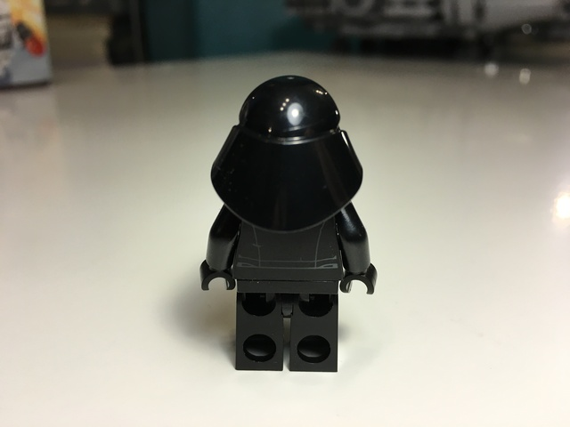](https://www.freelug.org/IMG/jpg/FirstOrder_14.jpg)

On commence le montage de la tourelle, on remarque une tile 1x2 sérigraphiée.

[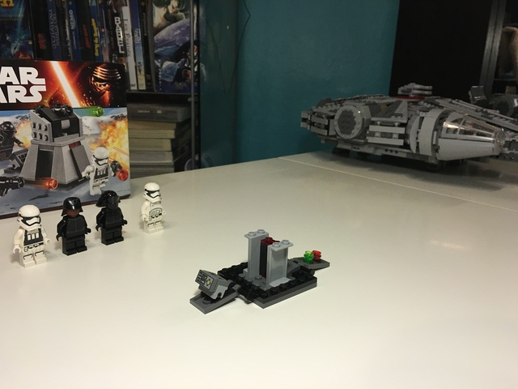](https://www.freelug.org/IMG/jpg/FirstOrder_15.jpg)

Le corps de la tourelle est terminé.

[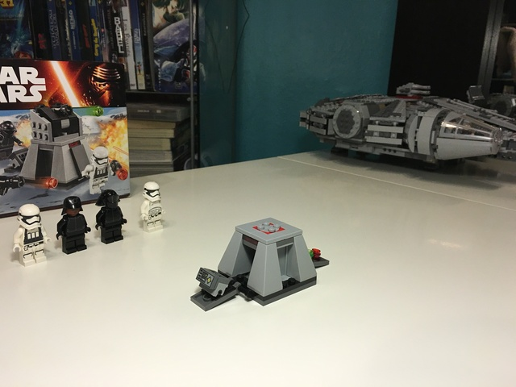](https://www.freelug.org/IMG/jpg/FirstOrder_16.jpg)

On s’attaque maintenant à la batterie laser.

[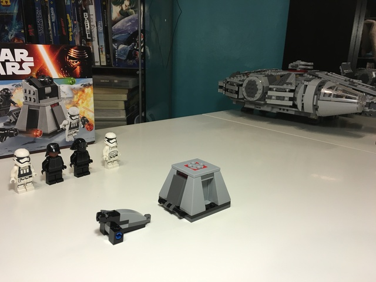](https://www.freelug.org/IMG/jpg/FirstOrder_17.jpg)

La partie canon est maintenant finie, plus qu’à la fixer.

[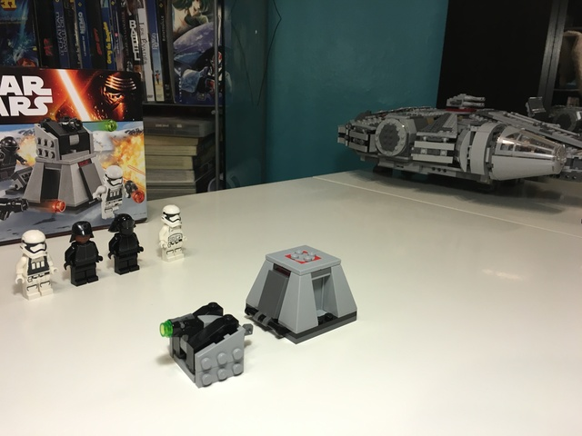](https://www.freelug.org/IMG/jpg/FirstOrder_18.jpg)

Voilà le résultat.

[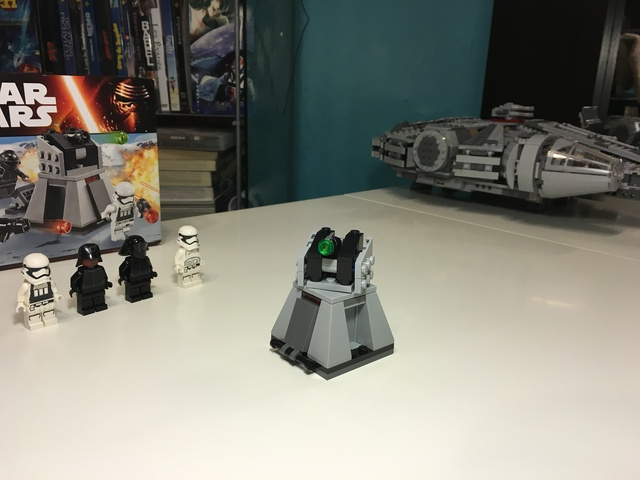](https://www.freelug.org/IMG/jpg/FirstOrder_19.jpg)

[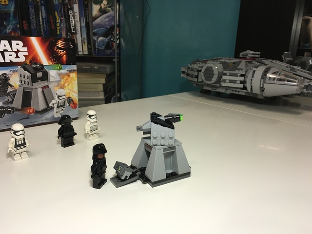](https://www.freelug.org/IMG/jpg/FirstOrder_20.jpg)

[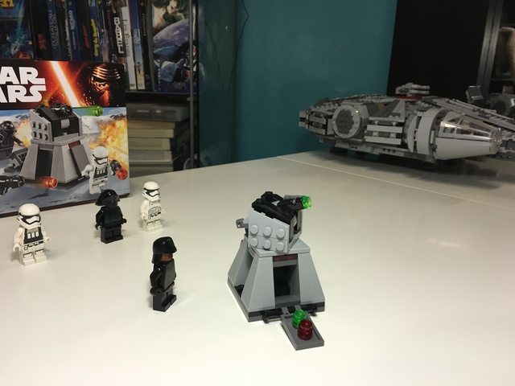](https://www.freelug.org/IMG/jpg/FirstOrder_21.jpg)

**AVIS :**

Si on oubliera bien vite la tourelle de ce _Battle Pack_, il n’en sera pas de même pour les deux _First Order Trooper_ qui sont elles superbement réalisées. Clairement, hormis pour les collectionneurs de minifigs, on peut se passer de ce set sans hésitation.

**BONUS :**

Voici un GIF animé réalisé avec la totalité des photos prises pour cette review.

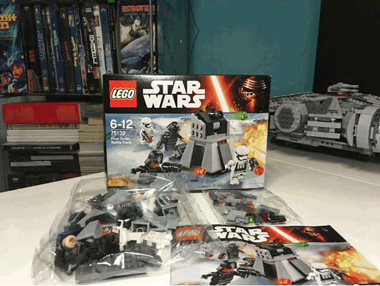
