Bonjour,

Aujourd’hui nous restons dans l’univers urbain avec cette sandwicherie qui, si les promesses qui nous sont faites sur la boite sont tenues, devrait trouver une place de choix dans les dioramas city.

Le set 31050 est sorti il y a quelques semaines, faisant partie de la première vague de l’année.  
**–** nombre de pièces : 467  
**–** minifigs : 2  
**–** prix S@H : 34,99€ soit un rapport prix/pièce de 7,5cts

[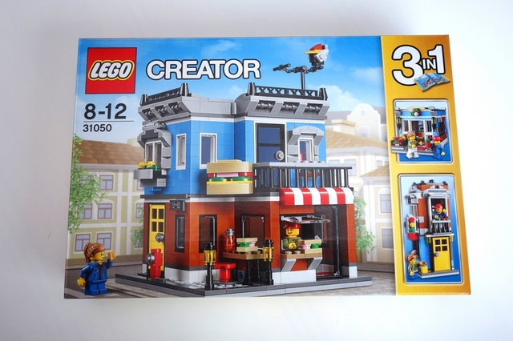](https://www.freelug.org/IMG/jpg/2016-02-07_-_31050_Corner_Deli_Creator_001.jpg)

La boîte est vraiment belle, la construction principale est très bien mise en valeur et occupe une large partie de la surface d’exposition. Il y a un côté petit modular qui n’est pas fait pour me déplaire.  
Sur la droite, un bandeau nous rappelle que nous sommes dans la gamme Creator 3 en 1 et nous propose des petits visuels des constructions alternatives.

[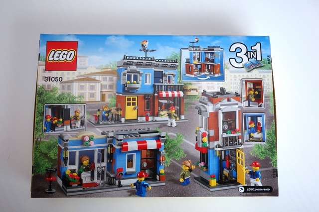](https://www.freelug.org/IMG/jpg/2016-02-07_-_31050_Corner_Deli_Creator_002.jpg)

Sur l’arrière de la boîte, les 3 modèles sont exposés, la sandwicherie, le magasin de fleur et la maison. Une vignette nous présente également le système d’ouverture et de fermeture du set et quelques fonctions de confort pour nos chères minifigs.

[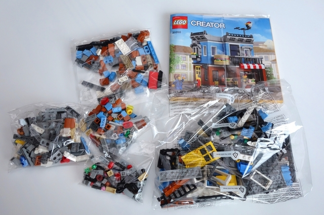](https://www.freelug.org/IMG/jpg/2016-02-07_-_31050_Corner_Deli_Creator_003.jpg)

[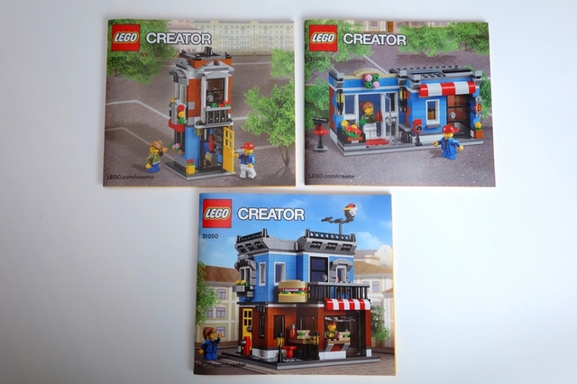](https://www.freelug.org/IMG/jpg/2016-02-07_-_31050_Corner_Deli_Creator_004.jpg)

A l’intérieur, 5 sachets de pièces et 3 notices, une par modèle, protégées dans un plastique également. J’apprécie l’effort de protection.

[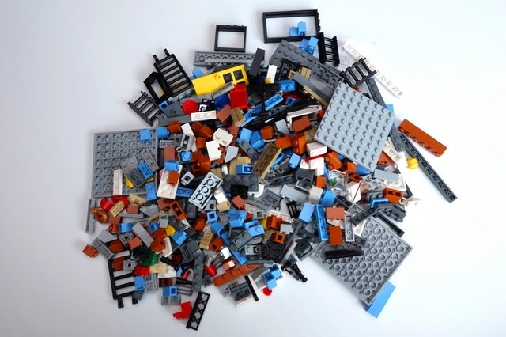](https://www.freelug.org/IMG/jpg/2016-02-07_-_31050_Corner_Deli_Creator_005.jpg)

Une fois tous ces sachets ouverts, on a un joli petit tas de briques, plates, tiles, etc...  
On va pouvoir attaquer la construction.

[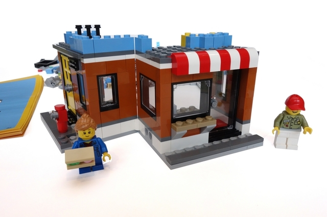](https://www.freelug.org/IMG/jpg/2016-02-07_-_31050_Corner_Deli_Creator_007.jpg)

Nous voici arrivés à l’étape 41, pour le moment rien d’extraordinaire dans la technique de construction, on se contente d’empiler des briques pour monter des murs.

[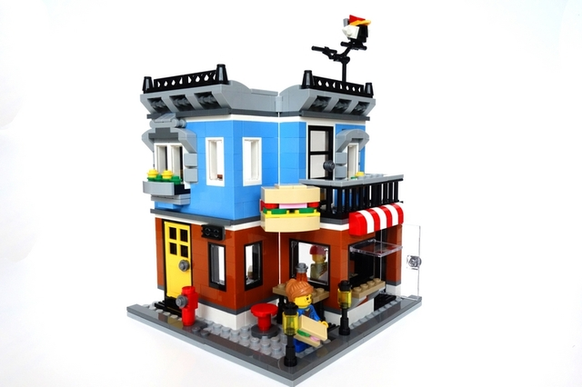](https://www.freelug.org/IMG/jpg/2016-02-07_-_31050_Corner_Deli_Creator_009.jpg)

Et voilà le résultat final, qui est plutôt probant à mes yeux, on sent qu’un effort a été fait sur les finitions de l’étage et sur la corniche de toit. On n’est pas sur un modular, mais ça a de l’allure. L’antenne avec son piaf perché apporte une petite touche de finition agréable.

[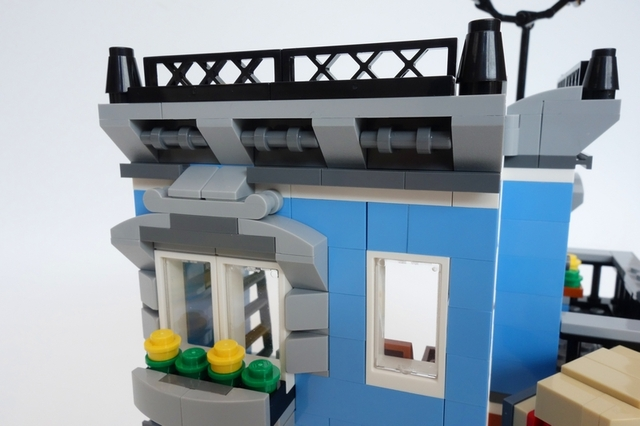](https://www.freelug.org/IMG/jpg/2016-02-07_-_31050_Corner_Deli_Creator_010.jpg)

[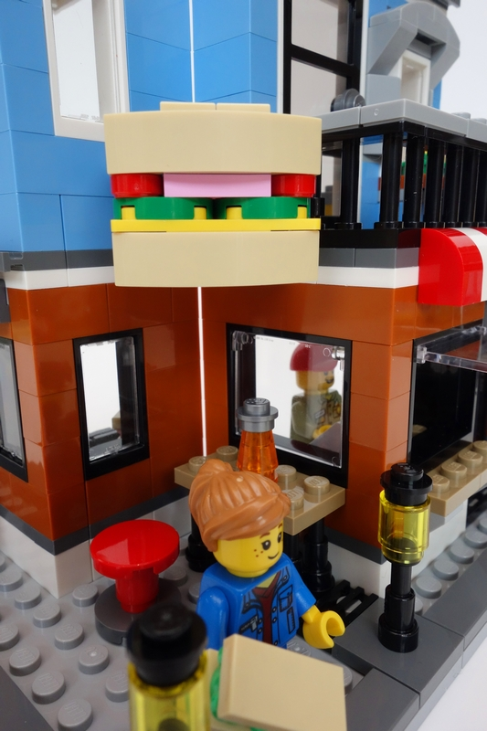](https://www.freelug.org/IMG/jpg/2016-02-07_-_31050_Corner_Deli_Creator_011.jpg)

L’enseigne "sandwiche" est plutôt réussie à mon goût.

[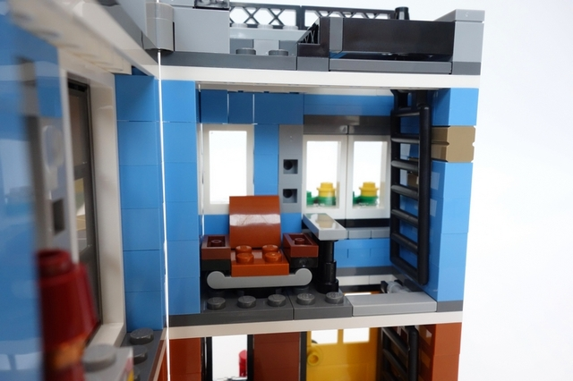](https://www.freelug.org/IMG/jpg/2016-02-07_-_31050_Corner_Deli_Creator_013.jpg)

A l’intérieur, c’est le minimum syndical par contre. L’accès à l’appartement qui se situe au-dessus du magasin se fait par une... échelle, et le fauteuil a tout juste la place pour se coincer entre la barrière et le mur. Une petite lampe posée sur un petit meuble complète la décoration intérieure, tandis qu’une porte donne accès à une terrasse et qu’une autre échelle permettra d’accéder au toit.

[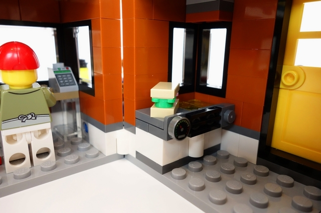](https://www.freelug.org/IMG/jpg/2016-02-07_-_31050_Corner_Deli_Creator_014.jpg)

Dans la boutique, là encore, service minimum avec une caisse enregistreuse et une cuisinière.

[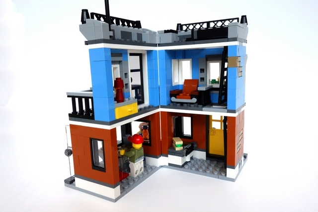](https://www.freelug.org/IMG/jpg/2016-02-07_-_31050_Corner_Deli_Creator_012.jpg)

Petite vue d’ensemble de l’intérieur.

Un des intérêts du set est que le bâtiment peut se poser en version fermée ou ouverte.

[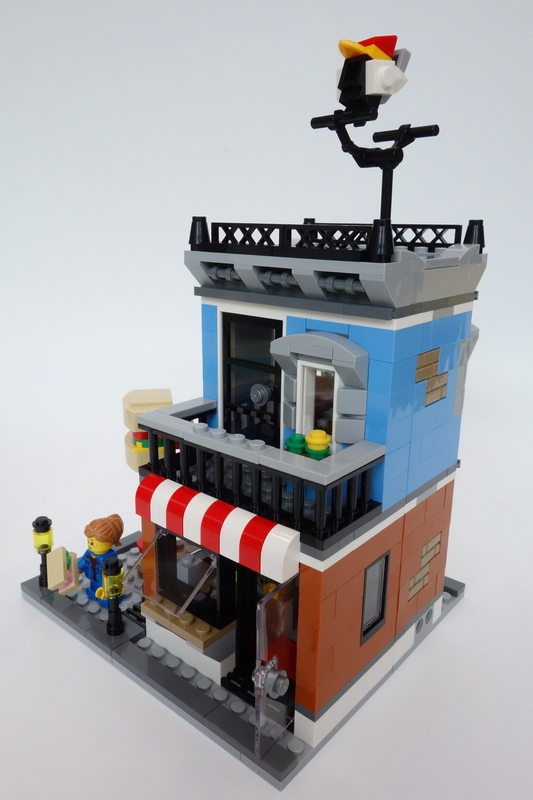](https://www.freelug.org/IMG/jpg/2016-02-07_-_31050_Corner_Deli_Creator_015.jpg)

[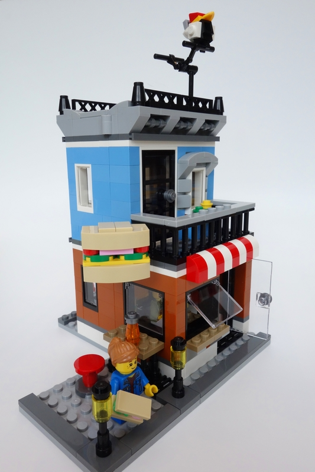](https://www.freelug.org/IMG/jpg/2016-02-07_-_31050_Corner_Deli_Creator_016.jpg)

[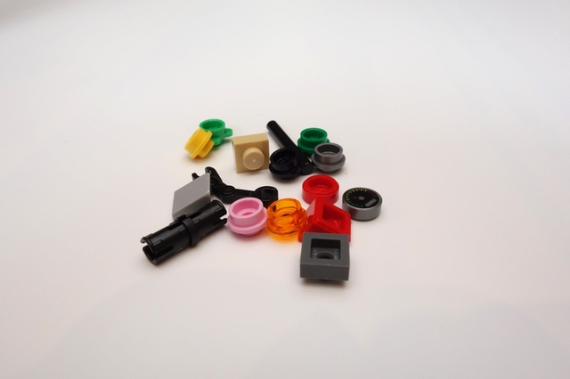](https://www.freelug.org/IMG/jpg/2016-02-07_-_31050_Corner_Deli_Creator_008.jpg)

Quelques pièces en rab, c’est toujours ça de pris.

Passons voir les minifigs maintenant. Comme pour les bâtiments, on est sur du 3 en 1, pour chaque modèle, on peut modifier torso et jambes des figs pour donner une impression de changement. Je ne vous présente ici que les versions du modèle principal.

[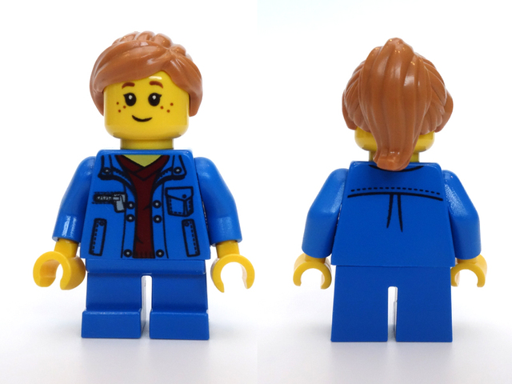](https://www.freelug.org/IMG/jpg/Minifig_01.jpg)

Jambes courtes pour cette petite fille. Le torse représente une veste en jean ouverte sur un t-shirt rouge. La sérigraphie est propre et le dos bénéficie également de quelques lignes de sérigraphie qui apportent un peu de relief. On retrouve ce torse dans quelques sets City et même dans le Detective Office 10246.

[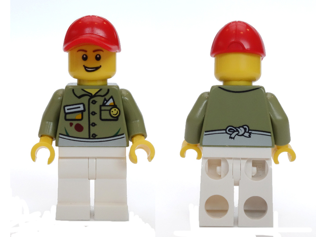](https://www.freelug.org/IMG/jpg/Minifig_02.jpg)

J’aime bien ce torse avec ses tâches de ketchup et de moutarde sur le chemise. On l’avait déjà vu dans le set 70812 Creative Ambush sur le Kébab Bob, on pourra d’ailleurs préférer cette minifig qui était livrée avec des jambes sérigraphiées pour représenter le tablier à la place de celle fournie avec ce set.

Conclusion :

Même si globalement la construction se résume à un empilement de briques, le résultat final dans sa version ouverte sur un coin de rue est très agréable. Pour le prix on a un chouette bâtiment à intégrer dans sa ville. Le choix des couleurs : Dark Orange et Medium Blue peut semble étrange au premier abord, mais il donne finalement un résultat intéressant, un peu moderne.  
Pour ceux qui s’en sentent l’envie, quelques modifications lui donneront encore plus fière allure que ce qu’il a déjà.

**–** _Oh mais dis moi, tu ne fais pas les autres modèles ?... J’peux les construire ? Hein... dis ? Allez, je peux les faire... S’teuplé..._

[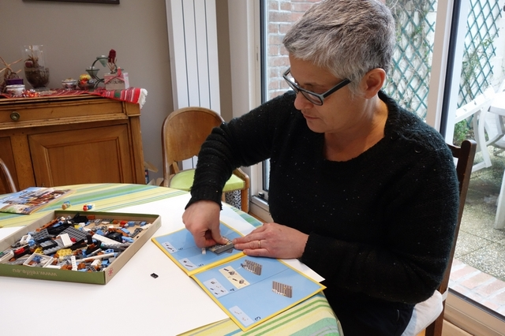](https://www.freelug.org/IMG/jpg/2016-02-07_-_31050_Corner_Deli_Creator_006.jpg)

Bonus : les modèles alternatifs.

[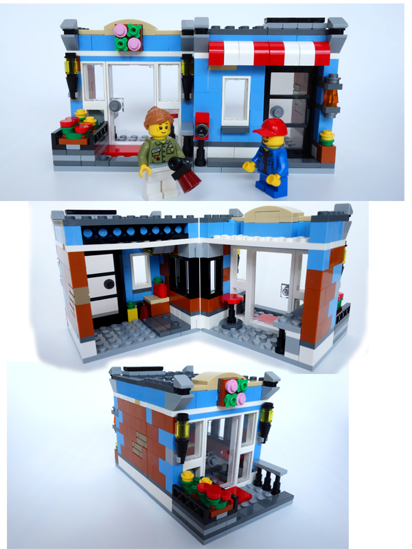](https://www.freelug.org/IMG/jpg/Modele_02.jpg)

Le magasin de fleurs, un pauvre bâtiment sur un niveau, sans aucun détail.

[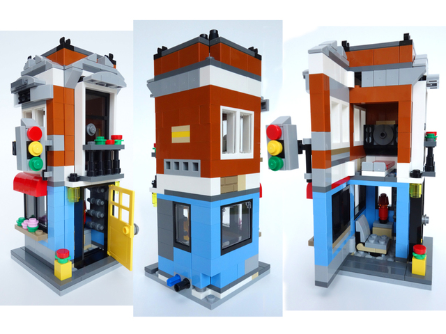](https://www.freelug.org/IMG/jpg/Modele_03.jpg)

Encore plus dispensable que le magasin de fleurs, la maison ne ressemble pas à grand chose.

Autant certains modèles Creator 3 en 1 peuvent proposer des modèles alternatifs très intéressants, autant on se contentera ici du modèle principal.
