Review un peu spéciale aujourd’hui avec quatre figurines customs venant du site [minifigures.com](http://www.minifigures.com/), site Anglais créé en 2004 et spécialisé dans le custom des minifigures _LEGO_.

Le site part de figurines _LEGO_ officielles vierges qui ont droit ensuite à une impression digitale (procédé différent de la sérigraphie).  
Ils ont maintenant une clientèle mondiale avec notamment des entreprises comme _Google_, _Pixar_ ou _Fox Studio_...

* * *

**King of Pop**  
Prix : 14,95£  
Particularité : Non

Grand fan de _Michael Jackson_, je ne pouvais pas passer à côté de ce custom.  
La réalisation est elle à la hauteur de la version 3D affichée sur le site.

La minifig représente _MJ_ avec la tenue ci-dessous.

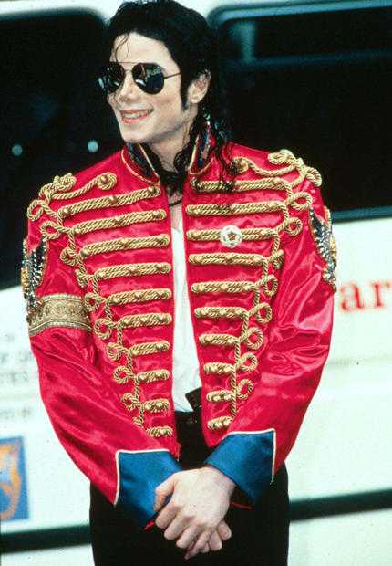

L’emballage est soigné et résistant, il reprend en arrière plan la version 3D de la minifigure présente sur le site.

[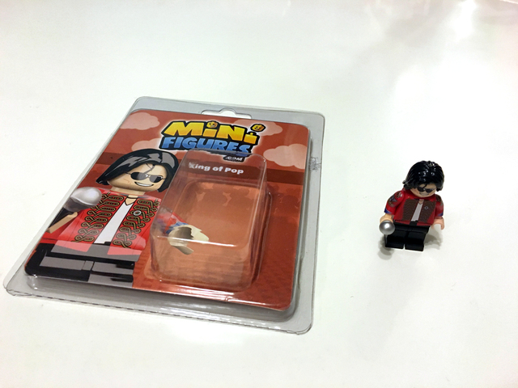](https://www.freelug.org/IMG/jpg/MJ_01.jpg)

De face, le _King of Pop_ est une réussite, le visage est reconnaissable et le vice est poussé jusqu’à reproduire la petite mèche de cheveux qui tombe sur les yeux. Les dorures de la vestes sont superbement réalisées et l’alignement avec la continuité sur les jambes est impeccable (notez le pan de chemise qui ressort d’un côté).  
Seul bémol au niveau des bras, au lieu d’arrêter l’impression digitale de manière nette et franche, l’entreprise a préférée un procédé d’atténuation. Ce qui donne une impression d’usure/effacement assez troublante.

[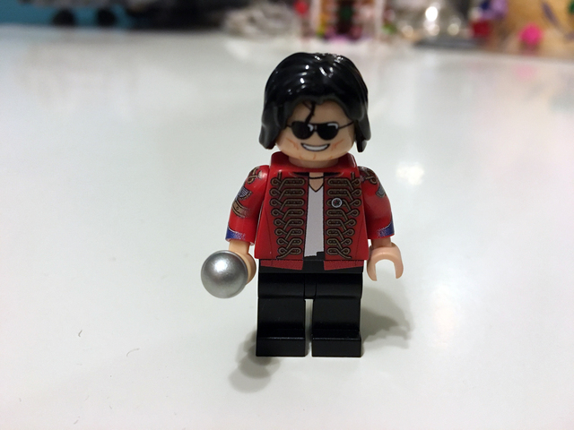](https://www.freelug.org/IMG/jpg/MJ_02.jpg)

Le dos est lui aussi imprimé avec des coutures noires et dorées.

[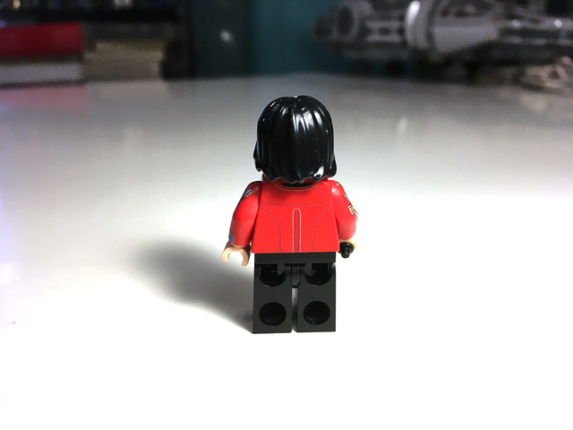](https://www.freelug.org/IMG/jpg/MJ_06.jpg)

Vue de gauche, l’impression est toujours aussi précise et détaillée avec pas moins de trois "détails" : le revers de manche, un écusson et des dorures au niveau de l’épaule.

[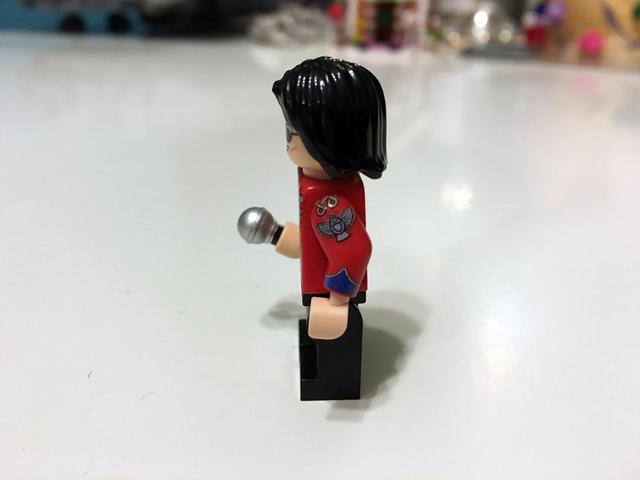](https://www.freelug.org/IMG/jpg/MJ_03.jpg)

Vue de droite, _Minifigures.com_ pas avare de détails à rajouté un brassard en plus des trois autres détails cités au dessus.  
Comme on peux le voir la fig est fournie avec un micro.

[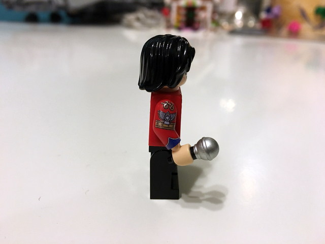](https://www.freelug.org/IMG/jpg/MJ_04.jpg)

**CONCLUSION :**

Très belle réalisation que cette figurine du _King of Pop_, très fidèle à la tenue originale jusqu’au détail de la chemise.

* * *

**Freddie Mercury**  
Prix : 14,95£  
Particularité : Non

Un autre artiste que j’adore, _Freddie Mercury_ du groupe _Queen_, autre custom que je me devais donc de posséder.

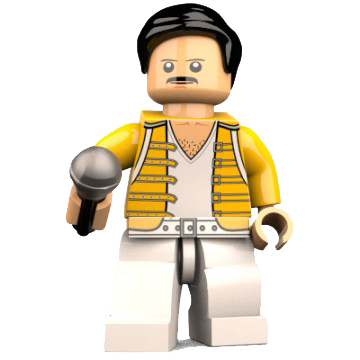

La minifigure représente _Freddie Mercury_ dans une de ses tenues de scène les plus connue.

[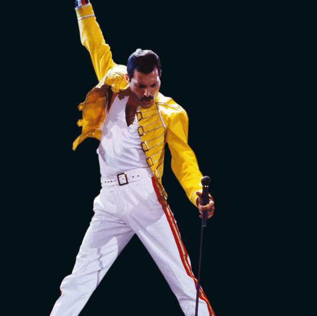](https://www.freelug.org/IMG/jpg/FM_06.jpg)

Emballage standard chez _Minifigures.com_, avec un fond jaune cette fois-ci pour s’accorder avec le personnage.

[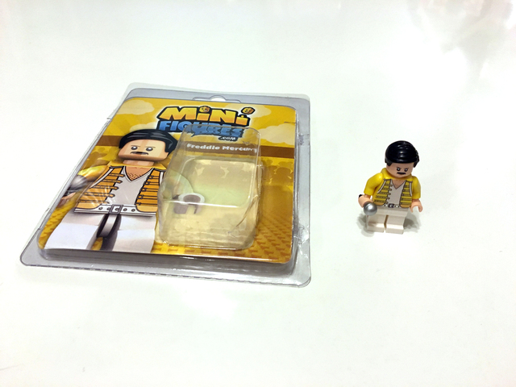](https://www.freelug.org/IMG/jpg/FM_01.jpg)

Encore une fois la réalisation est impeccable. Tout y est, la veste à lanières, la ceinture à trous, même les poils sont présents.  
Seul bémol, le visage que reste un poil quelconque malgré la moustache légendaire du chanteur.

[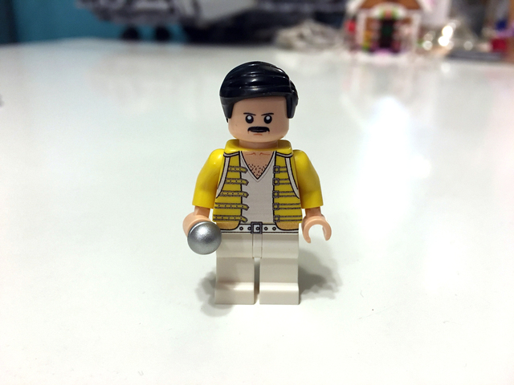](https://www.freelug.org/IMG/jpg/FM_02.jpg)

De dos l’impression est toujours aussi précise avec, comme au recto, un alignement parfait de la continuité de la veste sur les jambes. Du très beau travail.  
Le visage alternatif est bien plus réussi, avec un _Freddie Mercury_ en train de chanter les yeux fermés. On notera le petit détail supplémentaire des trois gouttes de sueurs dues à l’effort de la performance.

[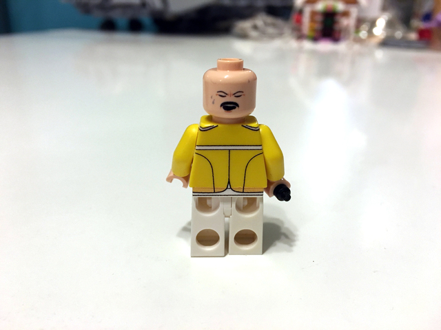](https://www.freelug.org/IMG/jpg/FM_03.jpg)

Sur les côtés, c’est ici le pantalon qui est agrémenté de bandes rouge et or.  
On se retrouve donc bien avec une des tenues mythique du chanteur ce qui renforce la fidélité de cette minifig.

[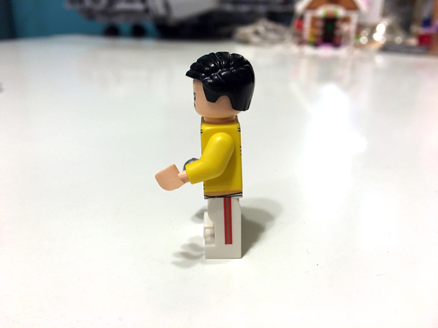](https://www.freelug.org/IMG/jpg/FM_04.jpg)

[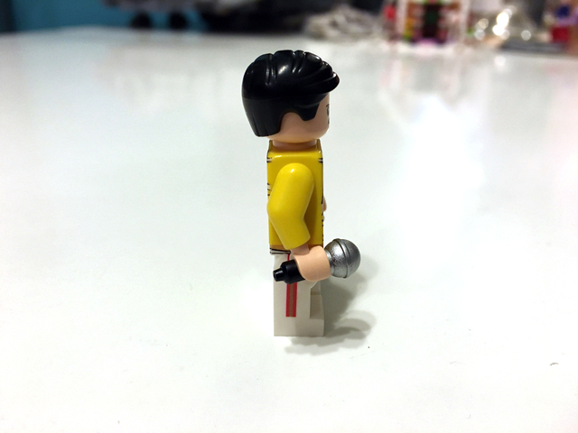](https://www.freelug.org/IMG/jpg/FM_05.jpg)

**CONCLUSION :**

Encore une fois la réalisation et la finition de cette fig sont exemplaires, gros coup de coeur pour le visage alternatif de l’artiste en train de chanter.

* * *

**Stan Lee**  
Prix : 14,95£  
Particularité : Édition limitée

Créateur d’une grande partie de l’univers _Marvel_, _Stan Lee_ est une figure mythique de l’univers Geek.

Difficile de trouver une photo correspondant à la fig réalisée, même si _Stan_ Lee est habitué aux vestes marron.

L’habituel emballage de _Minifigures.com_ donne toujours cet aspect qualitatif. Un fond marron qui s’accorde avec les lunettes fumées du génial scénariste.

[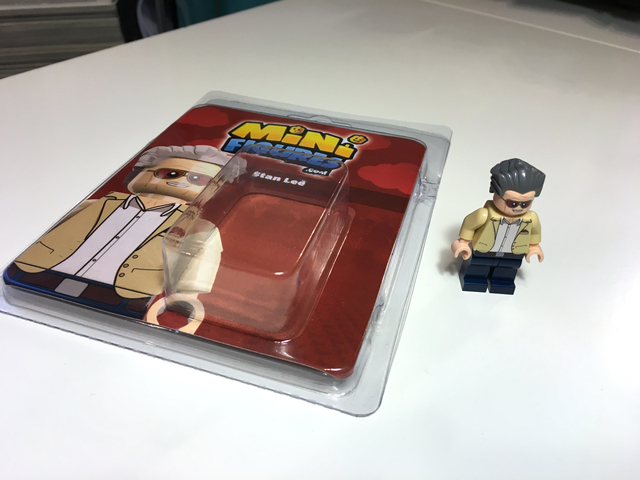](https://www.freelug.org/IMG/jpg/SL_01.jpg)

Belle réalisation pour le visage, avec les éternelles lunettes fumées de _Stan_, sa petite moustache et les rides dues à son grand age.  
Impression superbe pour la veste et la chemise, décidément _Minifigures.com_ maîtrise son sujet.

[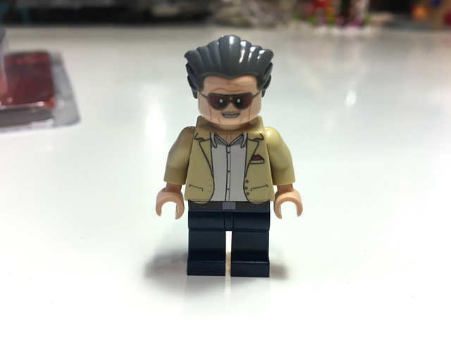](https://www.freelug.org/IMG/jpg/SL_02.jpg)

Rien a déclaré sur les côtés et strict minimum pour le verso qui fait du coup pâle figure à côté du recto aussi fourni.

[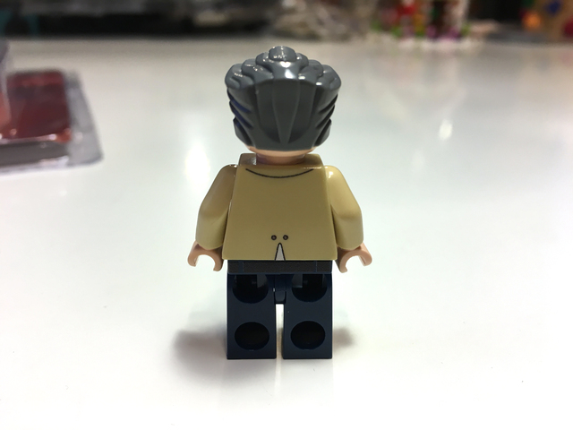](https://www.freelug.org/IMG/jpg/SL_03.jpg)

**CONCLUSION :**

Figurine réussie sur le recto qui fourmille de détails, je suis un poil dessus par le verso.  
Au final, j’adore tout de même cette minifig, c’est _STAN LEE_ quand même.

* * *

**Dr Anatomini**  
Prix : 14,95£  
Particularité : Non

Voilà un custom qui parait prometteur sur le site, voyons tout de suite ce qu’il en est.

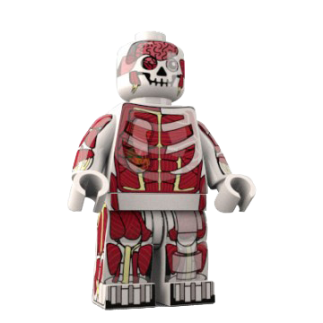

Ce custom est une réinterprétation du célèbre écorché de nos manuels scolaire.

[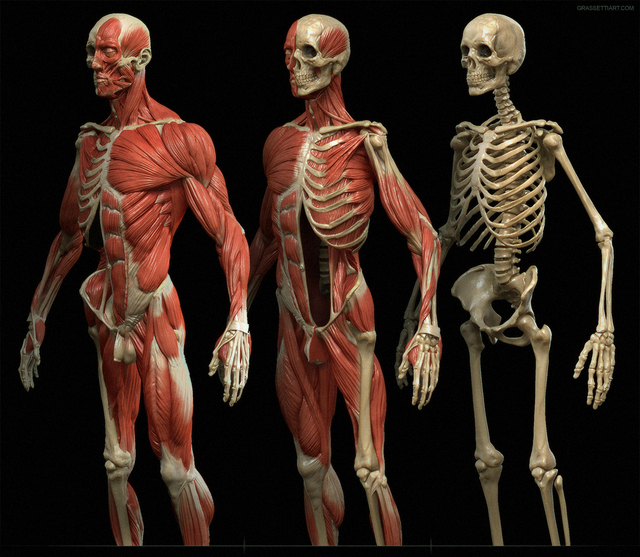](https://www.freelug.org/IMG/jpg/DA_07.jpg)

Aucun changement sur l’emballage, on ne change pas une équipe qui gagne. Le fond est dans les ton gris/blanc et fait penser à une radio.

[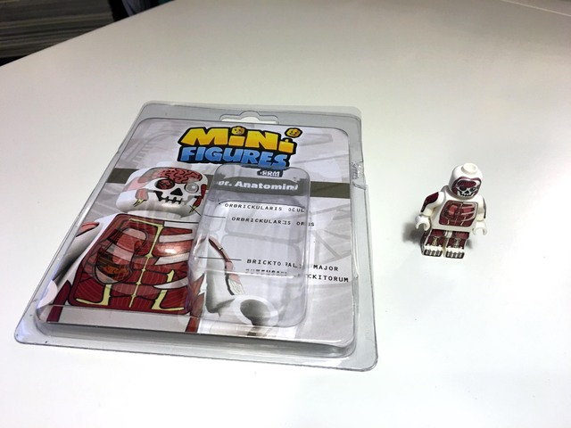](https://www.freelug.org/IMG/jpg/DA_01.jpg)

Réalisation impeccable, avec de nombreuses couleurs. L’impression digitale est superbe et comprend tellement de détails qu’il est difficile d’en faire le compte.

[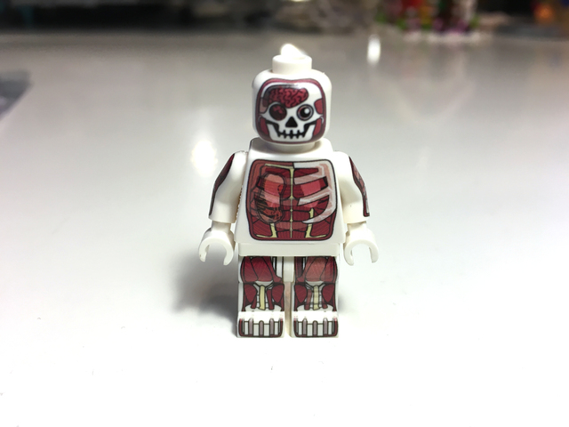](https://www.freelug.org/IMG/jpg/DA_02.jpg)

Au verso même débauche de couleur et de détails.

[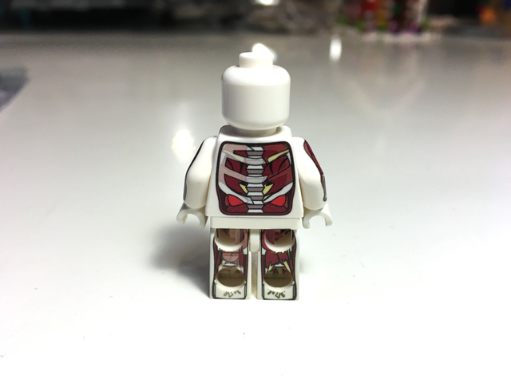](https://www.freelug.org/IMG/jpg/DA_03.jpg)

L’intérieur des jambes est lui aussi imprimé. Chapeau, c’est LE détail qui tue.

[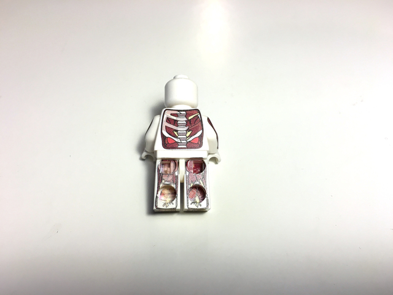](https://www.freelug.org/IMG/jpg/DA_06.jpg)

De chaque côté les jambes et les bras sont imprimés, avec des détails différents.  
A gauche les "os", à droite les muscles.  
La classe tout simplement.

[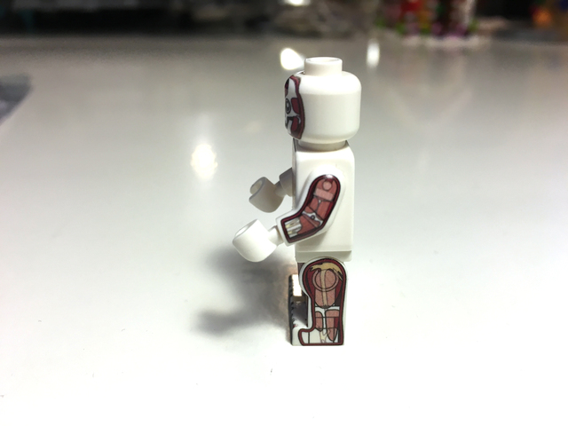](https://www.freelug.org/IMG/jpg/DA_05.jpg)

[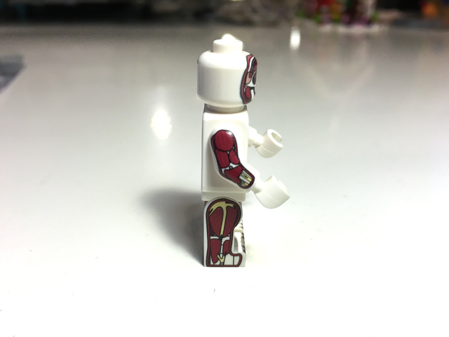](https://www.freelug.org/IMG/jpg/DA_04.jpg)

**CONCLUSION :**

Concrètement, c’est **LA figurine** qui sort de ce lot. Même si les trois autre sont superbes, celle-ci est magnifiquement réalisée. Elle à toute sa place dans une collection ou dans un MOC.  
Pour moi c’est un **must-have**.
