Cet article présente la plus récente version du registre custom pour Track Designer ainsi que les éléments qui le composent.

_This article presents the latest version of the Track Designer custom registry and the elements it contains._

La plus récente version du registre : 0.9f

_Latest version of the registry : 0.9f_

**Custom registry 0.9f**

|  |  |
| --- | --- |
| Contributeur | Nature de la contribution |
| [Erik Amzallag](mailto:brickerik@free.fr) | Dessins, plaques de base |
| [Pierre Normandin](mailto:pierre_normandin@hotmail.com) | Dessins (_bitmap pictures_) et registres (_registries_), plaques de base (_baseplates_), plaques espace (_space baseplates_), rails customs (_custom tracks_), plateformes (_platforms_) |
|  |  |

**–** Les images suivantes ont été tirées du registre et converties au format .jpeg.  
**–** Les numéros et descriptions correspondent à ceux de _[Peeron](http://www.peeron.com/)_.  
**–** Les auteurs mentionnés sont ceux ayant contribué gracieusement à ce registre en soumettant les images. Il est possible que des images semblables aient pu être produites par d’autres personnes à notre insu et nous n’en sommes pas responsables.

**–** _The followings pictures come from the registry and have been converted into jpeg files.  
**–** The numbers and descriptions (reference column) are from _[Peeron](http://www.peeron.com/)_.  
**–** The names in the last column are the contributing authors. Similar pictures might have been made by other people without our knowledge and we are not in any way responsible for any confusion, apparent duplication or other issues arising from this._

| Image | Reference | Auteur/Author |
| --- | --- | --- |
| [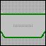](http://www.peeron.com/inv/parts/309p01) **309p01** Baseplate 32 x 32 Service Station with Pattern | [309p01 - Baseplate 32 x 32 Service Station with Pattern](http://www.peeron.com/inv/parts/309p01) | [Pierre Normandin](mailto:pierre_normandin@hotmail.com) |
|  **309p02** Baseplate 32 x 32 Island with River Pattern | [309p02 - Baseplate 32 x 32 Island with River Pattern](http://www.peeron.com/inv/parts/309p02) | [Pierre Normandin](mailto:pierre_normandin@hotmail.com) |
|  **309px1** Baseplate 32 x 32 Service Station with White Lines and Crosswalk Pattern | [309p03 - Baseplate 32 x 32 Service Station with White Lines and Crosswalk Pattern](http://www.peeron.com/inv/parts/309p03) | [Pierre Normandin](mailto:pierre_normandin@hotmail.com) |
| [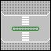](http://www.peeron.com/inv/parts/309p04) **309px2** Baseplate 32 x 32 Service Station with White and Green Lines and Crosswalk Pattern | [309p04 - Baseplate 32 x 32 Service Station with White and Green Lines and Crosswalk Pattern](http://www.peeron.com/inv/parts/309p04) | [Pierre Normandin](mailto:pierre_normandin@hotmail.com) |
| [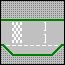](http://www.peeron.com/inv/parts/425p01) **425p01** Baseplate 32 x 32 Road 3 Lane with Race Track Pattern | [425p01 - Baseplate 32 x 32 Road 3 Lane with Race Track Pattern](http://www.peeron.com/inv/parts/425p01) | [Pierre Normandin](mailto:pierre_normandin@hotmail.com) |
| [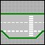](http://www.peeron.com/inv/parts/425px1) **425px1** Baseplate 32 x 32 Road 3 Lane with Green Lines, White Dashed Lines, and Crosswalk Pattern | [425px1 - Baseplate 32 x 32 Road 3 Lane with Green Lines, White Dashed Lines, and Crosswalk Pattern](http://www.peeron.com/inv/parts/425px1) | [Pierre Normandin](mailto:pierre_normandin@hotmail.com) |
| [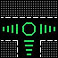](http://www.peeron.com/inv/parts/608p02) **608p02** Baseplate 32 x 32 Road 9-Stud T Intersection with Green Octagon | [608p02 - Baseplate 32 x 32 Road 9-Stud T Intersection with Green Octagon](http://www.peeron.com/inv/parts/608p02) | [Pierre Normandin](mailto:pierre_normandin@hotmail.com) |
| [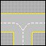](http://www.peeron.com/inv/parts/608p03) **608p03** Baseplate 32 x 32 Road 9-Stud T Intersection with Yellow Lines | [608p03 - Baseplate 32 x 32 Road 9-Stud T Intersection with Yellow Lines](http://www.peeron.com/inv/parts/608p03) | [Pierre Normandin](mailto:pierre_normandin@hotmail.com) |
|  **2358p02** Baseplate 32 x 32 Road 7-Stud Straight with Runway Pattern | [2358p02 - Baseplate 32 x 32 Road 7-Stud Straight with Runway Pattern](http://www.peeron.com/inv/parts/2358p02) | [Pierre Normandin](mailto:pierre_normandin@hotmail.com) |
| [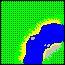](http://www.peeron.com/inv/parts/2359px3) **2359px3** Baseplate 32 x 32 Road 7-Stud Curve with Foliage and Lagoon Pattern | [2359px3 - Baseplate 32 x 32 Road 7-Stud Curve with Foliage and Lagoon Pattern](http://www.peeron.com/inv/parts/2359px3) | [Erik Amzallag](mailto:brickerik@free.fr) |
| [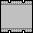](http://www.peeron.com/inv/parts/2617) **2617 Grey** Platform 16 x 16 x 2 & 1/3 Even Grey | [2617 - Platform 16 x 16 x 2 & 1/3 Even Grey](http://www.peeron.com/inv/parts/2617) | [Pierre Normandin](mailto:pierre_normandin@hotmail.com) |
| [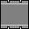](http://www.peeron.com/inv/parts/2617) **2617 Dark Grey** Platform 16 x 16 x 2 & 1/3 Even Dark Grey | [2617 - Platform 16 x 16 x 2 & 1/3 Even Dark Grey](http://www.peeron.com/inv/parts/2617) | [Pierre Normandin](mailto:pierre_normandin@hotmail.com) |
| [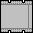](http://www.peeron.com/inv/parts/2642) **2642 Grey** Platform 16 x 16 x 2 & 1/3 Ramp Grey | [2642 - Platform 16 x 16 x 2 & 1/3 Ramp Grey](http://www.peeron.com/inv/parts/2642) | [Pierre Normandin](mailto:pierre_normandin@hotmail.com) |
| [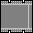](http://www.peeron.com/inv/parts/2642) **2642 Dark Grey** Platform 16 x 16 x 2 & 1/3 Ramp Dark Grey | [2642 - Platform 16 x 16 x 2 & 1/3 Ramp Dark Grey](http://www.peeron.com/inv/parts/2642) | [Pierre Normandin](mailto:pierre_normandin@hotmail.com) |
| [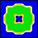](http://www.peeron.com/inv/parts/3811p02) **3811p02** Baseplate 32 x 32 with Island Pattern | [3811p02 - Baseplate 32 x 32 with Island Pattern](http://www.peeron.com/inv/parts/3811p02) | [Pierre Normandin](mailto:pierre_normandin@hotmail.com) |
|  **3867p01** Baseplate 16 x 16 with Island and Water Pattern | [3867p01 - Baseplate 16 x 16 with Island and Water Pattern](http://www.peeron.com/inv/parts/3867p01) | [Pierre Normandin](mailto:pierre_normandin@hotmail.com) |
| [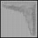](http://www.peeron.com/inv/parts/3947) **3947** Baseplate 32 x 32 with Craters | [3947 - Baseplate 32 x 32 with Craters](http://www.peeron.com/inv/parts/3947) | [Pierre Normandin](mailto:pierre_normandin@hotmail.com) |
| [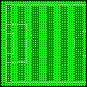](http://www.peeron.com/inv/parts/4186p01) **4186p01** Baseplate 48 x 48 with Playing Field Pattern | [4186p01 - Baseplate 48 x 48 with Playing Field Pattern](http://www.peeron.com/inv/parts/4186p01) | [Pierre Normandin](mailto:pierre_normandin@hotmail.com) |
|  **4478p01** Baseplate 32 x 32 with Driveway and Gray Pattern | [4478p01 - Baseplate 32 x 32 with Driveway and Gray Pattern](http://www.peeron.com/inv/parts/4478p01) | [Pierre Normandin](mailto:pierre_normandin@hotmail.com) |
|  **4478px1** Baseplate 32 x 32 with Driveway and White Lines Pattern | [4478px1 - Baseplate 32 x 32 with Driveway and White Lines Pattern](http://www.peeron.com/inv/parts/4478px1) | [Pierre Normandin](mailto:pierre_normandin@hotmail.com) |
| [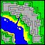](http://www.peeron.com/inv/parts/6024px2) **6024px2** Baseplate 32 x 32 Canyon Plate with Foliage, Rocks, and Lagoon Pattern | [6024px2 - Baseplate 32 x 32 Canyon Plate with Foliage, Rocks, and Lagoon Pattern](http://www.peeron.com/inv/parts/6024px2) | [Erik Amzallag](mailto:brickerik@free.fr) |
| [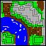](http://www.peeron.com/inv/parts/6024px5) **6024px5** Baseplate 32 x 32 Canyon Plate with Mountain and River Rapids Pattern | [6024px5 - Baseplate 32 x 32 Canyon Plate with Mountain and River Rapids Pattern](http://www.peeron.com/inv/parts/6024px5) | [Erik Amzallag](mailto:brickerik@free.fr) |
|  **6099p02** Baseplate 32 x 32 Road 9-Stud Landing Pad with Green Octagon | [6099p02 - Baseplate 32 x 32 Road 9-Stud Landing Pad with Green Octagon](http://www.peeron.com/inv/parts/6099p02) | [Pierre Normandin](mailto:pierre_normandin@hotmail.com) |
| [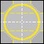](http://www.peeron.com/inv/parts/6099p03) **6099p03** Baseplate 32 x 32 Road 9-Stud Landing Pad with Yellow Circle | [6099p03 - Baseplate 32 x 32 Road 9-Stud Landing Pad with Yellow Circle](http://www.peeron.com/inv/parts/6099p03) | [Pierre Normandin](mailto:pierre_normandin@hotmail.com) |
| [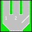](http://www.peeron.com/inv/parts/6100p01) **6100p01** Baseplate 32 x 32 with 3 Driveways and Set 6571 Pattern | [6100p01 - Baseplate 32 x 32 with 3 Driveways and Set 6571 Pattern](http://www.peeron.com/inv/parts/6100p01) | [Pierre Normandin](mailto:pierre_normandin@hotmail.com) |
| [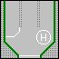](http://www.peeron.com/inv/parts/6100px1) **6100px1** Baseplate 32 x 32 with 3 Driveways, White Lines, and Circled H Pattern | [6100px1 - Baseplate 32 x 32 with 3 Driveways, White Lines, and Circled H Pattern](http://www.peeron.com/inv/parts/6100px1) | [Pierre Normandin](mailto:pierre_normandin@hotmail.com) |
| [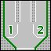](http://www.peeron.com/inv/parts/6100px2) **6100px2** Baseplate 32 x 32 with 3 Driveways and Outer Lanes Labeled 1 and 2 | [6100px2 - Baseplate 32 x 32 with 3 Driveways and Outer Lanes Labeled 1 and 2](http://www.peeron.com/inv/parts/6100px2) | [Pierre Normandin](mailto:pierre_normandin@hotmail.com) |
| [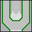](http://www.peeron.com/inv/parts/6100px3) **6100px3** Baseplate 32 x 32 with 3 Driveways and Diagonal Lines Pattern | [6100px3 - Baseplate 32 x 32 with 3 Driveways and Diagonal Lines Pattern](http://www.peeron.com/inv/parts/6100px3) | [Pierre Normandin](mailto:pierre_normandin@hotmail.com) |
| [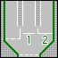](http://www.bricklink.com/catalogItem.asp?PartID=6100pb04) **6100pb04** Baseplate 32 x 32 with 3 Driveways, ’1’ center, ’2’ right Pattern | [6100pb04 - Baseplate, Road 32 x 32 with 3 Driveways, ’1’ center, ’2’ right Pattern (Set 6383)](http://www.bricklink.com/catalogItem.asp?PartID=6100pb04) | [Pierre Normandin](mailto:pierre_normandin@hotmail.com) |
|  **30030p01** Baseplate 32 x 32 with Racing Pattern | [30030p01 - Baseplate 32 x 32 with Racing Pattern](http://www.peeron.com/inv/parts/30030p01) | [Pierre Normandin](mailto:pierre_normandin@hotmail.com) |
|  **30225p01** Baseplate 16 x 16 Driveway with Gray Drive Pattern | [30225p01 - Baseplate 16 x 16 Driveway with Gray Drive Pattern](http://www.peeron.com/inv/parts/30225p01) | [Pierre Normandin](mailto:pierre_normandin@hotmail.com) |
|  **30225p02** Baseplate 16 x 16 Driveway with Gray Drive/White Stripes Pattern | [30225p02 - Baseplate 16 x 16 Driveway with Gray Drive/White Stripes Pattern](http://www.peeron.com/inv/parts/30225p02) | [Pierre Normandin](mailto:pierre_normandin@hotmail.com) |
|  **30401px1** Baseplate 16 x 32 Roadway Ramp Straight with White Center Stripe Pattern | [30401px1 - Baseplate 16 x 32 Roadway Ramp Straight with White Center Stripe Pattern (Set 6600)](http://www.bricklink.com/catalogItemPic.asp?P=30401px1) | [Pierre Normandin](mailto:pierre_normandin@hotmail.com) |
|  **30402px1** Baseplate 24 x 24 Roadway Ramp Curved with White Center Stripe Pattern | [30402px1 - Baseplate 24 x 24 Roadway Ramp Curved with White Center Stripe Pattern (Set 6600)](http://www.bricklink.com/catalogItemPic.asp?P=30402px1) | [Pierre Normandin](mailto:pierre_normandin@hotmail.com) |
| [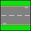](http://www.peeron.com/inv/parts/44336p01) **44336p01** Baseplate 32 x 32 Road 6-Stud Straight with Road Pattern | [44336p01 - Baseplate 32 x 32 Road 6-Stud Straight with Road Pattern](http://www.peeron.com/inv/parts/44336p01) | [Pierre Normandin](mailto:pierre_normandin@hotmail.com) |
| [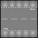](http://www.peeron.com/inv/parts/44336px4) **44336px4** Baseplate 32 x 32 Road 6-Stud Straight with White Dashed Lines Pattern | [44336px4 - Baseplate 32 x 32 Road 6-Stud Straight with White Dashed Lines Pattern](http://www.peeron.com/inv/parts/44336px4) | [Pierre Normandin](mailto:pierre_normandin@hotmail.com) |
| [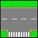](http://www.peeron.com/inv/parts/44341px1) **44341px1** Baseplate 32 x 32 Road 6-Stud T Intersection with Dark Gray Road Pattern | [44341px1 - Baseplate 32 x 32 Road 6-Stud T Intersection with Dark Gray Road Pattern](http://www.peeron.com/inv/parts/44341px1) | [Pierre Normandin](mailto:pierre_normandin@hotmail.com) |
| [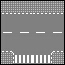](http://www.peeron.com/inv/parts/44341px2) **44341px2** Baseplate 32 x 32 Road 6-Stud T Intersection with White Dashed Lines and Crosswalk Pattern | [44341px2 - Baseplate 32 x 32 Road 6-Stud T Intersection with White Dashed Lines and Crosswalk Pattern](http://www.peeron.com/inv/parts/44341px2) | [Pierre Normandin](mailto:pierre_normandin@hotmail.com) |
| [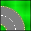](http://www.peeron.com/inv/parts/44342p01) **44342p01** Baseplate 32 x 32 Road 6-Stud Curve with Pattern | [44342p01 - Baseplate 32 x 32 Road 6-Stud Curve with Pattern](http://www.peeron.com/inv/parts/44342p01) | [Pierre Normandin](mailto:pierre_normandin@hotmail.com) |
|  **44342px2** Baseplate 32 x 32 Road 6-Stud Curve with White Dashed Lines Pattern | [44342px2 - Baseplate 32 x 32 Road 6-Stud Curve with White Dashed Lines Pattern](http://www.peeron.com/inv/parts/44342px2) | [Pierre Normandin](mailto:pierre_normandin@hotmail.com) |
| [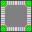](http://www.peeron.com/inv/parts/44343px1) **44343px1** Baseplate 32 x 32 Road 6-Stud Crossroads with Dark Gray Road and Crosswalks Pattern | [44343px1 - Baseplate 32 x 32 Road 6-Stud Crossroads with Dark Gray Road and Crosswalks Pattern](http://www.peeron.com/inv/parts/44343px1) | [Pierre Normandin](mailto:pierre_normandin@hotmail.com) |
| [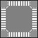](http://www.peeron.com/inv/parts/44343px3) **44343px3** Baseplate 32 x 32 Road 6-Stud Crossroads with White Dashed Lines and Crosswalks Pattern | [44343px3 - Baseplate 32 x 32 Road 6-Stud Crossroads with White Dashed Lines and Crosswalks Pattern](http://www.peeron.com/inv/parts/44343px3) | [Pierre Normandin](mailto:pierre_normandin@hotmail.com) |
| **Pièces modifiées / _custom parts_** |  |  |
| 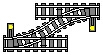 **Double-points-left** | Aiguillage double gauche, _Double Points Left_ | [Pierre Normandin](mailto:pierre_normandin@hotmail.com) |
| 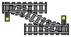 | Aiguillage double droite, _Double Points Right_ | [Pierre Normandin](mailto:pierre_normandin@hotmail.com) |
| 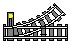 | Demi-courbe d’aiguillage gauche, _Half Curve Left Points_ | [Pierre Normandin](mailto:pierre_normandin@hotmail.com) |
| 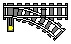 | Demi-courbe d’aiguillage droite, _Half Curve Right Points_ | [Pierre Normandin](mailto:pierre_normandin@hotmail.com) |
| 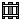 | Demi-rail droit, _Half Straight_ | [Pierre Normandin](mailto:pierre_normandin@hotmail.com) |
| 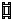 **Quarter-straight-track** 1/4 de section de rail droite - 1/4 straight track section | Quart de rail droit, _Quarter Straight_ | [Pierre Normandin](mailto:pierre_normandin@hotmail.com) |

Ont aussi été ajoutées au registre : les plaques de base de format 8x16, 8x32, 16x16, 16x32 et 32x32 dans la plupart des couleurs disponibles et/ou ayant été produites.

_Baseplates at the following sizes have also been added to the registry in most available and/or produced colours : 8x16, 8x32, 16x16, 16x32 and 32x32._

Il est possible que les rendus n’aient pas été faits à toutes les échelles. Les rendus des échelles à 2 tenons par pixel et 1 tenon par pixel sont presque tous complets.

_A few elements are available only in the scale of 2 and 1pixel/stud_

Archives :

Version 0.9e

**Custom registry 0.9e**

Version 0.9d

**Custom registry 0.9d**
