Lancée début 2016, Nexo Knights est une nouvelle gamme made in LEGO :

> Voyage dans un monde de chevaliers high-tech et de monstres de lave avec un magicien numérique pour une nouvelle aventure passionnante !

Les sets sont couplés à un jeu vidéo pour smartphone/tablette, les blasons contenus dans les boites LEGO permettent d’avoir différents pouvoirs dans le jeu.

Aujourd’hui je vous propose la review de deux sets dans la gamme _Nexo Knights_ : **Ultimate Aaron** (70332) et **Ultimate Lavaria** (70335).  
Ces sets sortis en 2016 au prix de 9,99 € l’unité sont composés respectivement de 82 et 69 pièces, soit un ratio prix/pièce de 12 et 15 centimes d’€.

[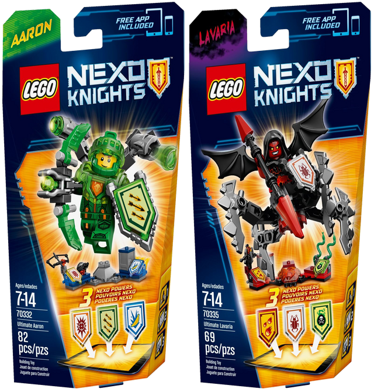](https://www.freelug.org/IMG/png/UltimateAaronlavaria_box.png)

* * *

Le visuel des boites reprend bien le thème "chevalier high-tech" avec ses couleurs jaune et bleue.  
Sur le bas des boites on voit les trois _Nexo Powers_ contenus dans le set et qui permettront de jouer dans le jeu vidéo. Le visuel est complètement dans le ton de cette nouvelle gamme, _LEGO_ a réussi son coup de ce côté-là.

[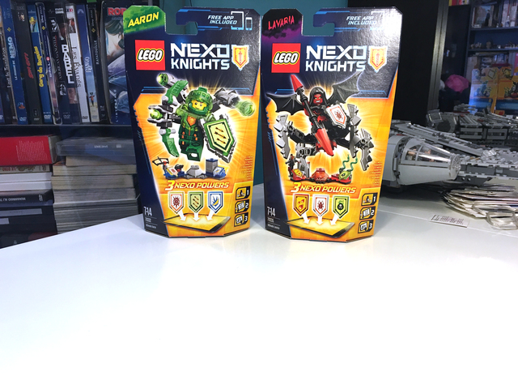](https://www.freelug.org/IMG/jpg/UltimateAaronLavaria_01.jpg)

Le dos des sets apportent un visuel du set monté et une grande partie est dédiée au jeu vidéo et au matériel avec lequel il est compatible. Le verso du set fait bien triste à cause de cet encart.

[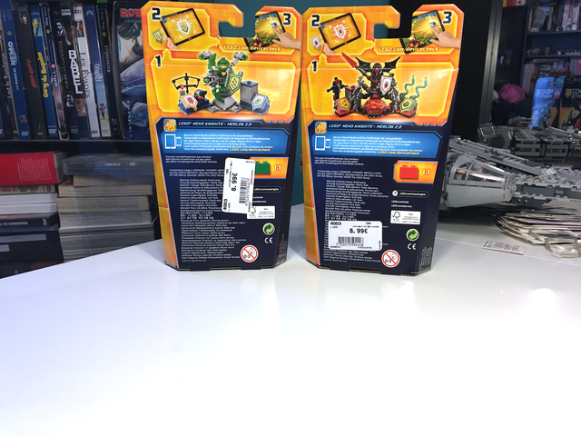](https://www.freelug.org/IMG/jpg/UltimateAaronLavaria_02.jpg)

Une fois ouvert, chaque set contient deux sachets non numérotés et une notice de construction.

[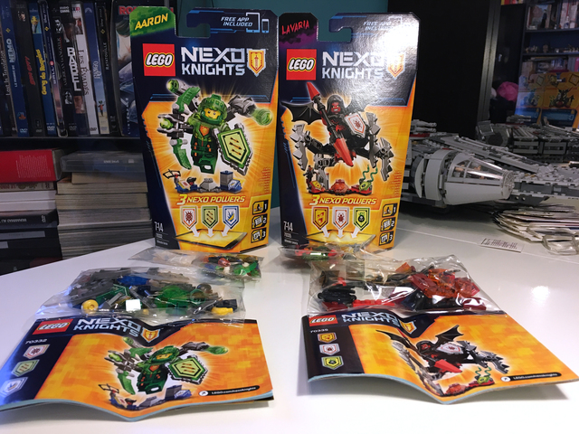](https://www.freelug.org/IMG/jpg/UltimateAaronLavaria_03.jpg)

* * *

**Ultimate Aaron :**

La minifig d’_[Aaron](http://brickset.com/minifigs/nex021/Ultimate-Aaron-\(70332\))_ est, comme toute les figs _Nexo Knight_, vraiment réussie. Tant au niveau du double visage, qu’au niveau de la sérigraphie du torso et des jambes. Cette dernière est complètement dans le thème avec une armure qui mélange high-tech et moyen-age, impression renforcée avec le blason sur le torse.

[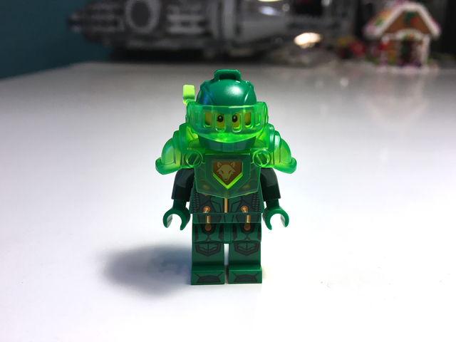](https://www.freelug.org/IMG/jpg/UltimateAaronLavaria_05.jpg)

_Aaron_ sans ses casque et armure. On se rend mieux compte de la sérigraphie et du côté _Iron Man_ du moyen-age de l’armure.

[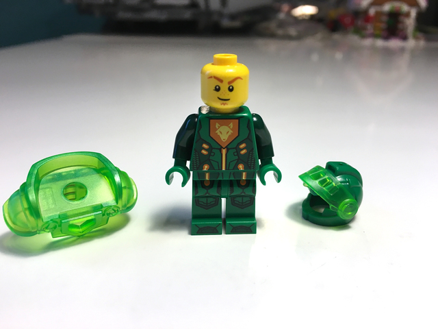](https://www.freelug.org/IMG/jpg/UltimateAaronLavaria_06.jpg)

Le dos est richement décoré et le visage alternatif est un des plus sympa qu’il m’ait été donné de voir chez _LEGO_.

[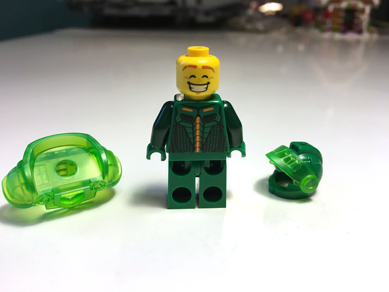](https://www.freelug.org/IMG/jpg/UltimateAaronLavaria_07.jpg)

_Aaron_ en armure complète avec armes et bouclier.  
Va pas falloir trop le faire chier :D

[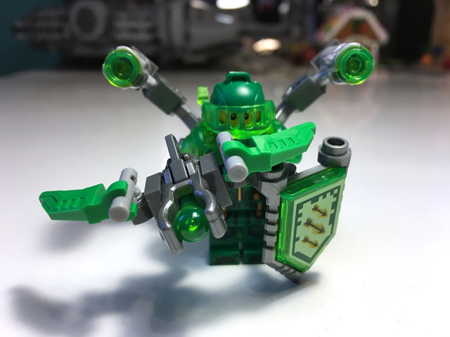](https://www.freelug.org/IMG/jpg/UltimateAaronLavaria_08.jpg)

Voici le set complet avec les deux autres blasons sérigraphiés et les armes qui leurs correspondent (oui, oui il y a bien des armes bananes).

[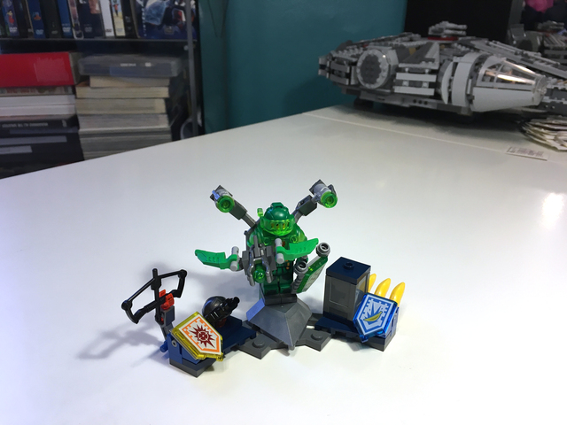](https://www.freelug.org/IMG/jpg/UltimateAaronLavaria_09.jpg)

Focus sur les trois pièces sérigraphiées du set.

[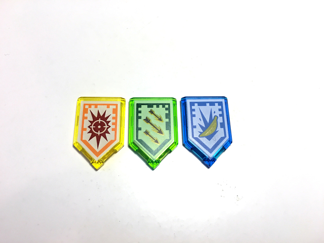](https://www.freelug.org/IMG/jpg/UltimateAaronLavaria_04.jpg)

* * *

**Ultimate Lavaria :**

Voici _[Lavaria](http://brickset.com/minifigs/nex030/Lavaria)_, la démone-araignée. Les sérigraphie du visage et du corps sont superbement fines et détaillées.

[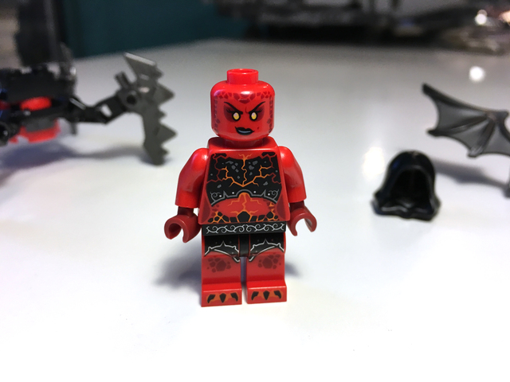](https://www.freelug.org/IMG/jpg/UltimateAaronLavaria_14.jpg)

Le dos est dans la même veine et le visage alternatif est ici aussi magnifique.

[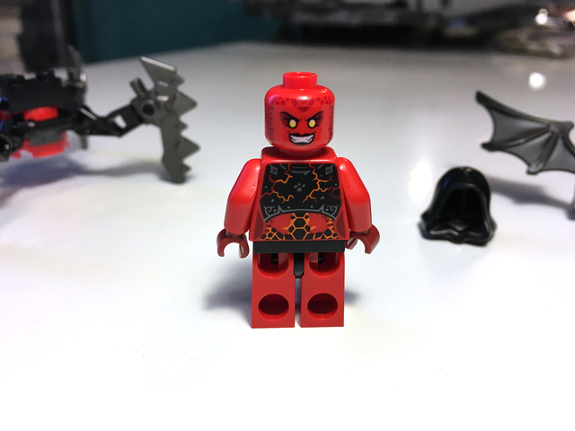](https://www.freelug.org/IMG/jpg/UltimateAaronLavaria_15.jpg)

_Lavaria_ en mode araignée avec ses ailes de démone et son capuchon. La construction des pattes, même si elle est simple, est redoutablement efficace.

[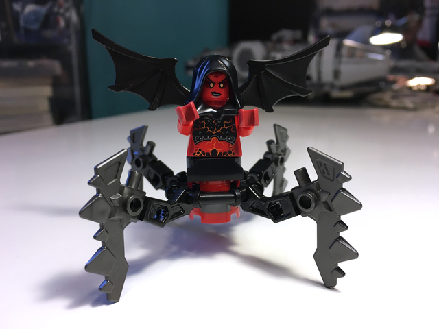](https://www.freelug.org/IMG/jpg/UltimateAaronLavaria_11-2.jpg)

Sans son capuchon.

[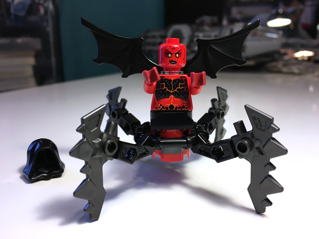](https://www.freelug.org/IMG/jpg/UltimateAaronLavaria_12.jpg)

De dos on peut voir que _LEGO_ a même pensé à l’abdomen sur le corps araignée.

[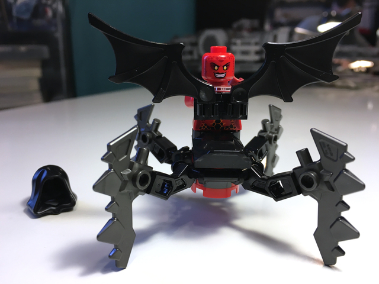](https://www.freelug.org/IMG/jpg/UltimateAaronLavaria_13.jpg)

Lavaria _avec arme et bouclier_.

[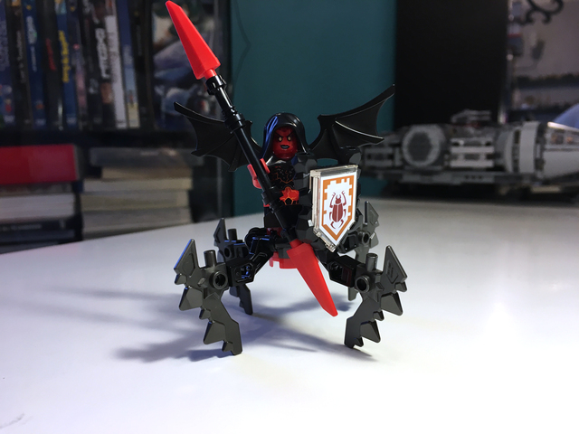](https://www.freelug.org/IMG/jpg/UltimateAaronLavaria_16.jpg)

Mise en situation sur le socle avec les armes et blasons supplémentaires.

[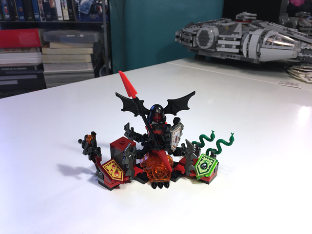](https://www.freelug.org/IMG/jpg/UltimateAaronLavaria_17.jpg)

Gros plan sur les trois blasons sérigraphiés.

[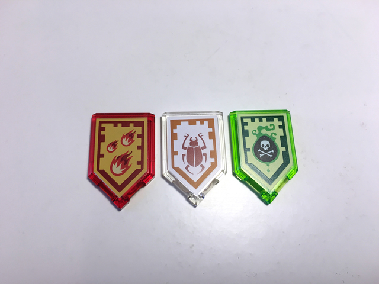](https://www.freelug.org/IMG/jpg/UltimateAaronLavaria_10.jpg)

**AVIS :**

Armes banane et visage alternatif rieur d’un côté, corps d’araignée de l’autre. Nous somme clairement en présence des deux meilleures figurines de la série _Ultimate_ des _Nexo Knight_.

Bref, allez-y sans réfléchir, vous ne serez pas déçus.

[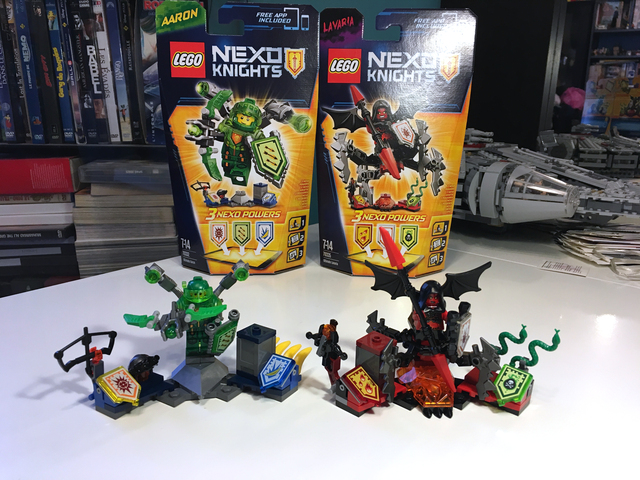](https://www.freelug.org/IMG/jpg/UltimateAaronLavaria_18.jpg)
