Salut à toutes et à tous,

Pour ma première review, j’ai décidé de m’attaquer au set de la Gamme _Star Wars_™ 75093, **Death Star™ Final Duel** (ou **Le Duel final de l’Etoile de la Mort** pour les moins anglophones d’entre vous !) acheté tout récemment, bien qu’il soit sorti début juin 2015.  
Ce set coûte 99,99€ et est composé de de 5 mini-figurines.  
et 784 pièces (soit un ratio de 12,7cts/pièce).

[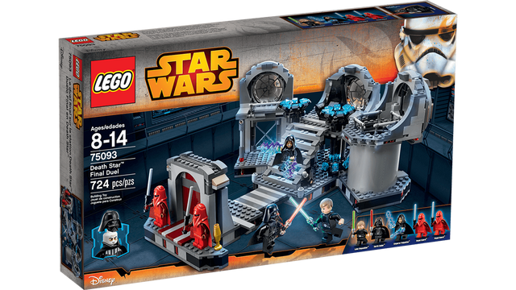](https://www.freelug.org/IMG/png/LEGO_75093_box1_1224x688.png)

* * *

[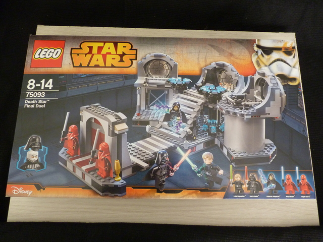](https://www.freelug.org/IMG/jpg/P1040396.jpg)

La boîte nous présente un visuel pré-Episode VII avec la présence en haut à droite d’une tête de _Stormtrooper_™ et mettant en scène l’épique combat final de l’Episode VI. Un petit encart en bas à gauche vient nous spécifier que sous son casque, la minifigurine de _Dark Vador_™ possède son visage abîmé de la fin de la trilogie originale pour ceux qui voudraient rejouer l’émouvante scène du « Pour une fois, laisse-moi te regarder avec mes propres yeux ».

[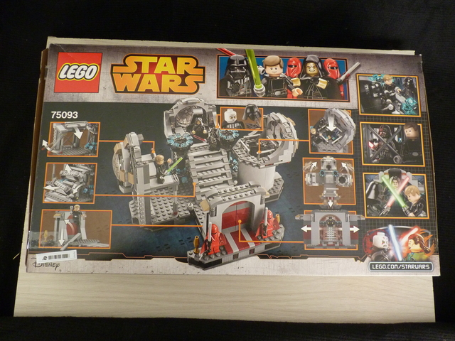](https://www.freelug.org/IMG/jpg/P1040397.jpg)

Au dos de la boîte, une image générale du set avec des ramifications pour nous présenter les subtilités de la construction (mécanismes, détails et scénettes).

* * *

[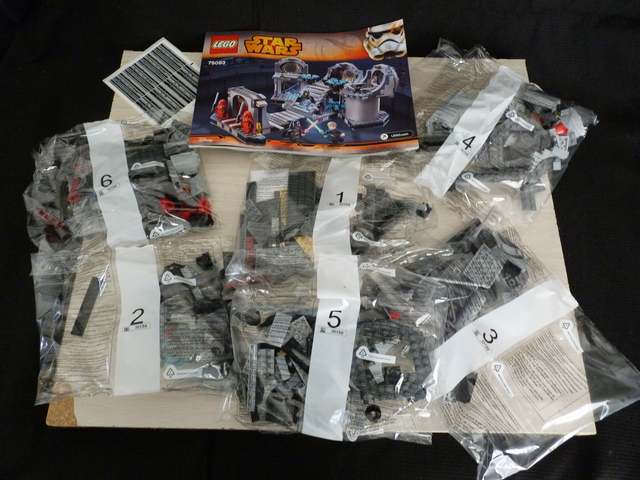](https://www.freelug.org/IMG/jpg/P1040398.jpg)

En ouvrant la boîte, on trouve six sachets, un livret de notice et une petite planche d’autocollants.

Passons maintenant aux minifigurines. Un des deux membres de la [Garde Royale](http://brickset.com/minifigs/sw521/Royal-Guard-with-Dark-Red-Arms-and-Hands) tout d’abord, rien d’extraordinaire.

[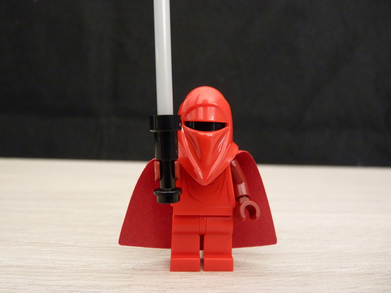](https://www.freelug.org/IMG/jpg/P1040442.jpg)

[Luke](http://brickset.com/minifigs/sw635/Luke-Skywalker-%28Jedi-Master%29) dans son accoutrement noir. J’ai beaucoup apprécié les détails sur le visage avec la petite fossette au menton et la cicatrice ainsi que le torse (notamment au dos avec la petite pochette).

[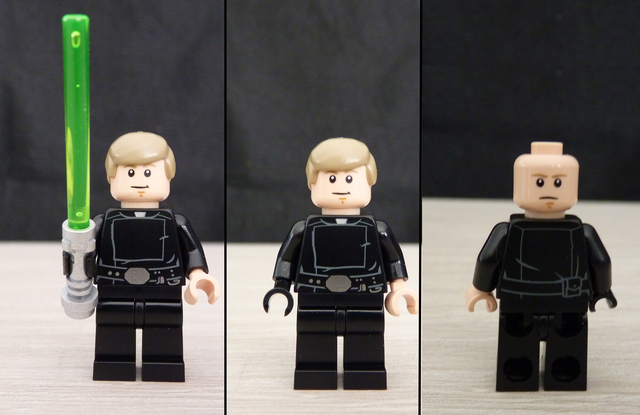](https://www.freelug.org/IMG/jpg/Luke.jpg)

[L’empereur Palpatine](http://brickset.com/minifigs/sw634/Emperor-Palpatine), qui (comme Luke et Dark Vador™) diffère de l’exemplaire présent dans le set de **l’Étoile Noire** (10188). Deux visages également, tous les deux bien détaillés.

[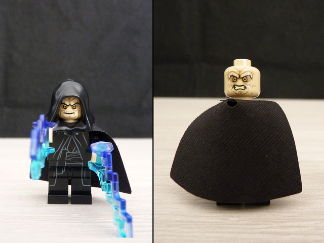](https://www.freelug.org/IMG/jpg/Empereur.jpg)

Et enfin, l’emblématique [Dark Vador](http://brickset.com/minifigs/sw636/Darth-Vader-%28Type-2-Helmet%29)™ pour lequel j’ai beaucoup apprécié le design se rapprochant à merveille du film : on retrouve un casque en deux parties (tour de cou + casque amovible) et un visage détaillé recto-verso reproduisant à merveille le Anakin Skywalker alors incarné par Sebastian Shaw. A noter également les détails sur le torse.

[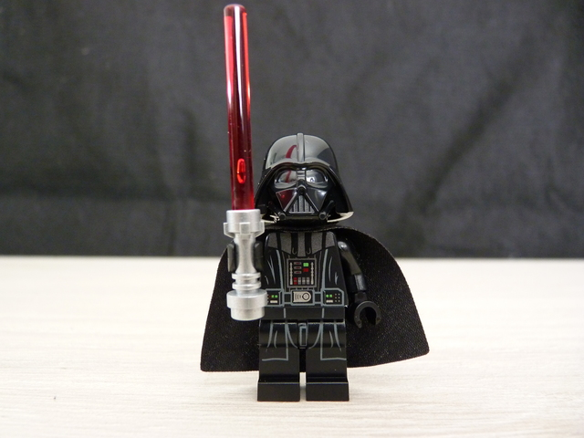](https://www.freelug.org/IMG/jpg/P1040411.jpg)

[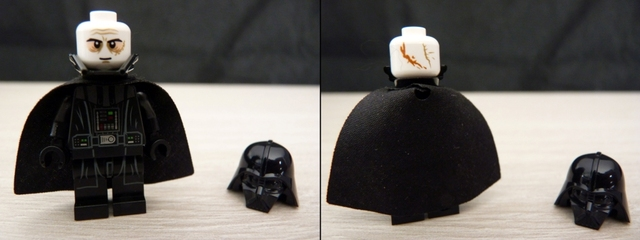](https://www.freelug.org/IMG/jpg/DV2.jpg)

* * *

Et c’est parti pour le montage, aidé par C3-PO et R2-D2.

[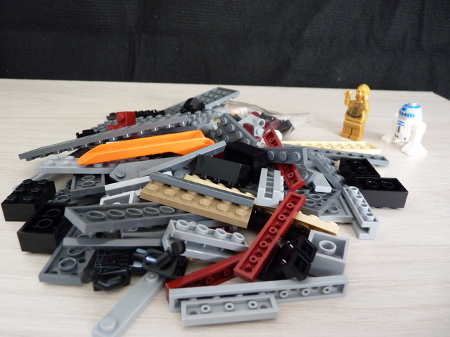](https://www.freelug.org/IMG/jpg/P1040401.jpg)

Le sachet 1 contient les pièces nécessaires à la construction de la structure de base avec sa passerelle coulissante. Rien de bien particulier mais j’ai bien aimé « l’entre deux plaques » avec ses différentes formes et couleurs pour déjà donner un peu de vie.

[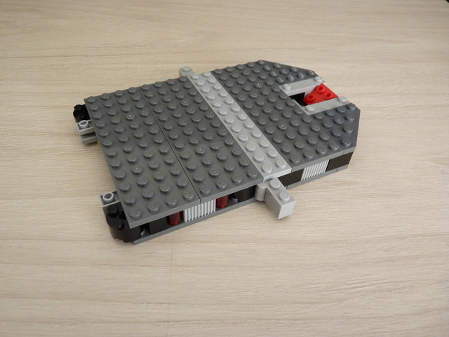](https://www.freelug.org/IMG/jpg/P1040419.jpg)

[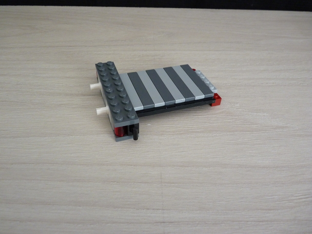](https://www.freelug.org/IMG/jpg/P1040420.jpg)

[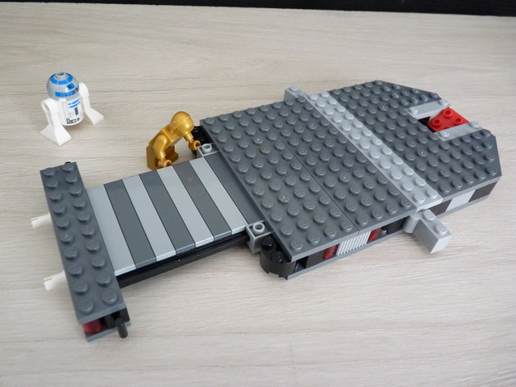](https://www.freelug.org/IMG/jpg/P1040421.jpg)

[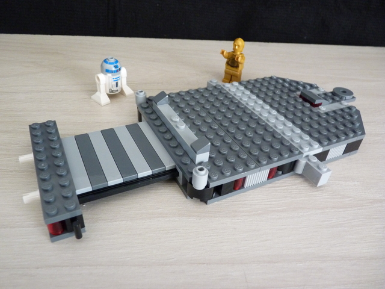](https://www.freelug.org/IMG/jpg/P1040423.jpg)

Le sachet 2 nous permet de commencer à nous élever vers la plateforme.

[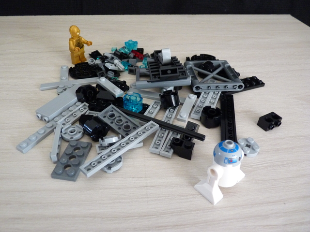](https://www.freelug.org/IMG/jpg/P1040425.jpg)

A noter la mise en place d’un premier mécanisme dont C3-PO nous fait la démonstration : un petit levier permet de « casser » une partie de la structure des escaliers.

[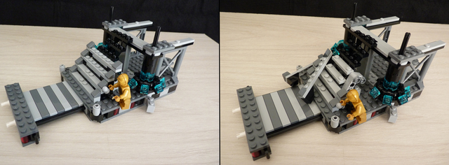](https://www.freelug.org/IMG/jpg/Escaliers.jpg)

[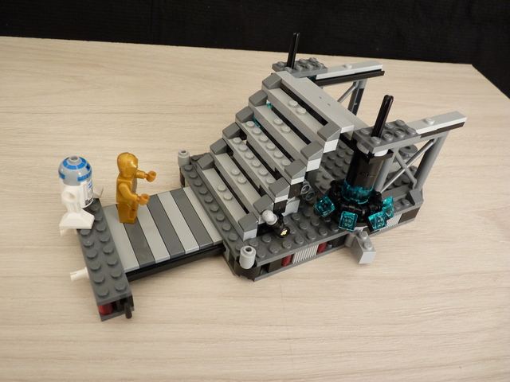](https://www.freelug.org/IMG/jpg/P1040430.jpg)

La première tour voit son apparition grâce au contenu du troisième sachet.

[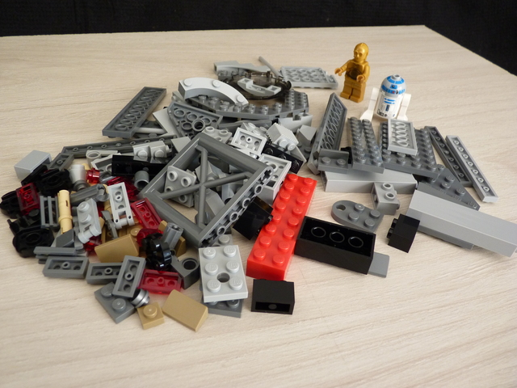](https://www.freelug.org/IMG/jpg/P1040432.jpg)

Celle-ci est raccordée en cours de parcours à la base, comme nous le montre à nouveau le droïde doré.

[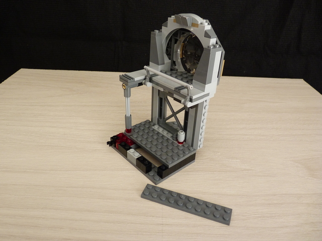](https://www.freelug.org/IMG/jpg/P1040433.jpg)

[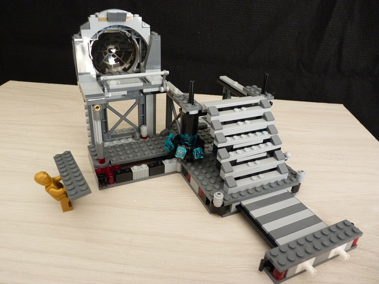](https://www.freelug.org/IMG/jpg/P1040435.jpg)

[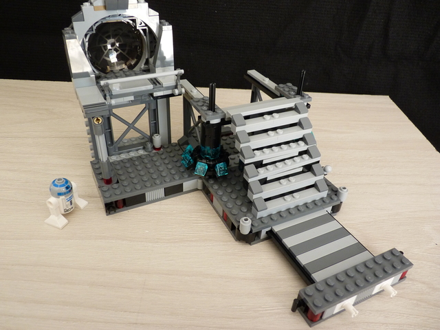](https://www.freelug.org/IMG/jpg/P1040436.jpg)

Dark Vador™ nous montre également comment il peut casser le pylône soutenant la petite plateforme où est censé se trouver Luke.

[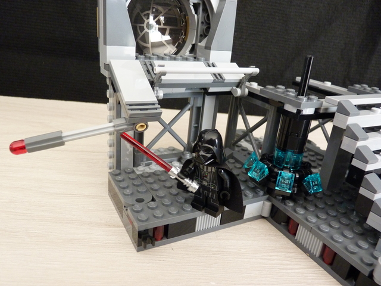](https://www.freelug.org/IMG/jpg/P1040437.jpg)

Le sachet 4 va nous permettre de monter la deuxième tour et d’utiliser les autocollants pour représenter l’intérieur du conduit où finira l’Empereur Palpatine.

[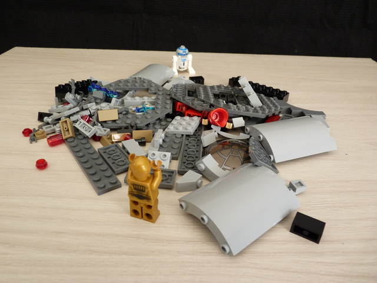](https://www.freelug.org/IMG/jpg/P1040439.jpg)

[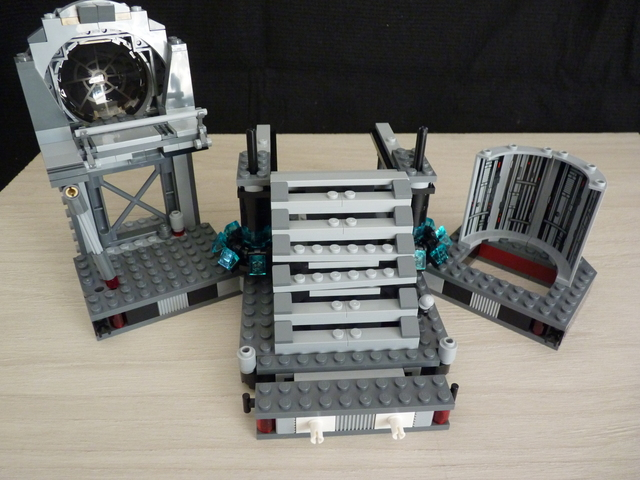](https://www.freelug.org/IMG/jpg/P1040444.jpg)

[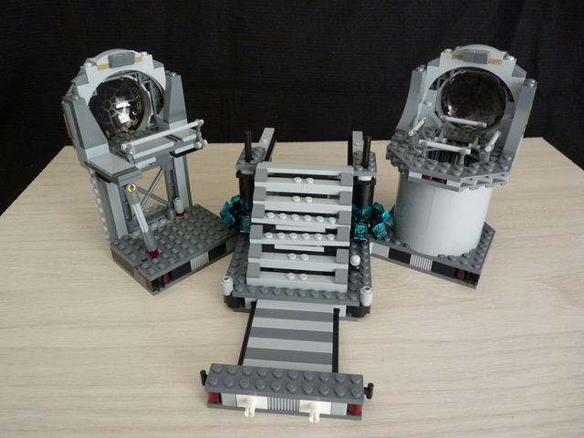](https://www.freelug.org/IMG/jpg/P1040445.jpg)

Le cinquième sachet contient le reste de la tour principale avec notamment le siège de l’Empereur.

[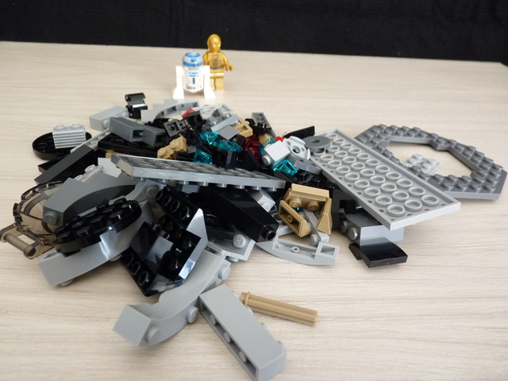](https://www.freelug.org/IMG/jpg/P1040447.jpg)

Un des petits mécanismes de plus nous permet de faire jaillir le sabre de Dark Vador™ du sol. Pour ceux qui se poseraient la question, le mécanisme ne fait que jaillir le sabre, il ne va pas directement dans la main de la minifigurine !

[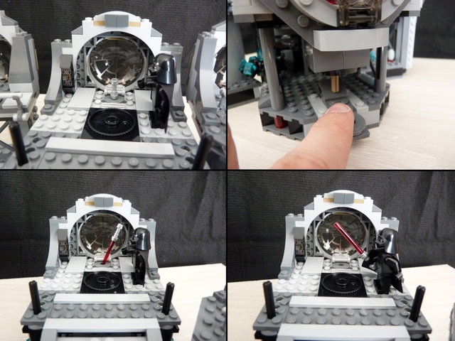](https://www.freelug.org/IMG/jpg/Sabre2.jpg)

[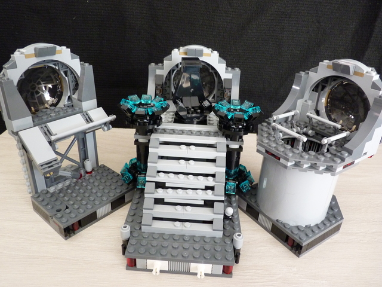](https://www.freelug.org/IMG/jpg/P1040455.jpg)

[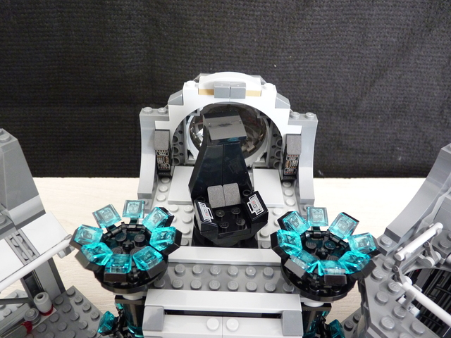](https://www.freelug.org/IMG/jpg/P1040456.jpg)

Enfin, le dernier sachet nous amène à clôturer à la fois la salle de l’Empereur et le set avec la porte d’entrée gardée par les deux membres de la Garde Royale.

[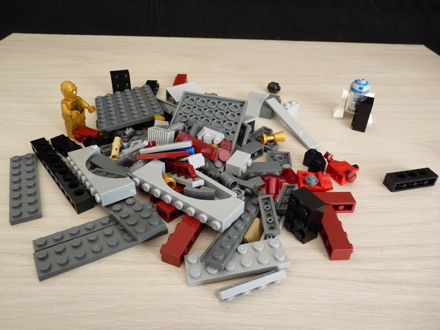](https://www.freelug.org/IMG/jpg/P1040458.jpg)

Deux petits mécanismes ici : un petit tremplin pour envoyer Luke dans les airs et les portes coulissantes.

[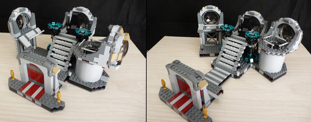](https://www.freelug.org/IMG/jpg/Fin.jpg)

Voilà le set fini et en action.

[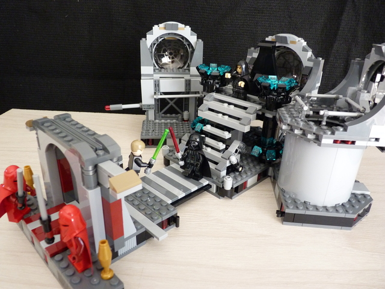](https://www.freelug.org/IMG/jpg/P1040462.jpg)

[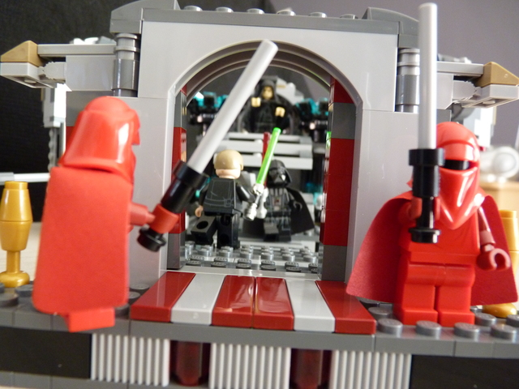](https://www.freelug.org/IMG/jpg/P1040463.jpg)

En fin de construction, quelques petites pièces en rab.

[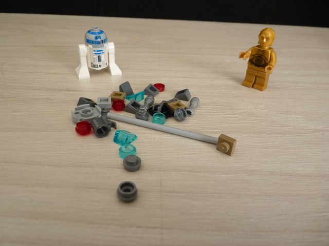](https://www.freelug.org/IMG/jpg/P1040464.jpg)

* * *

En conclusion, pour avoir acheté et monté il n’y a pas si longtemps le set de l’_Étoile Noire_, je suis vraiment content de ne pas avoir l’impression de juste remonter le même décor en plus grand mais de vraiment construire une scénette à part entière. De plus, grâce aux minifigurines plus détaillées pour l’occasion, je suis enchanté de mon achat. Tous les petits mécanismes rendent le set plus vivant et permettent de s’amuser à rejouer la fin de la deuxième trilogie.  
Non, vraiment, pas mécontent du tout de cet achat !

Merci de m’avoir lu et à bientôt !

[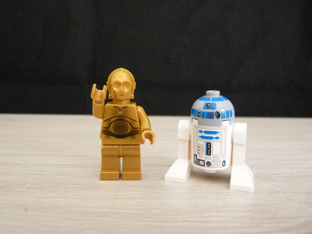](https://www.freelug.org/IMG/jpg/P1040465.jpg)
