Aujourd’hui je vous propose la review du set 75139 dans la gamme _Star Wars_ : **Battle of Takodana**.  
Ce set sorti en 2016 au prix de 59,99 € est composé de 409 pièces, soit un ratio prix/pièce de 15 centimes d’euros.

[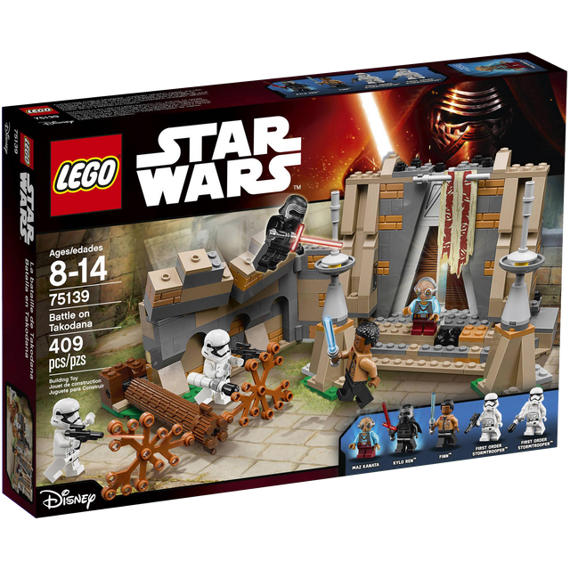](https://www.freelug.org/IMG/png/BattleOfTakodana_box.png)

* * *

Le visuel de la boite reprend une image du film original en fond. Le bandeau du haut est constitué des logos _LEGO_ et _Star Wars_ et du masque de _Kylo Ren_.  
La porte du repaire de _Maz Kanata_ est mise en scène dans un décor de la planète _Takonada_.

[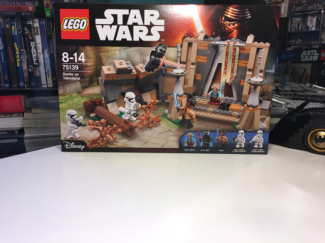](https://www.freelug.org/IMG/jpg/BattleOfTakodana_01.jpg)

Au verso, comme pour toutes les boites 2016, plusieurs vignettes avec les éléments de jouabilités du set, une photo des armes ainsi qu’un simili plan sur console "vidéo".

[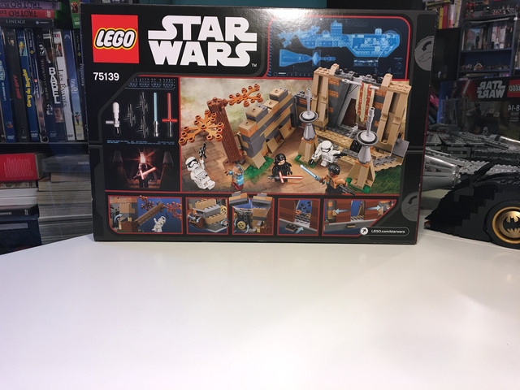](https://www.freelug.org/IMG/jpg/BattleOfTakodana_02.jpg)

La boite contient trois sachets numérotés, une notice de construction ainsi qu’une petite planche de stickers (on va pas se plaindre).  
**NB :** Le set ne comprend normalement qu’une planche de stickers, ma boite en contenait deux.

[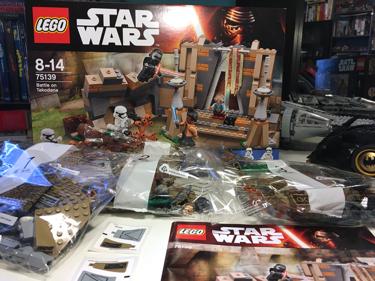](https://www.freelug.org/IMG/jpg/BattleOfTakodana_03.jpg)

Les stickers en gros plan.

[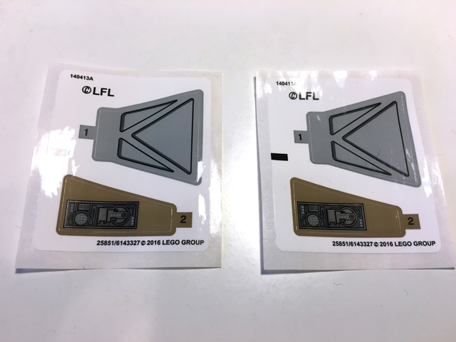](https://www.freelug.org/IMG/jpg/BattleOfTakodana_04.jpg)

* * *

Personnage énigmatique de l’épisode 7, _[Maz Kanata](http://brickset.com/minifigs/sw703/Maz-Kanata-\(75139\))_ est une vieille amie de _Han Solo_, sa figurine _LEGO_ est une réussite. Tant au niveau du torso qu’au niveau de la tête ou des sérigraphies, cette fig **exclusive** est un gros coup de cœur.

[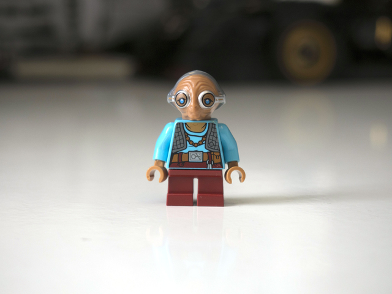](https://www.freelug.org/IMG/jpg/BattleOfTakodana_05.jpg)

Le dos est lui aussi réussi. Pas de visage alternatif, mais la tête moulée est superbe au recto comme au verso.

[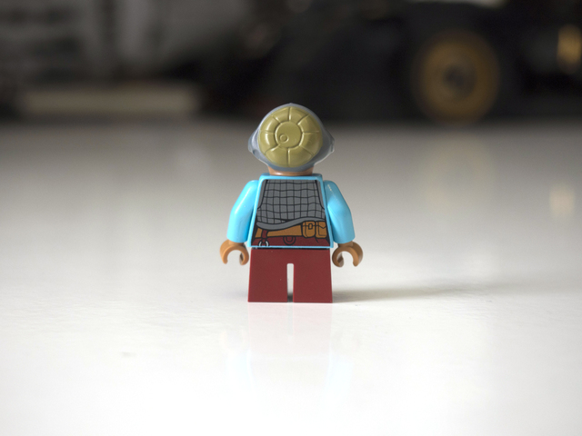](https://www.freelug.org/IMG/jpg/BattleOfTakodana_06.jpg)

On retrouve la même fig de _[Finn](http://brickset.com/minifigs/sw676/Finn)_ que dans le _[Millennium Falcon (75105)](http://www.geeksarea.net/review-lego-75105-millennium-falcon-star-wars_4110)_, sérigraphie sympa et bien réalisée. Toujours ce petit espace entre les cheveux et le front qui donne un air bizarre à la figurine.

[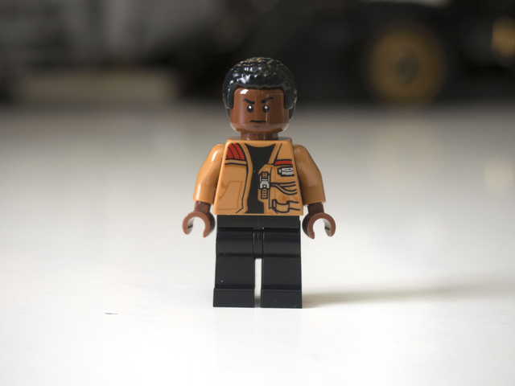](https://www.freelug.org/IMG/jpg/BattleOfTakodana_07.jpg)

Au dos, les plis de la veste sont bien retranscrits. Le visage alternatif avec un air... Dubitatif ?!

[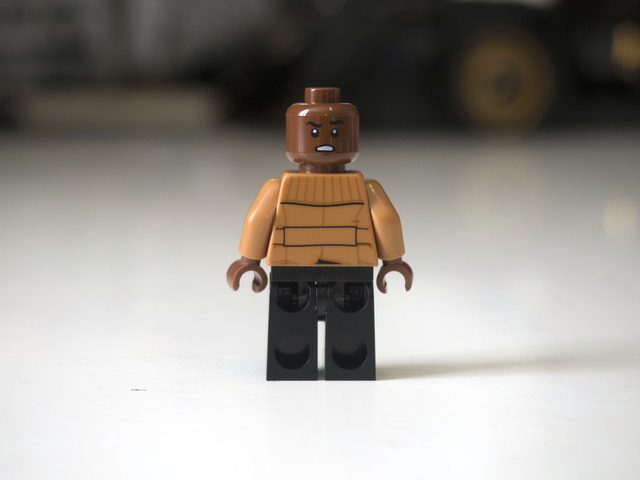](https://www.freelug.org/IMG/jpg/BattleOfTakodana_08.jpg)

Grand méchant de _The Force Awaken_, voici _[Kylo Ren](http://brickset.com/minifigs/sw717/Kylo-Ren-\(75139\))_. Ici avec son casque, qui malheureusement lui fait une tête démesurée. En dehors de ça, cette minifig est plutôt bien réussie même si les sérigraphies ne sont pas transcendantes.  
Notez quand même que cette fig est elle aussi exclusive à ce set.

[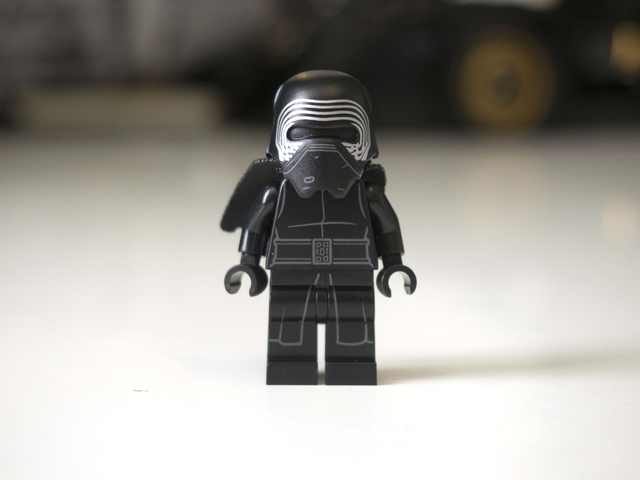](https://www.freelug.org/IMG/jpg/BattleOfTakodana_09.jpg)

_Ben Solo_/_Kylo Ren_ sans son masque, visage de bad guy vraiment réussi (il fait plus peur que l’acteur, c’est dire). Avec ces cheveux il prend un petit air de [_Snape_/_Rogue_](http://brickset.com/minifigs/hp100/Professor-Snape-Light-Flesh-Head-Brown-Facial-Lines) dans _Harry Potter_.

[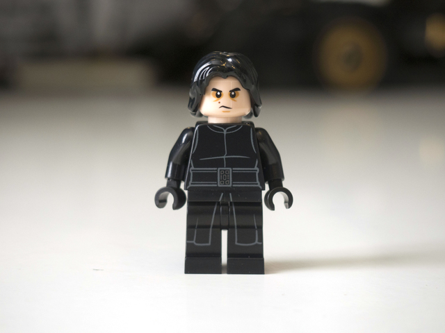](https://www.freelug.org/IMG/jpg/BattleOfTakodana_10.jpg)

De dos, la sérigraphie apporte du réalisme mais sans plus, par contre le visage alternatif énervé est vraiment superbe.

[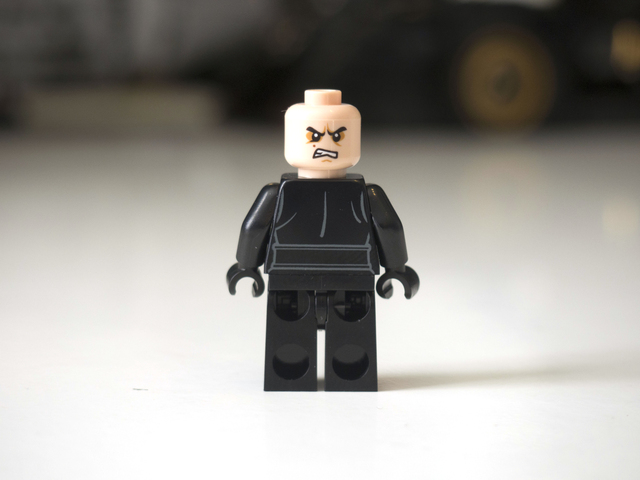](https://www.freelug.org/IMG/jpg/BattleOfTakodana_11.jpg)

Rien de nouveau pour les _[First Order Stormtrooper](http://brickset.com/minifigs/sw667/First-Order-Stormtrooper)_, minifig déjà présente dans deux autres sets. Même si le casque et les détails des sérigraphies sont vraiment très beaux.

[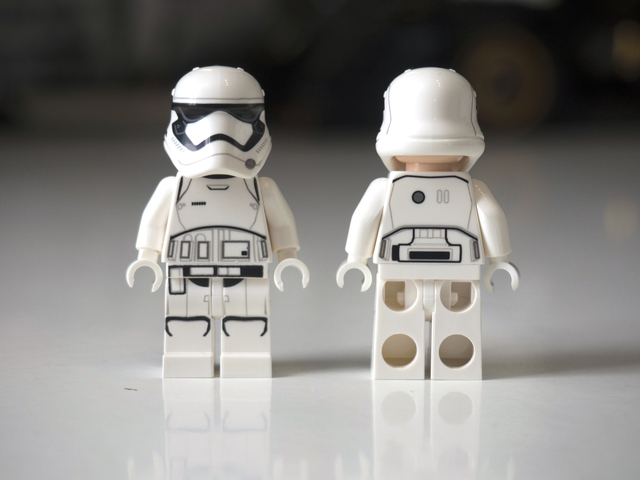](https://www.freelug.org/IMG/jpg/BattleOfTakodana_12.jpg)

Sans casque on se retrouve devant le classique visage des _Clone Trooper_. Comme je l’ai déjà dit, il serait temps que _LEGO_ fasse évoluer ce point, vu que le _First Order_ n’utilise pas de clone dans ses rangs

[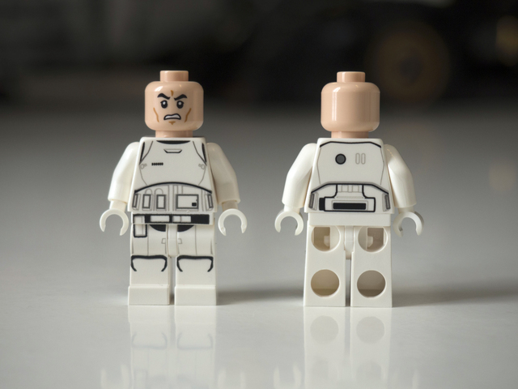](https://www.freelug.org/IMG/jpg/BattleOfTakodana_13.jpg)

* * *

On débute le sachet 1 par le socle de la porte du repaire de _Maz Kanata_ qui est constitué de marches.

[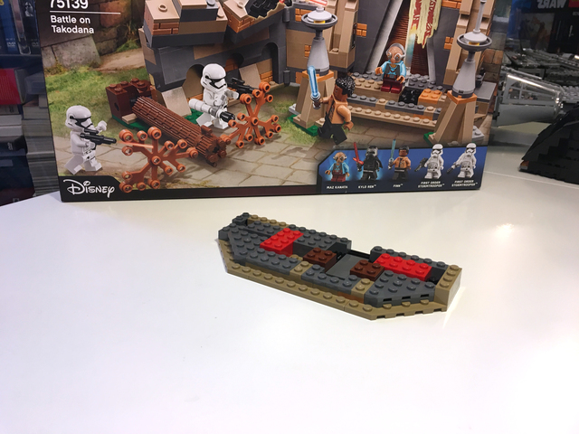](https://www.freelug.org/IMG/jpg/BattleOfTakodana_14.jpg)

A la fin du sachet 1 on se retrouve avec les marches et le bas du mur principal.  
On peut noter que le premier autocollant a été placé sur la gauche de la porte sur une brique Dark Tan.

[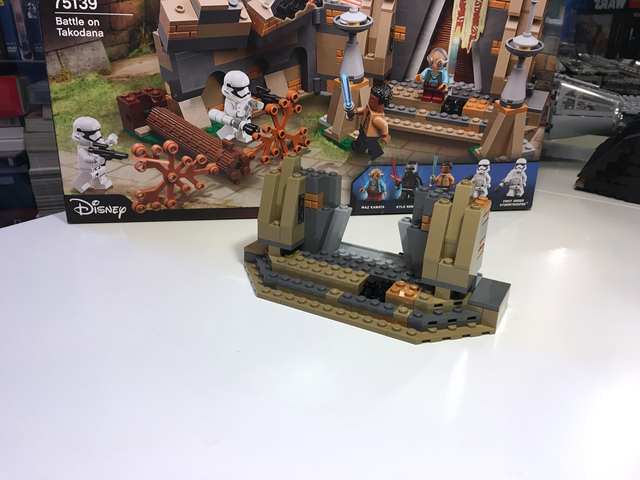](https://www.freelug.org/IMG/jpg/BattleOfTakodana_15.jpg)

On commence le sachet 2 avec la construction des "lourdes" portes.

[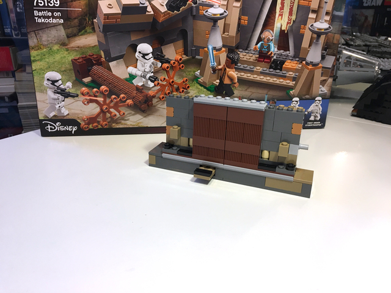](https://www.freelug.org/IMG/jpg/BattleOfTakodana_16.jpg)

L’entrée est quasiment finie, le deuxième autocollant a été placé au-dessus de la porte.

[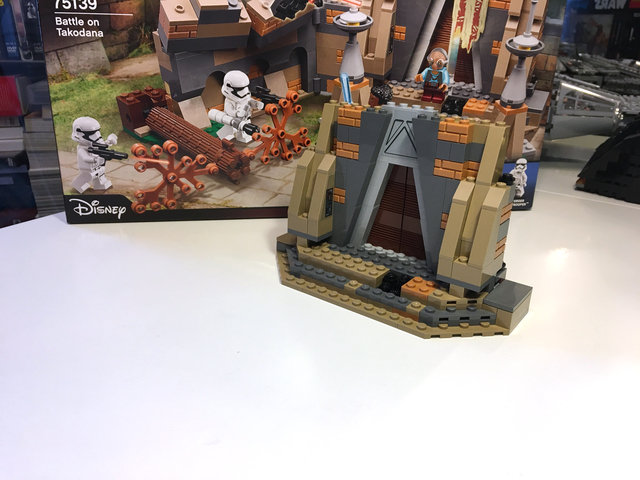](https://www.freelug.org/IMG/jpg/BattleOfTakodana_17.jpg)

Voila l’entrée finie, on s’attaque maintenant aux deux piliers qui vont venir agrémenter cette entrée.

[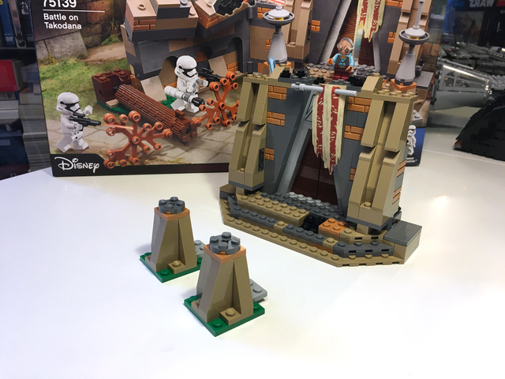](https://www.freelug.org/IMG/jpg/BattleOfTakodana_18.jpg)

Une fois fini les piliers, on commence à construire le mur d’enceinte qui est constitué de mécanisme pour plus de jouabilité.

[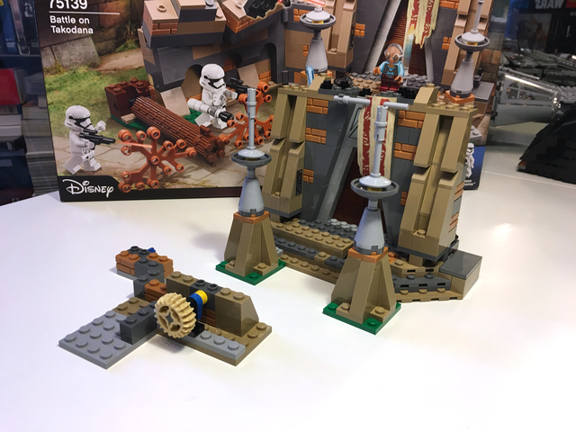](https://www.freelug.org/IMG/jpg/BattleOfTakodana_19.jpg)

Le mur prend petit à petit de la hauteur, vous pouvez voir une cache sur la droite de la construction.

[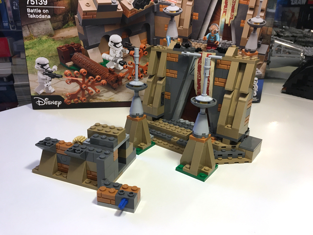](https://www.freelug.org/IMG/jpg/BattleOfTakodana_20.jpg)

Construction d’un deuxième mécanisme qui permettra de figurer un arbre qui tombe à terre.

[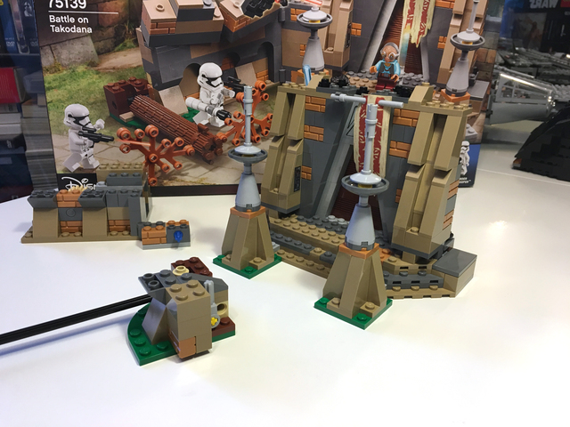](https://www.freelug.org/IMG/jpg/BattleOfTakodana_21.jpg)

Voilà le tronc fini et en position relevé.

[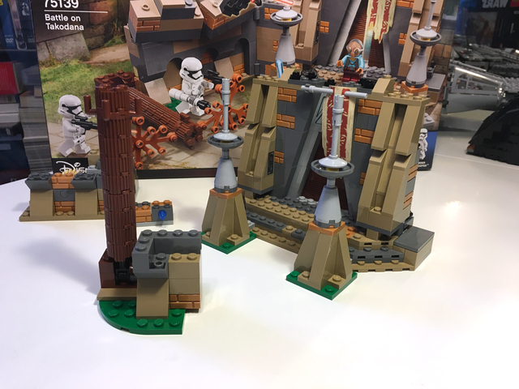](https://www.freelug.org/IMG/jpg/BattleOfTakodana_22.jpg)

On accroche le mécanisme au mur qui continue à monter.

[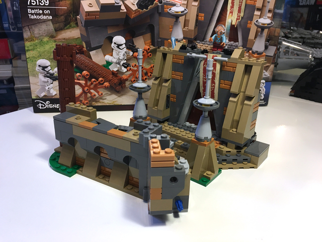](https://www.freelug.org/IMG/jpg/BattleOfTakodana_23.jpg)

On accroche maintenant le mur à la porte.

[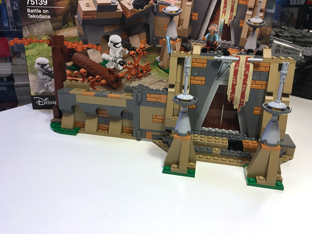](https://www.freelug.org/IMG/jpg/BattleOfTakodana_24_1.jpg)

On ajoute les pans de murs qui sont destructibles et ainsi s’achève la construction de ce set

[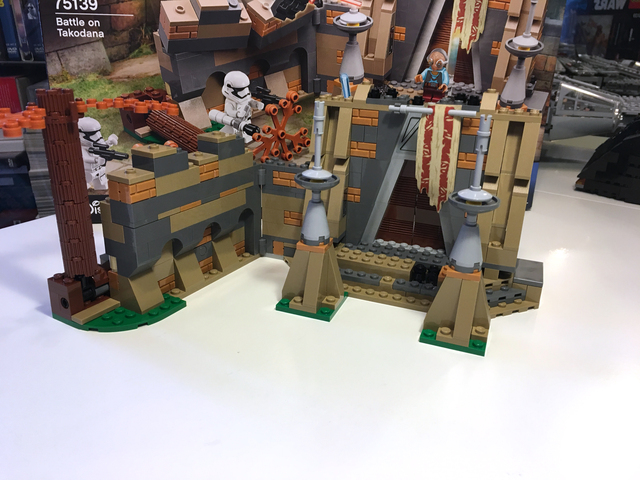](https://www.freelug.org/IMG/jpg/BattleOfTakodana_25_1.jpg)

Voilà le set mis en scène avec les minifigures.

[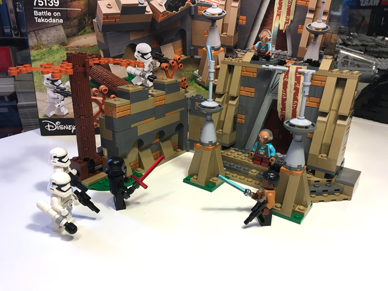](https://www.freelug.org/IMG/jpg/BattleOfTakodana_26_1.jpg)

**AVIS :**

Que dire de ce set, franchement je le trouve ridicule au vue de la scène qu’il recrée. De plus je suis loin de m’être "éclaté" à le monter. Pour tout dire, il est aujourd’hui démonté et a rejoint mon vrac. Heureusement que les figs sauvent le set de la débâcle totale.  
Au final une grosse déception.

**BONUS :**

Voici un GIF animé réalisé avec la totalité des photos prises pour cette review (cliquez sur l’image pour lancer l’animation).

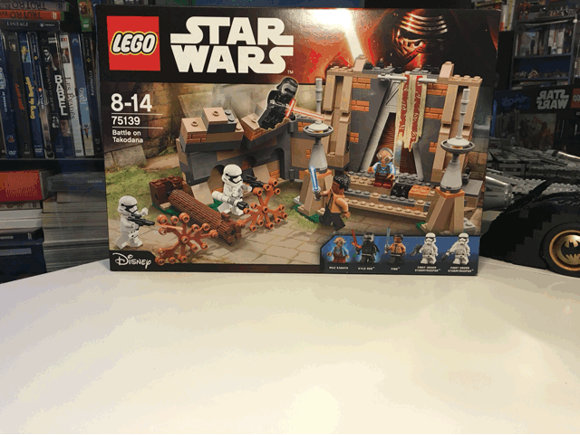
