Il y a quelques jours, j’ai craqué pour le set Cloud City, plutot que de le monter dans mon coin, j’ai voulu vous en faire profiter.

Voici la boite encore fermée :

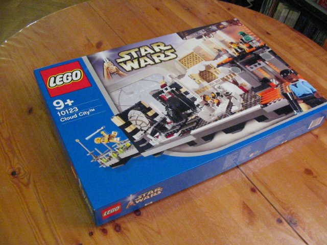

Et une fois ouverte :

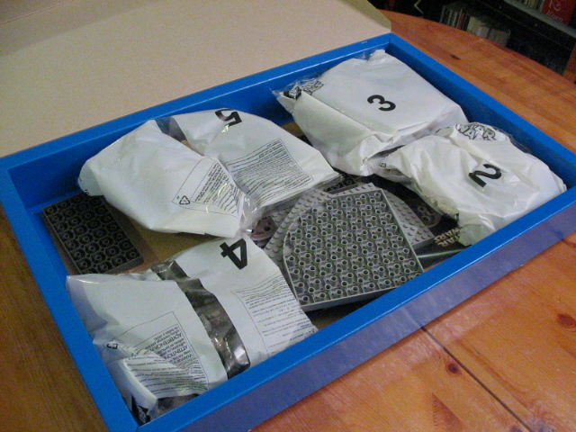

Tout de suite on remarque que les pièces sont réparties en sachets numérotés comme c’est le cas pour tous les grands sets. Cela permet de perdre moins de temps à chercher les pièces lors du montage. Mais certains diront peut-être que cela gache le plaisir :-)

On ouvre donc le premier sachet. Comme d’habitude chez Lego on commence toujours le montage par les minifigs :

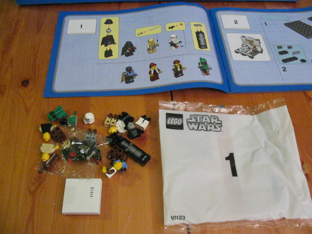

Le set comprends 7 minifigs (Dark Vador, Boba Fett, un stormtrooper, Luke Skywalker, Leia Organa, Lando Calrissian et Han Solo) + Han Solo emprisonné dans la carbonite.

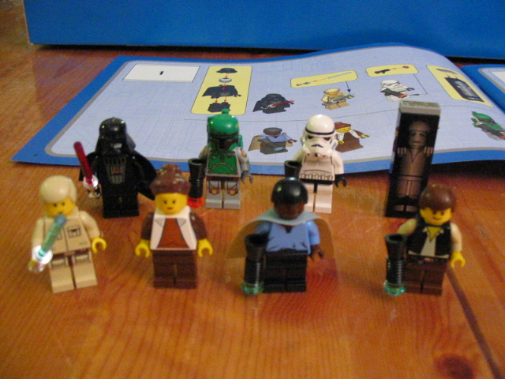

Coté minifig on doit bien sûr mentionner la présence exeptionnelle de Lando (première minifig noire produite par Lego hormi les basketteurs de NBA qui sont des minifigs modifiées). Mais aussi je remarque que la minifig de Boba Fett est différente de celle présente dans les autres sets : ses bras et ses jambes sont sérigraphiés ! J’ai fait une photo de comparaison avec un Boba Fett d’une autre boite (à gauche sur la photo ci-dessous).

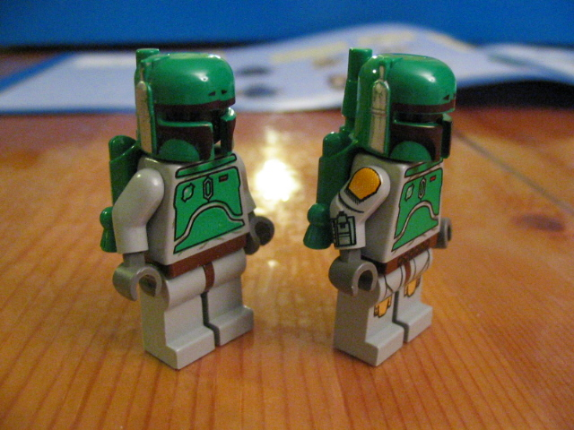

Enfin, on peut noter la nouvelle chevelure extra longue de Leia.

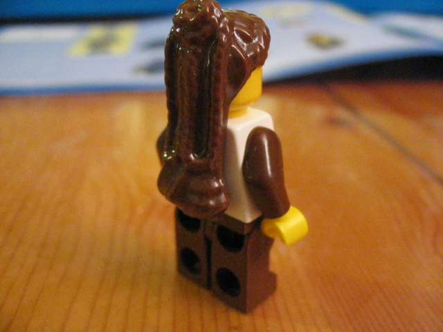

Une fois les minifigs vite montées, j’attaque le deuxième sachet :

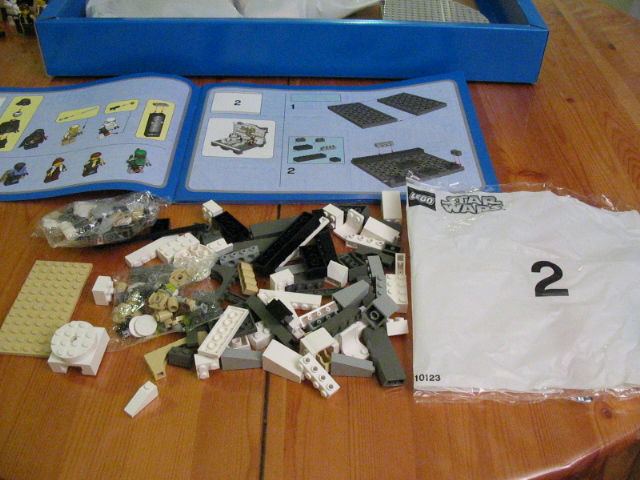

Je remarque la présence dans ce sachet d’une nouvelle pièce (du moins je pense qu’elle l’est), il s’agit d’une turntable (table tournante) blanche 4 x 4 à crans (c’est à dire qu’elle ne tourne pas librement). Vous pouvez la voir en bas à gauche sur l’image ci-dessus. Dommage que cette pièce n’ait pas le même socle que les turntables classiques, mais un socle de 1,33 brique de haut, ce qui ne facilitera pas son intégration dans un MOC.

Et voici le premier module monté avec les pièces en rab à coté :

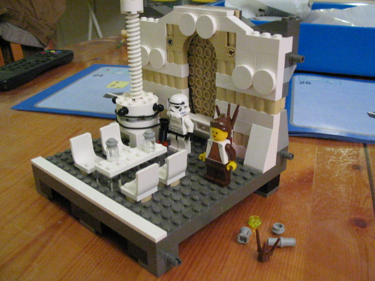

La partie mobile de ce module est la porte qui peut s’ouvrir et rester ouverte grace à la turntable crantée.

J’enchaîne avec la troisième partie qui contient beaucoup de gris et de orange transparent (notament 4 briques 4 x 1 orange transparente vide à l’intérieur) :

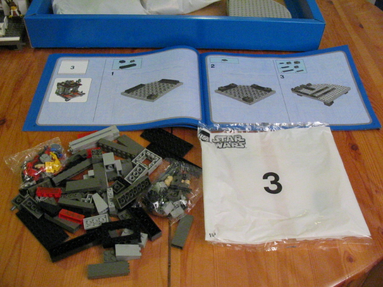

Remarquez la brique grise 2 x 2 x 8 en haut à gauche qui me semble un peu incongrue. Ils auraient pu s’en sortir avec des briques 2 x 2 toutes simples, voir du 1 x 2 x 5. Elle sert de colone de guidage pour la plateforme. Car effectivement du coté des choses qui bougent dans ce module, il faut noter l’astucieux système du puits de carbonisation. La plateforme sur laquelle se trouve Han peut monter et descendre, une fois en bas, on peut intervertir la minifig avec le bloc de carbonite et remonter la plateforme.

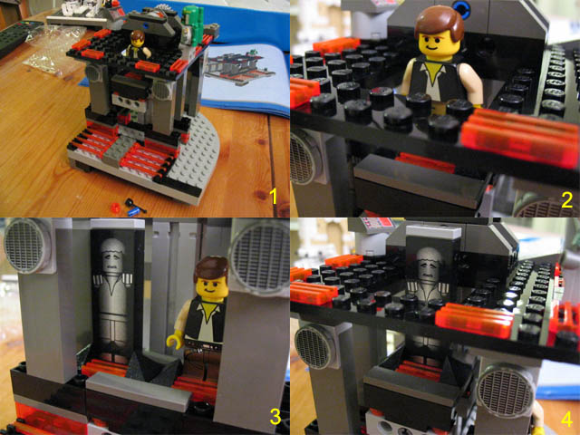

On est maintenant à la moitié du montage, il ne reste plus que deux sachets. J’attaque donc le quatrième :

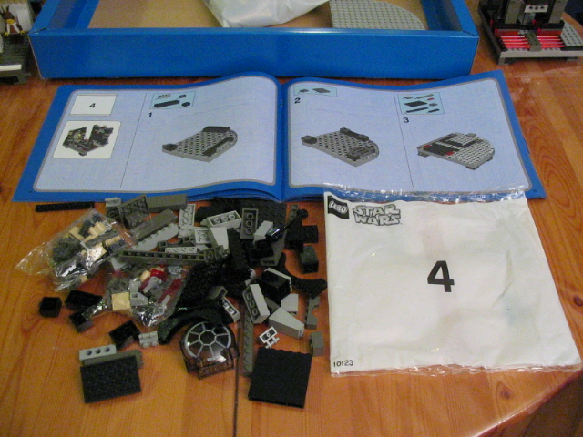

Je n’ai rien remarqué de spécial concernant ce module, à part les tiles grilles 1 x 2 en rouge transparentes qui sont assez cool, mais qui rappellent de trop loin le décor légérement rougeoyant du film.

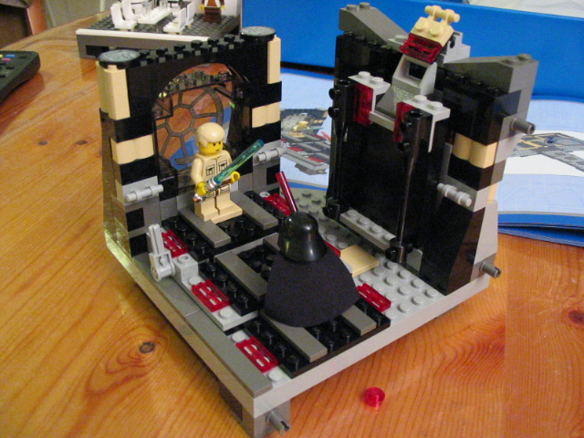

Par contre dans ce module il y a deux truc qui bougent : la verrière qui peut basculer et faire passer Luke à travers, et le mur du fond qui peut s’incliner. Bof pas de quoi s’éterniser, passons plutot au dernier module. Ah tiens, à ce propos, ils se sont trompé sur la notice, ils ont indiqué le numéro de sachet 4 alors qu’il s’agit du 5 (Tsss... c’est pas sérieux ça) :

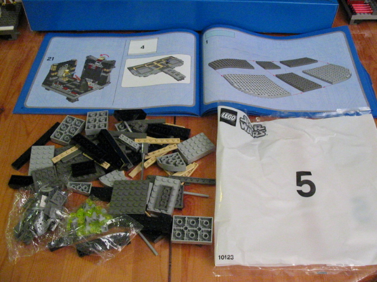

C’est un sachet tout particulièrement recommandé pour ceux qui aiment les tiles 1x6 et 1x8. Je soupçonne les designers du set d’avoir ajouté ces tiles pour consolider l’assemblage de la plateforme d’atterrissage, mais à mon avis ils auraient pu se contenter d’un assemblage par le dessous.

Et voici le module assemblé, avec ses pièces en rab :

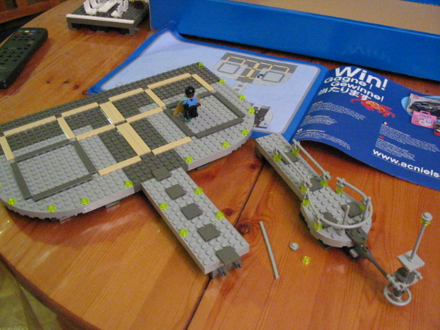

J’avoue que c’est le module que je préfère, notament à cause de l’antenne que je trouve superbement faite.

Et voici le set au complet :

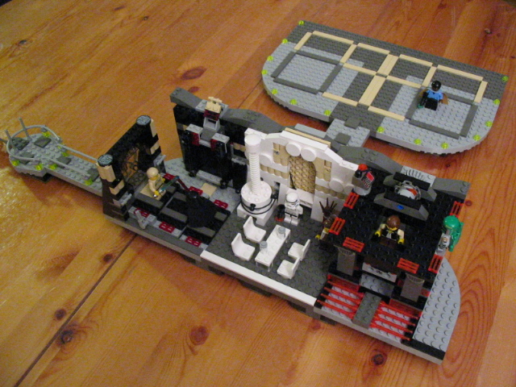

**En conclusion :**  
C’est un set assez plaisant à monter, et les minifigs sont vraiment sympa. Néanmoins il n’y a finalement pas beaucoup de pièces. D’autre part, en tant que MOCueur starwars, je suis bien évidement exigent quant à la fidélité des décors, et je trouve que ce set est un peu léger de ce point de vue là...
