Bonjour à tous, aujourd’hui je vous propose la review du set 7784 dans la gamme _DC Comics_ : _The Batmobile : Ultimate Collectors’ Edition_.  
Ce set sorti en 2006 (oui, il y a dix ans) est composé de 1045 pièces et coûtait environ 80 euros à l’époque, soit un ratio prix/pièce de 8 centimes d’euros.

[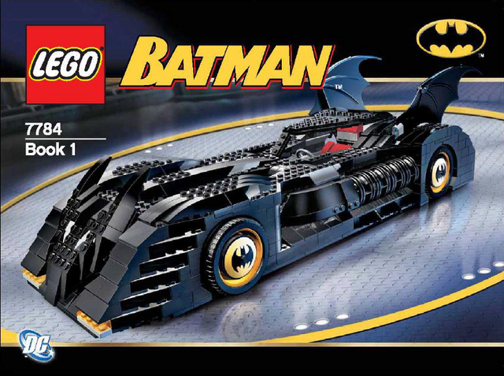](https://www.freelug.org/IMG/png/batmobile7784_box.png)

* * *

Une fois n’est pas coutume je ne vous présenterai pas le contenu de la boite, ce set ne se trouve quasiment que d’occasion, sans boite : il m’a été impossible de prendre en photo les sachets contenus dans ce set.

Une fois démonté l’exemplaire qu’un ami m’a offert pour mes 40 ans, je me retrouve avec un paquet de boites et de sachets remplis de briques noires.

[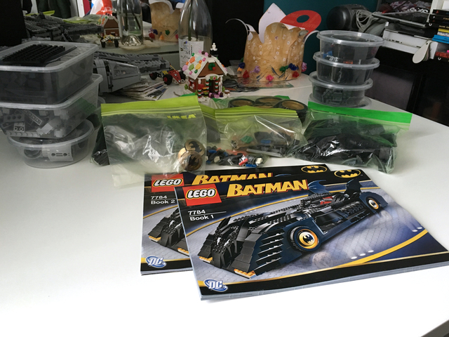](https://www.freelug.org/IMG/jpg/batmobile7784_01.jpg)

On commence la construction par le châssis de la _Batmobile_.

[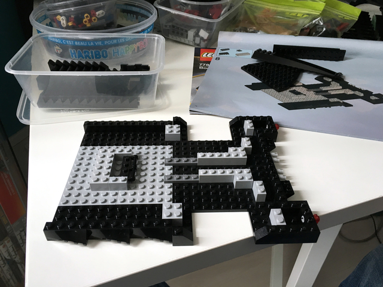](https://www.freelug.org/IMG/jpg/batmobile7784_02.jpg)

La base du châssis est terminée.

[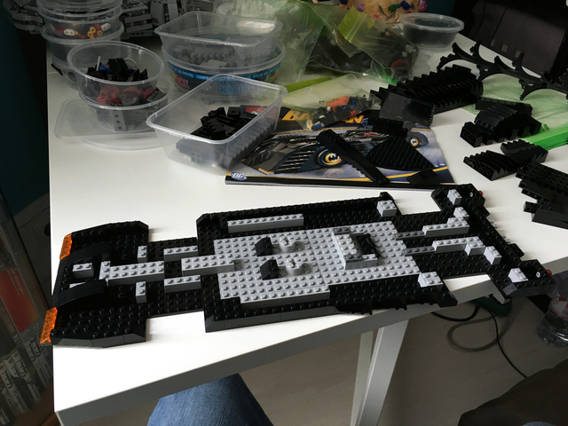](https://www.freelug.org/IMG/jpg/batmobile7784_03.jpg)

La construction avance doucement mais sûrement.

[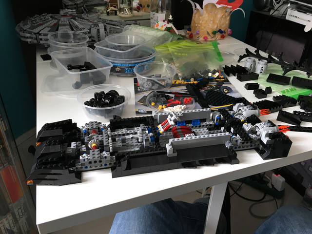](https://www.freelug.org/IMG/jpg/batmobile7784_04.jpg)

Voilà où nous en sommes à la fin du premier livret d’instruction.

[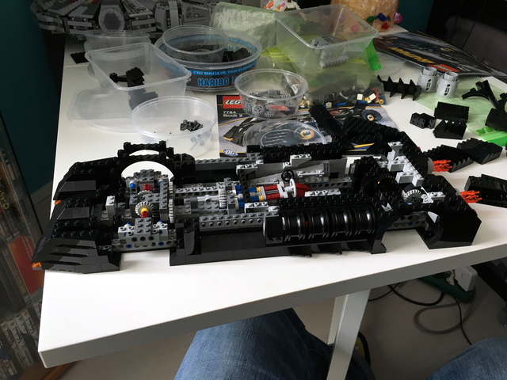](https://www.freelug.org/IMG/jpg/batmobile7784_05.jpg)

Au milieu du livret deux.

[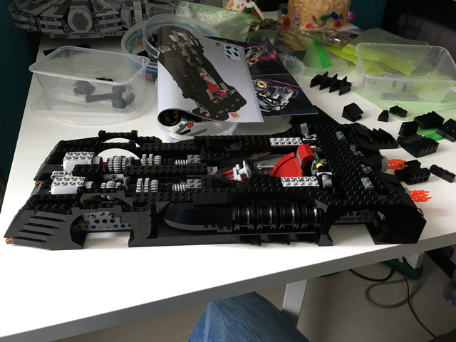](https://www.freelug.org/IMG/jpg/batmobile7784_06.jpg)

* * *

Voilà le résultat final, une _Batmobile_ au rendu proche de celle du film de _Tim Burton_.

[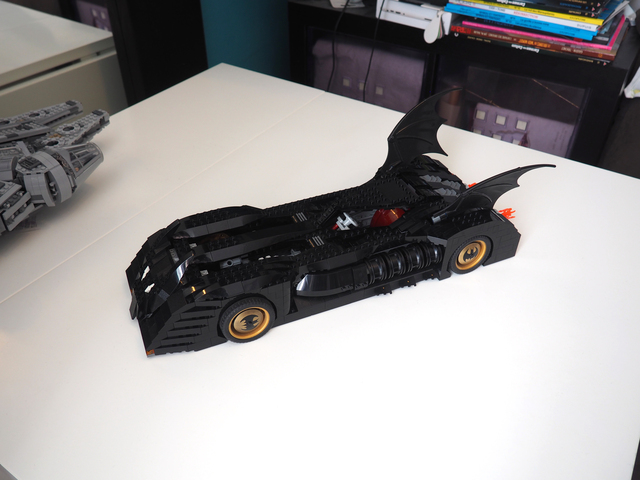](https://www.freelug.org/IMG/jpg/batmobile7784_07.jpg)

[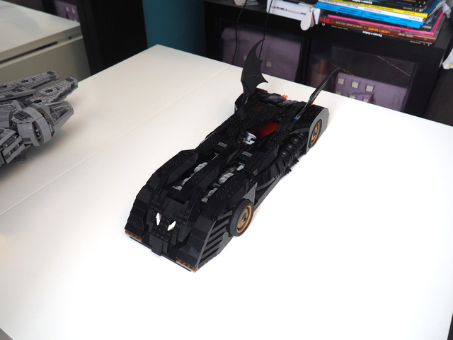](https://www.freelug.org/IMG/jpg/batmobile7784_08.jpg)

[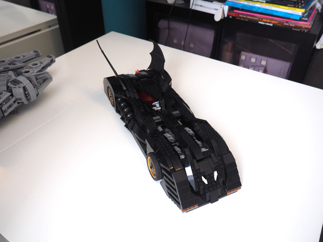](https://www.freelug.org/IMG/jpg/batmobile7784_09.jpg)

[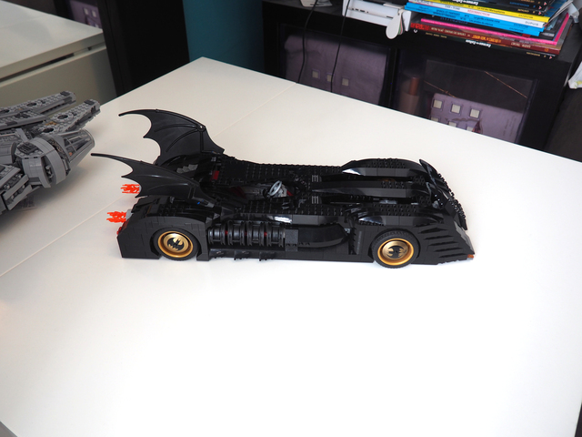](https://www.freelug.org/IMG/jpg/batmobile7784_10.jpg)

[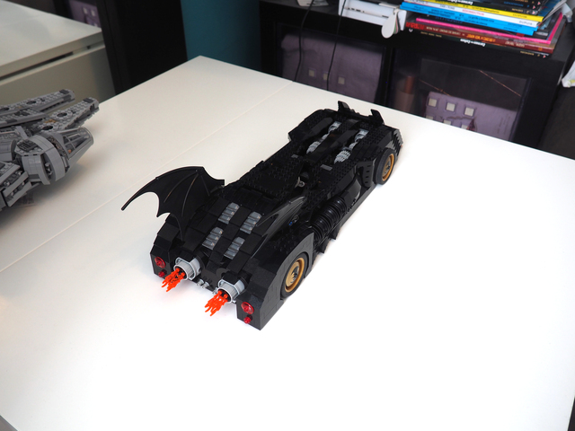](https://www.freelug.org/IMG/jpg/batmobile7784_11.jpg)

Cockpit ouvert et calandre avant relevée laissant voir les turbines

[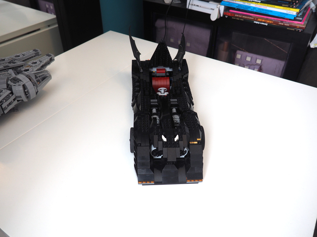](https://www.freelug.org/IMG/jpg/batmobile7784_12.jpg)

[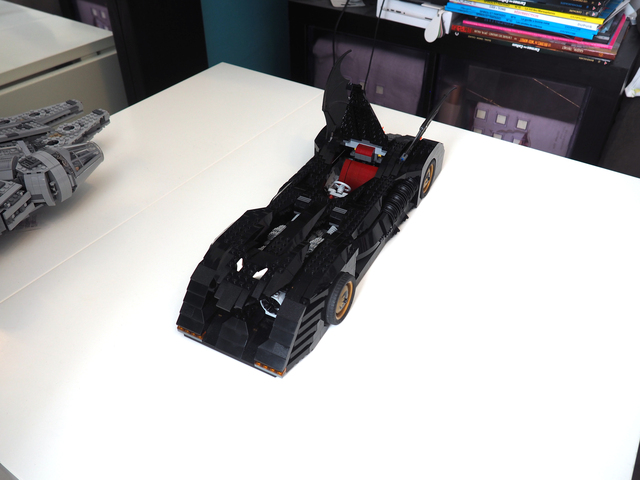](https://www.freelug.org/IMG/jpg/batmobile7784_13.jpg)

* * *

**AVIS :**

Autant vous le dire tout de suite la construction en _loose_ est "compliquée" à cause de la prolifération de pièces noires, pour autant le montage est super plaisant et on s’émerveille à chaque étape de voir "naître" cet engin sous nos mains.

Bref, cette _Batmobile_ est un set à posséder pour tout fan qui se respecte.

**BONUS :**

Deux véhicules mythiques face à face.

[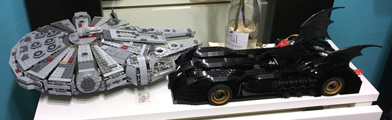](https://www.freelug.org/IMG/jpg/batmobile7784_14.jpg)
