Aujourd’hui je vous propose la review du set 70167 dans la gamme _Ultra Agents_ : **Invizable Gold Getaway**.  
Ce set sorti en 2015 au prix de 19,99 € est composé de 237 pièces, soit un ratio prix/pièce de 8 centimes d’euros.

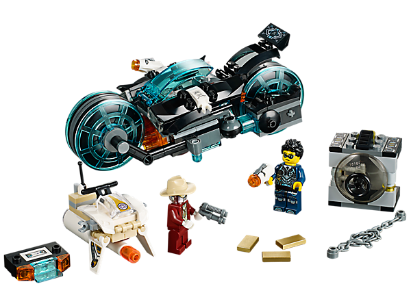

* * *

Le visuel de la boite est composé d’un bandeau composé des logos _LEGO_ et _Ultra Agents_ et d’une image représentant le face-à-face entre deux figurines _LEGO_ de la franchise.  
Les véhicules composant le set sont mis en scène dans un décor futuriste en train d’effectuer une course-poursuite. C’est simple mais efficace.

[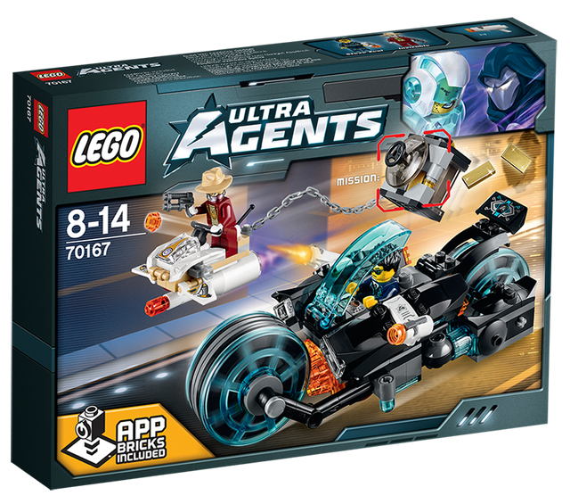](https://www.freelug.org/IMG/png/InvizableGoldGetaway_box_recto.png)

Au verso, plusieurs vignettes afin de faire voir les éléments de jouabilité ainsi qu’une publicité pour une application maison permettant de faire interagir les _App Bricks_ contenues dans la boite.

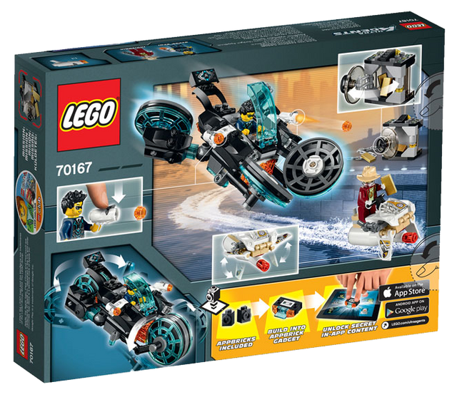

Les _App Bricks_ en gros plan (recto et verso).

[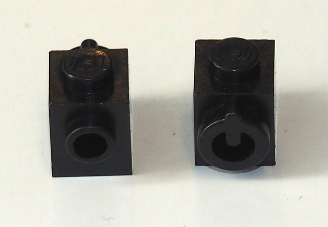](https://www.freelug.org/IMG/jpg/InvizableGoldGetaway_00.jpg)

Voici un [lien vers une courte vidéo _YouTube_ qui vous permettra de vous rendre compte du concept](https://youtu.be/3albY48WvUc).

Le set est composé de trois sachets, d’une planche de stickers et d’une notice de montage.

[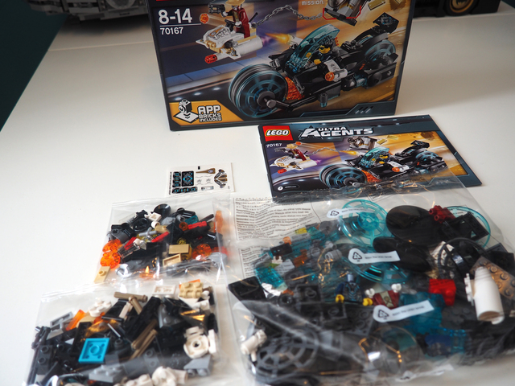](https://www.freelug.org/IMG/jpg/InvizableGoldGetaway_01.jpg)

Gros plan sur la planche de stickers composée de neuf auto-collants.

[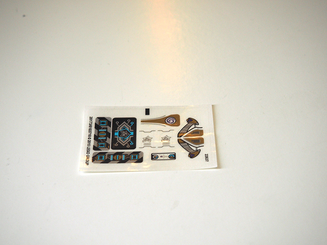](https://www.freelug.org/IMG/jpg/InvizableGoldGetaway_02_mini.jpg)

* * *

La première minifig de ce set est l’_[Agent Steve Zeal](http://brickset.com/minifigs/uagt022/Agent-Steve-Zeal)_, cette dernière comporte de belles sérigraphies qui ne sont pas sans rappeler les armures d’_Iron Man_ ou des chevaliers _Nexo Knight_.

[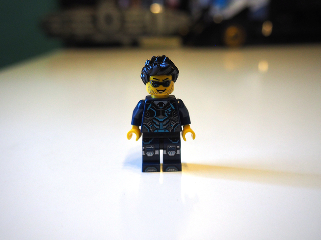](https://www.freelug.org/IMG/jpg/InvizableGoldGetaway_03.jpg)

De dos, les sérigraphies sont toujours aussi bien réalisées et nous avons même droit à un visage alternatif.

[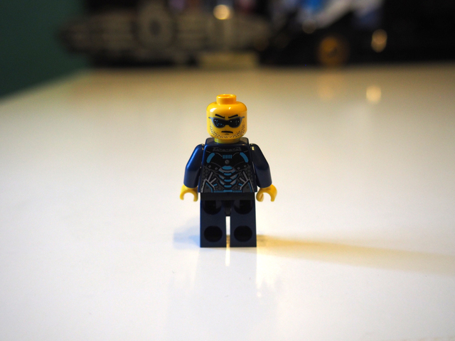](https://www.freelug.org/IMG/jpg/InvizableGoldGetaway_04.jpg)

La deuxième fig est _[Invizable](http://brickset.com/minifigs/uagt021/Invizable)_, le méchant de ce set. Agrémenté d’un chapeau ce personnage a tout du look d’un "caïd" type rappeur afro-américain. Petit plus, cette fig est exclusive à ce set.

[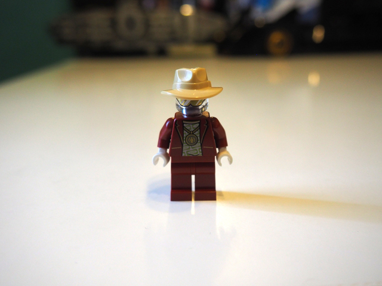](https://www.freelug.org/IMG/jpg/InvizableGoldGetaway_05.jpg)

Les sérigraphies du torso, même si elles ne sont pas transcendantes, sont joliment réalisées. Le plus de cette fig est clairement la tête transparente agrémentée de large lunettes de soleil.

[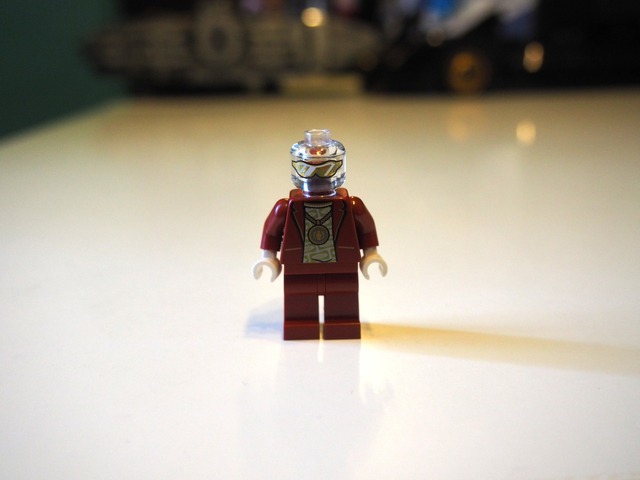](https://www.freelug.org/IMG/jpg/InvizableGoldGetaway_06.jpg)

Au verso, pas grand-chose à se mettre sous la dent à part quelques plis sur le torso.

[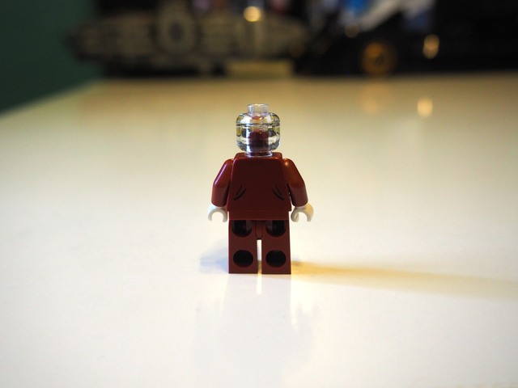](https://www.freelug.org/IMG/jpg/InvizableGoldGetaway_07.jpg)

* * *

On débute la construction par le speeder d’_Invizable_.

[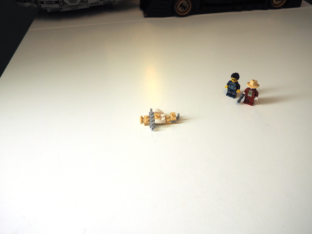](https://www.freelug.org/IMG/jpg/InvizableGoldGetaway_08.jpg)

A la moitié de la construction on a déjà collé trois stickers.

[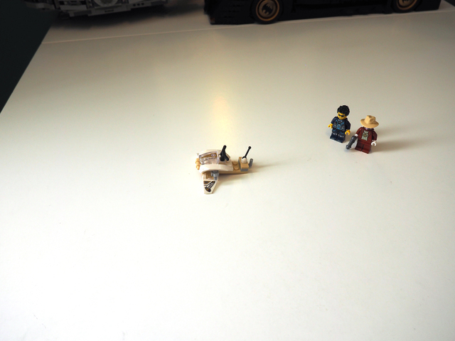](https://www.freelug.org/IMG/jpg/InvizableGoldGetaway_09.jpg)

En fait ce speeder c’est un réacteur sur lequel on a collé une selle, un guidon et deux ailes stabilisatrices Ôo

[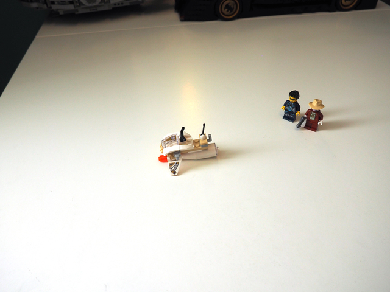](https://www.freelug.org/IMG/jpg/InvizableGoldGetaway_10.jpg)

Une fois le speeder terminé, on s’attaque au coffre-fort.

[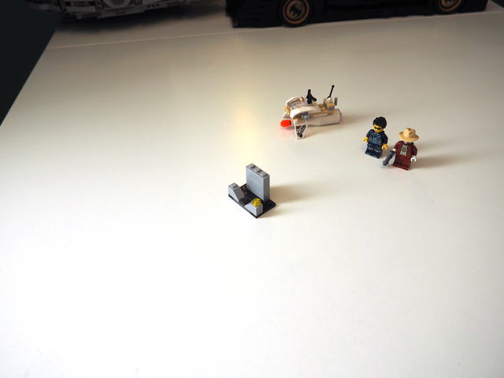](https://www.freelug.org/IMG/jpg/InvizableGoldGetaway_11.jpg)

Et hop ! Deux stickers supplémentaires, le système de la porte est plutôt ingénieux.

[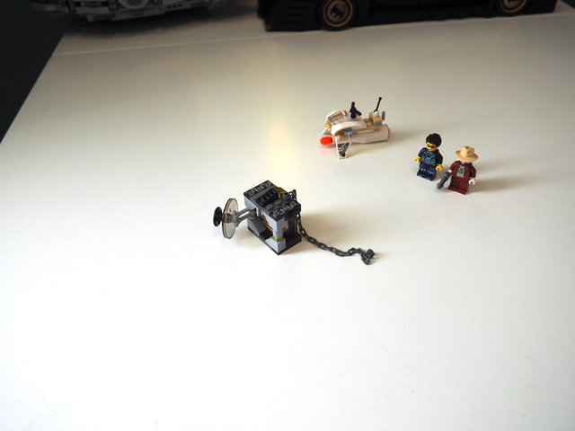](https://www.freelug.org/IMG/jpg/InvizableGoldGetaway_12.jpg)

Voilà maintenant le gros morceau, la moto volante de _Steve Zeal_.

[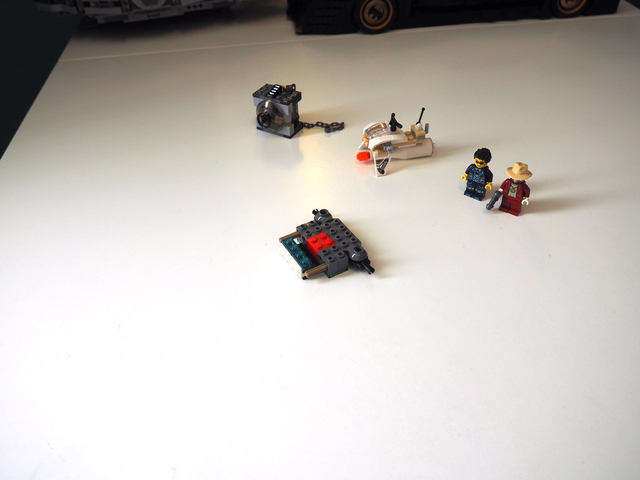](https://www.freelug.org/IMG/jpg/InvizableGoldGetaway_13.jpg)

La construction est assez plaisante pour un set de cette taille.

[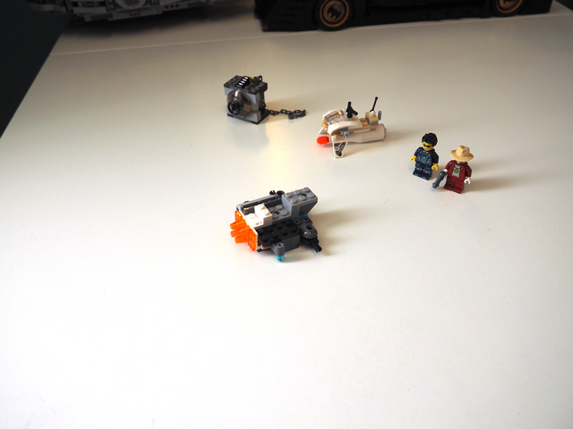](https://www.freelug.org/IMG/jpg/InvizableGoldGetaway_14.jpg)

Le système qui permettre d’ouvrir/fermer la roue arrière.

[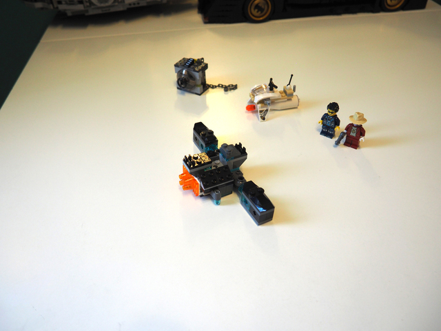](https://www.freelug.org/IMG/jpg/InvizableGoldGetaway_15.jpg)

La roue arrière en deux parties.

[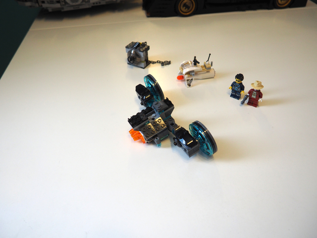](https://www.freelug.org/IMG/jpg/InvizableGoldGetaway_16.jpg)

On s’attaque maintenant au carénage.

[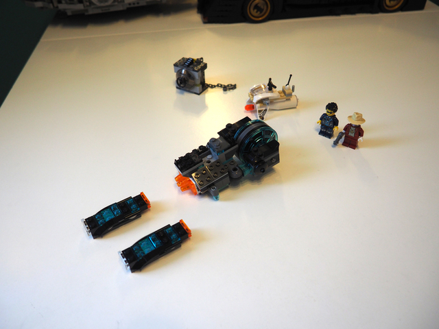](https://www.freelug.org/IMG/jpg/InvizableGoldGetaway_17.jpg)

Du coup la moto prend de l’épaisseur.

[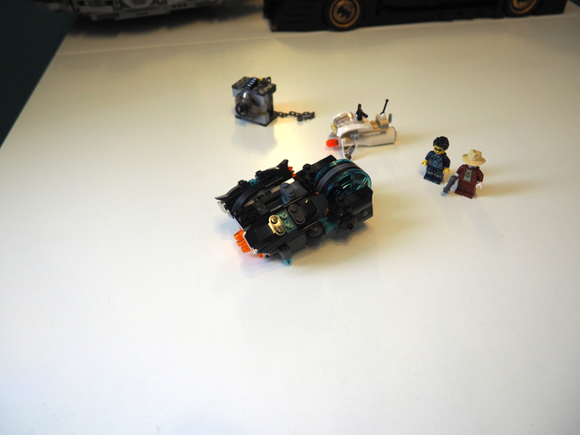](https://www.freelug.org/IMG/jpg/InvizableGoldGetaway_18.jpg)

Deux nouveaux stickers au niveau du carénage et la première partie de la fourche et de la roue avant.

[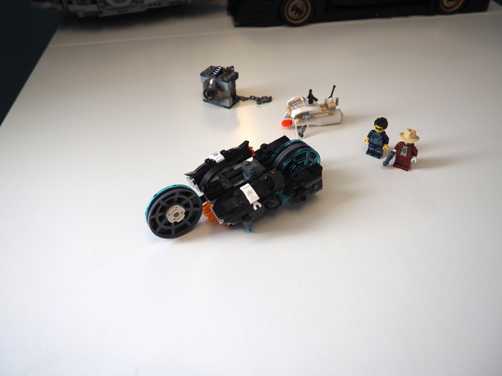](https://www.freelug.org/IMG/jpg/InvizableGoldGetaway_19.jpg)

Voilà la moto terminée avec la moto en version deux-roues.

[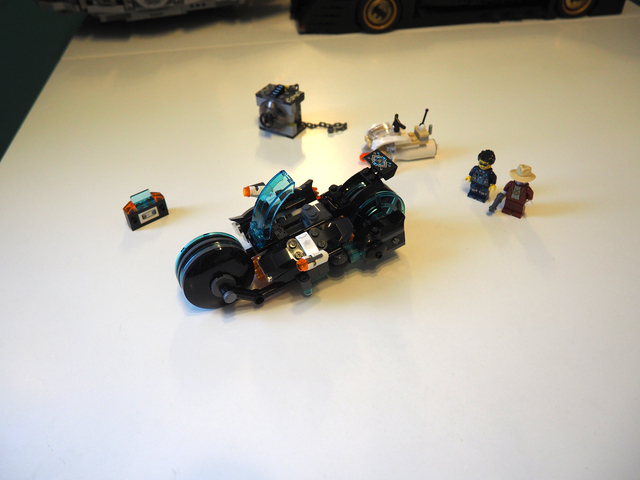](https://www.freelug.org/IMG/jpg/InvizableGoldGetaway_20.jpg)

La moto en version volante avec les roues ouvertes.

[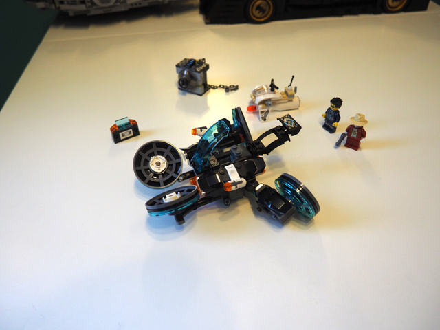](https://www.freelug.org/IMG/jpg/InvizableGoldGetaway_21.jpg)

Et voilà le set mis en situation.

[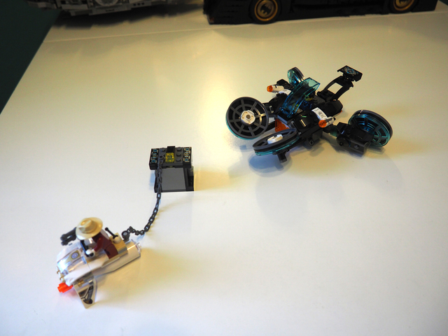](https://www.freelug.org/IMG/jpg/InvizableGoldGetaway_22.jpg)

**AVIS :**

Un petit set qui ne casse pas des briques, mais qui reste plaisant à construire, en outre les figs sont vraiment sympa.  
Bref, le rendu final et la présence d’une fig exclusive font que ce set obtient un bon rapport qualité/prix.  
Si vous le trouvez et que que vous aimez cette gamme, foncez !

**BONUS :**

Voici un GIF animé réalisé avec la totalité des photos prises pour cette review (cliquez sur l’image pour lancer l’animation).

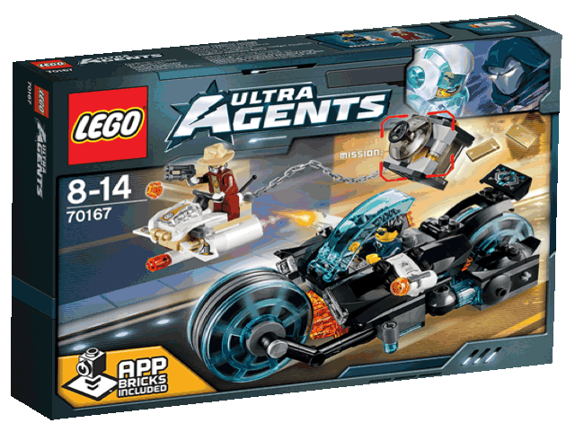
