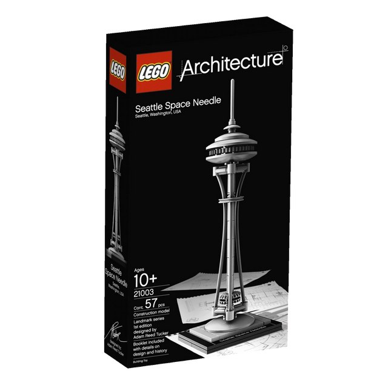
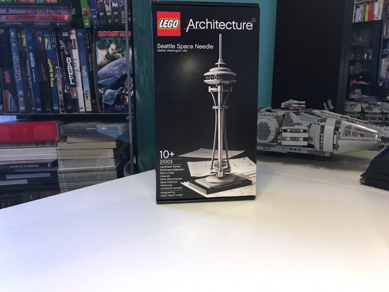
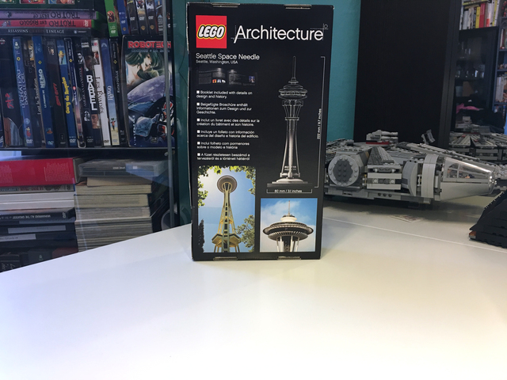
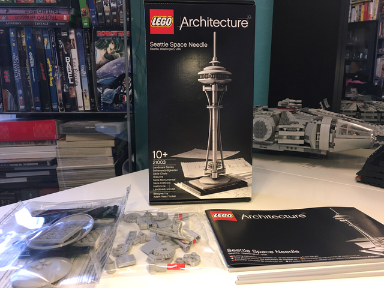
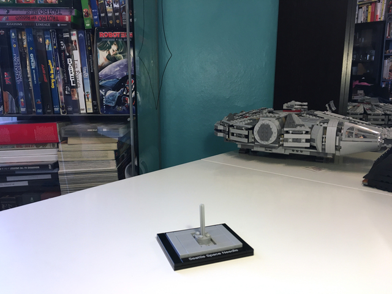
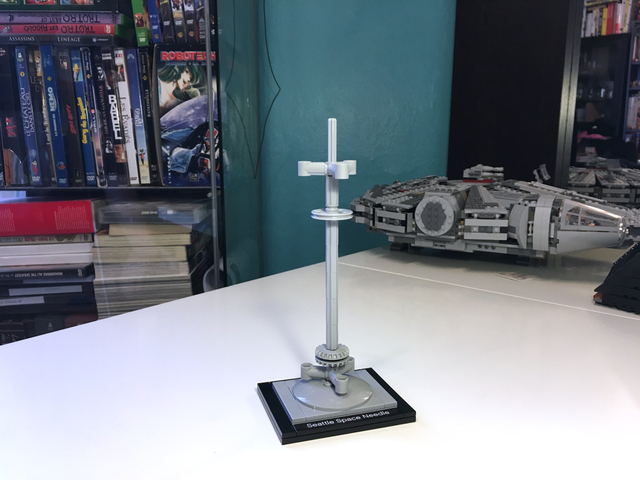
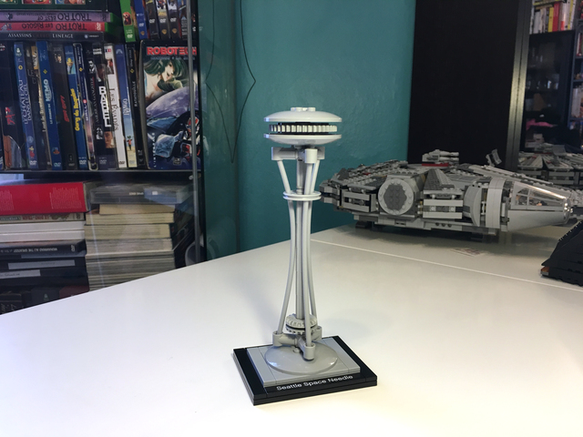
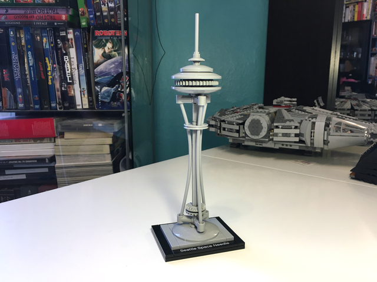
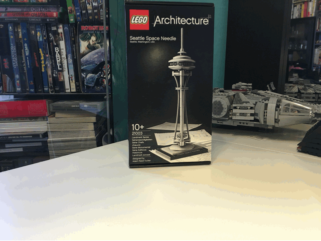

Bonjour à tous, aujourd’hui je vous propose une review du set 21003 dans la gamme _Architecture_ : **Seattle Space Needle**.  
Ce set sorti en 2009 est composé de 57 pièces et coûte 19,99 euros, soit un ratio prix/pièce de 35 centimes d’euros (outch !).

* * *

Au recto, on retrouve la signature noire de la gamme _Architecture_ avec le set mis en avant sur des plans de construction.

Au verso, des photos de l’édifice, la taille du modèle _LEGO_ et des informations.

La boite contient deux sachets, quatre tubes semi-rigides et une notice. Cette dernière est agrafée et non avec un dos carré comme sur le reste de la gamme.

On commence la construction avec le socle qui portera l’édifice, avec la traditionnelle _tile_ noire sérigraphiée au nom du monument.

L’armature constituée d’une barre _Technic_.

Comme vous le voyez la construction est très simpliste.

Pose de la deuxième pièce qui nous permettra d’installer les tubes semi-rigide.

Les tubes posés, on construit le haut de la tour où est situé le restaurant panoramique _[SkyCity](http://www.spaceneedle.com/information/)_.

Pour finir, on pose l’antenne.

**AVIS :**

Set simpliste et très (trop) rapide à monter et un ratio prix/pièce énorme. Néanmoins le résultat final est, étonnement, plutôt réussi.

**BONUS :**

Voici un GIF animé réalisé avec les photos prise pour cette review (cliquez sur l’image pour lancer l’animation).

