Aujourd’hui je vous propose la revue du modèle 42031 de la gamme **Technic**, **Le Camion nacelle**.

Ce modèle sorti en 2015 au prix de 9,99 € est composé de 155 pièces, soit un ratio prix/pièce de 6,5 centimes environ.

L’avant présente le modèle principal, que je décris ici,...

[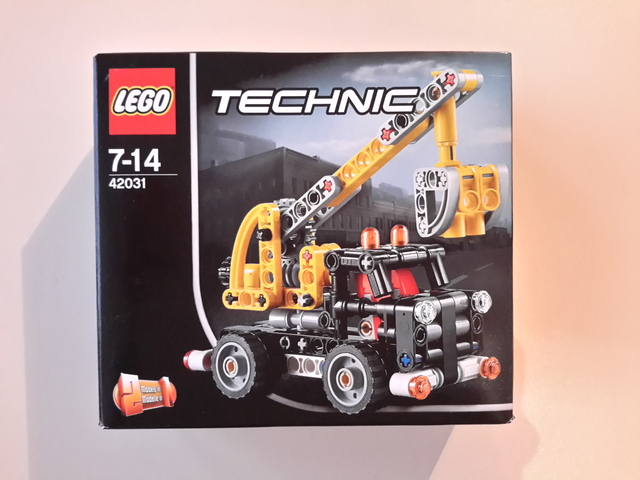](https://www.freelug.org/IMG/jpg/avant.jpg)

.. et l’arrière un modèle de dépanneuse.

[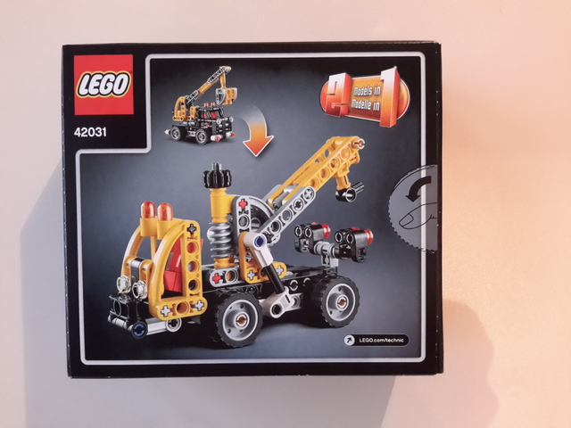](https://www.freelug.org/IMG/jpg/arriere.jpg)

_Jeu bonus pour les experts Technic_ : j’ai fait une erreur bête au montage, que l’on peut voir sur au moins une photo (attention il faut avoir l’œil !). Laquelle ? Solution tout à la fin !

* * *

La boîte contient trois sachets plus deux barres noires, et deux manuels, un pour chaque modèle.

[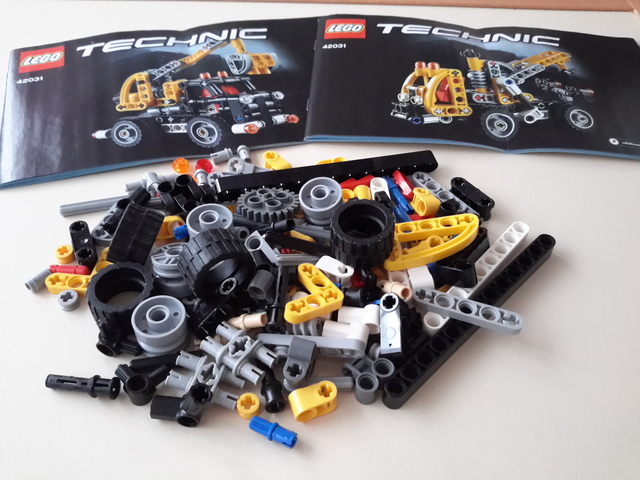](https://www.freelug.org/IMG/jpg/20160424_182312.jpg)

On commence par le châssis sur lequel viendront se placer les roues.

[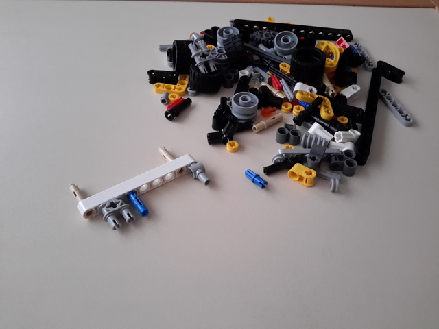](https://www.freelug.org/IMG/jpg/20160424_182519.jpg)

On enchaîne sur un second niveau...

[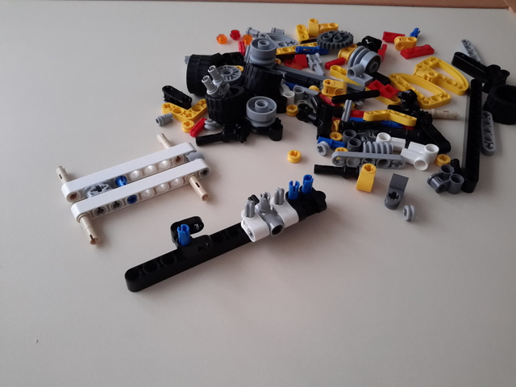](https://www.freelug.org/IMG/jpg/20160424_182918.jpg)

... sur lequel s’attache le siège, le seul élément (à part les six phares) qui contienne huit pièces System.

[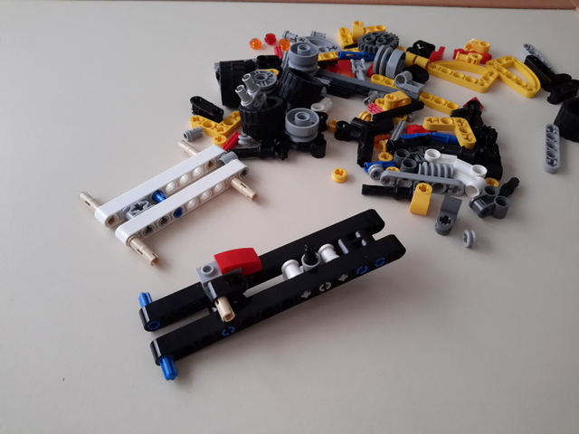](https://www.freelug.org/IMG/jpg/20160424_183107.jpg)

Puis on pose les deux morceaux l’un sur l’autre.

[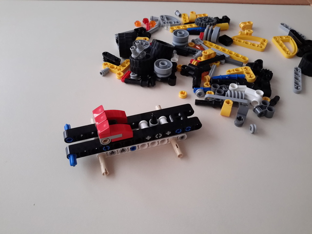](https://www.freelug.org/IMG/jpg/20160424_183229.jpg)

Les phares arrière viennent lier les deux parties.

[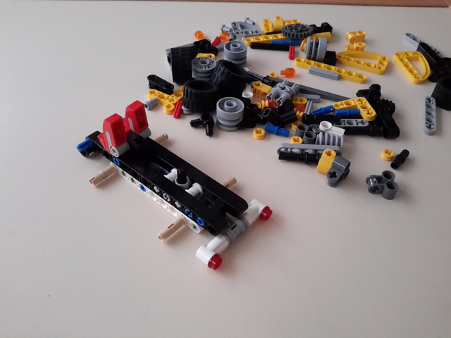](https://www.freelug.org/IMG/jpg/20160424_183336.jpg)

On monte ensuite l’avant, avec quatre phares.

[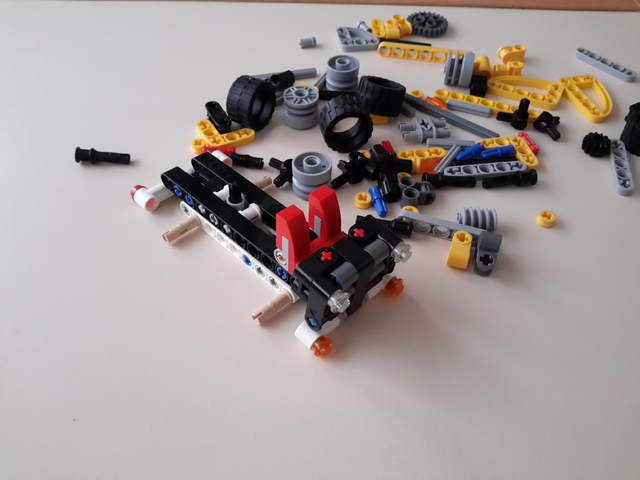](https://www.freelug.org/IMG/jpg/20160424_183927.jpg)

Et on bloque les sièges en position avec l’arrière de la cabine.

[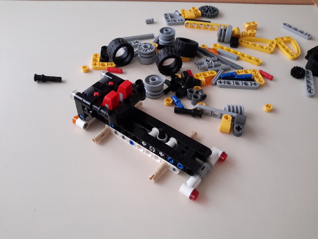](https://www.freelug.org/IMG/jpg/20160424_184048.jpg)

Puis on monte le toit du camion tandis que l’assemblage des deux niveaux est renforcé par une barre verticale qui sert aussi à accrocher le toit.

[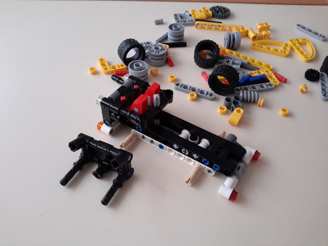](https://www.freelug.org/IMG/jpg/20160424_184359.jpg)

Le corps du camion avec son toit, il ne lui manque plus que les roues.

[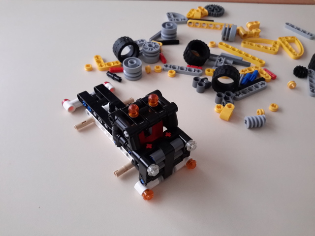](https://www.freelug.org/IMG/jpg/20160424_184525.jpg)

La construction suivante est le support pivotant de la nacelle.

[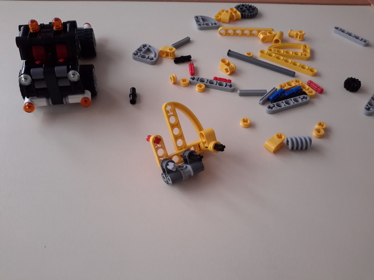](https://www.freelug.org/IMG/jpg/20160424_184955.jpg)

Celui-ci comporte une vis sans fin...

[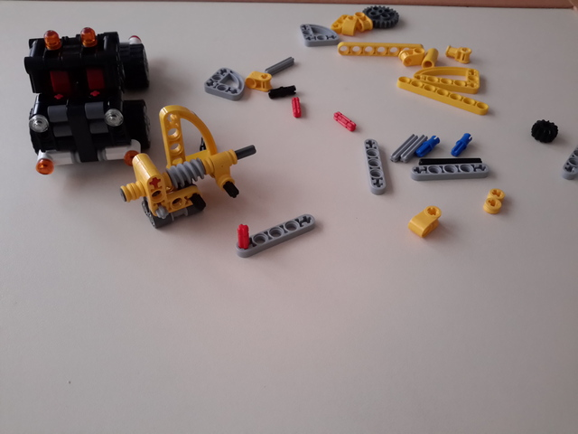](https://www.freelug.org/IMG/jpg/20160424_185248.jpg)

... sur laquelle s’enclenche un engrenage qui permettra de faire monter ou descendre la nacelle.

[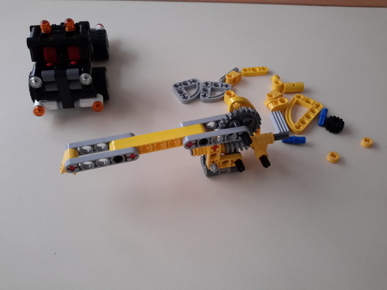](https://www.freelug.org/IMG/jpg/20160424_185649.jpg)

La nacelle elle-même est composée de quelques pièces assez simples (une pièce s’est cachée hors de la photo).

[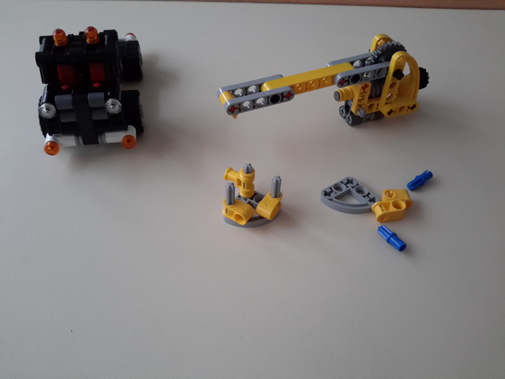](https://www.freelug.org/IMG/jpg/20160424_185937.jpg)

Mais le résultat est très appréciable (la pièce cachée est la jaune cylindrique qui permet d’accrocher la nacelle au reste de la plate-forme).

[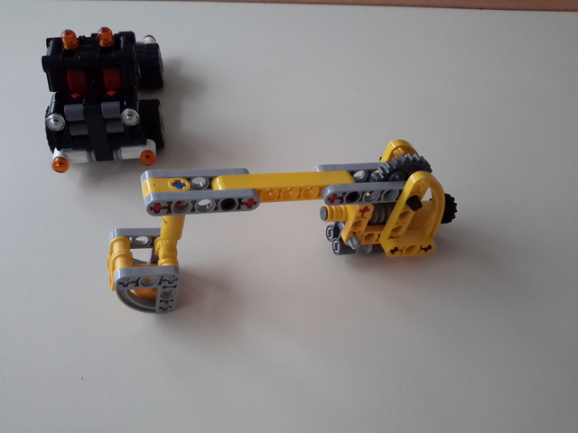](https://www.freelug.org/IMG/jpg/20160424_190102.jpg)

Et voici le modèle terminé, avec la nacelle assemblée. En position basse elle touche juste le sol, et passe évidemment entre les deux lampes du toit.

[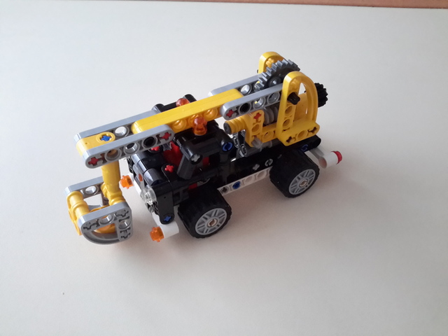](https://www.freelug.org/IMG/jpg/20160424_190119.jpg)

La nacelle peut tourner horizontalement ou monter/descendre via l’engrenage et la vis. Elle ne peut en revanche pas saisir les pièces en bonus.

[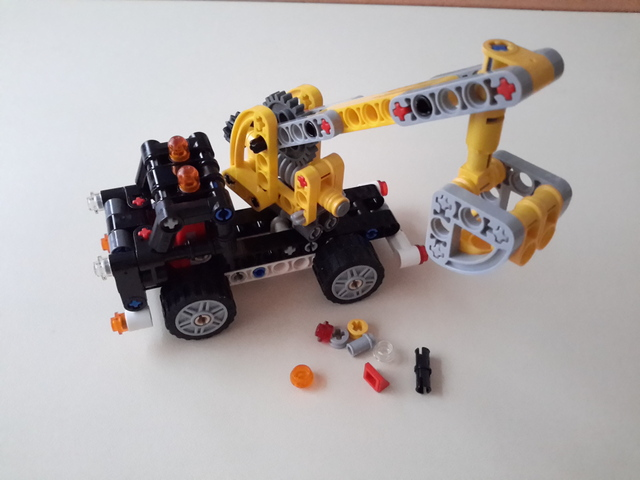](https://www.freelug.org/IMG/jpg/20160424_190723.jpg)

**Avis :**

Cela faisait longtemps que je n’avais pas eu de Technic, et c’est probablement la première fois que j’ai si peu de pièces « System » dans un modèle (les vieux Technic avaient me semble-t-il plus de telles pièces).

Je trouve le résultat final intéressant, en quelques pièces la forme du camion est bien saisie, et l’articulation de la nacelle est un bon plus.

Enfin ce modèle comporte de nombreuses pièces que je découvre (en couleur, et surtout en forme).

Bref un très bon modèle pour moi.

**Bonus :**

Des images du second modèle réalisable avec la boîte, qui n’utilise pas toutes les pièces disponibles.

[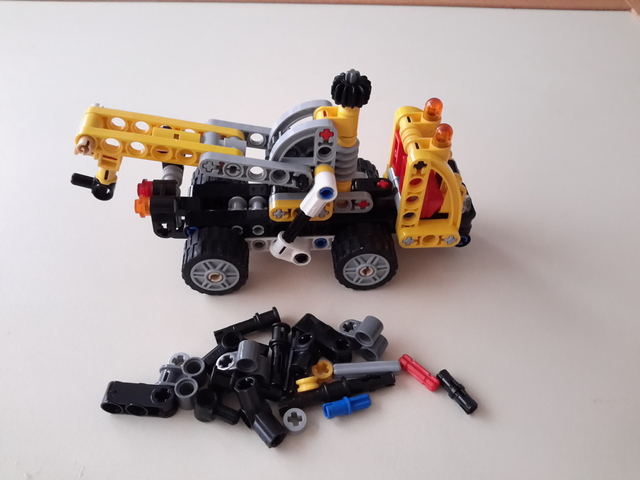](https://www.freelug.org/IMG/jpg/20160424_180758.jpg)

[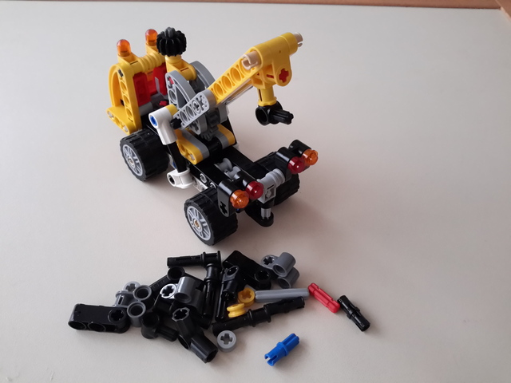](https://www.freelug.org/IMG/jpg/20160424_180856.jpg)

Et un .gif comportant toutes les images réalisées pour la revue (cliquer pour lancer l’animation, 8,2 Mo).

[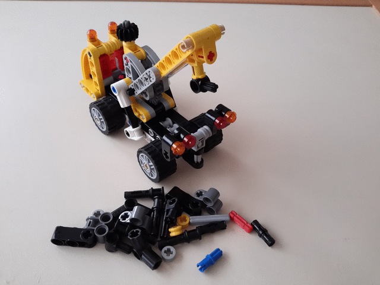](https://www.freelug.org/IMG/gif/modele.gif)
