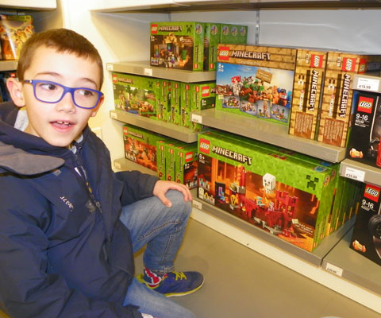
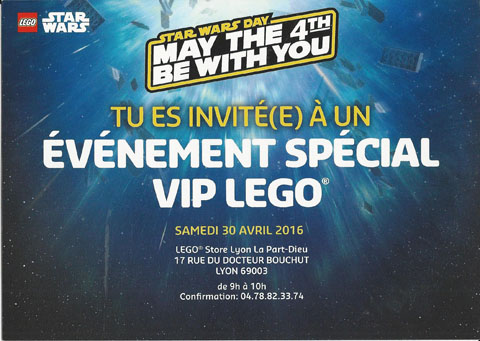
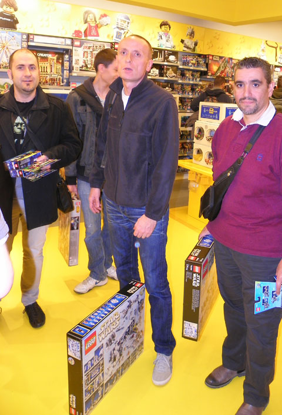
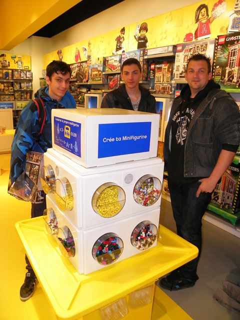
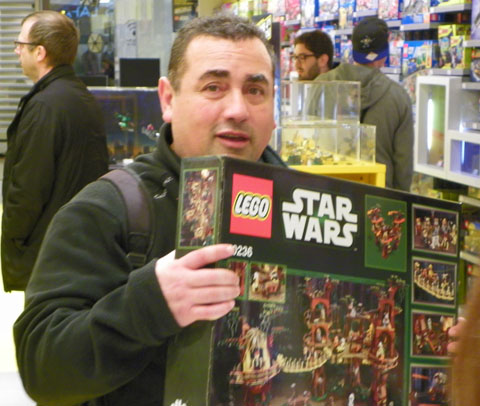
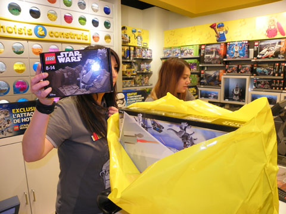
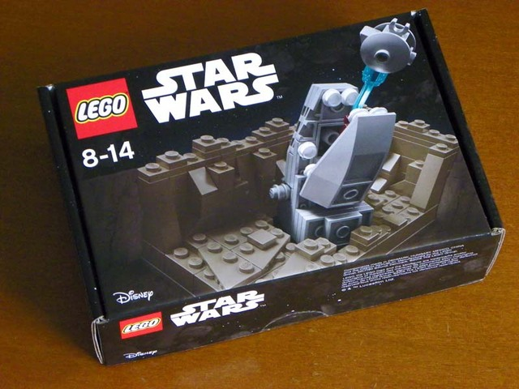
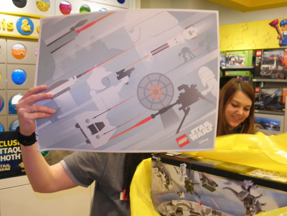
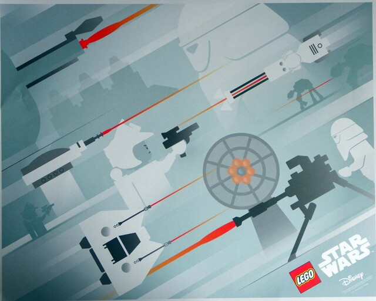
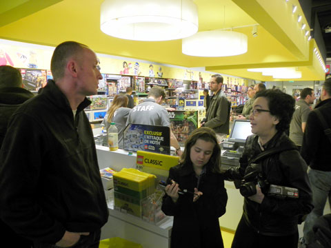

Star Wars est un thème incontournable de l’univers LEGO et il est donc sujet à des événements, dont un qui revient chaque année : le 4 mai.

**Non, on a dit SW, pas Minecraft**

Pourquoi le 4 mai ? Car en anglais , le 4 mai se dit "may the fourth", qui a une prononciation très proche de "may the force" - "que la force" - ce qui donne donc un jeu de mot bien connu des fans de Star Wars : "may the fourth (force) be with you" - que le 4 mai (la force) soit avec toi.

Le 4 mai a donc eu lieu un événement...euh non....le 30 avril. Allez comprendre, l’événement du 4 mai a eu lieu le 30 avril. Passons, cela n’a pas d’importance.

**un "petit" achat**

Reprenons. Le 30 avril a donc eu lieu un événement Star Wars dans tous les LEGO Store de France et à cette occasion, un panel de fans avait été choisi et invité à venir une heure avant l’ouverture des magasins.

**Discussion autour de bar Minifig**

En quoi consistait l’événement ? Je veux dire mis à part le fait d’avoir le magasin pour nous tous seuls avec des chouquettes et des jus de fruits au PaB.

Déjà cela marquait l’ouverture des offres qui vont durer jusqu’au 7 mai à savoir :  
**–** 10% de réduction sur la totalité de la gamme LEGO Star Wars ( à l’exception du set 75098).  
**–** Le polybag 30602 First Order Stormtrooper offert pour toute commande d’au moins 55 €.  
**–** Le poster LEGO Star Wars : The Force Awakens offert pour toute commande d’un produit de la gamme LEGO Star Wars.

**Un autre "petit" achat**

De plus, à partir de 125 euros d’achat (en produit SW), le set de l’attaque du ver de l’espace était offert.

**Le set exclusif offert**

Le set est en édition très limité (3500 sets), LEGO a prévu un contrôle très étroit pour qu’il ne soit pas distribué plus de sets que de participants (un seul passage en caisse). Allons-nous assister à des reventes à des tarifs cosmiques de ce set très exclusif ? [^1]

Nous avons par ailleurs reçu un poster original (non plié en quatre - dédicace à Will).

**Le poster offert**

Je rajouterai qu’au delà des "goodies", cette heure passée en compagnie de fans fut très agréable et qu’elle m’a permis de retrouver des têtes connues mais aussi de faire connaissance, avec un très grand plaisir, des "petits nouveaux".

**Des habituées de Hothbricks rencontrent Will le webmestre**

Pour conclure je remercie l’équipe du Store pour son accueil chaleureux malgré l’horaire très précoce (8h45 au lieu des 9h prévues et 10h habituelles !)

Didier ENJARY

\================================================

Bonjour,

Je suis allé au LEGO Store de DisneyLand Paris ce matin.  
Peu de monde. J’ai même appris que sur les 19 personnes qui devaient venir, certaines n’étaient pas venues...

Outre ce qu’a déjà indiqué Didier, c’est vrai que c’est très agréable d’avoir le magasin pour nous tout seul.

Mention spéciale à Mathieu et Thomas, ainsi qu’à la jeune fille blonde (dont le prénom m’échappe, navré) pour leur excellent accueil, comme toujours.

A bientôt !

Sylvain CACHEUX

[^1]: Dès le lendemain, le set se négociait aux alentours de 200 euros.
