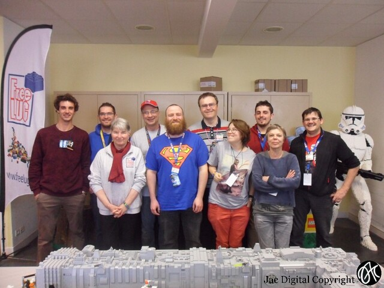
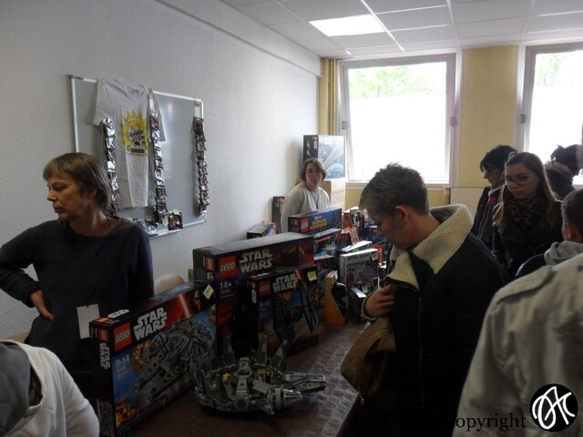
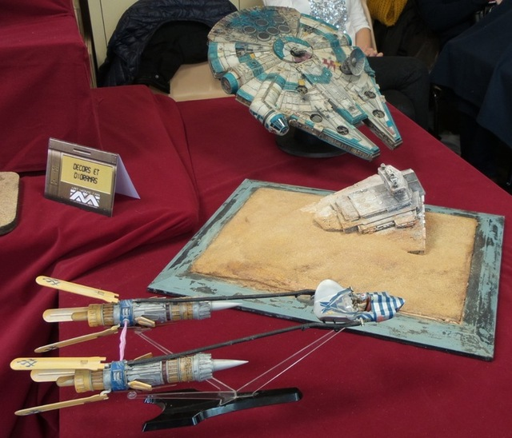
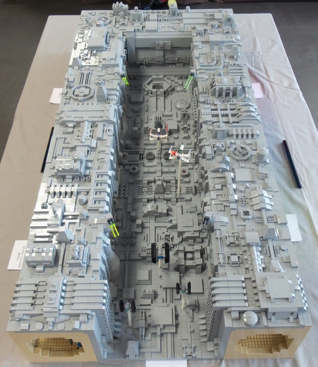
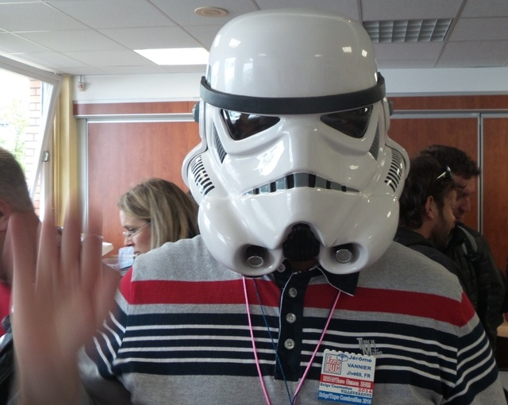
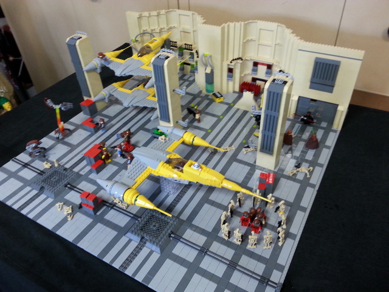

Pour cette année, l’espace disponible était inscrit dans une salle spécialement dédiée à nos chères petites briques.

La convention SW et SF de Cusset prend de l’ampleur d’année en année, 12000 visiteurs pour cette édition. Les trilogies VII, VIII, VIX et celle annoncé avec Rogue One, contribuent à booster les choses. De ce fait, les organisateurs ont décidé de donner plus de place à la convention. Pour les créations en briques LEGO de l’association FreeLUG nous pouvons utiliser désormais une salle déporté du lieu habituel.

Une petite angoisse, tout de même, est-ce que les visiteurs viendront jusqu’à nous, isolé de tous ???

Cela fut vite passé en milieu d’après-midi. Des stands de toutes sortes étaient présentés sous des chapiteaux dans tout le parc situé devant l’espace Chambon, des combats, des dessinateurs de BD, plein de choses intéressantes pour les fans. Tout était accessible à pied. Malgré la pluie de l’après-midi, les visiteurs se sont pressés dans la salle LEGO pour admirer les différentes œuvres que nous présentions cette année.

Merci à tous pour la réussite de cette nouvelle édition.

_JAC63, [ma galerie photo](http://photos.freelug.org/main.php/v/JAC/Exposition/2016/Generation+SW/)_

* * *

Les hôtesses du stand 1001 bricks ont passé un très agréable week-end. Elles remercient toute l’organisation.

_Sabine et Mia_

* * *

Grand amateur de maquettes en général et de celles de Star Wars en particulier, c’est toujours un régal pour moi de venir traîner mes bottes à Cusset le premier week-end de mai !

Et comme, en plus, il y a des LEGO, c’est vraiment trop dur de résister. Du coup j’ai amené des trucs...

Si je rajoute qu’il y avait les copains, qu’on a bien ri et bien mangé, je crois que c’est clair : ce fut un excellent week-end ! D’autant plus que les lieux étaient pour nous plus agréables que l’année dernière, étant cette fois-ci délocalisés dans une salle hors de l’espace Chambon transformé en sauna permanent. Bon, ça sentait parfois un peu la croquette chez nous aussi mais ça c’est Étienne... ;-)

_Jérôme (jivé69)  
[https://jive69mocs.blogspot.fr](https://jive69mocs.blogspot.fr/)_

* * *

De nouveau présent cette année pour cette convention, c’est une nouvelle étape que l’équipe organisatrice des Héritiers qui a été franche cette année.

Après avoir profité des offres du 4th May au Store de Clermont, je suis arrivé en fin de matinée.  
C’est avec mon frère qu’on a présenté deux dioramas cette année.

Encore un beau succès pour cette convention, merci aux organisateurs.  
Merci à Séverine et Sélène pour leur accueil et à l’année prochaine !

_Pierre L. (Pierrolego)_
