Aujourd’hui je vous propose la review du set 9489 dans la gamme _Star Wars_ : **Endor Rebel Trooper & Imperial Trooper Battle Pack**.  
Ce set sorti en 2012 au prix de 16,99 € est composé de 77 pièces, soit un ratio prix/pièce de 22 centimes d’euros.

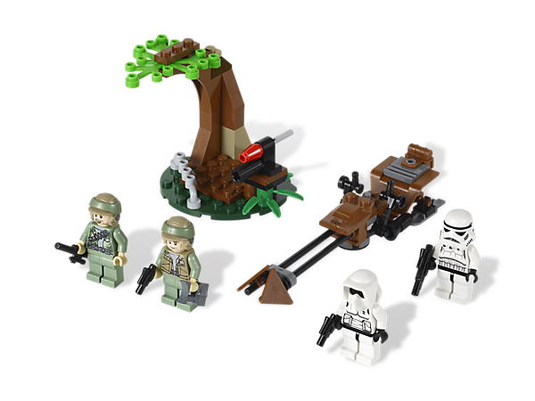

Les sets de la trilogie originale traitant de _Tatooine_, de _Hoth_ ou comme ici d’_Endor_ sont plutôt prisés des collectionneurs, voyons si ce set à 17 euros vaut la peine d’être possédé.

* * *

Le visuel de la boite reprend une scène du film _Le retour du Jedi_. Le bandeau du haut est constitué des logos _LEGO_ et _Star Wars_ et de _Darth Maul_ (comme toute la gamme sortie en 2012).  
Le contenu du set est intégré dans le décor de la forêt d’_Endor_.

[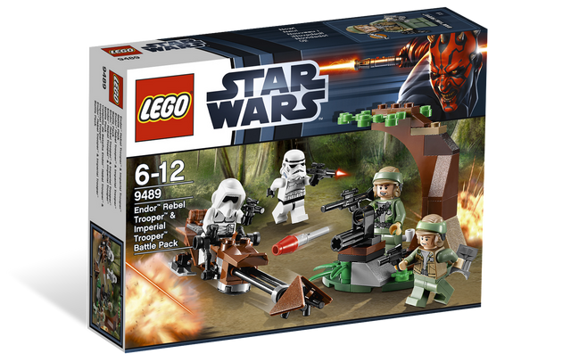](https://www.freelug.org/IMG/png/EndorRebelImperialTrooperBP_01.png)

Au verso plusieurs vignettes avec les éléments de jouabilités du set.

[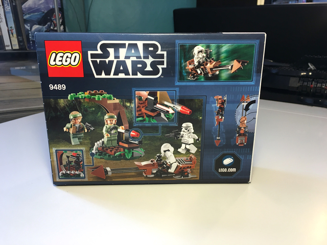](https://www.freelug.org/IMG/jpg/EndorRebelImperialTrooperBP_02.jpg)

Une fois ouvert, le set contient deux sachets et une notice de construction.

[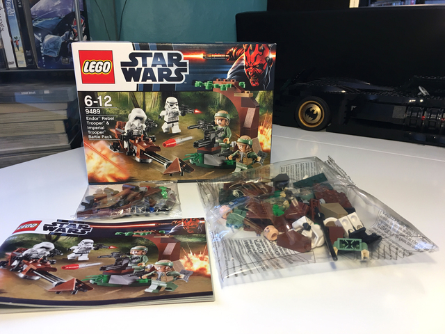](https://www.freelug.org/IMG/jpg/EndorRebelImperialTrooperBP_03.jpg)

* * *

La minifig du _[Scout Trooper](http://brickset.com/minifigs/sw005b/Scout-Trooper-\(Patterned-Head-Dark-Bluish-Gray-Torso-Pattern\)-\(9489\))_ est plutôt simple même si la sérigraphie est de bonne facture.

[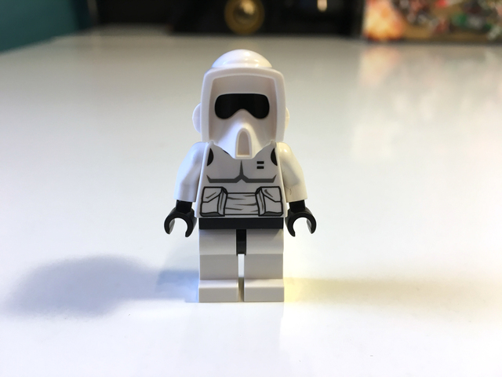](https://www.freelug.org/IMG/jpg/EndorRebelImperialTrooperBP_04.jpg)

De dos aucune sérigraphie ne vient agrémenter le torso, nous avons par contre droit à un visage sérigraphié (alors que dans les sets de 2011, les têtes étaient sans sérigraphie).

[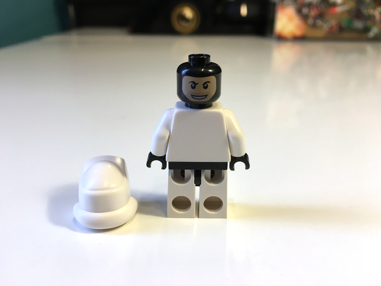](https://www.freelug.org/IMG/jpg/EndorRebelImperialTrooperBP_06.jpg)

Le _[Stormtrooper](http://brickset.com/minifigs/sw366/Stormtrooper-\(Detailed-Armor-Patterned-Head-Dotted-Mouth-Pattern\))_, bien que moins détaillé que ceux du cru 2016, n’en reste pas moins une des figs les plus emblématiques et des plus réussies de la franchise chez _LEGO_.

[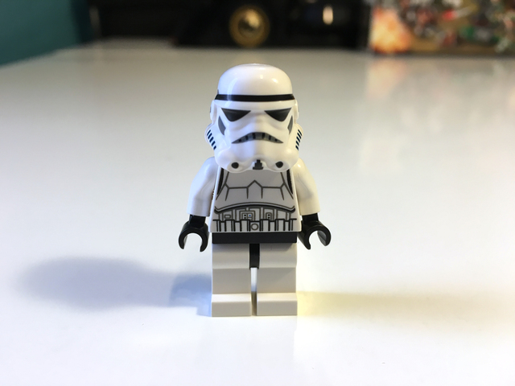](https://www.freelug.org/IMG/jpg/EndorRebelImperialTrooperBP_07.jpg)

Nous avons le droit à la même tête que pour le _Scout Trooper_.

[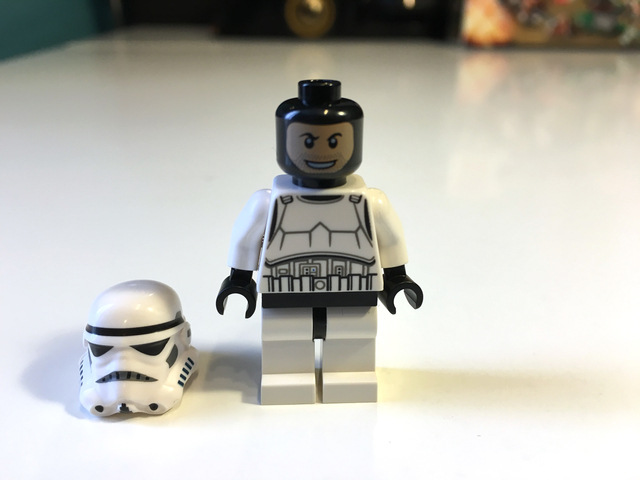](https://www.freelug.org/IMG/jpg/EndorRebelImperialTrooperBP_08.jpg)

De dos, on retrouve une sérigraphie précise et détaillée.

[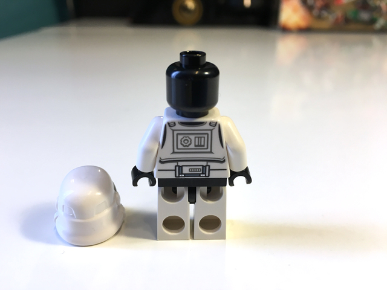](https://www.freelug.org/IMG/jpg/EndorRebelImperialTrooperBP_09.jpg)

Le _[Rebel Commando Stubble](http://brickset.com/minifigs/sw368/Rebel-Commando-Stubble-\(9489\))_ est exclusif à ce set. La sérigraphie est très belle pour l’époque avec moult détails, le casque est lui aussi très bien réalisé.

[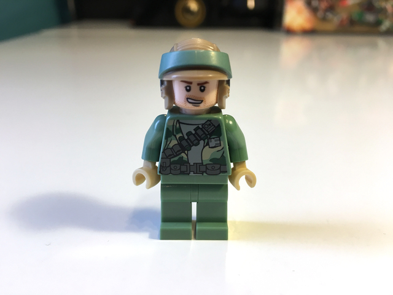](https://www.freelug.org/IMG/jpg/EndorRebelImperialTrooperBP_10.jpg)

De dos on retrouve les motifs camouflage et les pochettes de ceinture chères aux designers _LEGO_.

[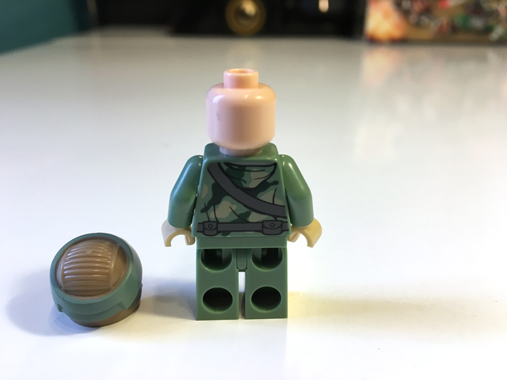](https://www.freelug.org/IMG/jpg/EndorRebelImperialTrooperBP_11.jpg)

Le deuxième _[Rebel Commando](http://brickset.com/minifigs/sw367/Rebel-Commando-Dark-Tan-Vest)_ perd la cartouchière mais gagne une veste du plus bel effet. Le visage fait âgé et permet de ne pas avoir des fig qui se ressemblent comme deux gouttes d’eau.

[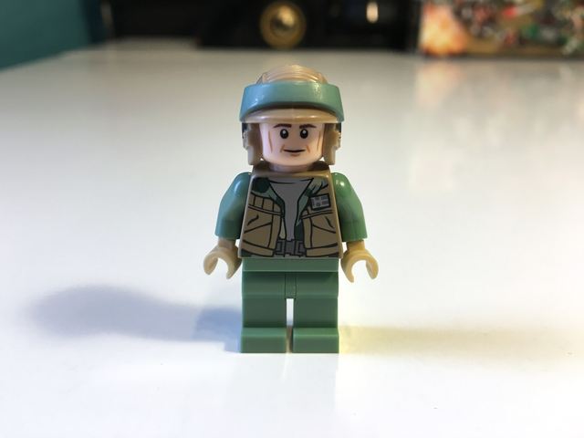](https://www.freelug.org/IMG/jpg/EndorRebelImperialTrooperBP_12.jpg)

De dos la sérigraphie est bien en adéquation avec le recto avec les plis de la veste.

[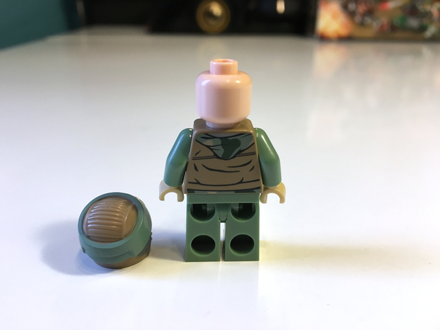](https://www.freelug.org/IMG/jpg/EndorRebelImperialTrooperBP_13.jpg)

* * *

On commence par construire l’arbre des _Rebels_.

[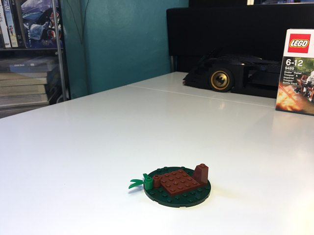](https://www.freelug.org/IMG/jpg/EndorRebelImperialTrooperBP_14.jpg)

La construction est simpliste.

[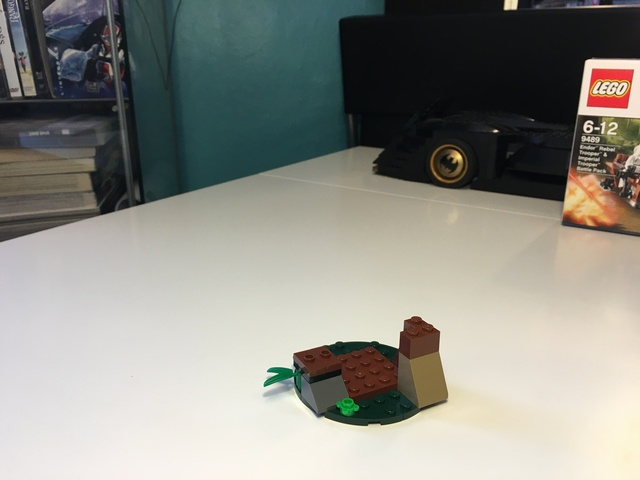](https://www.freelug.org/IMG/jpg/EndorRebelImperialTrooperBP_15.jpg)

Une fois fini il y a peu à se mettre sous la dent.

[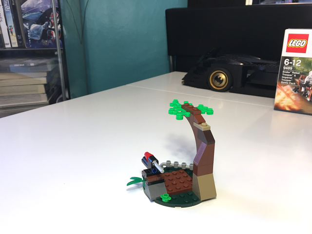](https://www.freelug.org/IMG/jpg/EndorRebelImperialTrooperBP_17.jpg)

Vue sous un autre angle.

[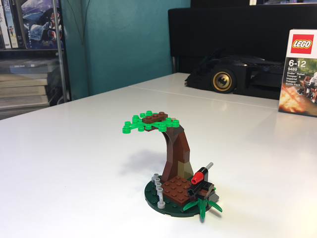](https://www.freelug.org/IMG/jpg/EndorRebelImperialTrooperBP_18.jpg)

On s’attaque maintenant au _Speeder Bike_.

[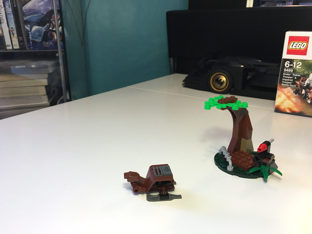](https://www.freelug.org/IMG/jpg/EndorRebelImperialTrooperBP_19.jpg)

Qui prend forme rapidement.

[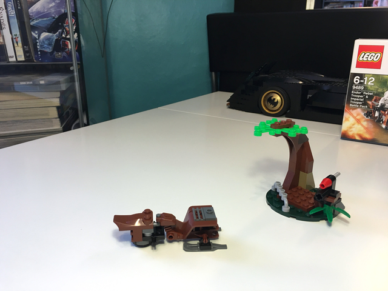](https://www.freelug.org/IMG/jpg/EndorRebelImperialTrooperBP_20.jpg)

C’est déjà terminé.

[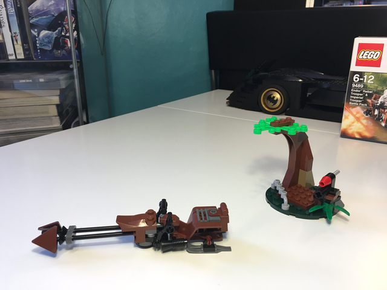](https://www.freelug.org/IMG/jpg/EndorRebelImperialTrooperBP_21.jpg)

Voici une petite mise en situation du set.

[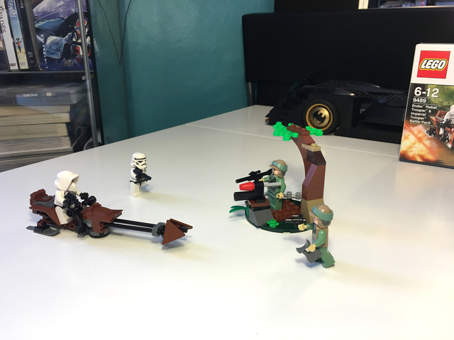](https://www.freelug.org/IMG/jpg/EndorRebelImperialTrooperBP_22.jpg)

**AVIS :**

Au final ce petit set est à la mesure de tous les _Battle Pack_. Par contre possédant l’_[UCS Ewok Village](http://brickset.com/sets/10236-1/Ewok-Village)_, _[The Battle of Endor](http://brickset.com/sets/8038-1/The-Battle-of-Endor)_ et le set _[Ewok Attack](http://brickset.com/sets/7956-1/Ewok-Attack)_, ce petit set me permettra d’ajouter figurines et véhicule à un futur diorama _Endor_.

**BONUS :**

Voici un GIF animé réalisé avec la totalité des photos prises pour cette review (cliquez sur l’image pour lancer l’animation).

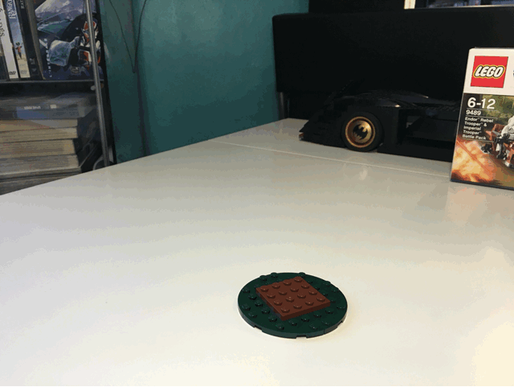
