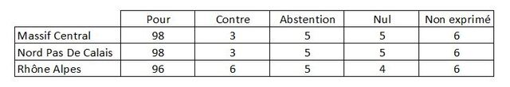

Afin de procéder au décompte des bulletins de vote, nous faisons appel aux volontaires pour le dépouillement des votes.

Se portent volontaires : Denis LAURENCON, Marc THENOT, Nicolas WEEGER, Rémi BOURRE, Pierrick DAUNY

_Début de séance 15h08_

## Ordre du jour

**–** Le mot du Président  
**–** Rapport Moral  
**–** Rapport Financier  
**–** Renouvellement du Conseil d’Administration  
**–** Comités Régionaux  
**–** FFMF  
**–** Questions Réponses

## Décompte des personnes présentes et représentées

-   Présents : 72
-   Représentés : 45
-   **Total : 117**

Nombre d’adhérents le jour de l’assemblée : 284

## Le mot du Président

Le président fait un discours d’ouverture, en rendant hommage à un de nos adhérents disparu pendant l’année 2015.

_15h24_

## Rapport Moral

Le président procède au déroulement du bilan moral.

Il y est évoqué les dotations de la part de LEGO FR et DK. Nous recevons des dons à la fois pour les événements que nous organisons et pour l’association. Il est de notre responsabilité de bien veiller au bon usage de ces derniers. Vu l’accumulation de vrac issu de ces dons, nous avons décidé de les redistribuer aux adhérents présents physiquement à l’Assemblée Générale.

Il reste encore pas mal de chantiers en cours. Nous décidons cette année de porter l’accent sur notre site internet, qui est notre vitrine. Une réunion en réel sera organisée avec les personnes motivées et s’y connaissant sur le sujet pendant un week-end afin de poser le cahier des charges.

Nous faisons un rappel sur notre position par rapport aux nombreuses demandes que nous recevons sur la boîte mail contact et pour répondre à la nouvelle politique de LEGO.

Notre association est à but non lucratif et nous ne pouvons pas avoir de lien avec les sociétés et des centres commerciaux, toutefois nous décidons de continuer à étudier toutes demandes particulières telle qu’une action dans un centre commercial seulement si c’est pour la promotion d’un de nos événements.

Suite à des différends entre la société Epicure et les associations créatrices des œuvres d’Histoires-en-Briques, nous rappelons les engagements des parties :

-   Les œuvres appartiennent aux associations.
-   Epicure doit nous informer de l’utilisation qui en est fait.
-   Les associations peuvent utiliser les œuvres hors emploi pendant des expositions gérées par Epicure.

Il a été décidé de mettre un membre à l’honneur :

**–** Denis LAURENCON pour l’initiative d’organisation d’une Briqu’Expo à La Ville Du Bois (91)

Vote à bulletin secret du rapport moral :

**–** Pour : 105  
**–** Contre : 2  
**–** Abstention : 3  
**–** Nuls : 4  
**–** Non Exprimé : 3

**Le rapport moral est approuvé à 105 voix contre 2**

_15h39_

## Rapport Financier

Le trésorier présente les différents comptes de FreeLUG. En fin d’exercice 2015, le budget est positif de 4946.69 €.

**Questions**

**–** **Alain R** : Nous avons du matériel en stock issu de dons ou d’achats, quelle est la valeur in fine de ce stock ?

**Réponse** : Il est impossible de le chiffrer, nous savons que nous ne pouvons pas le vendre donc nous lui attribuons la valeur de 0 €.

**–** **Paul Q** : Qu’est-ce que l’assurance rembourse en cas de perte (vol, incendie...)

**Réponse** : C’est une somme globale qui a été déclarée, nous serions remboursés au forfait.

Aparté : Xavier D, travaillant dans les assurances, se propose de nous expliquer plus clairement les modalités si la situation le demande.

Le trésorier continue avec les prévisions pour 2016, budget établi sur un nombre de 262 adhérents.

Vote à bulletin secret du rapport financier :

**–** Pour : 109  
**–** Contre : 1  
**–** Abstention : 3  
**–** Nul : 0  
**–** Non exprimé : 4

**Le rapport financier est approuvé à 109 voix contre 1**

_16h15_

## Renouvellement du Conseil d’Administration

Nous procédons au renouvellement de 5 postes du conseil d’administration (4 pour une durée de 3 ans et 1 pour une durée de 1 an) dont voici les résultats :

Vote à bulletin secret  
**–** Erik AMZALLAG 107  
**–** Antoine CLEMENT-LAROSIERE 74  
**–** Daniela DROST 95  
**–** Arnaud GINDRE 37  
**–** Pierre LAURENGE 97  
**–** Richard LEMEITER 107

Sont élus pour 3 ans : Erik AMZALLAG, Richard LEMEITER, Pierre LAURENGE et Daniela DROST.

Est élu pour un an : Antoine CLEMENT-LAROSIERE.

Nous félicitons tout de même Arnaud GINDRE pour s’être porté volontaire.

_16h35_

## Comités Régionaux

Lors de la réunion du mois de février, le Conseil d’Administration s’est prononcé pour la dissolution du CoR Sarthe. En effet, conformément au règlement des CoR, l’absence d’activité depuis 2 ans et l’impossibilité d’obtenir la nomination d’un responsable de l’animation de ce CoR, nous a amené à cette décision.

Nous avons reçu la demande pour la création de 3 CoRs

-   Massif-Central
-   Nord-Pas-de-Calais
-   Rhône-Alpes

Conformément au règlement, la création de ces CoRs est soumise aux votes lors de l’Assemblée Générale.

Les 3 responsables désignés par les adhérents des dits CoR prennent la parole pour expliquer la demande.

Le vote se fait à bulletin secret, dont voici les résultats :

**Les 3 CoRs sont créés.**

_16h44_

## FFMF

Richard explique que FreeLUG est affilié à la FFMF par le biais de l’adhésion de certains de ces adhérents.

**Questions**

**–** **Alain R** : Pourquoi ne voit-on pas de LEGO dans les revues ?

**Réponse** : C’est de la faute de FreeLUG et de ses adhérents, il faut des volontaires pour écrire ces articles.

**–** **Stéphane B** : Quel est le prix de l’adhésion annuelle ?

**Réponse** : 9 euros.

**–** **Alain R** : Peut-on participer à un de leur stage, voire en proposer ?

**Réponse** : Oui, nous pouvons, du fait de notre affiliation, d’ailleurs cela a déjà été fait par le passé avec Erik A et Richard L pour la formation à la gestion d’une association.

_16h52_

## Questions / Réponses

**–** **Benoît** : Pour le site, il est difficile de s’y inscrire.

**Réponse** : Nous prenons note et reverrons cela avec la refonte du site.

**–** **Laurent L** : Est-ce que FreeLUG peut avoir une affluence sur la sortie d’une pièce rare ou non produite dans une couleur, ou y avoir accès ?

**Réponse** : Non, seuls les LCP (LEGO Certified Professional) ont accès à des pièces rares du fait de leur obligation de coller leur construction.

**–** **Alexis L** : Y a-t-il des boîtes utilisables en exposition appartenant à l’association ?

**Réponse** : Oui, nous avons quelques boîtes mais il est difficile de les conserver du fait du problème de transport. L’expérience de la pratique des prêts nombreux d’une animation à l’autre montre qu’elles se dégradent très vite, ce qui rend leur durée de vie très courte.

**–** **Mickaël G** : Est-ce que le nom de FreeLUG a été déposé à l’INPI ?

**Réponse** : Non cela n’a pas été fait. Il faudrait que nous nous y penchions. Quoi qu’il en soit, si un usage abusif devait être constaté, nous pourrions faire valoir nos droits du fait de l’ancienneté notoirement publique de l’association.

**–** **Philippe H** : Qu’est-ce que l’Exposition de Versailles ?

**Réponse** : Il s’agit d’une exposition du même genre qu’Histoire-en-Briques, mais sans interlocuteur intermédiaire. Seules les 2 associations concernées (Frenchbrick et FreeLUG) sont en contact avec la mairie de Versailles, donneuse d’ordre. La société ERC Briques nous seconde pour la fourniture des briques.

C’est la mairie de Versailles qui finance les briques et les œuvres resteront la propriété de FreeLUG ou FrenchBrick en fonction de l’appartenance associative des constructeurs.

_Fin de séance : 17h12_

Pour toute remarque ou commentaire, merci de contacter le CA : [CA@freelug.org](mailto:CA@freelug.org)
