Aujourd’hui _FreeLUG_ vous propose la review du set 70817 dans la gamme _The LEGO Movie_ : **Batman And Super Angry Kitty Attack**.  
Ce set sorti en 2015 au prix de 12,99 euros est composé de 115 pièces, soit un ratio prix/pièce d’environ 11 centimes d’euros.

[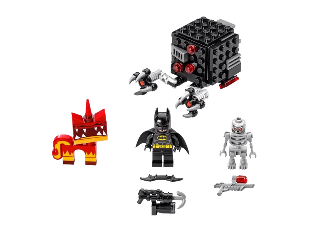](https://www.freelug.org/IMG/png/BatmanAngryKittyAttack.png)

* * *

Le visuel de la boite est composé en haut des logos _LEGO_ et _The LEGO Movie_.  
Le set est inséré dans une scène se passant dans la ville du film.

[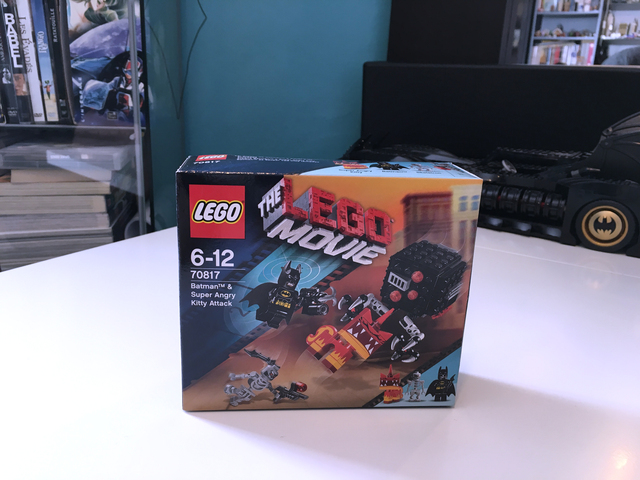](https://www.freelug.org/IMG/jpg/BatmanAngryKittyAttack_01.jpg)

Au verso, on retrouve plusieurs vignettes avec les éléments de jouabilités du set.

[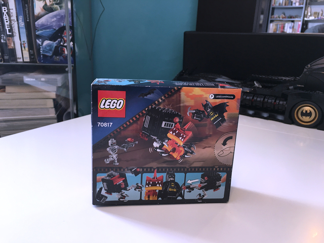](https://www.freelug.org/IMG/jpg/BatmanAngryKittyAttack_02.jpg)

La boite contient trois sachets, un carton pour protéger la cape de _Batman_ et une notice de construction.

[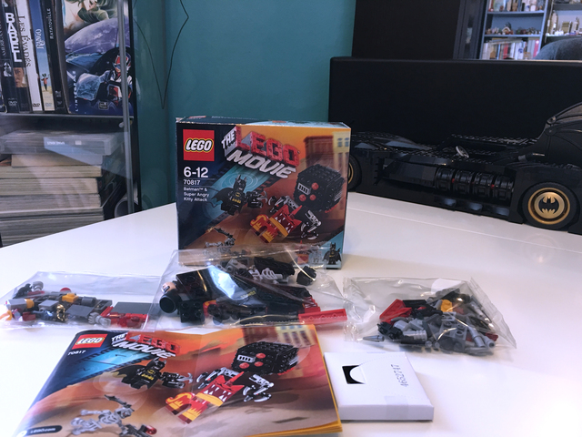](https://www.freelug.org/IMG/jpg/BatmanAngryKittyAttack_03.jpg)

* * *

Première minifig, le _[Robo Skeleton](http://brickset.com/minifigs/tlm048/Robo-Skeleton)_. Aucune sérigraphie hormis la tête.

[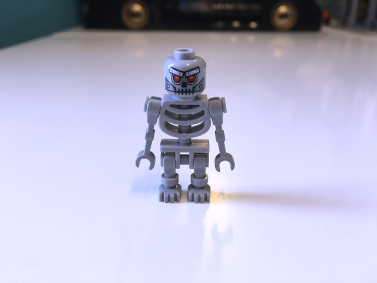](https://www.freelug.org/IMG/jpg/BatmanAngryKittyAttack_04.jpg)

De dos rien à signaler, c’est tout gris.

[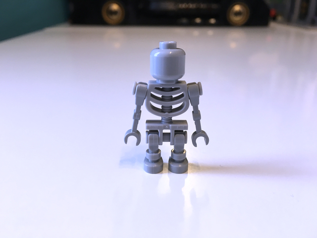](https://www.freelug.org/IMG/jpg/BatmanAngryKittyAttack_05.jpg)

Deuxième fig, _[Super Angry Kitty](http://brickset.com/minifigs/tlm091/Super-Angry-Kitty)_. Les nombreuses sérigraphies sont très bien réalisées, mention "_coup de cœur_" pour la bouche et les yeux en colère.

[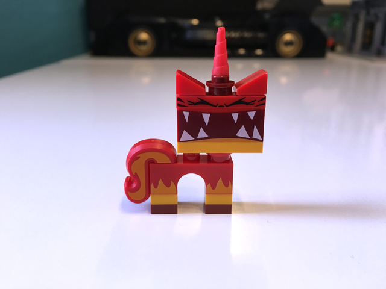](https://www.freelug.org/IMG/jpg/BatmanAngryKittyAttack_06.jpg)

Pas de sérigraphie à l’arrière de la tête.

[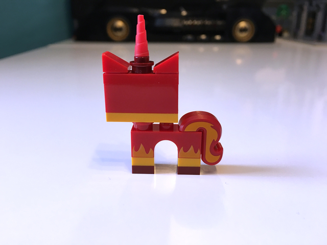](https://www.freelug.org/IMG/jpg/BatmanAngryKittyAttack_07.jpg)

Dernière fig, _[Batman](http://brickset.com/minifigs/tlm090/Batman-Dual-Sided-Head-Grin-and-Angry-Face-\(Type-2-Cowl\))_. Sérigraphies classiques pour le torse, par contre au niveau de la tête c’est la joie avec des expressions vraiment cartoonesques.

[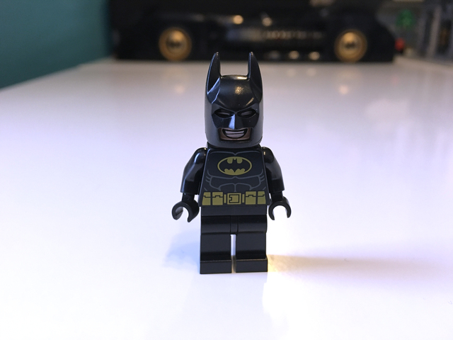](https://www.freelug.org/IMG/jpg/BatmanAngryKittyAttack_08.jpg)

Sans le masque on se rend mieux compte des dites expressions.

[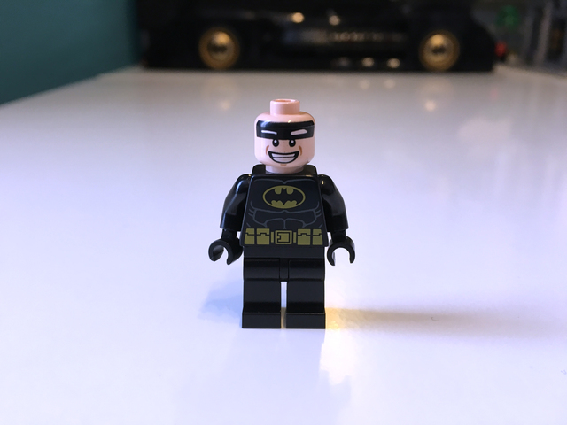](https://www.freelug.org/IMG/jpg/BatmanAngryKittyAttack_09.jpg)

Visage alternatif énervé avec une bouche disproportionnée (j’adore !).

[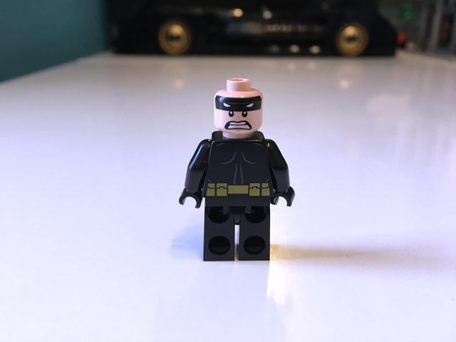](https://www.freelug.org/IMG/jpg/BatmanAngryKittyAttack_10.jpg)

* * *

On commence la construction du robot sentinelle.

[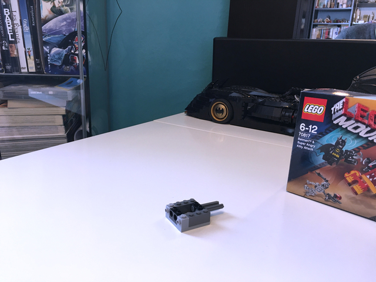](https://www.freelug.org/IMG/jpg/BatmanAngryKittyAttack_11.jpg)

On passe rapidement au dessous.

[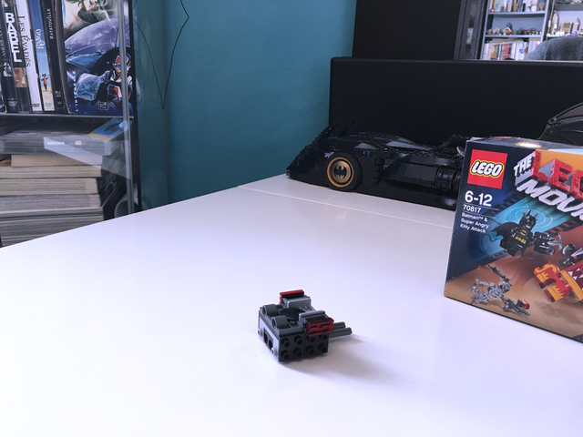](https://www.freelug.org/IMG/jpg/BatmanAngryKittyAttack_12.jpg)

Puis on continue la construction du corps.

[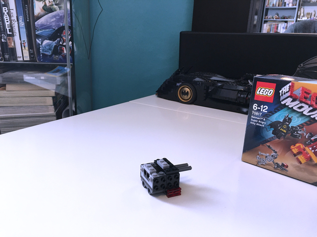](https://www.freelug.org/IMG/jpg/BatmanAngryKittyAttack_13.jpg)

Les barres _Technic_ permettront de lancer les missiles clic.

[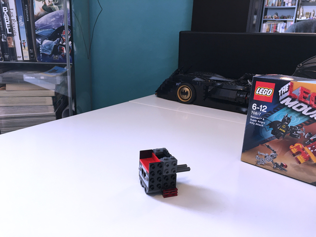](https://www.freelug.org/IMG/jpg/BatmanAngryKittyAttack_14.jpg)

La _Plate 4x2_ permettra d’activer le système pour simuler la destruction du robot.

[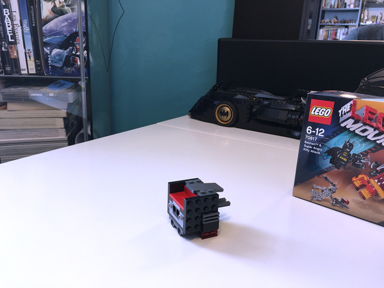](https://www.freelug.org/IMG/jpg/BatmanAngryKittyAttack_15.jpg)

On commence les bras.

[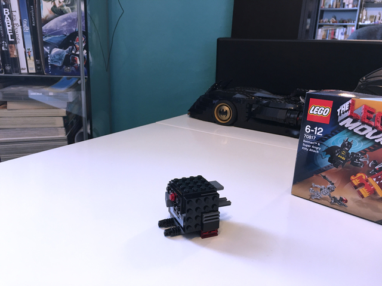](https://www.freelug.org/IMG/jpg/BatmanAngryKittyAttack_16.jpg)

Une fois les bras fixés, le set est terminé.

[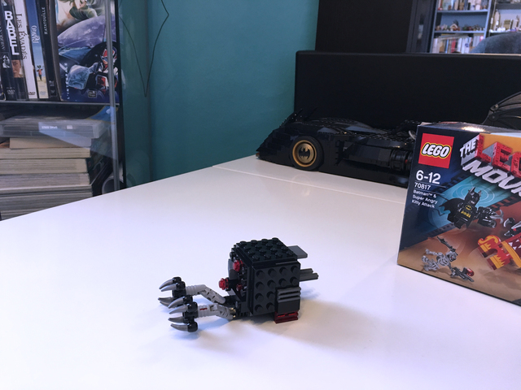](https://www.freelug.org/IMG/jpg/BatmanAngryKittyAttack_17.jpg)

Voici plusieurs photos du set en situation.

[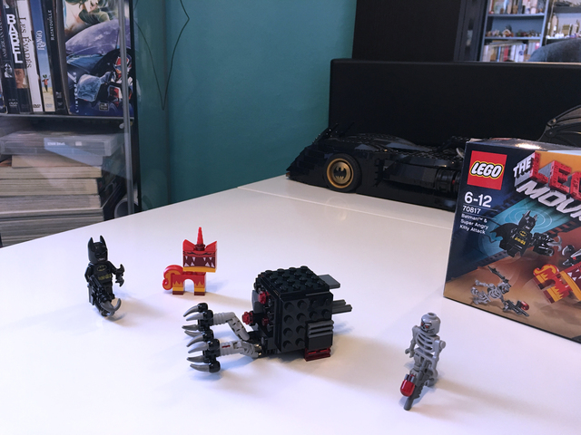](https://www.freelug.org/IMG/jpg/BatmanAngryKittyAttack_18.jpg)

[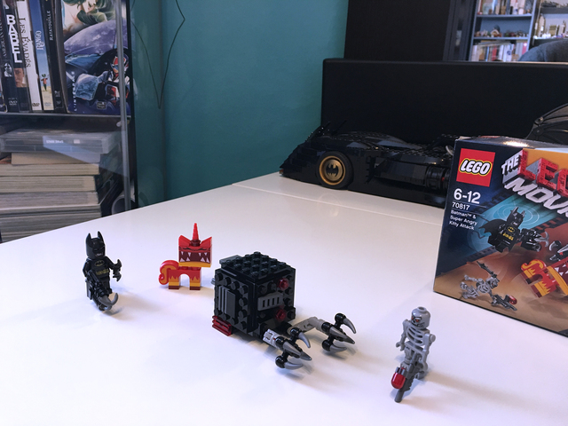](https://www.freelug.org/IMG/jpg/BatmanAngryKittyAttack_21.jpg)

[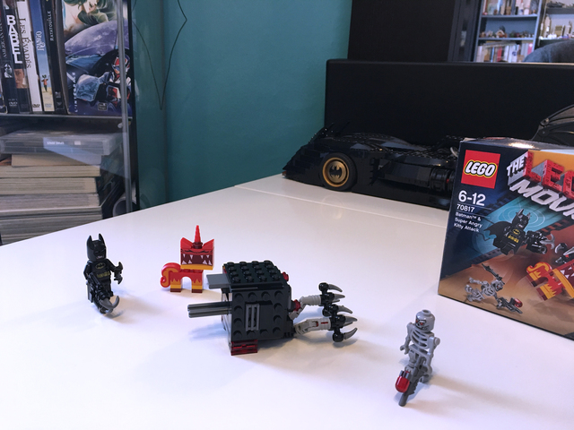](https://www.freelug.org/IMG/jpg/BatmanAngryKittyAttack_22.jpg)

[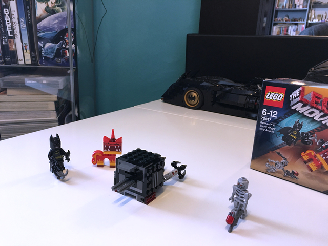](https://www.freelug.org/IMG/jpg/BatmanAngryKittyAttack_23.jpg)

[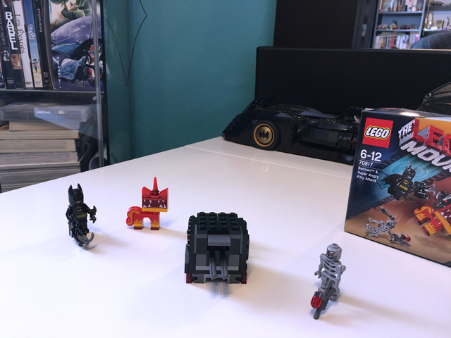](https://www.freelug.org/IMG/jpg/BatmanAngryKittyAttack_24.jpg)

[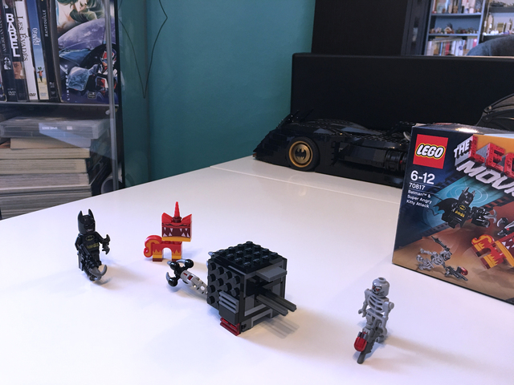](https://www.freelug.org/IMG/jpg/BatmanAngryKittyAttack_25.jpg)

[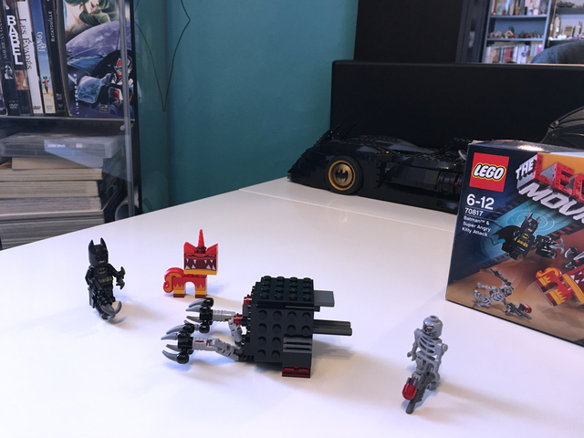](https://www.freelug.org/IMG/jpg/BatmanAngryKittyAttack_26.jpg)

* * *

**AVIS :**

Un petit set vraiment sympathique, construction rapide mais intéressante. De plus, avec les fig _Batman_ et _Super Angry Kitty_ exclusives au set, il serait vraiment dommage de se priver.

**BONUS :**

Voici un GIF animé réalisé avec la totalité des photos prises pour cette review (cliquez sur l’image pour lancer l’animation).

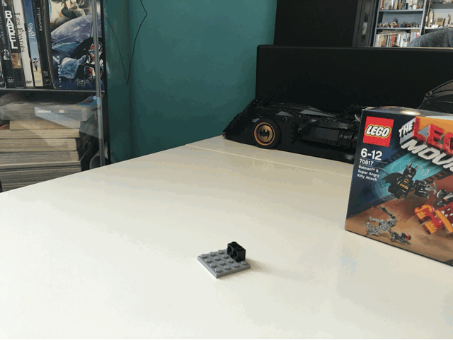
