Aujourd’hui _FreeLUG_ vous propose la revue du set 70409 dans la gamme _Pirates_, **La défense du radeau**.

Ce set sorti en 2015 au prix de 9,99 euros est composé de 84 pièces, soit un ratio prix/pièce d’environ 12 centimes d’euros.

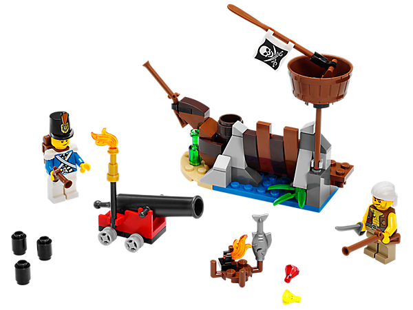

* * *

Le visuel de la boite est composé en haut des logos LEGO et Pirates.

[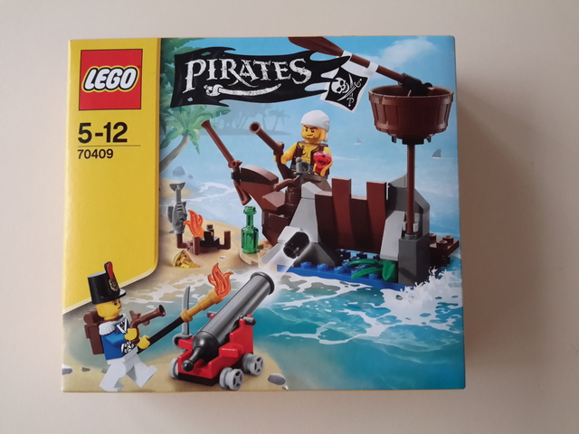](https://www.freelug.org/IMG/jpg/20160522_121554.jpg)

Le dos présente le canon tirant sur la palissade, et incite à combiner le présent set avec le 70411, _L’île au trésor_.

[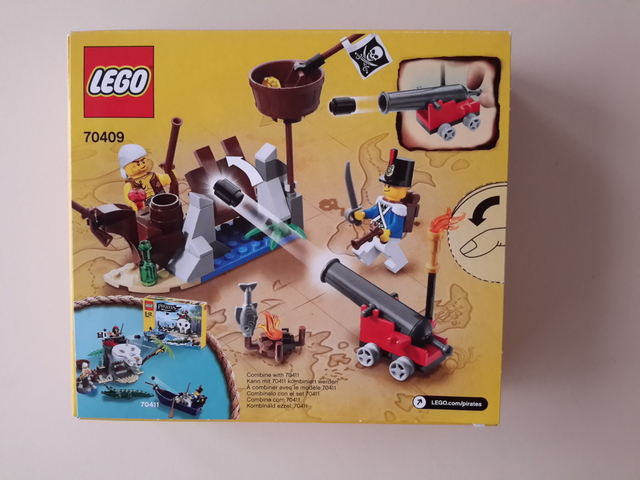](https://www.freelug.org/IMG/jpg/20160522_121618.jpg)

La boîte contient deux sachets et une notice.

[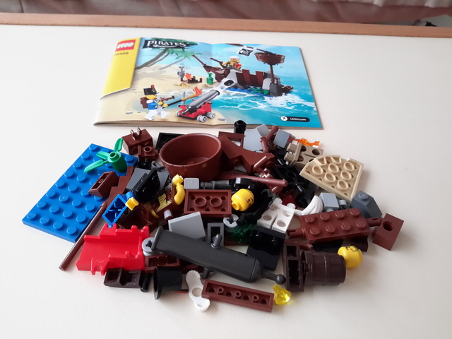](https://www.freelug.org/IMG/jpg/20160522_114659.jpg)

La première figurine est le [Bluecoat Soldier 2 - Lopsided Smile](http://brickset.com/minifigs/pi153/Bluecoat-Soldier-2-Lopsided-Smile). Il porte des épaulettes, un sac à dos. La sérigraphie sur le devant du torso est celle d’un uniforme, tandis que les jambes sont uniformément blanches. Le visage est plutôt souriant, sans visage alternatif au dos.

[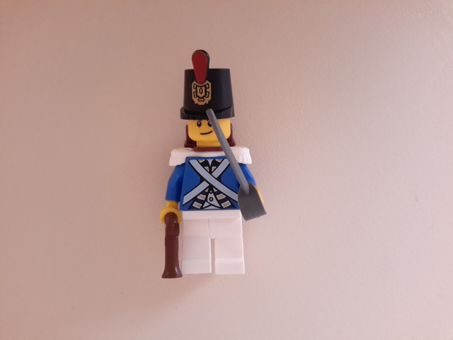](https://www.freelug.org/IMG/jpg/20160522_122133.jpg)

Le dos présente lui aussi la veste, assez simple, mais le sac à dos est amusant, donnant l’image d’un personnage mobile qui a son nécessaire de survie sur lui.

[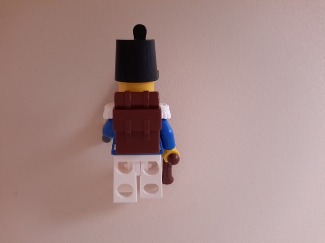](https://www.freelug.org/IMG/jpg/20160522_122145.jpg)

Le pirate lui est le [Old Pirate - Vest and Anchor, Crooked Smile and Scar](http://brickset.com/minifigs/pi158/Old-Pirate-Vest-and-Anchor-Crooked-Smile-and-Scar), exclusif à ce set [^1]. On sent le personnage qui a roulé sa bosse et n’a pas peur de se battre ou salir, même si les jambes, uniformes, sont assez peu adaptées au personnage à mon avis.

[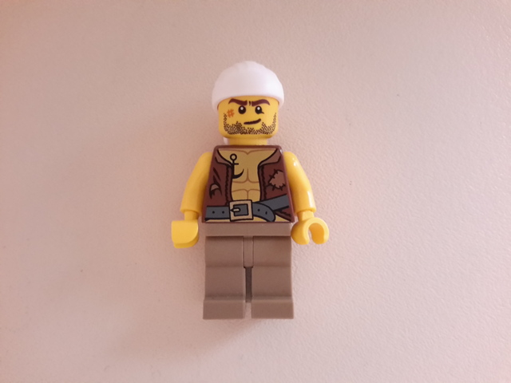](https://www.freelug.org/IMG/jpg/20160522_122105.jpg)

Le dos est presque basique par rapport à l’avant, mais a quand même un accroc.

[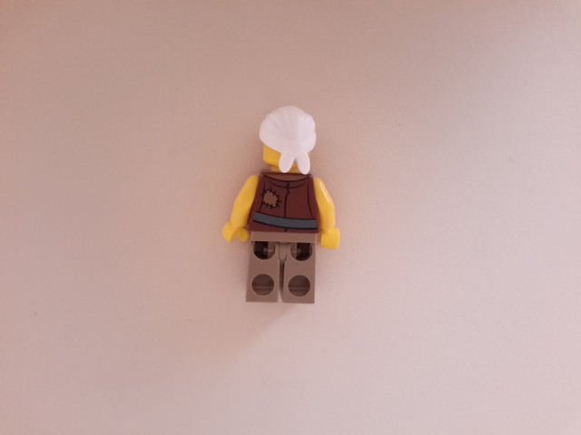](https://www.freelug.org/IMG/jpg/20160522_122118.jpg)

Le canon, pièce maîtresse, comporte deux pièces seulement, dont le corps du canon qui n’a pas de tenon LEGO. On le monte sur deux roues, on rajoute une mèche enflammée pour tirer, et trois projectiles, de simples briques cylindriques 1x1.

[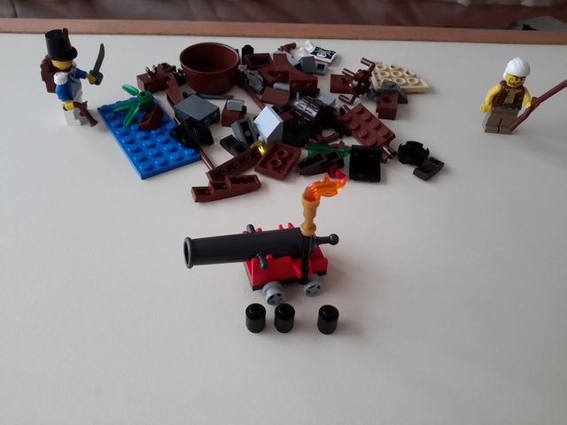](https://www.freelug.org/IMG/jpg/20160522_115520.jpg)

L’assemblage de la défense commence sur une plaque bleue 8x4, sur laquelle on pose une brique 4x2 avec ergots, lui permettant de basculer.

[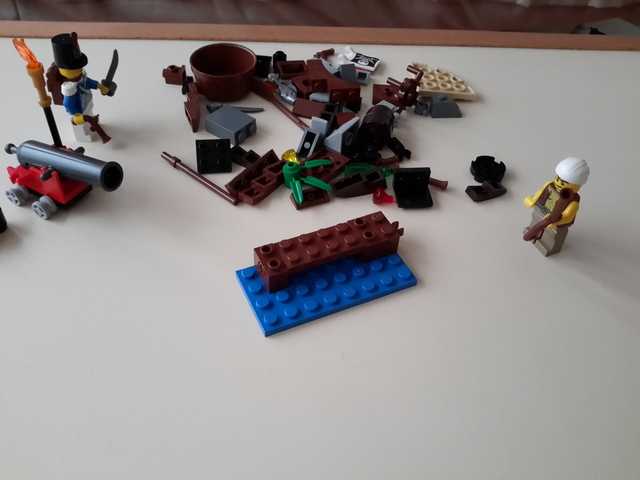](https://www.freelug.org/IMG/jpg/20160522_115639.jpg)

On monte un peu le décor autour de la palissade...

[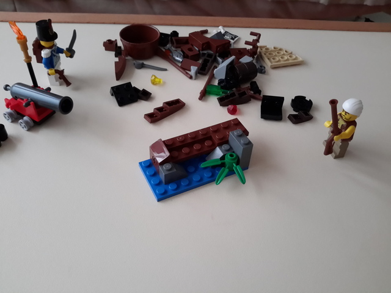](https://www.freelug.org/IMG/jpg/20160522_115839.jpg)

... avant de s’attaquer à celle-ci proprement dite.

[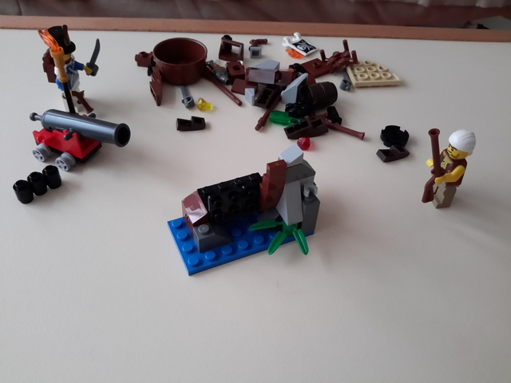](https://www.freelug.org/IMG/jpg/20160522_120042.jpg)

La palissade finie (et une bête erreur d’assemblage corrigée), on étend un peu sur le côté, avec une pièce arrondie.

[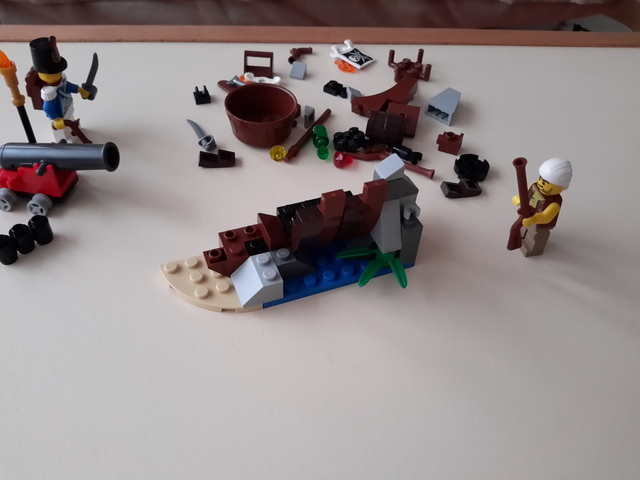](https://www.freelug.org/IMG/jpg/20160522_120436.jpg)

On monte un simili escarpement rocheux par-dessus.

[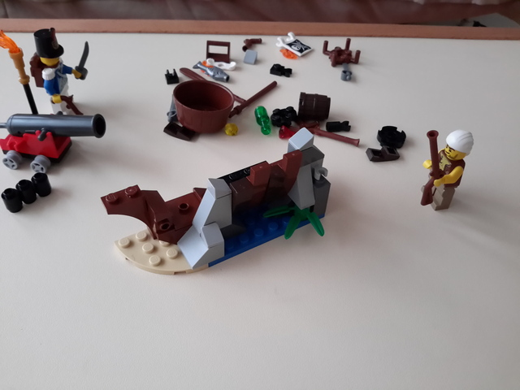](https://www.freelug.org/IMG/jpg/20160522_120551.jpg)

Le plus important, le trésor protégé par le pirate !

[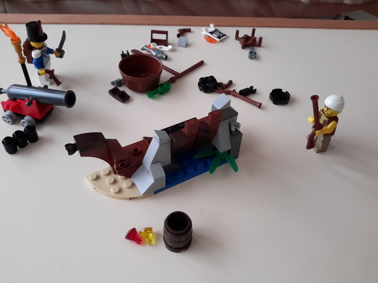](https://www.freelug.org/IMG/jpg/20160522_120655.jpg)

Le manuel fait monter le feu en le posant sur le baril au trésor, pourquoi pas...

[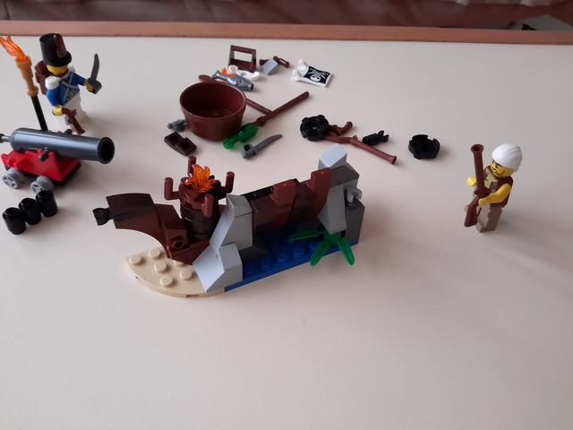](https://www.freelug.org/IMG/jpg/20160522_120802.jpg)

Après avoir posé un fusil à portée, ajouté un poisson à cuire, et l’indispensable bouteille de rhum, on commence à monter le poste d’observation.

[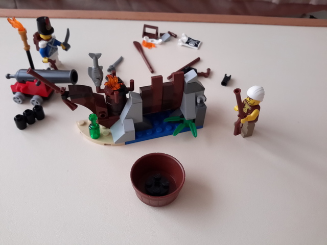](https://www.freelug.org/IMG/jpg/20160522_120935.jpg)

Enfin autre élément indispensable, le drapeau pirate !

[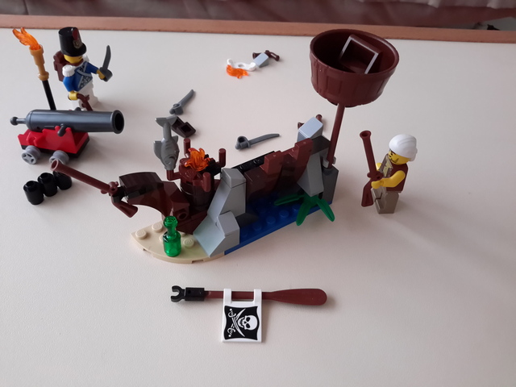](https://www.freelug.org/IMG/jpg/20160522_121052.jpg)

Il flotte fièrement sur le poste d’observation, terminant le set. Il reste plusieurs pièces, sabre, pistolet, épaulettes, une flamme.

[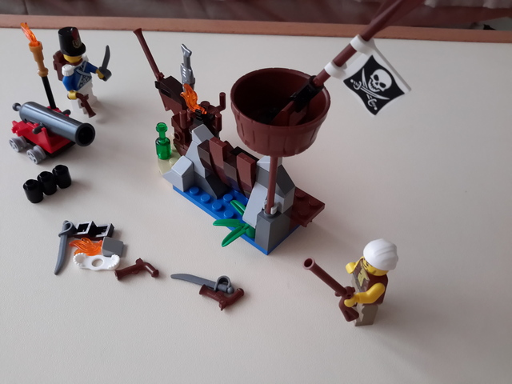](https://www.freelug.org/IMG/jpg/20160522_121221.jpg)

Le set un peu mis en scène. À noter que le canon tire ses pièces à plusieurs mètres sans problème, et qu’il est difficile de viser pour rabattre la palissade amovible !

[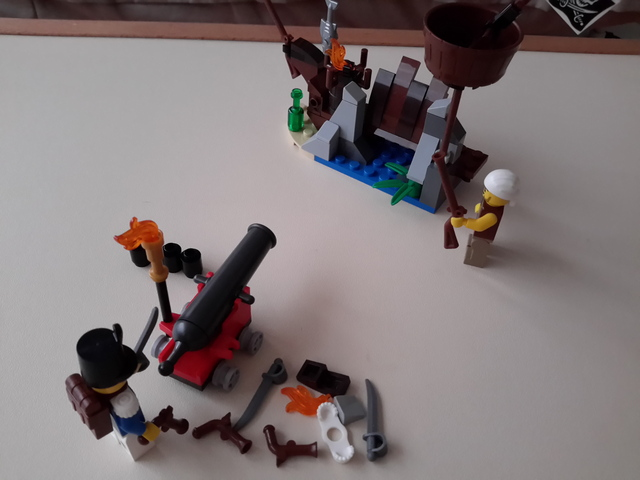](https://www.freelug.org/IMG/jpg/20160522_121423.jpg)

* * *

**AVIS :**

Le set est amusant pour les différents objets rassemblés (poisson, diamants, drapeau pirate, épaulettes, sac à dos), la combinaison de têtes et corps, la construction est rapide mais amusante.

En revanche les jambes sont décevantes...

Un bon set quand même à mon avis, et hisse et oh moussaillon !

**BONUS :**

Voici un GIF animé réalisé avec la totalité des photos prises pour cette revue (cliquez sur l’image pour lancer l’animation).

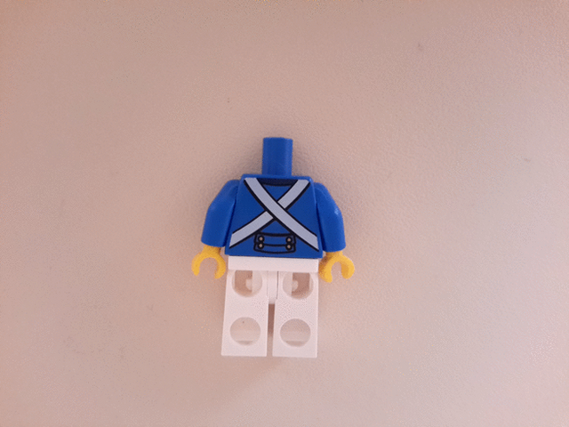

[^1]: Dixit Brickset. Les pièces individuelles sont cependant disponibles séparément apparemment.
