Salut tout le monde,

Aujourd’hui, je vous propose la review du polybag de la gamme _DC Comics Super Heroes_ 30446 **The Batmobile** sorti en mai 2016 et notamment offert lors du grand opening du Lego Store de Bordeaux (en tout cas, c’est ainsi que je me le suis procuré !).  
Le set est composé de 63 pièces ce qui fait un ratio de... ben 0,00cts la pièce vu que le polybag est offert ! (il y en a qui sont pas attentifs !)

[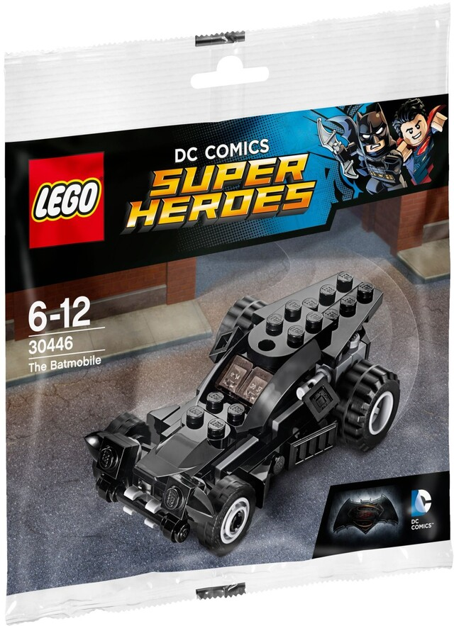](https://www.freelug.org/IMG/jpg/30446_alt1.jpg)

* * *

[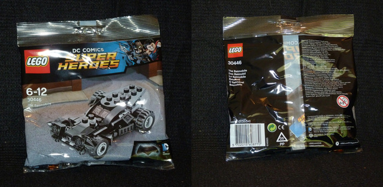](https://www.freelug.org/IMG/jpg/1-7.jpg)

Polybag classique présentant la construction terminée avec en haut la bannière DC Comics Super Heroes et en bas à droite l’icône DC précédée du logo du film "Batman VS Superman". Le dos est tellement neutre que j’ai de la peine à vous montrer la photo...

* * *

[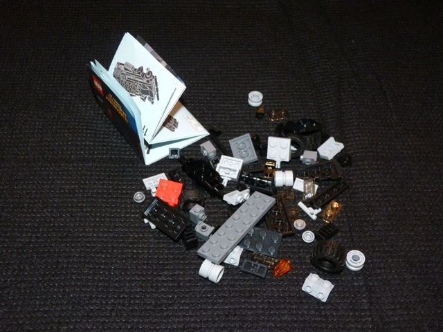](https://www.freelug.org/IMG/jpg/P1040468.jpg)

Sachet ouvert, 63 pièces et la petite notice en 17 étapes ce qui fait peu mais je reviendrai là-dessus dans ma conclusion.

* * *

Allez, c’est parti pour la construction avec l’aide de Batman en personne !

[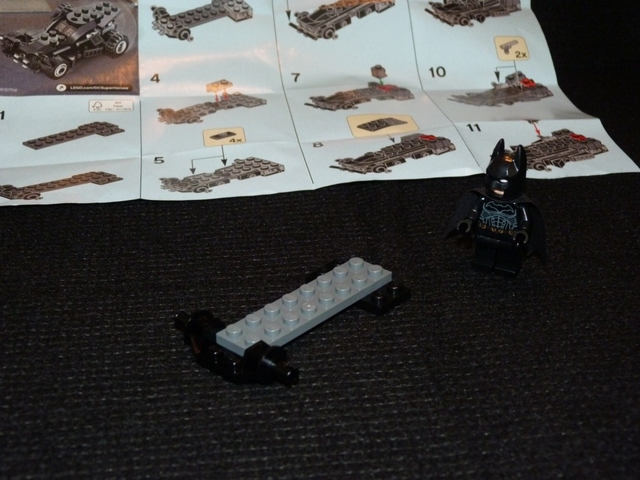](https://www.freelug.org/IMG/jpg/P1040470.jpg)

Évidemment, on commence par le châssis et on construit autour.

[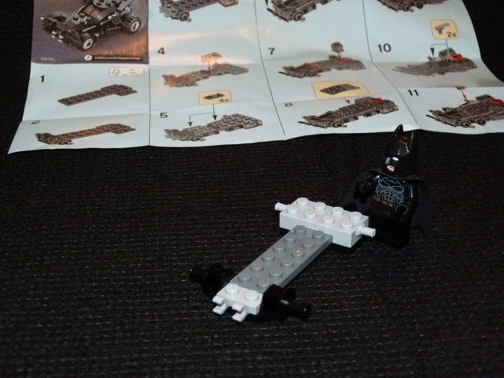](https://www.freelug.org/IMG/jpg/P1040471.jpg)

[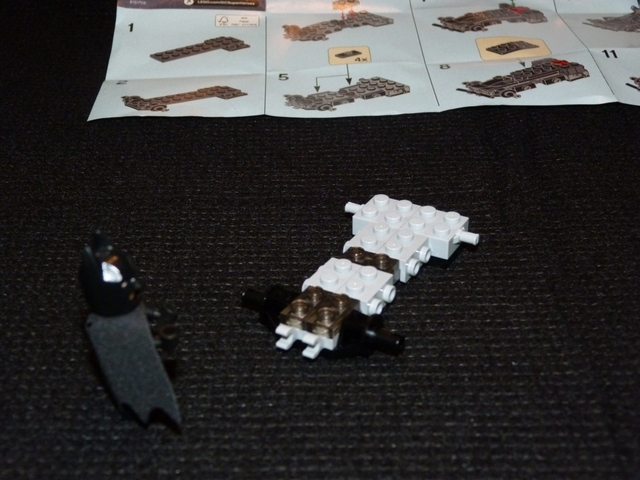](https://www.freelug.org/IMG/jpg/P1040472.jpg)

[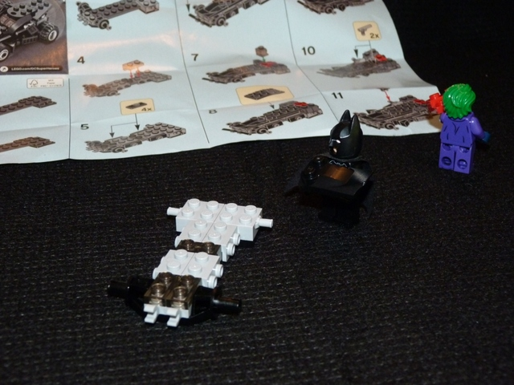](https://www.freelug.org/IMG/jpg/P1040473.jpg)

Que vois-je ?! Le Joker tente de saboter la construction en embarquant la plaquette modifiée 2x2x2/3 rouge !

[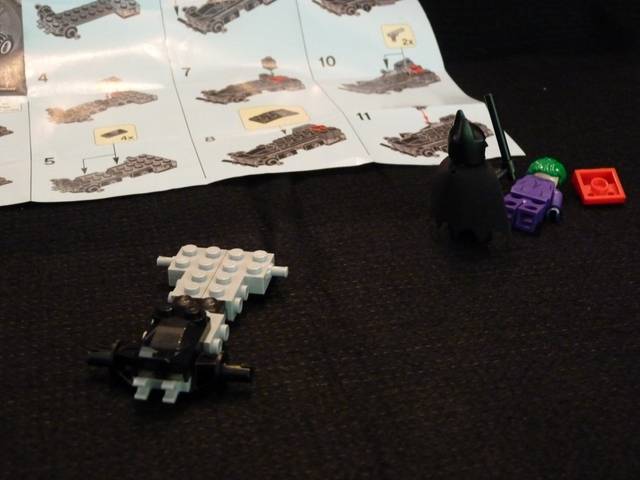](https://www.freelug.org/IMG/jpg/P1040475.jpg)

Heureusement, le Chevalier noir s’en rend compte et utilise la barre noire du polybag pour arrêter sa Némésis et poursuivre la construction.

[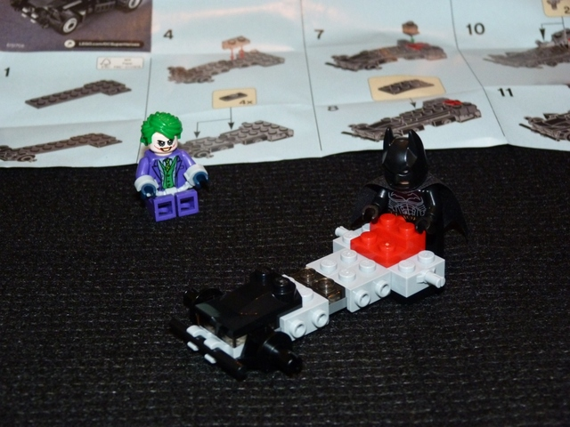](https://www.freelug.org/IMG/jpg/P1040477.jpg)

[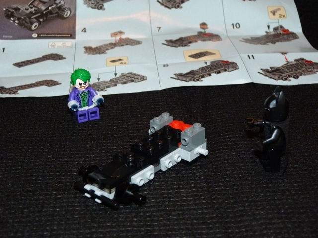](https://www.freelug.org/IMG/jpg/P1040480.jpg)

[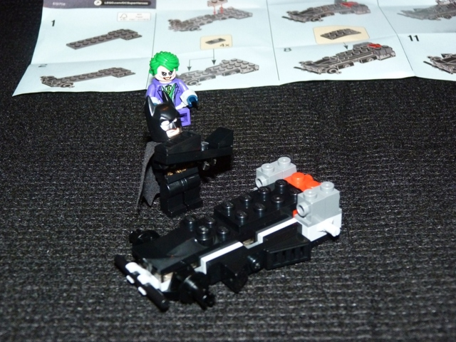](https://www.freelug.org/IMG/jpg/P1040481.jpg)

[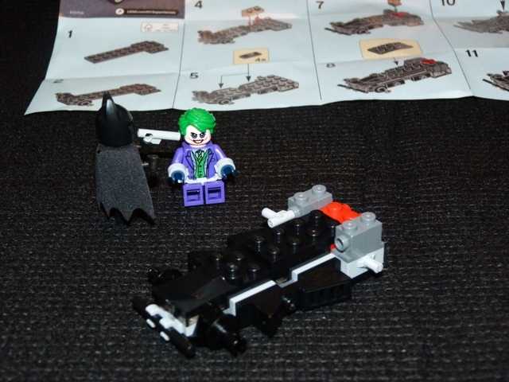](https://www.freelug.org/IMG/jpg/P1040483.jpg)

Non, Batman, tu ne tues pas, le pistolet n’est pas fait pour ça ! Il est là pour fixer les protections sur les côtés de ta voiture.

[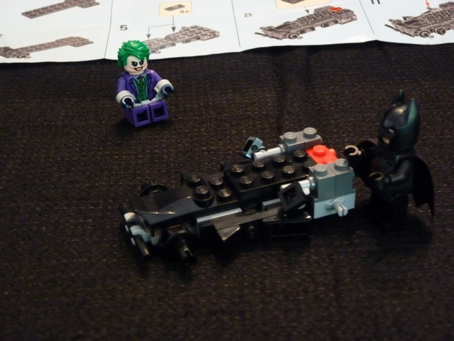](https://www.freelug.org/IMG/jpg/P1040485.jpg)

[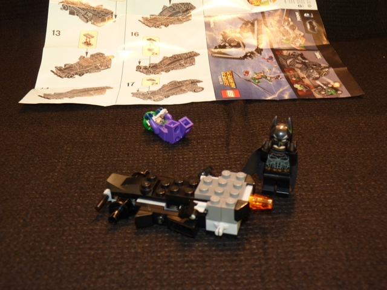](https://www.freelug.org/IMG/jpg/P1040487.jpg)

La flamme à l’arrière du véhicule apparaît et ça fait sursauter le guerrier masqué ce qui déclenche l’hilarité du Joker.

[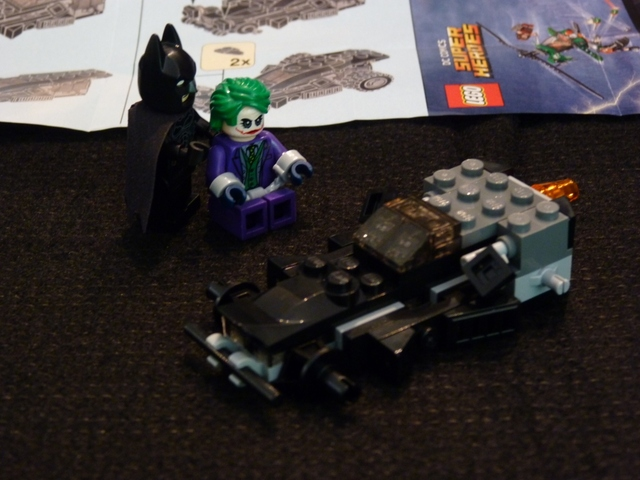](https://www.freelug.org/IMG/jpg/P1040489.jpg)

Mais l’homme chauve-souris calme le clown afin de terminer sa Batmobile dans le calme.

[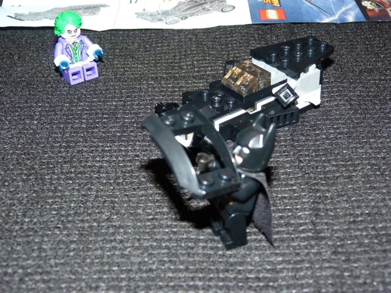](https://www.freelug.org/IMG/jpg/P1040491.jpg)

[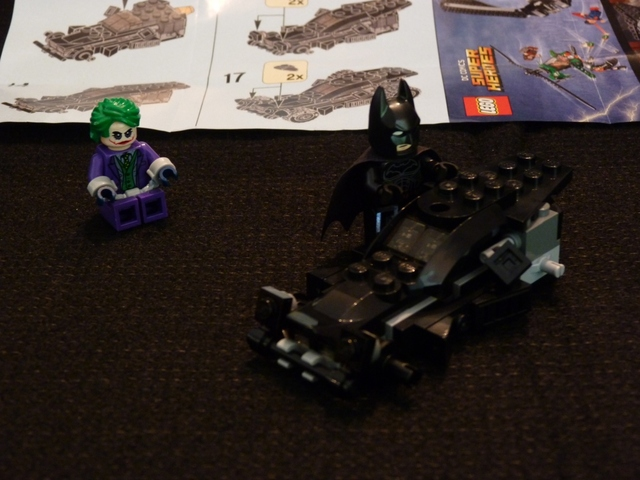](https://www.freelug.org/IMG/jpg/P1040493.jpg)

[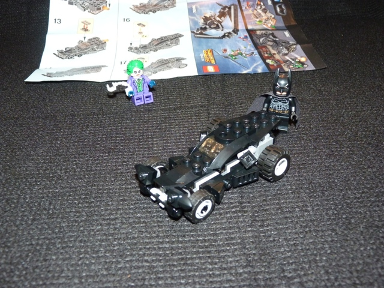](https://www.freelug.org/IMG/jpg/P1040495.jpg)

Notre super-héros admire son destrier mécanique flambant neuf sous toutes les coutures pendant que son pire ennemi prend discrètement la fuite.

[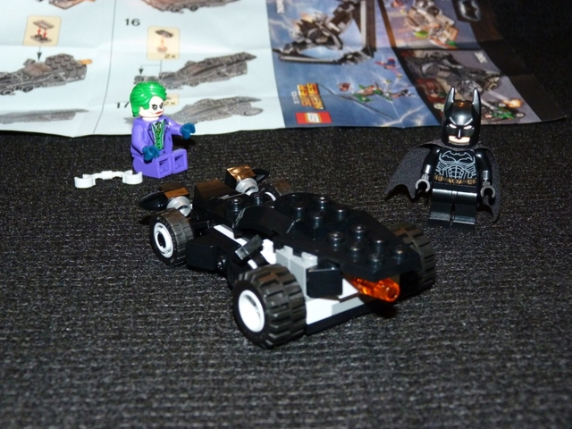](https://www.freelug.org/IMG/jpg/P1040496.jpg)

[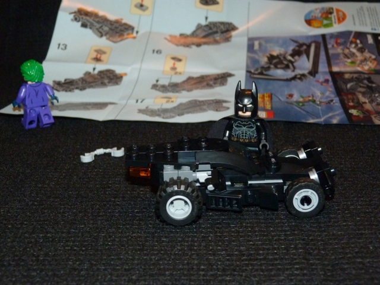](https://www.freelug.org/IMG/jpg/P1040500.jpg)

[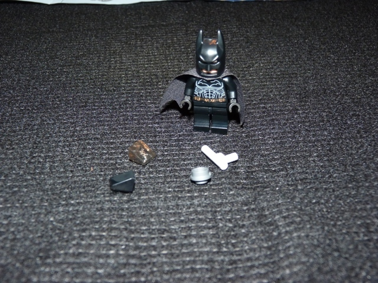](https://www.freelug.org/IMG/jpg/P1040505.jpg)

Le Joker a disparu mais il a quand même laissé les pièces en rab.

* * *

En conclusion, ce polybag n’a rien d’exceptionnel. Je ne cache pas ma déception... La construction est certes classique mais la notice s’emballe un peu par moment : il arrive qu’on ait qu’une pièce à poser et étape suivante il y en a 4-5 d’un coup, c’est un peu brouillon pour s’y retrouver (ce qui m’a d’ailleurs valu un petit retour en arrière sur seulement 17 étapes !).  
Après, un détail : je sais qu’on n’est pas dans la collection _Elves_ ou _Friends_ avec des couleurs partout, mais excepté deux pièces, on reste dans le trio gris clair / gris foncé / noir. Je sais bien que c’est Batman et pas Bob l’Eponge mais je sais pas, j’ai trouvé ça rébarbatif voire triste même avec si peu de pièces...  
De plus, pas de pièce exclusive au set, non vraiment, à mon sens même pour un set offert, ça ne ravira que les fans / collectionneurs de l’univers _Batman_ (ou _DC Comics_) et/ou les adorateurs du format Midi Scale.

[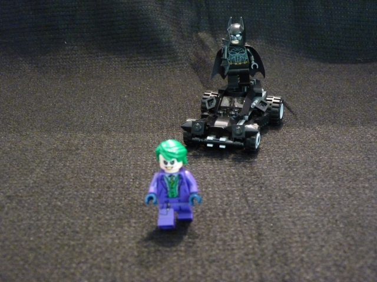](https://www.freelug.org/IMG/jpg/P1040507.jpg)

En attendant une prochaine review, Batman peut désormais partir à la poursuite du clown sadique...

Merci de m’avoir lu !

A une prochaine !
