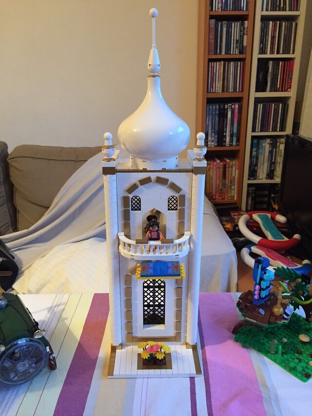
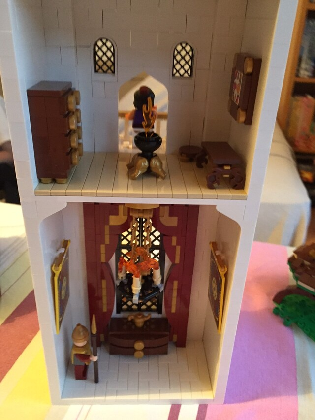
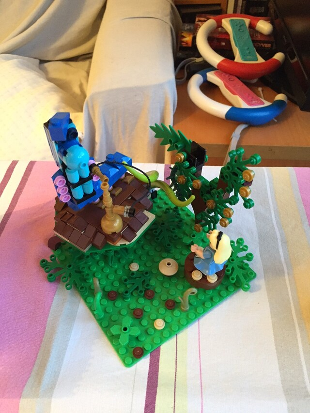
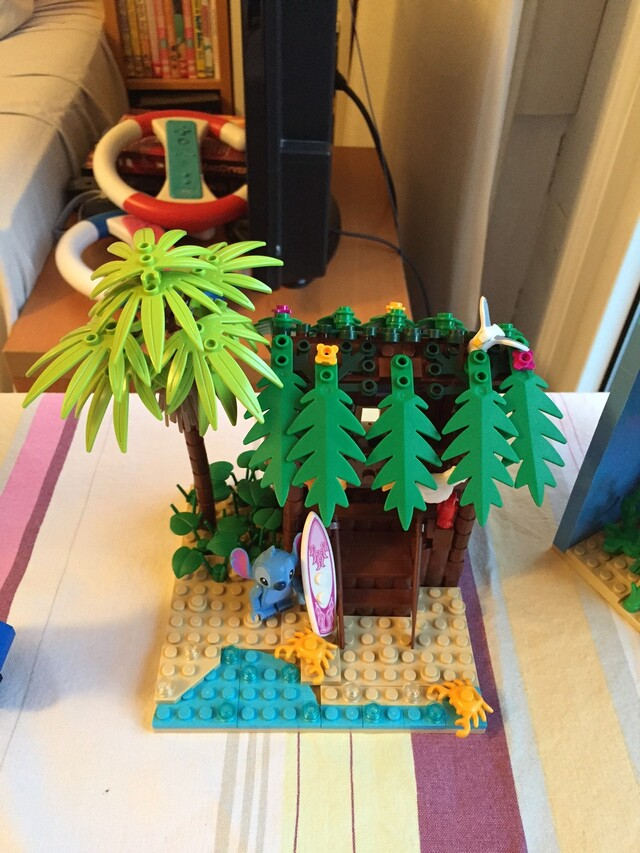
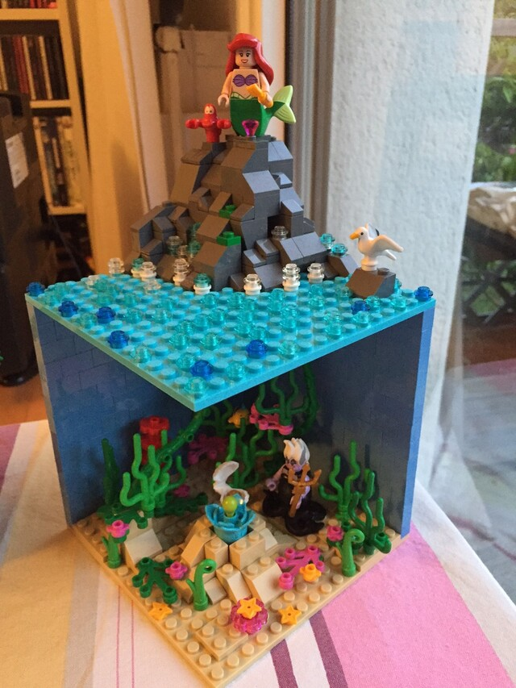
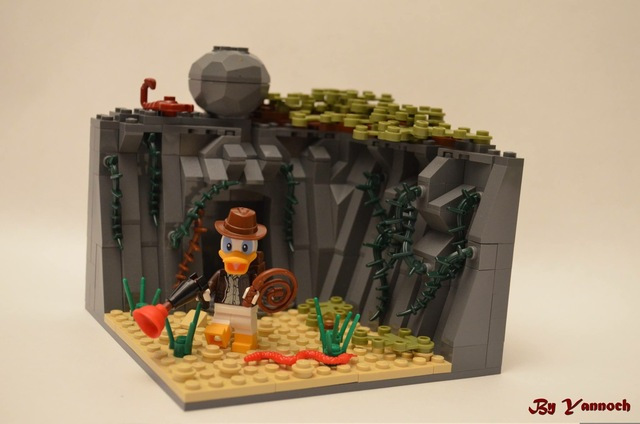
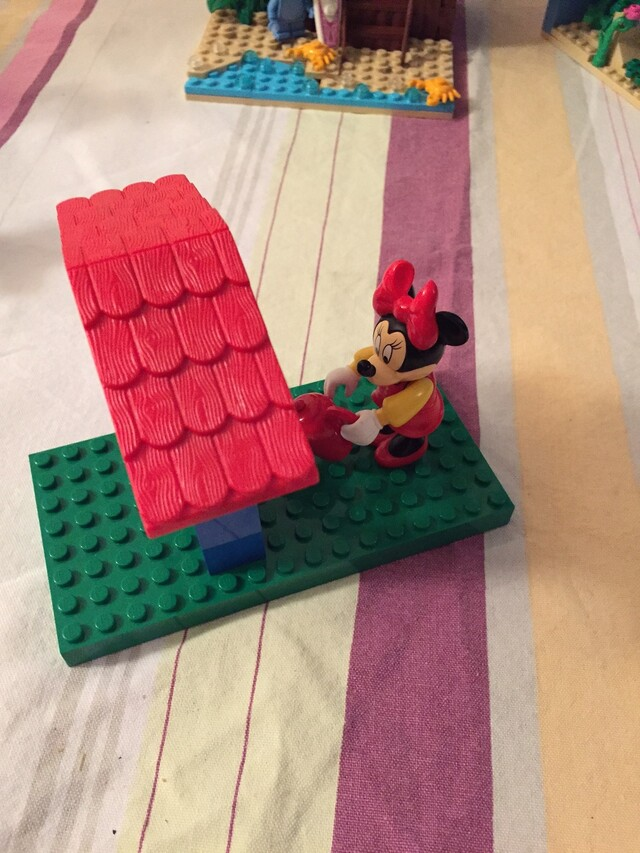
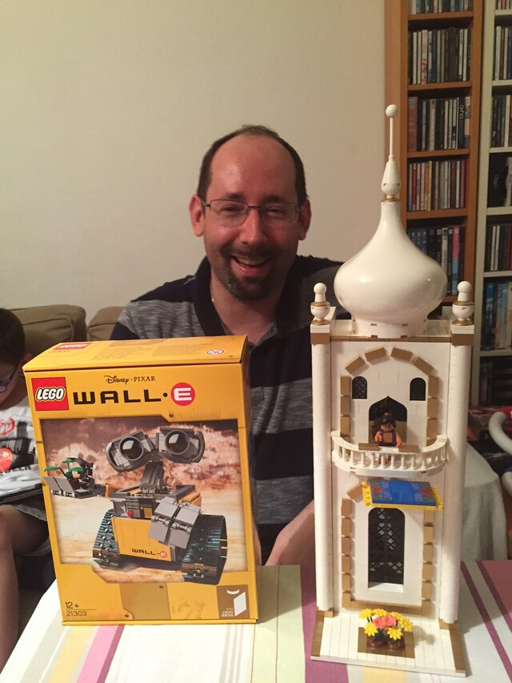

Le samedi 28 Mai, nous nous sommes retrouvés chez Didier afin de manger, boire, discuter et surtout répondre au premier concours du CoR RA (VoldeCoR).  
Le thème était un MOC de 16x16 sur l’univers Disney. La présence d’une minifigurine Disney (récemment sortie) était un plus. Marie était la juge accompagné d’Yves.

Voici les photos des différents MOC. Dans l’ordre vous avez Laurent (Aladdin), Sandra (Alice), Marie (avec deux créations Stitch et Ariel), Yannick (QuakeShot) et Pierre (Minnie).

LAURENT

SANDRA

MARIE

YANNICK

PIERRE

Et notre grand Gagnant : Laurent

_\------------------_

Bah moi je n’ai pas eu d’idée à temps alors je suis venu pour les pizzas... Et je n’ai pas été déçu car, en plus, il y avait du brownie de compèt : merci Sandra ! Et bravo pour ta deuxième place.  
Une très bonne idée, ces petits concours internes et locaux. Ça peut permettre de resserrer les liens entre nous en nous voyant plus souvent. Et si ça peut motiver les nouveaux pour se montrer, c’est encore mieux !

Merci Didier pour avoir proposé ta maison comme lieu de débauche. C’est toujours un bon moment la visite de ta caverne à briques, ainsi que profiter de tes lumières de Jedi spécialiste de l’éternelle bataille entre les tenons et les anti-tenons. ;-)

Longue vie au COR !

Jérôme

_\------------------_

Une soirée sympathique avec plein de découvertes où j’ai encore appris plein de choses. Y avait même de la pizza et on a visité le grenier de Didier !!! Que demander de plus ?  
Les Mocs étaient magnifiques, avec un grand bravo à Laurent et une spéciale dédicace à celui de Pierre :)

Sandra

_\------------------_
