Sous le couvert d’une rencontre européenne sur l’exploration de la planète Mars (March On Mars), 25 jeunes de 15 pays de la communauté europénne se sont retrouvés à l’école Polytechnique.

Nos 4 valeureux compères se donnèrent rendez-vous sur un quai de gare à une heure où certains ne sont meme pas encore levé d’ordinaire, et cela se voit sur leurs visages :-)

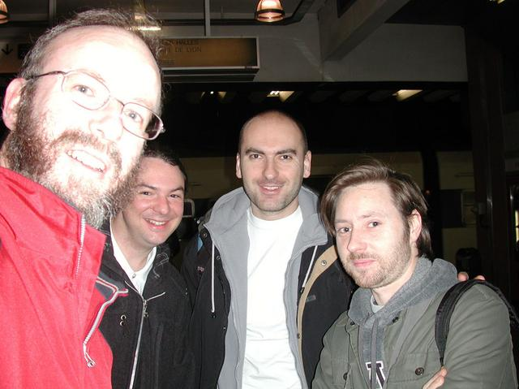

Les sacs à dos remplis de MOC à base de RCX et de livres sur la programmation, JLB, Chris, Philo et Gaël sont entrés dans une salle remplie de 25 jeunes (étudiantes et étudiants) discutant en anglais autour d’un café.

Les kits Mindstorms 1.5 étaient prétés par une université Suisse. Marc avaient commencé à construire un modèle identique à base d’un RCX, deux moteurs et deux capteurs (touch et light).

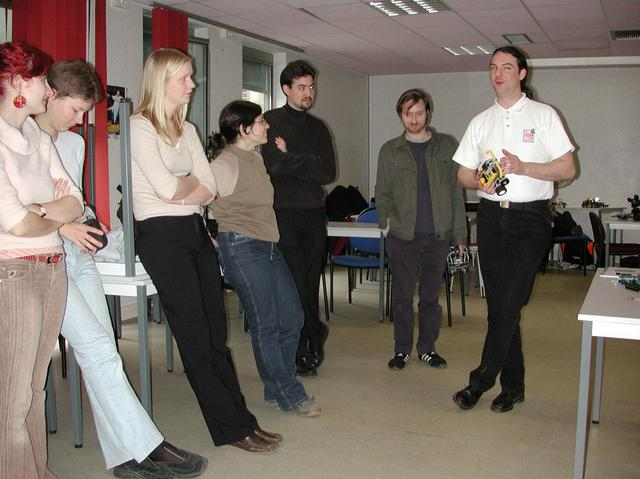

Après avoir installé BricxCC sur les ordinateurs, Philo et Chris ont présenté certaines de leurs créations.

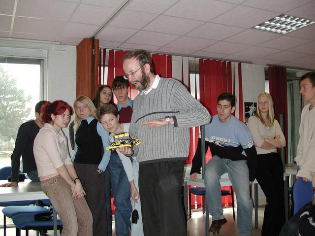

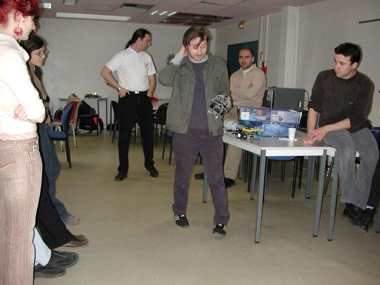

Chris et Philo ont d’ailleurs improvisé un combat de legway :-)

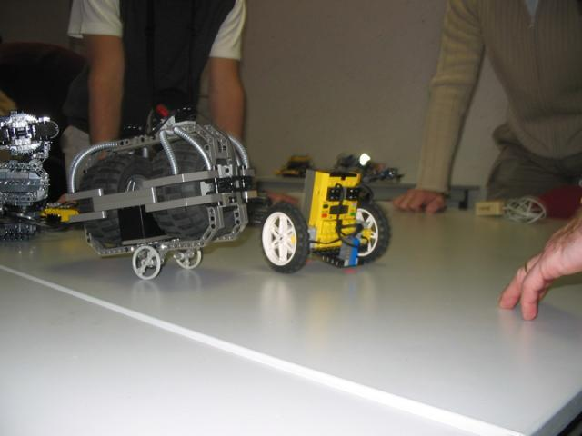

La bonne ambiance s’est très vite installée et de nombreuses questions ont fusé.

À 10h30, les démos finies, nous sommes passés aux choses sérieuses. Quatre groupes ce sont formés. Chaque groupe avait à sa disposition un set Mindstorm 1.5, un ordinateur avec BricxCC, et une liste des commandes de NQC.

Marc s’est occupé d’un groupe qui a demandé à programmer directement en JAVA.

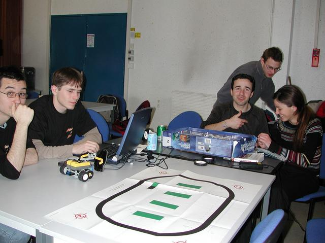

Philo s’est installé avec un groupe très curieux sur les capteurs.

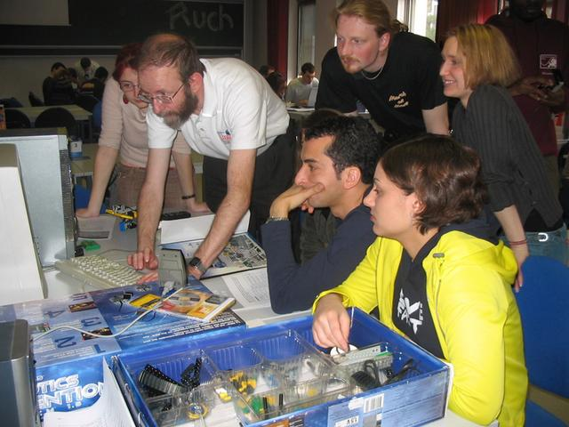

Chris, JLB et Gaël ont donc aidé les deux autres groupes à se mettre en place en présentant le RCX et le language NQC.

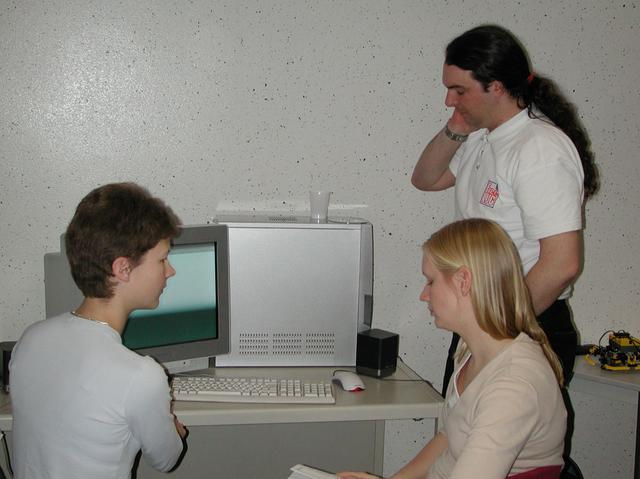

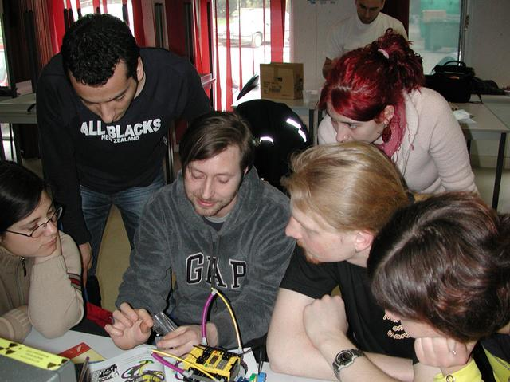

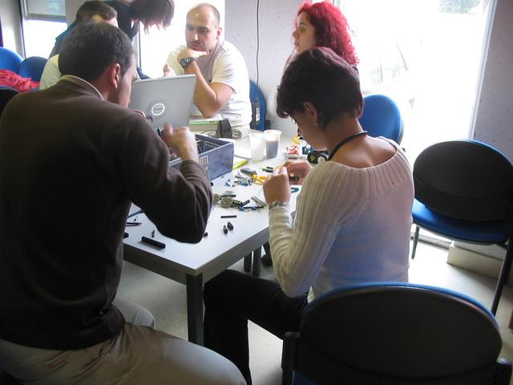

La première tâche demandée fut de faire avancer le robot, puis d’activer un "touch sensor" et enfin un capteur de lumière.

Après une heure, tous les groupes avaient des robots fonctionnels et chacun s’est lancé dans un projet propre. Le premier groupe a décidé de faire un robot qui reste sur la table (capteurs de bord). Le second s’est lancé dans un robot réagissant à une lumière, le troisième sur un robot jouant de la musique et dansant et le quatrième est resté sur l’idée d’origine, qui était de fabriquer un rover martien (capable de suivre une ligne et d’éviter des obstacles)

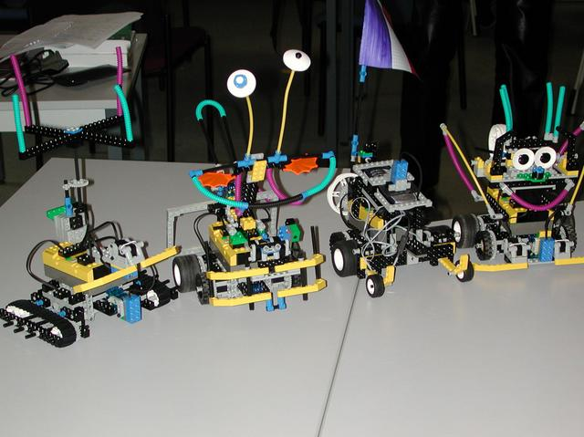

En paralléle, l’un des étudiants ayant fortement étudié la mécanique, a créé un p’tit robot en utilisant 2 moteurs, dont un en dynamo pour éviter d’utiliser des piles, l’ étudiant nous a en effet expliqué que les piles coûtaient très chers chez lui en Slovaquie.

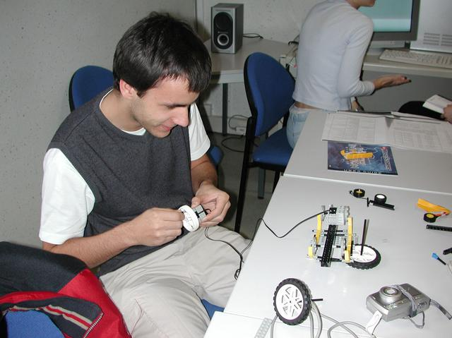

vous pouvez voir la vidéo de son marcheur en clickant sur les liens vidéos en bas de page.

Après 1h30 de pause pour le repas, trop longue pour certaines qui voulaient pouvoir revenir plut tôt à la salle pour continuer à "jouer", les constructions et programmations ont repris de plus belle.

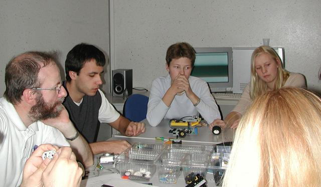

Enfin certains étudiants en ont quand même profité pour faire une sieste :-)

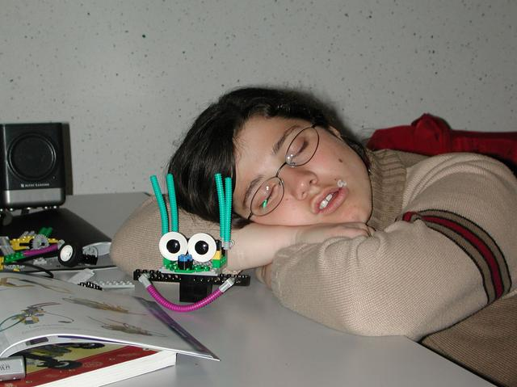

La semaine a du être difficile :-)

Un groupe a décidé de commander son robot avec un téléphone portable, idée surprenante, mais tellement logique ;)  
Il s’agit en fait d’appeler le téléphone, qui va alors allumer son écran pour annoncer un nouvel appel, un capteur de lumière détecte le changement et le programme active un moteur qui remue un drapeau. Vous pouvez voir les videos de ce robot sur les liens en bas de page.

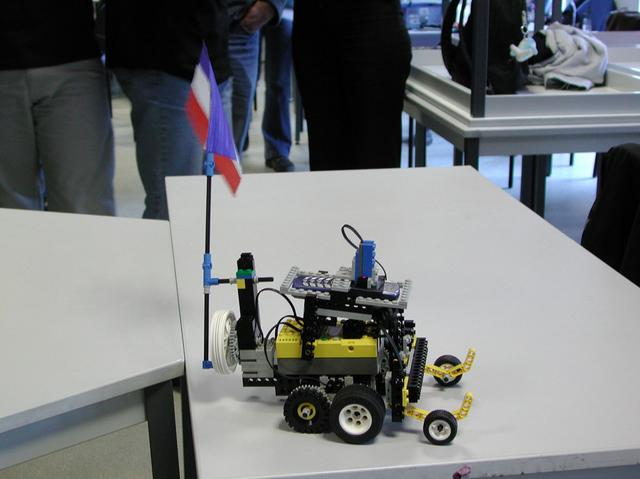

La fin de la journée est arrivée forcément trop vite, surtout lorsque l’on s’amuse. Les étudiants ont passés une journée excellente et certains d’entre eux (et elles) vont surement continuer leur expérience de robotique avec un set Minsdstorms. FreeLUG a donc assuré grave sur ce coup la :-)

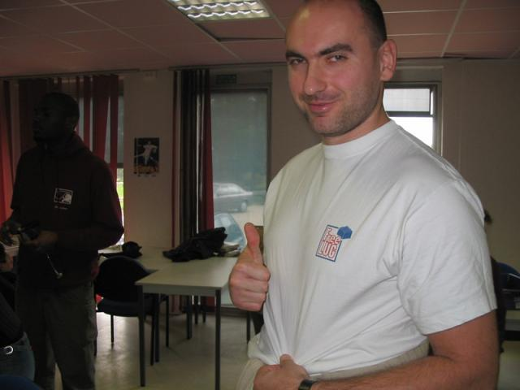

De notre coté aussi nous nous sommes beaucoup amusés, parfois surpris des idées développées. Une expérience passionante avec un public intéréssé et intéressant tout au long de le journée. Cette journée fut aussi l’occasion pour nous de nous replonger dans nos souvenirs de nos années étudiantes. Un grand remerciement à l’équipe étudiante organisatrice de cet évènement (Alex, Vince et d’autres), et peut-être à l’année prochaine :-)

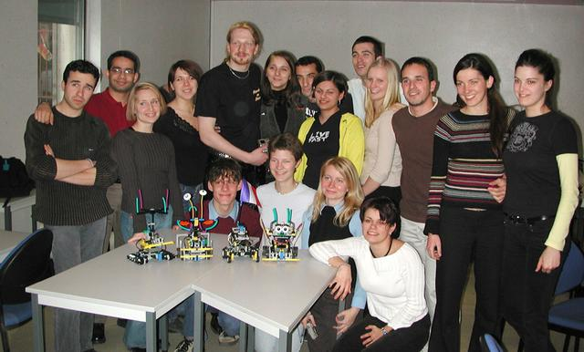
