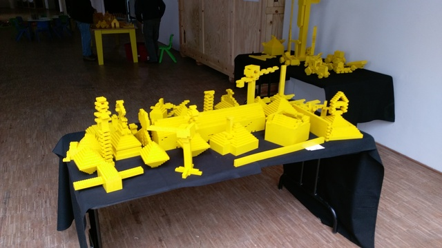
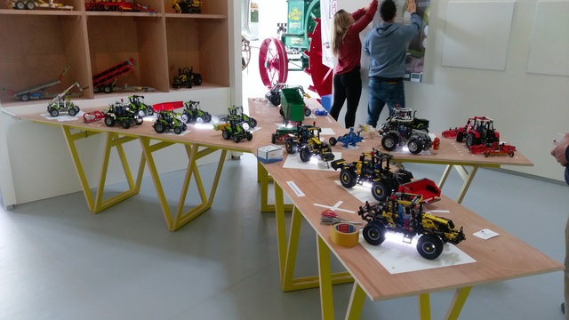
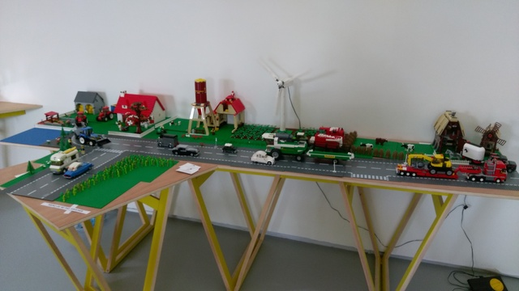
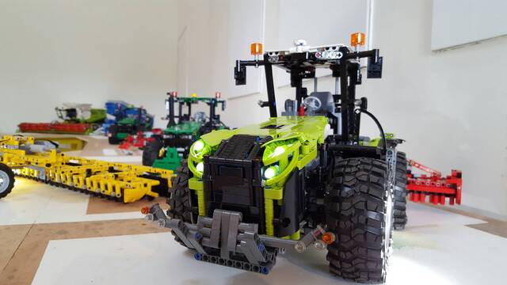
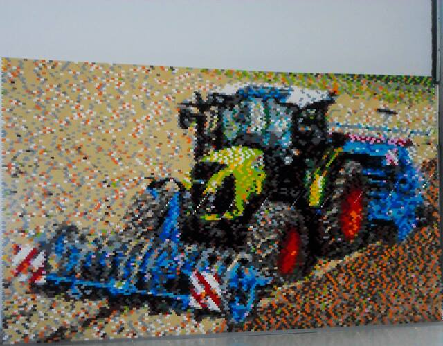
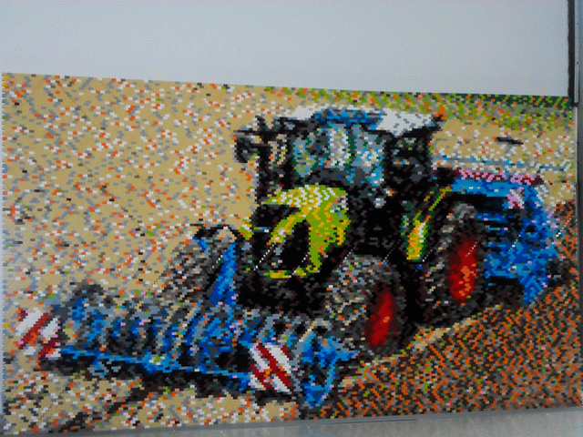

Afin de promouvoir un peu plus son gros événement de 2016, le Tractobrick, le musée agricole a cherché à faire un exposition avec des LEGO. Le constructeur de ce tracteur à l’échelle 1:1, ERC Briques, m’a transmis la demande. En effet en 2009, j’y ai déjà exposé des LEGO sous la bannière FreeLUG.

La participation de FreeLUG a été validée par le CA lors de la réunion issue de l’AG.

Après validation, j’ai donc cherché des AFOL pour m’aider dans cette tache. Tout naturellement, j’ai pensé à Rémi LANCIEN, également fan de LEGO et du monde agricole.

Suite au discussion avec le musée, nous avons proposé 4 parties distinctes

**–** Une partie exposition de modèles Tehcnic (en sets, en MOC ou en MOD).  
**–** Une partie en city avec la gamme de LEGO de 2013.  
**–** Un atelier de construction libre avec des briques jaunes.  
**–** Une mosaïque sur le thème de l’agriculture

Après ma visite lors de l’exposition de Frenchbrick à Mennecy les 30 avril et 1er mai, j’ai pu faire la connaissance de Benoît VERNET, AFOL et travaillant dans le monde agricole. Après vérification de sa disponibilité, c’est avec plaisir qu’il a accepté mon invitation avec ces modèles Technic.

Arrivé le samedi matin pour le montage et la préparation de la mosaïque, nous répartissons les taches avec Benoît et Rémi, ainsi qu’avec les animateurs du musée. Vu la configuration du musée, nous ne pouvons pas être tous les 3 dans le même endroit.

Benoît restera avec la partie City et Technic, Rémi sera avec la construction libre et les briques jaunes, et moi avec la mosaïque.

Voici quelques photos de notre exposition :

**Construction des enfants**

**Partie Technic de Rémi**

**Partie City de Sébastien**

**Partie Technic de Benoît**

**Mosaïque une fois finie**

**Petit gif de la construction de la mosaïque**

## **Petit gif de la construction de la mosaïque** Cliquez pour lancer

Article paru dans l’Écho Républicain

**Article écho républicain**

Voilà d’autres photos de l’exposition

[Photos](http://photos.freelug.org/main.php/v/sebhamon/2016/COMPA/)

Seb

* * *

Bonjour tout le monde

Voilà l’expo au COMPA est passée, passée à une vitesse incroyable.

J’étais dans la partie création libre à l’entrée sur le circuit de retour.

La brique de 2x4 de couleur jaune. Toutes les générations se sont arrêtées et se sont installées aux tables.

Les gens étaient surpris de l’imagination de certains, et oui en effet il y avait 3 tables d’exposition.

Sur les 2 après midi il n’y avait pas assez d’espace d’exposition et de briques, ma dure tâche était de démonter les créations les plus anciennes.

Les jours se suivent et ne se ressemblent pas, idem pour les créations.

A + Rémi
