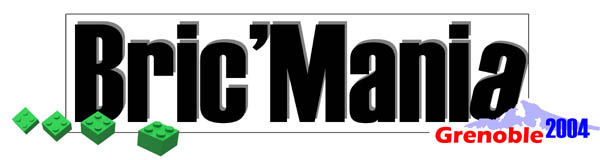
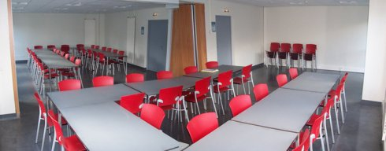

Cet été, FreeLUG vous organise un week-end de Lego, histoire de nous rencontrer et de montrer vos Mocs...

**Cet été c’est la....**

Apres Rennes en 2003, c’est au tour de **Grenoble** de vous accueillir les **24 & 25 juillet 2004** pour deux jours de rencontre, d’amusement et d’admiration de vos réalisations.

Ce week end vous est réservé, vous les Afol, il ne s’agit pas d’une expo publique. Vous pouvez y participer soit en exposant vos realisations, soit en nous honorant de votre présence.

**–** Lieu de rendez-vous :

**Auberge de Jeunesse de Grenoble-Echirolles**  
10 Avenue du Grésivaudan 38130 Echirolles  
Tel : (33) 04.76.09.33.52  
Mail : [grenoble-echirolles@fuaj.org](mailto:grenoble-echirolles@fuaj.org)

L’auberge de jeunesse propose des possibilités d’hébergement (avec acces pour handicapés) et de repas :

-   la nuit : 13,25 € par personne (petit dejeuné inclus, prevoir le couchage, - 5 ans gratuit, chambre de 2,4,6 ou 8)
-   repas : 8,60 € ( midi ou soir, possibilité de prendre ses repas ailleurs dans le quartier )
-   parking fermé gratuit

-   la salle : en forme de L, elle est au rez-de-chaussée de l’auberge de jeunesse. Elle est aussi équipée pour des connexions internets.
    
    
    

**–** Acces à l’auberge : [Carte](http://perso.freelug.org/rhone_alpes/BricMania/Map2km.gif)

-   depuis Gare SNCF de Grenoble (TGV direct Paris/Grenoble) : Tramway A ou B direction Centre Ville jusqu’à l’arret _Alsace Lorraine_, puis Bus n°1 direction Pont de Claix, arrêt _Quinzaine_.
-   depuis Autoroute de Lyon (A48) ou de Chambery (A41) : Direction Rocade sud, sortie _Echirolles Ouest_, puis direction Echirolles sur le _Cours Jean Jaures_, et 1e à droite avant la Caféteria Casino.

**–** Organisation :

Ce joli week end commencera le samedi 24 juillet à 9h jusqu’au dimanche 25 vers 18h. Nous allons mettre en place quelques animations, mais si vous avez des idées ou des envies, signalez les nous !! Cela peut etre un "concours de beauté de Lego", ou encore un exposé sur un thème, ou sur un modele de votre conception...

**–** Inscription :

Dans un soucis de bonne organisation, vous devez vous inscrire en apportant les quelques informations demandées suivantes :

1.  Nom
2.  nombre de personnes vous accompagnant (famille par ex)
3.  nombre de lits souhaité si vous couchez à l’auberge
4.  nombre de repas( samedi midi, samedi soir & dimanche midi)
5.  Arrivée prevue vendredi ou samedi
6.  Exposant ou visiteur
7.  Si exposant, quelle surface estimée souhaitée (important si il vous faut une grande table)
8.  Theme exposé
9.  Animation proposée

Inscrivez vous a cette adresse : [bricmania@freelug.org](mailto:bricmania@freelug.org?subject=inscription)

La somme de 8 € par adulte vous sera demandé pour couvrir les frais de location, payable d’avance ou sur place ( chèque au nom de FreeLUG).

Bric’mania est ouvert a tous les Afols, donc si vous venez de France, d’Italie, de Belgique, d’Allemagne, des Pays-bas, d’Angleterre ou d’ailleurs... vous etes cordialement invité à vous manifester et à venir....

[Grenoble](http://www.grenoble-isere.info/default.asp) et ses alentours propose un choix assez grand de visites, monuments et musées, ainsi que de belles promenades sur les montagnes qui surplombes la ville à faire en famille.

**–** Informations :

Si vous avez des questions, des propositions d’animation, contacter nous sur [bricmania@freelug.org](mailto:bricmania@freelug.org), où vous pouvez me trouver aussi sur le [Chat !](http://www.freelug.info/cgi-bin/cgiirc/irc.cgi) de Freelug tous les apres-midi, et demander Chimere.
