Voici la revue du set 10244 dans la gamme Expert : Fairground Mixer (la fête foraine). Il est sorti en 2014 au prix de 129,99 euros pour 1746 pièces. Soit un ratio de 7,4 centimes par pièce avec 12 minifigs.

La boite possède les logos CREATOR et EXPERT. La boite montre le manège et autres stands dans un décor de fête foraine.

[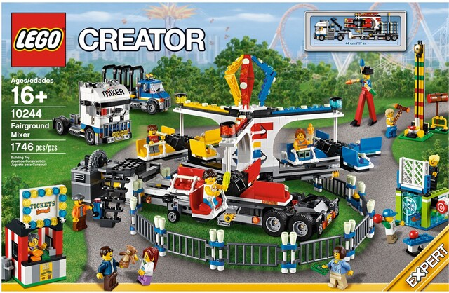](https://www.freelug.org/IMG/jpg/10244_alt1.jpg)

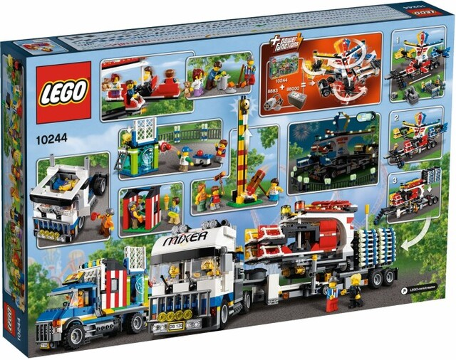

Les sachets sont numérotés de 1 à 3 correspondants aux différentes étapes de montage et au numéro du livret fourni. Ce qui permet de faire le montage en plusieurs fois.

[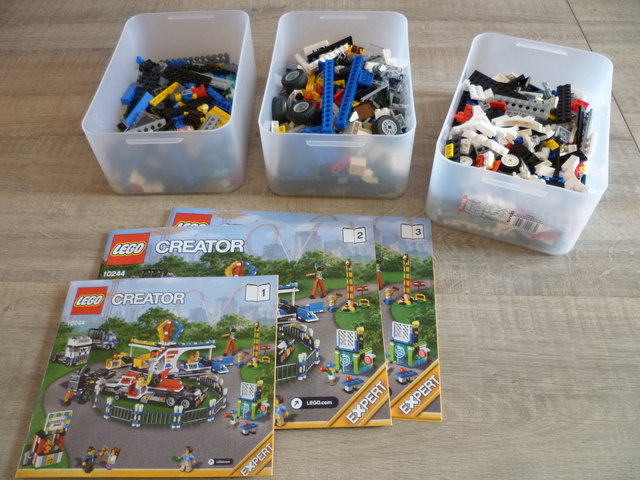](https://www.freelug.org/IMG/jpg/P1070767.jpg)

## Etape 1 - Les stand et leur camion de transport

Voici les pièces des sachets numéro 1

[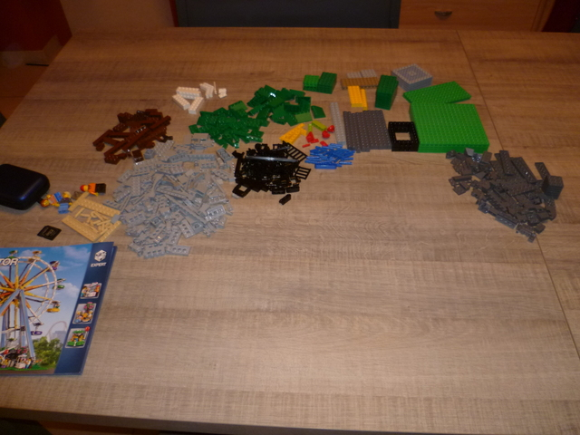](https://www.freelug.org/IMG/jpg/P1070523.jpg)

On commence par le jongleur

[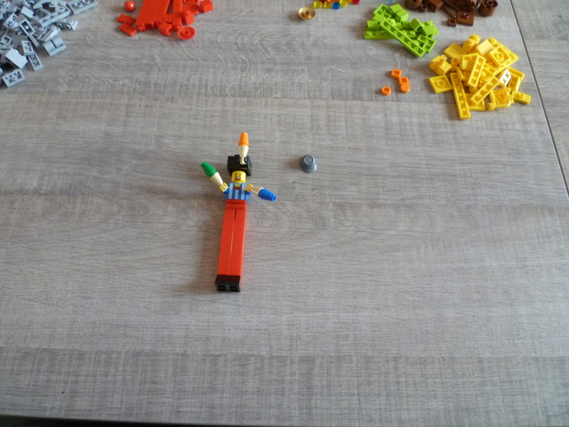](https://www.freelug.org/IMG/jpg/P1070773.jpg)

Voici la base du camion. On comprendra après pourquoi ce trou.

[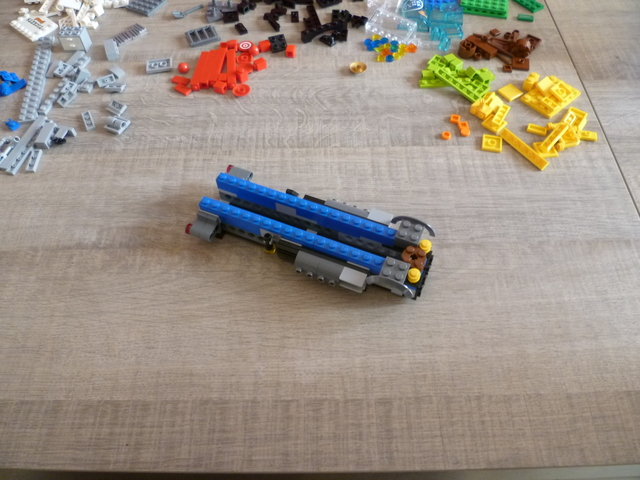](https://www.freelug.org/IMG/jpg/P1070786.jpg)

Et le camion fini.

[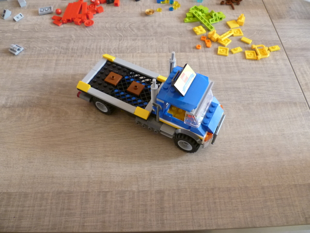](https://www.freelug.org/IMG/jpg/P1070798.jpg)

Avec l’autocollant ’LEGO Amusements’

[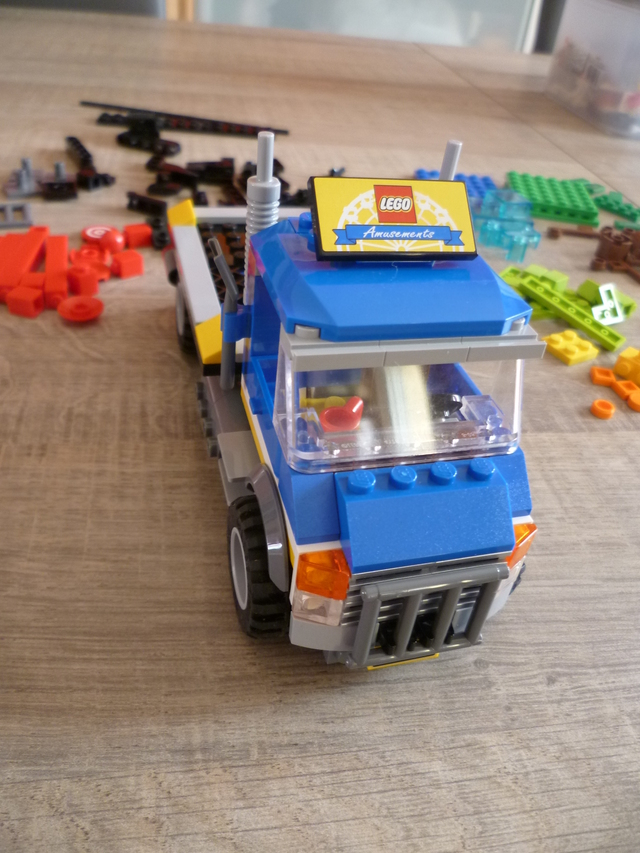](https://www.freelug.org/IMG/jpg/P1070799.jpg)

Le stand de qui est le plus fort

[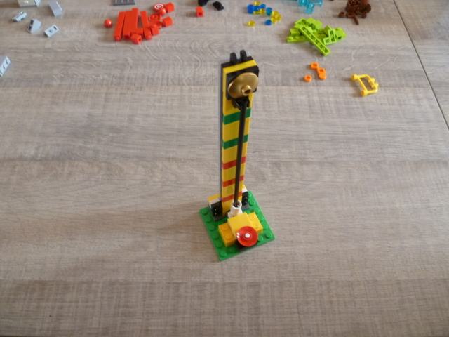](https://www.freelug.org/IMG/jpg/P1070812.jpg)

Avec les masses

[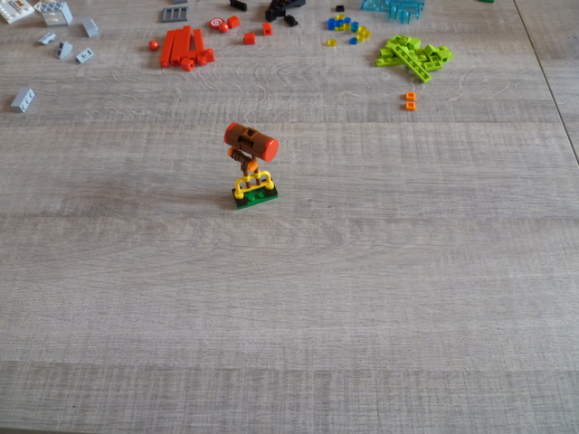](https://www.freelug.org/IMG/jpg/P1070816.jpg)

Le stand du lancer de balles

[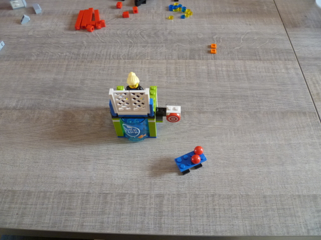](https://www.freelug.org/IMG/jpg/P1070830.jpg)

Et le stand de vente des tickets

[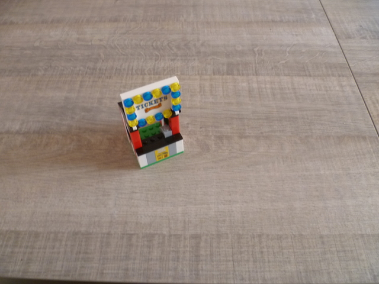](https://www.freelug.org/IMG/jpg/P1070840.jpg)

Voici l’ensemble des constructions du sachet 1

[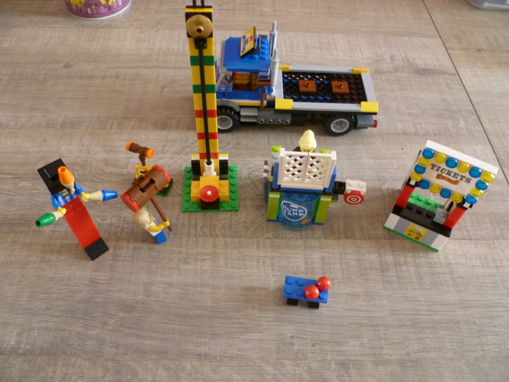](https://www.freelug.org/IMG/jpg/P1070841.jpg)

Cette fois tout est rangé sur le camion

[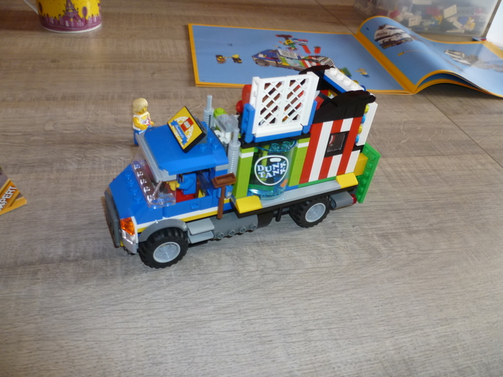](https://www.freelug.org/IMG/jpg/P1070842.jpg)

[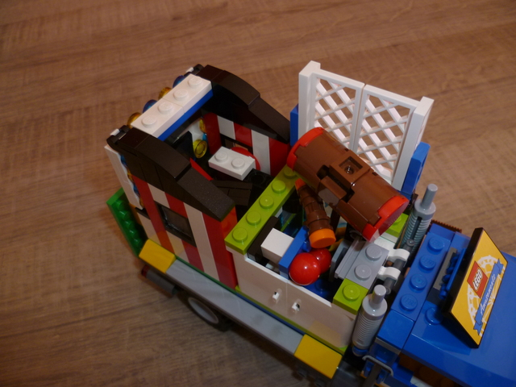](https://www.freelug.org/IMG/jpg/P1080365.jpg)

Et oui tout tient sur le camion !

## Etape 2 - Le camion manège et la base de sa remorque

Voici les pièces des sachets numéro 2

[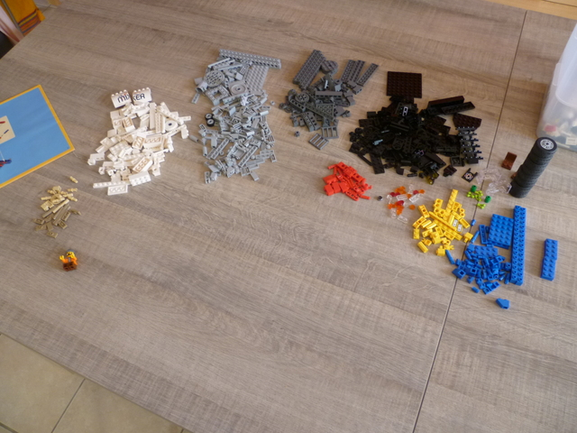](https://www.freelug.org/IMG/jpg/P1070843.jpg)

On commence par le camion. Voici le châssis

[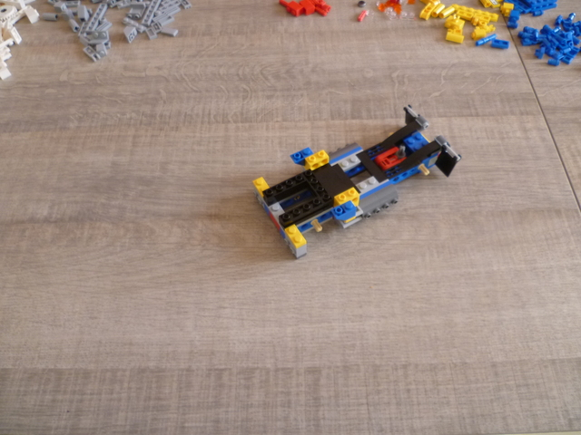](https://www.freelug.org/IMG/jpg/P1070854.jpg)

La cabine avec une couchette.

[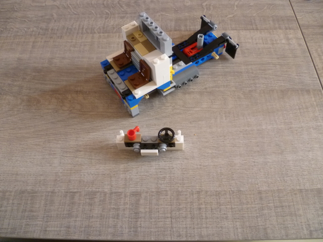](https://www.freelug.org/IMG/jpg/P1070865.jpg)

La calandre

[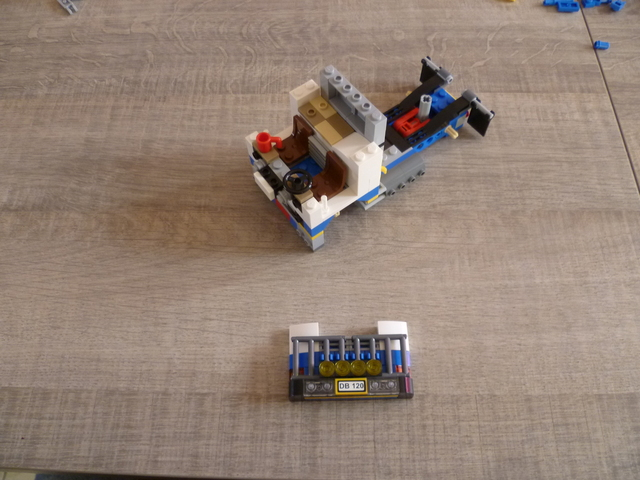](https://www.freelug.org/IMG/jpg/P1070874.jpg)

Et voilà le résultat

[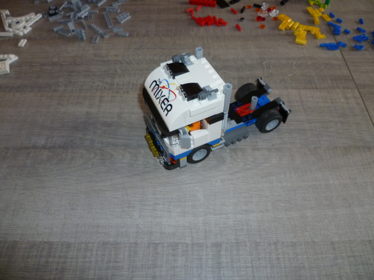](https://www.freelug.org/IMG/jpg/P1070891.jpg)

Le toit s’ouvre pour pouvoir mettre les minifigs

[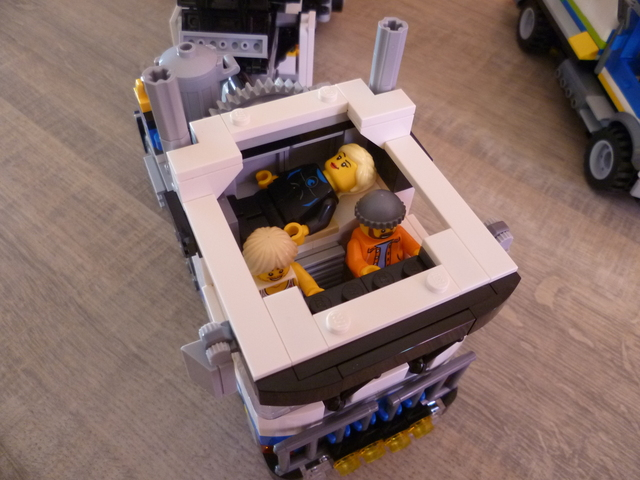](https://www.freelug.org/IMG/jpg/P1080364.jpg)

On continue avec la base de la remorque faite en pièces technic.

[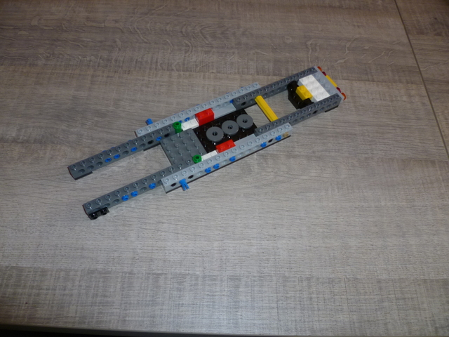](https://www.freelug.org/IMG/jpg/P1070902.jpg)

Il y a une grande démultiplication au niveau des engrenages pour permettre le montage d’un moteur (pour que l’ensemble ne tourne pas trop vite). On note aussi la présence d’un engrenage blanc qui permet de protéger le moteur en cas de blocage.

[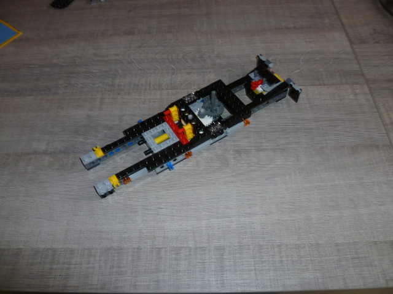](https://www.freelug.org/IMG/jpg/P1070915.jpg)

Voici le résultat à la fin du montage de la remorque.

[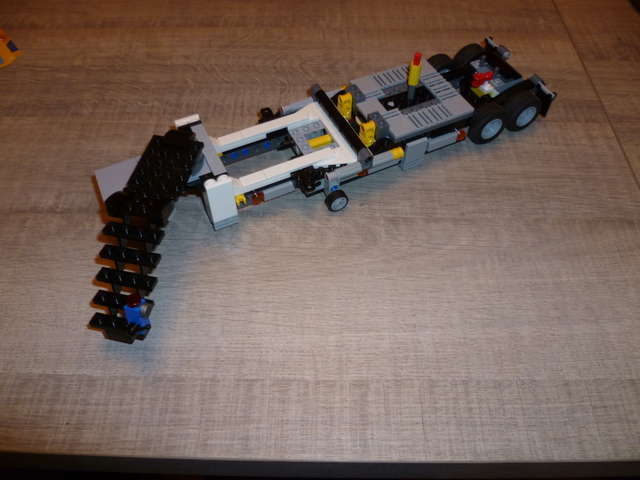](https://www.freelug.org/IMG/jpg/P1070937.jpg)

A la fin du sachet on monte un bloc manivelle pour pouvoir faire tourner le manège à la main. Il possède une très grande roue pour être capable de ne pas faire tourner le manège trop lentement (à cause de la forte démultiplication de la remorque).

[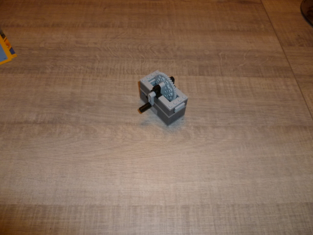](https://www.freelug.org/IMG/jpg/P1070947.jpg)

## Etape 3 - Le manège de la remorque

Voici les pièces des sachets numéro 3

[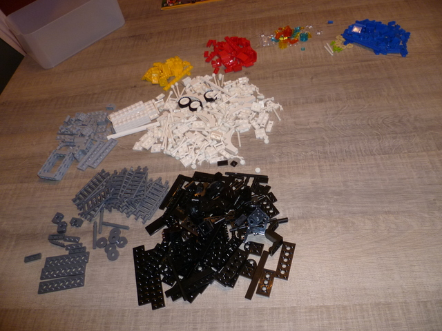](https://www.freelug.org/IMG/jpg/P1080284.jpg)

On commence par le montage des barrières,

[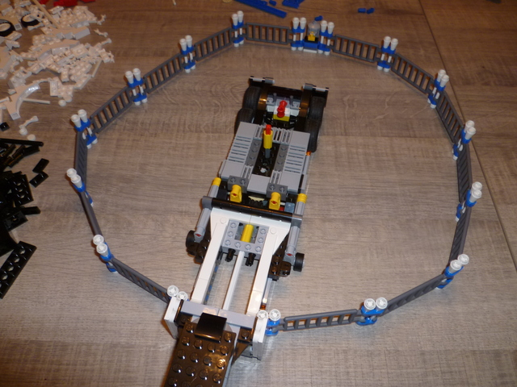](https://www.freelug.org/IMG/jpg/P1080295.jpg)

Puis on attaque la base,

[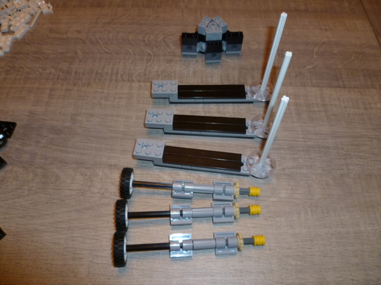](https://www.freelug.org/IMG/jpg/P1080313.jpg)

On monte la partie centrale,

[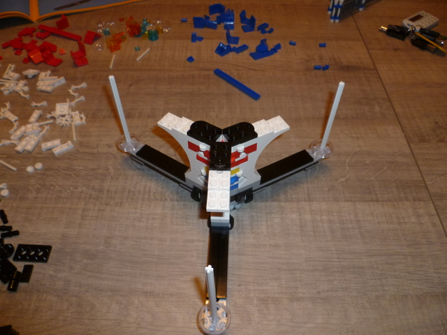](https://www.freelug.org/IMG/jpg/P1080332.jpg)

La partie fixe des sièges (j’ai fait les trois ensemble),

[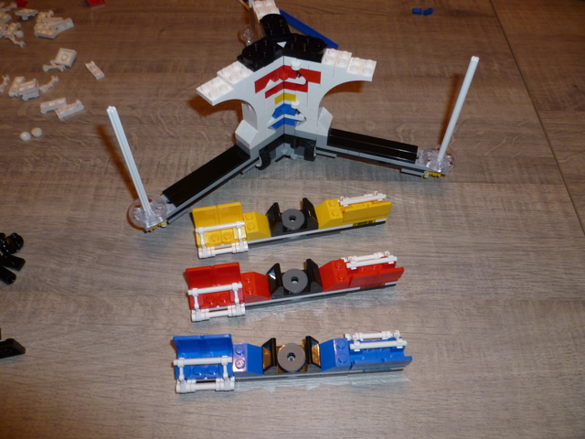](https://www.freelug.org/IMG/jpg/P1080339.jpg)

La partie mobile,

[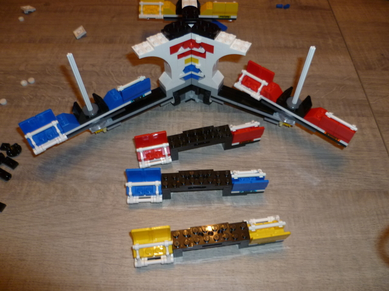](https://www.freelug.org/IMG/jpg/P1080344.jpg)

Et voilà le manège fini.

[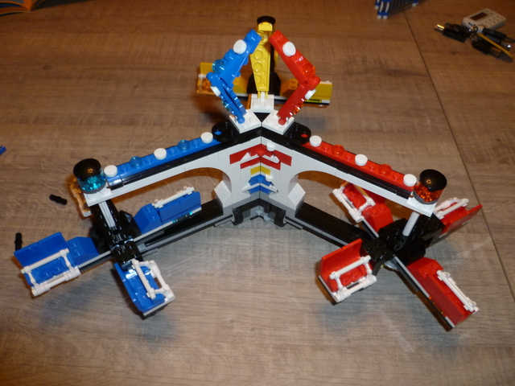](https://www.freelug.org/IMG/jpg/P1080354.jpg)

On finit ce modèle par le rack de rangement des barrières.

[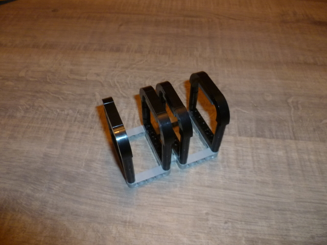](https://www.freelug.org/IMG/jpg/P1080361.jpg)

Voilà le résultat final installé,

[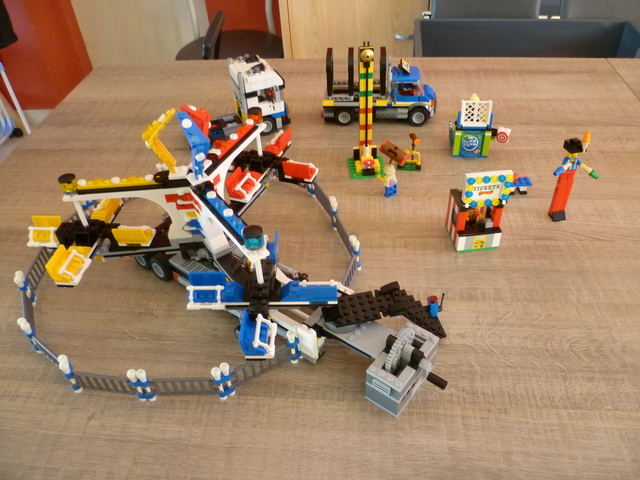](https://www.freelug.org/IMG/jpg/P1080371.jpg)

Et rangé sur les camions.

[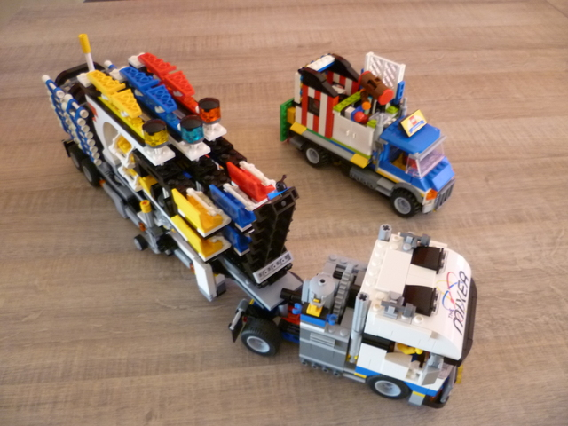](https://www.freelug.org/IMG/jpg/P1080363.jpg)

Ce set est vraiment très intéressant à construire avec beaucoup d’accessoires et 12 minifigs

## Etape 4 - La motorisation

Le modèle est déjà prévu pour être motorisé. Il faut un moteur M et un boitier de pile ou batterie (l’axe sur le moteur est fourni avec le set).

[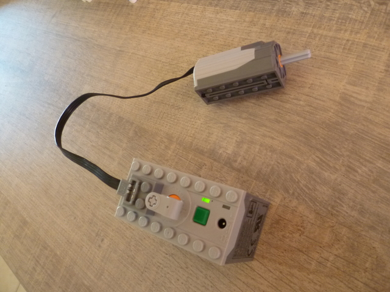](https://www.freelug.org/IMG/jpg/P1080378.jpg)

Le moteur se loge dans la remorque.

[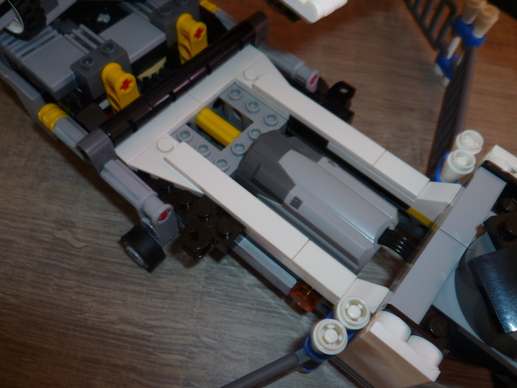](https://www.freelug.org/IMG/jpg/P1080379.jpg)

Voici le manège motorisé.

Video Player

[Vidéo de la publication d’origine](https://www.freelug.org/IMG/mov/P1080380.mov)

**Motorisé**

Voici le manège en fonction avec un moteur

Si l’on souhaite faire de l’automatisation avec des temps d’arrêt, il est aussi possible de loger un petit moteur mindstorm.

[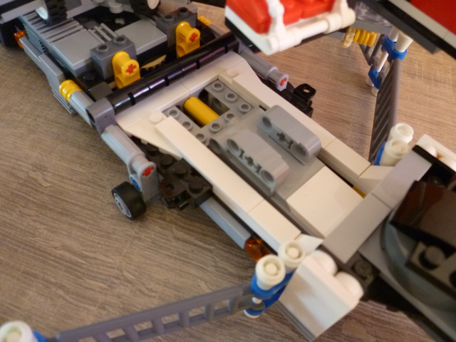](https://www.freelug.org/IMG/jpg/P1080381.jpg)

**Animations du montage** (Cliquez pour lancer l’animation)

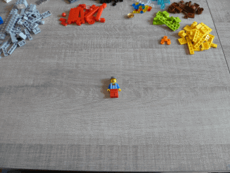
