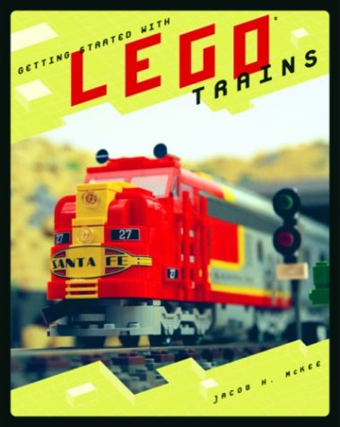
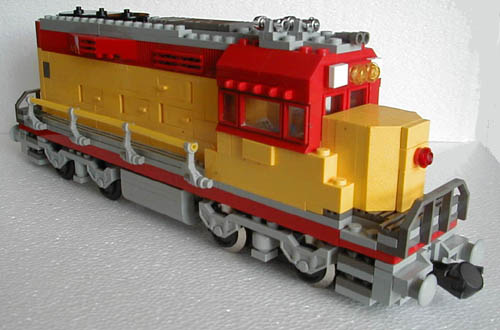

Après avoir annoncé la sortie du livre de Jake McKee "Getting started with LEGO&reg trains", disséquons un peu ce premier ouvrage sur les trains en LEGO®

La première impression est mitigée, en effet bien que le livre soit imprimé entièrement en couleur et sur un papier glacé de qualité, il ne fait qu’une centaine de page. On aurait souhaité qu’il soit plus épais. Toutefois cela reste satisfaisant pour un prix de 14$95.

Après une premier "feuilletage", on découvre une grande richesse d’illustration et un texte clair sur 4 colonnes. Notons que le livre est destiné aux adultes mais aussi aux enfants (dès 12ans) et que, par conséquent, l’anglais utilisé reste simple et donc très accessible aux francophones ayant des bonnes notions d’anglais sans être parfaitement bilingues.

Le livre se scinde en deux parties

La première laissera malheureusement les [AFOLs](http://www.freelug.org/article.php3?id_article=128) sur leur faim (descriptions des pièces utiles, des sets officiels). Cette première partie est heureusement aussi la plus courte.

La seconde partie présente trois modèles non officiels ([MOCs](http://www.freelug.org/article.php3?id_article=128)) à travers des notices de montage détaillées mais comportant de nombreuses erreurs (qui toutefois ne sont pas rédhibitoires pour le montage des modèles). C’est assez déçevant.

Cette seconde partie est aussi parsemée d’interviews (James Mathis, Steve Barile) et d’astuces : montage SNOT, montages avec le jumper plate, stickers...

L’auteur décrit aussi longuement le cheminement de construction de ses modèles et le processus créatif, détaillant point par point les éléments clés de la maquette.

On notera enfin que certains des éléments composants ce livre sont également disponible sur le net, parfois même mieux développés :

**–** Notice de montage d’une motrice quasi identique (sur le site de l’auteur) : [Bricksonthebrain](http://www.bricksonthebrain.com/instructions/offsite.cfm?linkID=45)  
**–** Etude de réseau sur [Train depot](http://www.ngltc.org/train_depot/plans.htm)  
**–** Interview de [James Mathis](http://www.lego.com/eng/trains/legoengineers/profiles.asp?id=jm) et [Steve Barile](http://www.mocpages.com/home.php/65) sur le processus de  
création  
**–** [Etude sur le SNOT](http://www.holgermatthes.de/bricks_us/index.htm)

Etant donné que c’est, à ma connaissance, le premier livre sur le sujet, je vous recommande l’[achat](http://www.amazon.fr/exec/obidos/ASIN/1593270062/qid%3D1081021207/171-0196445-5294604) de ce livre. Il m’a procuré beaucoup de plaisir aussi bien à la lecture que lors de la création du modèle phare :

