Review un peu spéciale aujourd’hui avec un pack de deux figurines customs venant du site _[wallercustoms.com](http://www.wallercustoms.com/)_.

Le créateur du site, _Brent Waller_, est le MOCeur à l’origine du projet _IDEAS Ghostbusters_.

« _Waller customs is a company founded by Brent Waller, the creator of the LEGO®Ideas Ghostbusters project. Using actual LEGO® parts (unless otherwise specified) we create custom designed LEGO® minifigures using the same printing technique used by LEGO®._ »

* * *

Les customs que je vais vous présenter aujourd’hui sont issues de la série _[X-Files](https://fr.wikipedia.org/wiki/X-Files_:_Aux_fronti%C3%A8res_du_r%C3%A9el)_.

[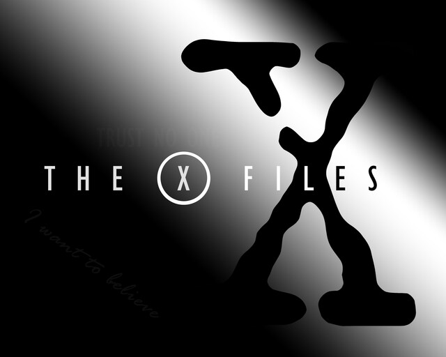](https://www.freelug.org/IMG/jpg/XFiles_logo.jpg)

Il s’agit bien entendu des célèbres agents _[Fox Mulder](https://fr.wikipedia.org/wiki/Fox_Mulder)_ et _[Dana Scully](https://fr.wikipedia.org/wiki/Dana_Scully)_.

-   **The X-Agents :**

Prix : 40$  
Contenu du pack :

-   _1x FBI X-Agent "Spooky"_
-   _1x FBI X-Agent "Skeptic"_
-   _1x "Spooky" FBI ID badge_
-   _1x "Skeptic" FBI ID badge_
-   _2x Flashlights_
-   _2x P228 Custom Pistol (not official LEGO Parts)_
-   _1x Sticker sheet with I want to believe poster and case files (not official LEGO Parts)_

Les figurines sont fournies dans un sachet zip et envoyées dans une enveloppe à bulles.

[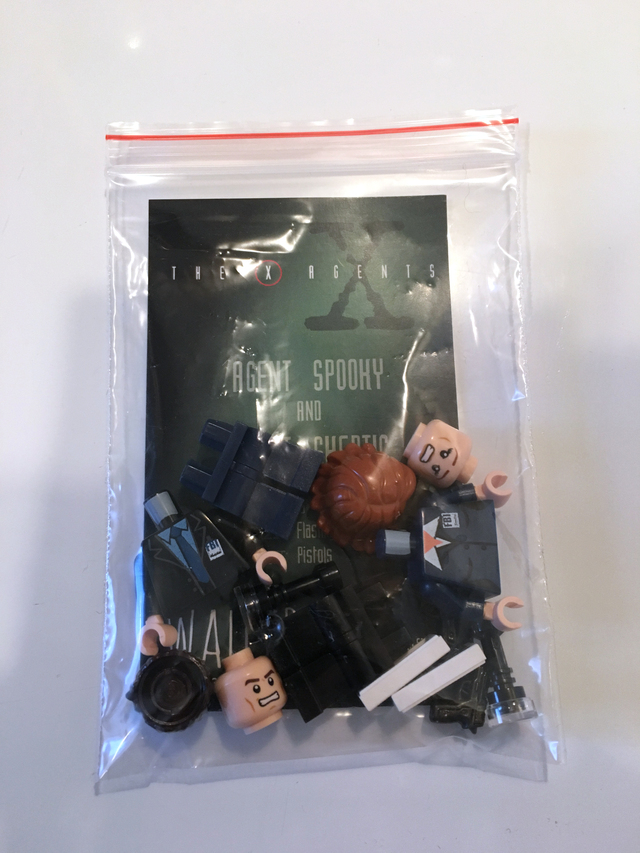](https://www.freelug.org/IMG/jpg/WallerCustoms_02.jpg)

La petite carte cartonnée et une planche de stickers permettant d’agrémenter un MOC (nous y reviendrons plus loin) de la célèbre affiche "_I WANT TO BELIEVE_", l’inscription "_Fox Mulder_" pour le chevalet de bureau et de quatre dossiers (les _X-Files_).

[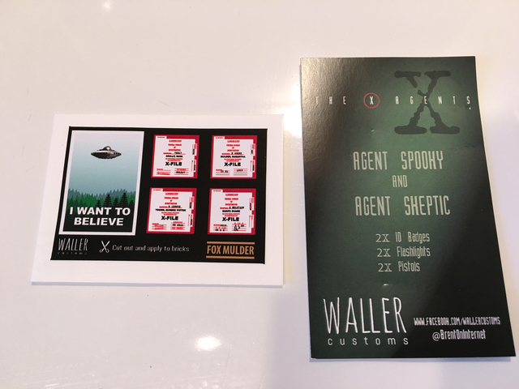](https://www.freelug.org/IMG/jpg/WallerCustoms_03.jpg)

Les six accessoires fournis avec les figurines : Deux lampes torche, deux cartes _FBI_ aux noms de nos héros (tiles 1x2 sérigraphiées) et deux pistolets (accessoires _LEGO_ non officiel).

[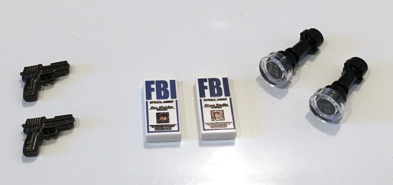](https://www.freelug.org/IMG/jpg/WallerCustoms_04.jpg)

* * *

-   **Dana Scully**

Notre héroïne est livrée avec un visage double face (ici avec l’expression apeurée), la sérigraphie est plutôt belle même si le col du chemisier comporte quelques imperfections et que le rose de son décolleté n’est pas raccord avec la teinte des têtes _LEGO_, ce qui est somme toute dommage. Un badge d’accès _FBI_ est accroché au revers de sa veste pour une plus grande fidélité.

[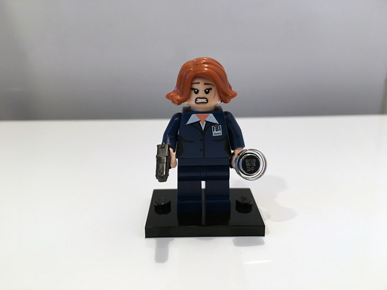](https://www.freelug.org/IMG/jpg/WallerCustoms_05.jpg)

De dos c’est le minimum syndical, _Scully_ aurait mérité quelques plis sur son tailleur ou au moins d’avoir une taille marquée comme au recto. Le visage alternatif est plutôt réussi avec un air narquois.

[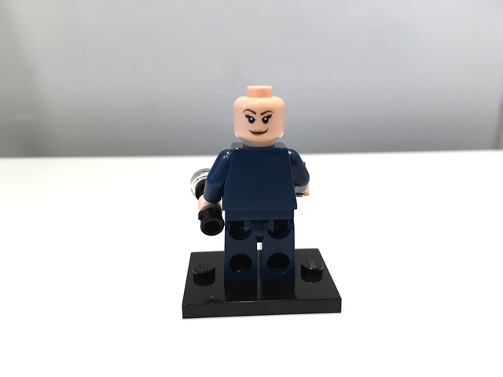](https://www.freelug.org/IMG/jpg/WallerCustoms_06.jpg)

Côtés gauche et droit, rien à déclarer niveau sérigraphies. Les photos vous permettront tout de même d’apprécier la fig sous tous les angles.

[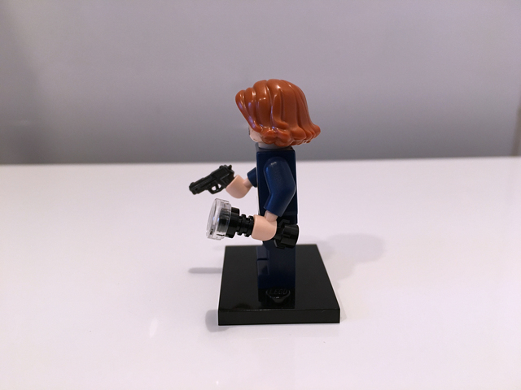](https://www.freelug.org/IMG/jpg/WallerCustoms_07.jpg)

[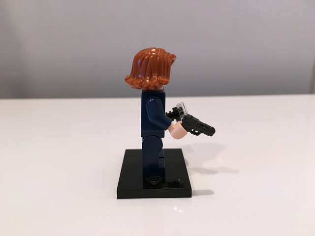](https://www.freelug.org/IMG/jpg/WallerCustoms_08.jpg)

* * *

-   **Fox Mulder**

Le héros qui croit aux petits hommes vert et aux complots gouvernementaux est vraiment réussi, son visage apeuré/énervé est vraiment sympa. Les petits points sur la chemise donnent une idée de la matière. Ici aussi le badge d’accès au _FBI_ est accroché sur le revers de la veste de _Mulder_.

[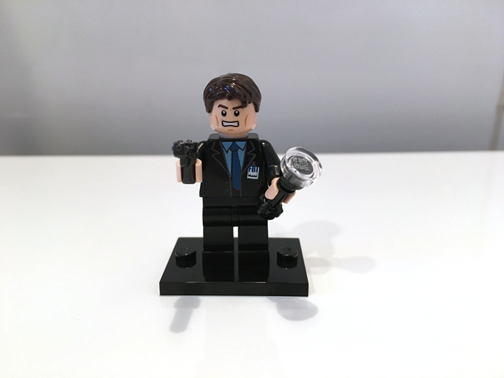](https://www.freelug.org/IMG/jpg/WallerCustoms_09.jpg)

Encore une fois, de dos c’est le désert niveau sérigraphie. C’est bien dommage que le créateur n’est pas agrémenté le verso de quelques plis qui auraient ajouté au réalisme. Le visage alternatif au sourire pincé est joliment réalisé.

[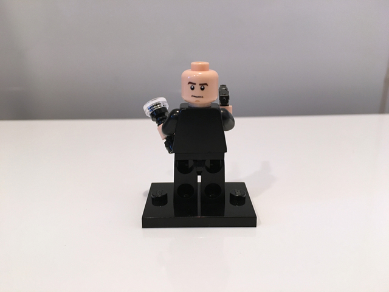](https://www.freelug.org/IMG/jpg/WallerCustoms_10.jpg)

Comme pour _Scully_, les côtés gauche et droite sont vierges de sérigraphies.

[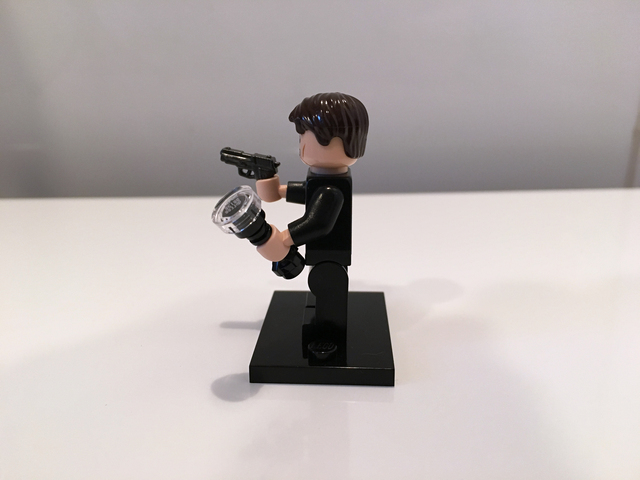](https://www.freelug.org/IMG/jpg/WallerCustoms_11.jpg)

[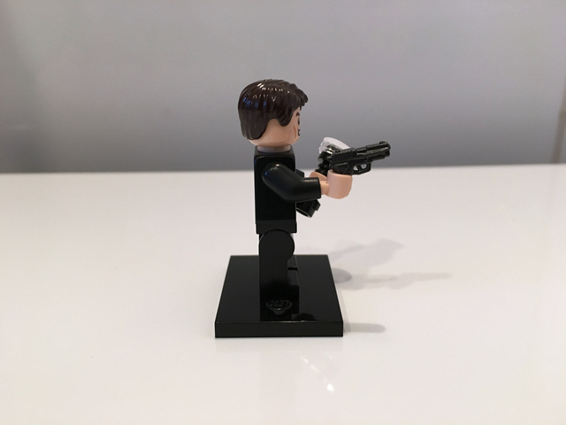](https://www.freelug.org/IMG/jpg/WallerCustoms_12.jpg)

* * *

Voici une petite photo des deux figurines avec le _Classic Alien_ de la série 6. Les expressions des visages prennent d’un coup tous leurs sens.

[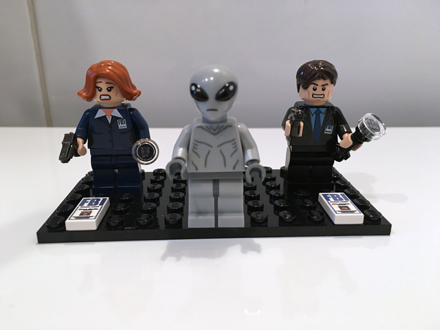](https://www.freelug.org/IMG/jpg/WallerCustoms_13.jpg)

* * *

-   **Bureau de Fox Mulder**

Le créateur des figurines vous propose, sur son site, de télécharger gratuitement le fichier LDD de son MOC du bureau de _Mulder_.  
L’attention est sympa et permet d’utiliser au mieux la planche de stickers fournie avec les figs.

-   _[Spooky’s Office file](http://www.wallercustoms.com/s/Spookys-Office.lxf)_

[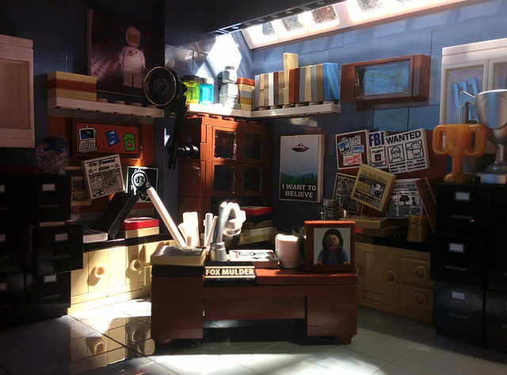](https://www.freelug.org/IMG/jpg/XFiles_Agents_Office.jpg)

* * *

**CONCLUSION :**

Réalisation en demi-teinte pour ces figurines, autant _Mulder_ est réussi, autant la sérigraphie sur _Scully_ montre des petits défauts. Et je ne parle pas du verso des figurines, vierges de toutes décorations.

Au final les stickers, les accessoires et la mise à disposition gratuite des plans du bureau de _Mulder_ apportent un plus qui empêche d’être déçu de cet achat.
