Voici une revue du set 71302, **Akida - Créature de l’eau**, de la gamme _Bionicle_.

Ce set sorti en 2015 comporte 120 pièces pour un prix de 9,99 €, soit un ratio prix/pièce d’environ 8 centimes.

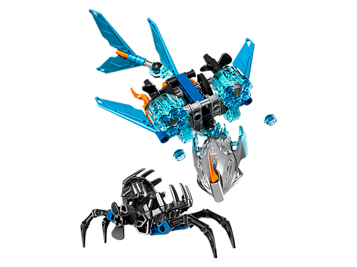

* * *

L’avant de la boîte comporte en haut les logos LEGO et Bionicle, avec sur le reste de l’espace la créature elle-même, en train de tirer quelques missiles.

[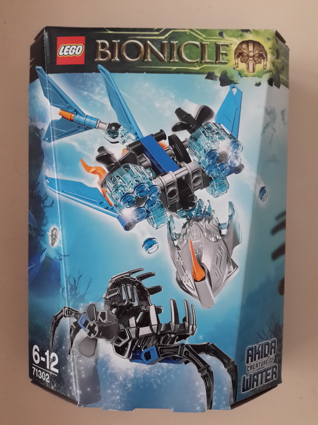](https://www.freelug.org/IMG/jpg/20160625_131410.jpg)

L’arrière propose de combiner ce set avec le 71307, _Gali - Unificateur de l’Eau_, afin de faire une créature plus puissante encore. À noter que la moitié de l’espace est dédié à des avertissements divers, et que le set est présenté comme une « figurines à construire ».

[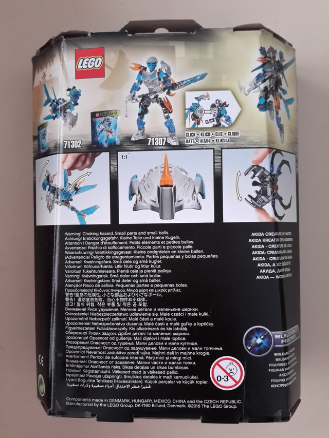](https://www.freelug.org/IMG/jpg/20160625_131424.jpg)

La boîte, qui n’a pas besoin d’être déchirée pour être ouverte, comporte une notice et deux sachets, soit un petit tas de pièces.

[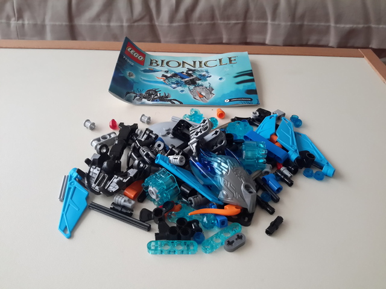](https://www.freelug.org/IMG/jpg/20160625_122230.jpg)

La construction commence par une sorte de piège, en forme de mâchoire avec quatre pattes, une hélice à l’arrière et un œil rouge à l’avant (visible sur la photo suivante).

[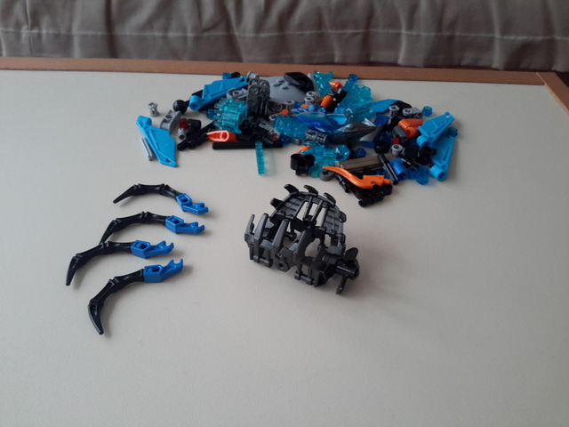](https://www.freelug.org/IMG/jpg/20160625_122432.jpg)

Akida elle-même commence par un corps symétrique, avec des pièces transparentes bleu du plus bel effet.

[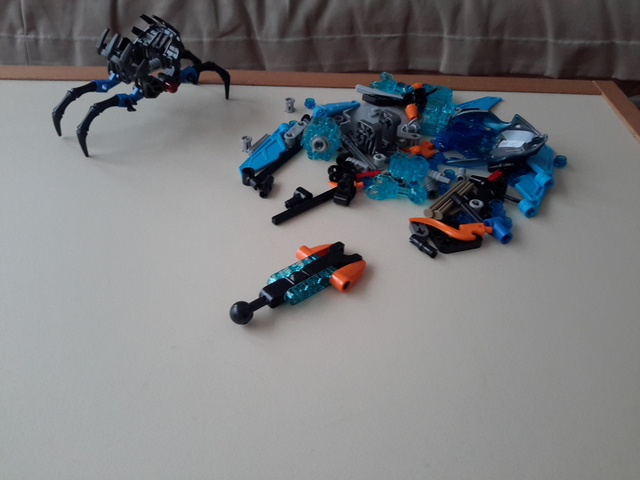](https://www.freelug.org/IMG/jpg/20160625_122712.jpg)

La construction continue avec des éléments du corps, et le premier morceau de la queue.

[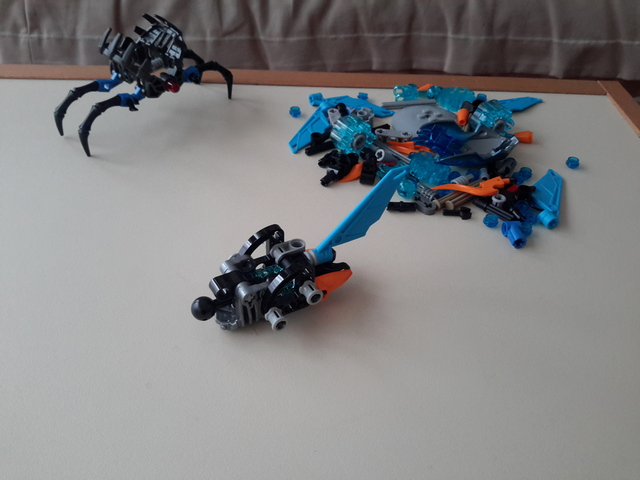](https://www.freelug.org/IMG/jpg/20160625_123139.jpg)

Une partie pivotante se rajoute, avec d’autres morceaux bleu transparent qui tournent dans l’axe.

[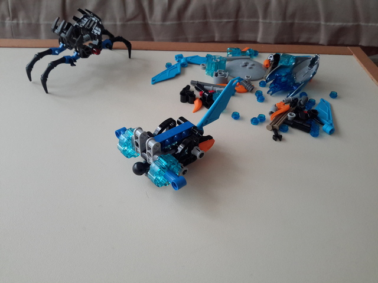](https://www.freelug.org/IMG/jpg/20160625_123528.jpg)

[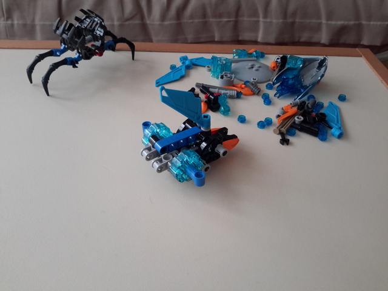](https://www.freelug.org/IMG/jpg/20160625_123539.jpg)

On rajoute ensuite le second et dernier morceau articulé de la queue, avec deux charnières.

[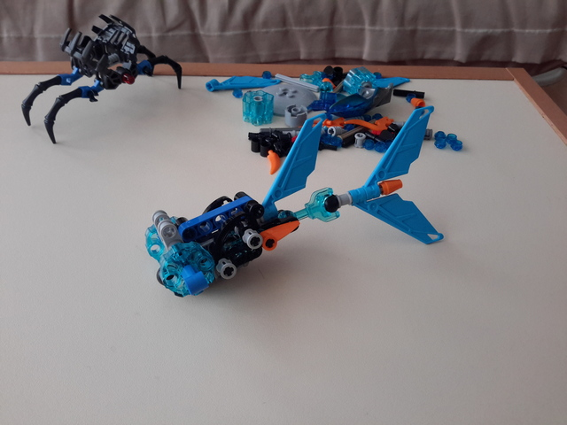](https://www.freelug.org/IMG/jpg/20160625_123806.jpg)

S’y ajoutent les ailes latérales, avec une magnifique traînée orange de chaque côté.

[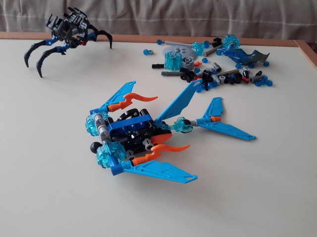](https://www.freelug.org/IMG/jpg/20160625_123953.jpg)

Le montage continue avec l’un des lance-missiles, qui comporte à l’arrière une hélice que l’on peut tourner pour tirer les pièces de l’avant.

[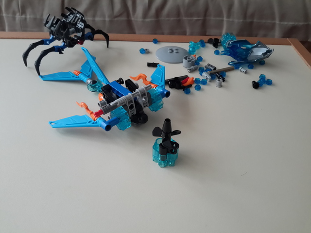](https://www.freelug.org/IMG/jpg/20160625_125745.jpg)

Voici la créature avec les deux lance-missiles montés, mais pas encore chargés, et sa tête, terminée pour ainsi dire.

[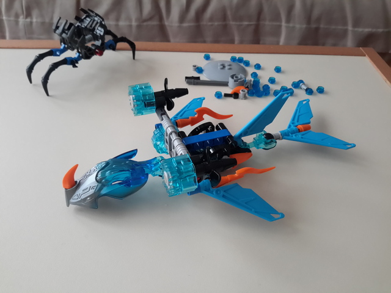](https://www.freelug.org/IMG/jpg/20160625_130153.jpg)

Et voici les armes chargées, et prêtes à tirer. La pièce grise au centre tourne (elle est attachée à l’hélice de l’arrière), et ce faisant éjecte les pièces bleues.

[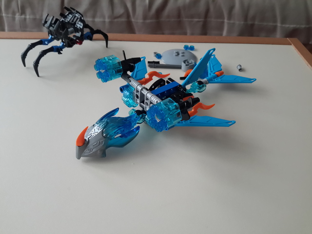](https://www.freelug.org/IMG/jpg/20160625_130254.jpg)

La créature avec les armes basculées sur l’avant (quand elle est dressée), sans doute pour quand on la combine avec la créature 71307.

[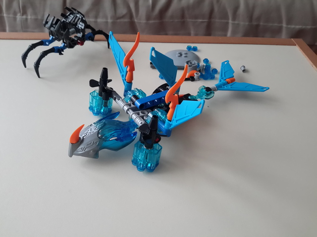](https://www.freelug.org/IMG/jpg/20160625_130314.jpg)

Pour finir on construit un support pour poser la créature, avec simplement quelques pièces.

[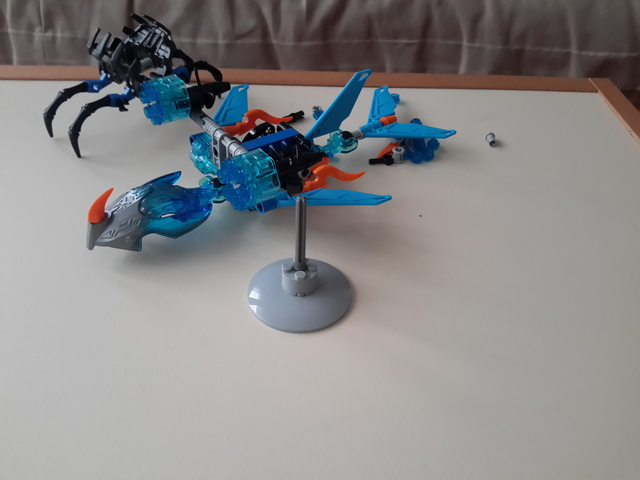](https://www.freelug.org/IMG/jpg/20160625_130338.jpg)

Et voici la créature terminée et installée. Elle peut tourner, pour présenter sa meilleure figure au public.

[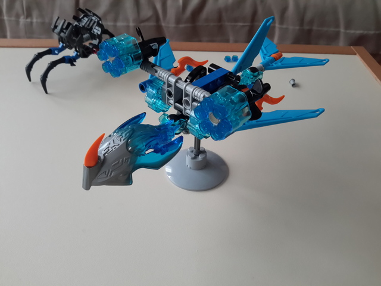](https://www.freelug.org/IMG/jpg/20160625_130349.jpg)

L’ensemble du modèle mis en scène, avec à droite les missiles de réserve, et à gauche les pièces bonus.

[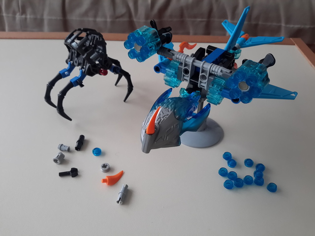](https://www.freelug.org/IMG/jpg/20160625_130451.jpg)

[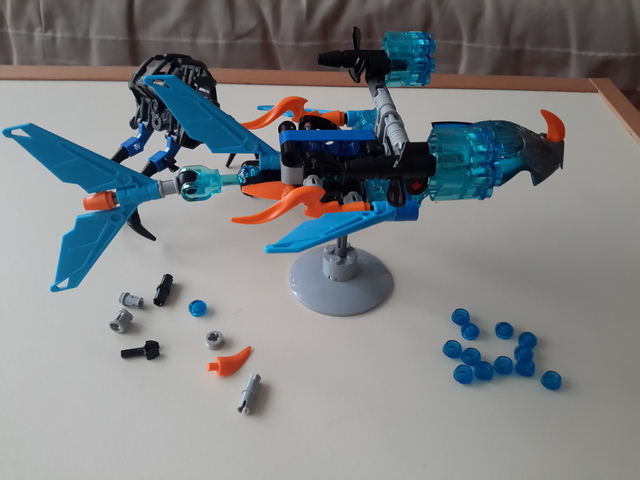](https://www.freelug.org/IMG/jpg/20160625_130517.jpg)

* * *

**Avis :** il s’agit de mon premier set Bionicle, et même si le rendu est joli, j’admets ne pas être trop fan de la gamme. Bien sûr il y a quelques pièces intéressantes, mais la plupart me semblent trop spécialisées pour être vraiment intégrées dans mes constructions habituelles.

**Bonus :** une animation (GIF) de toutes les étapes de la construction (cliquez pour lancer).

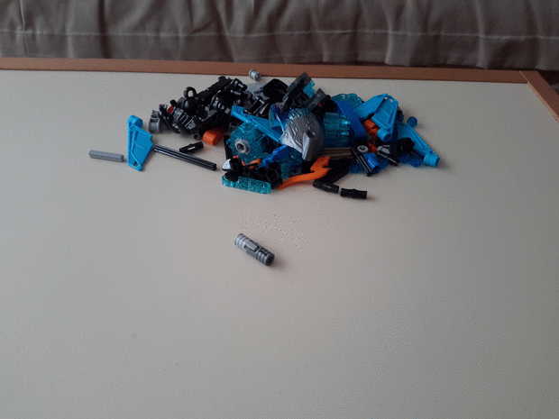
