Voici une revue du set 71303, **Ikir - Créature du feu**, de la gamme _Bionicle_, pour faire suite à ma revue du set [71302, Akida, créature de l’eau](/articles/2429/).

Ce set sorti en 2015 comporte 77 pièces pour un prix de 9,99 €, soit un ratio prix/pièce d’environ 13 centimes.

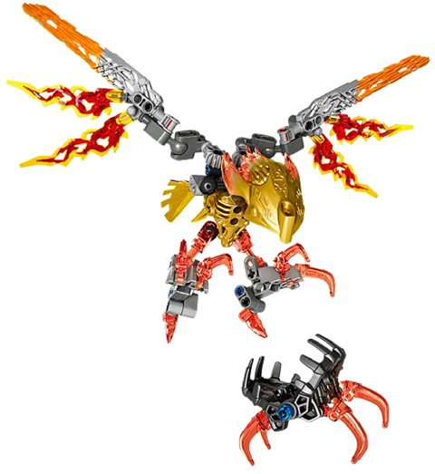

* * *

L’avant de la boîte présente la créature en plein vol, avec ses serres prêtes à saisir quelque ennemi qui se présenterait. Les logos LEGO et Bionicle sont présents en haut.

[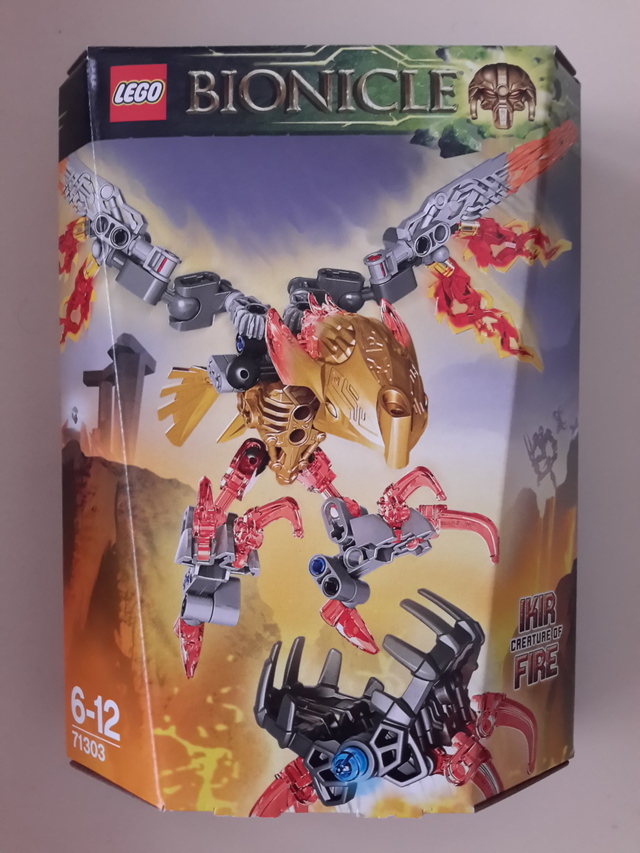](https://www.freelug.org/IMG/jpg/20160625_131335.jpg)

L’arrière propose de combiner cette créature avec le set 71308, _Tahu - Unificateur du Feu_, et montre certaines articulations. À noter que la moitié de l’espace est dédié à des avertissements divers, et que le set est présenté comme une « figurines à construire ».

[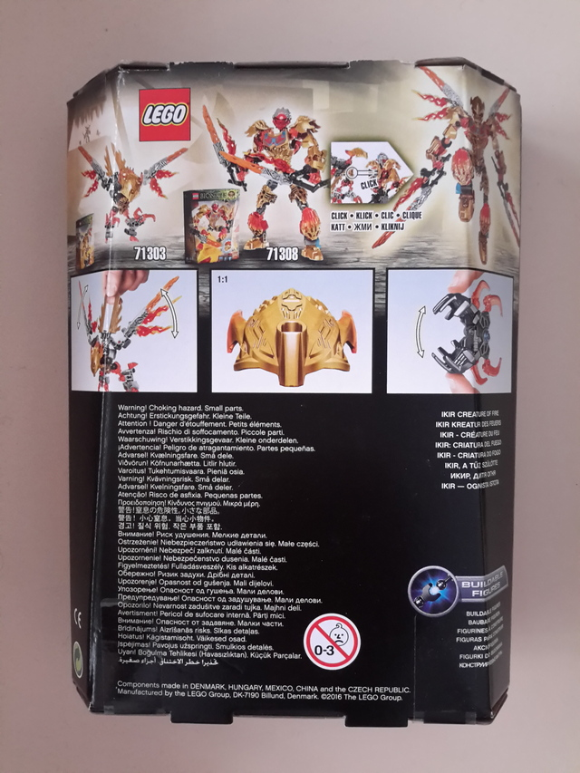](https://www.freelug.org/IMG/jpg/20160625_131350.jpg)

La boîte contient le manuel d’instructions et deux sachets et deux pièces à part (les deux pseudo-bras orange et grise au centre au premier plan sur la seconde photo).

[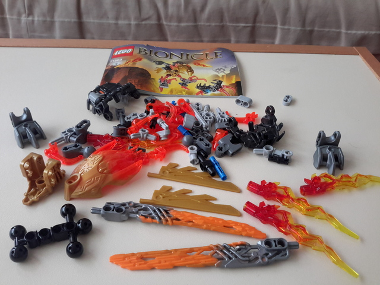](https://www.freelug.org/IMG/jpg/20160625_140102.jpg)

[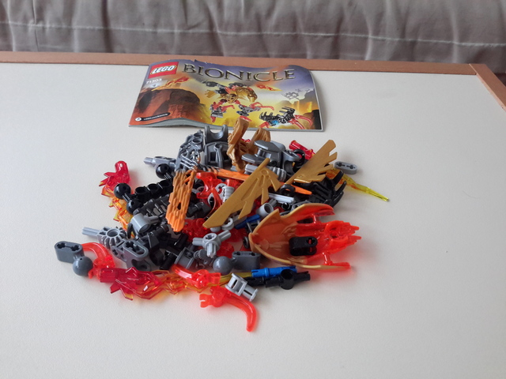](https://www.freelug.org/IMG/jpg/20160625_140012.jpg)

Avant de s’attaquer à la créature elle-même, on construit une sorte de piège, à thème rouge comme le feu (à mettre en parallèle au piège bleu de Akida).

[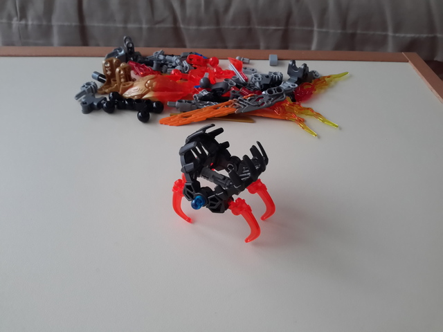](https://www.freelug.org/IMG/jpg/20160625_140306.jpg)

On commence par monter le torse de la créature, avec une forme en T sur laquelle on ajoute un plastron et quelques pièces Technic.

[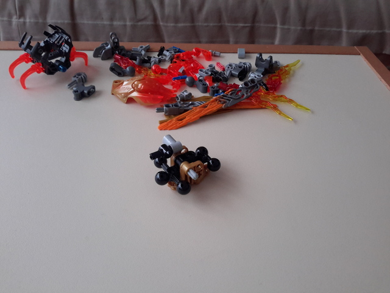](https://www.freelug.org/IMG/jpg/20160625_140510.jpg)

Le torse complété présente deux roues mobiles, qui serviront à faire bouger les ailes.

[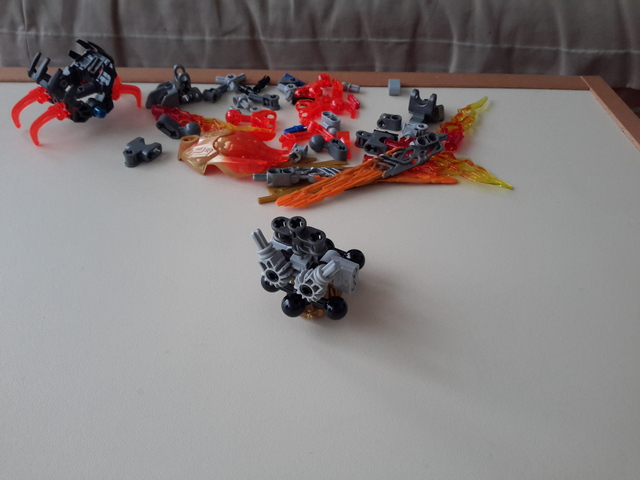](https://www.freelug.org/IMG/jpg/20160625_140755.jpg)

Les pieds comportent deux griffes orange transparent sur l’avant, et une petite sur l’arrière, avec deux articulations à deux degrés.

[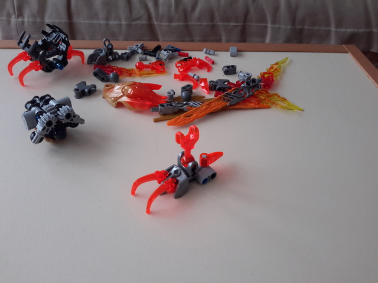](https://www.freelug.org/IMG/jpg/20160625_140930.jpg)

Le second pied se construit de façon symétrique. Voici la créature sur ses deux pattes.

[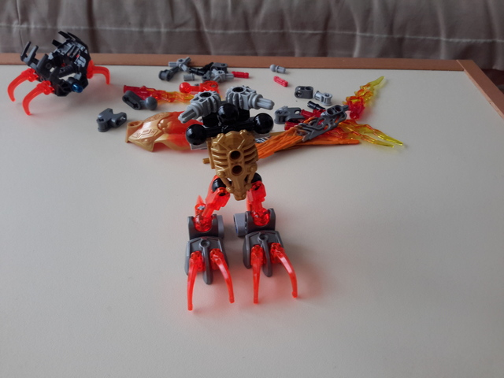](https://www.freelug.org/IMG/jpg/20160625_141145.jpg)

On place les deux ailes sur l’arrière, puis on s’attaque aux pseudo-bras, avec de magnifiques flammes jaune et rouge du plus bel effet. Ils comportent encore une articulation, permettant de nombreux mouvements.

[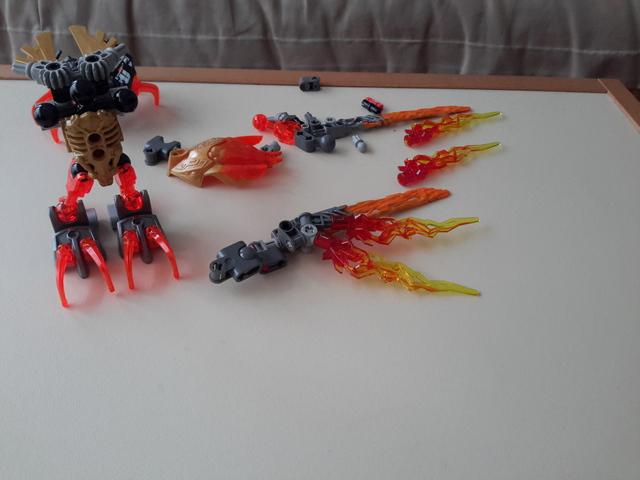](https://www.freelug.org/IMG/jpg/20160625_141515.jpg)

On attache ensuite le premier bras sur l’arrière.

[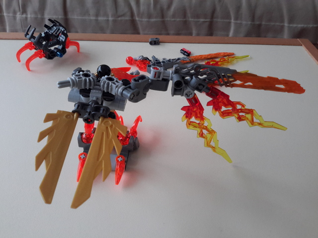](https://www.freelug.org/IMG/jpg/20160625_141607.jpg)

Le second se construire encore une fois de façon symétrique, et s’attache en miroir.

[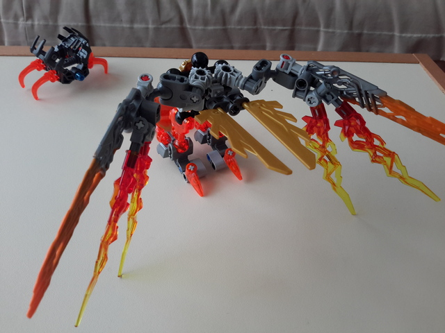](https://www.freelug.org/IMG/jpg/20160625_141927.jpg)

Enfin on termine la créature par la tête, qui peut tourner sous plusieurs angles, pour mieux se rattacher à l’Unificateur du feu sans doute.

[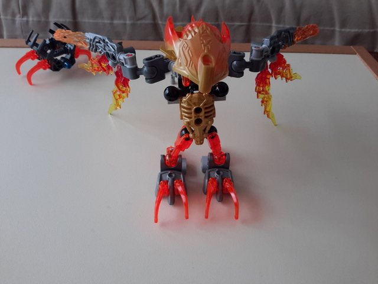](https://www.freelug.org/IMG/jpg/20160625_141954.jpg)

Et voici la créature contemplant les pièces bonus, uniquement des Technic.

[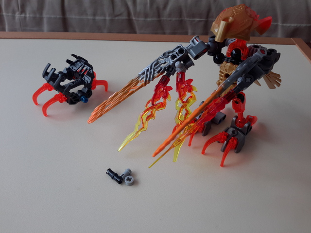](https://www.freelug.org/IMG/jpg/20160625_142044.jpg)

* * *

**Avis** : second set Bionicle que j’achète (après Akida donc), j’ai les mêmes réserves que pour le premier. Le rendu est très joli, mais les pièces me semblent très spécialisées par rapport à mes gammes habituelles.

Je pense donc que ce set sera mon dernier de cette gamme.

**Bonus** : animation de toutes les photos prises pour cette revue (cliquer pour lancer, 10 Mo).

