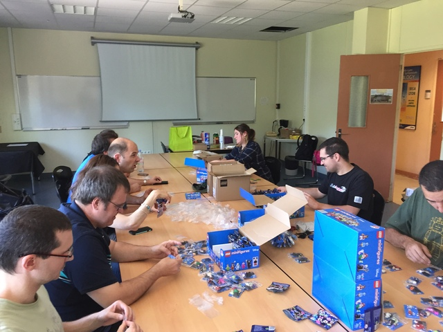
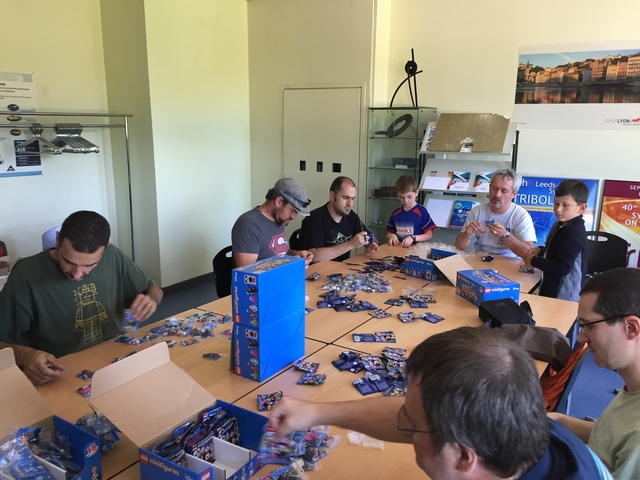
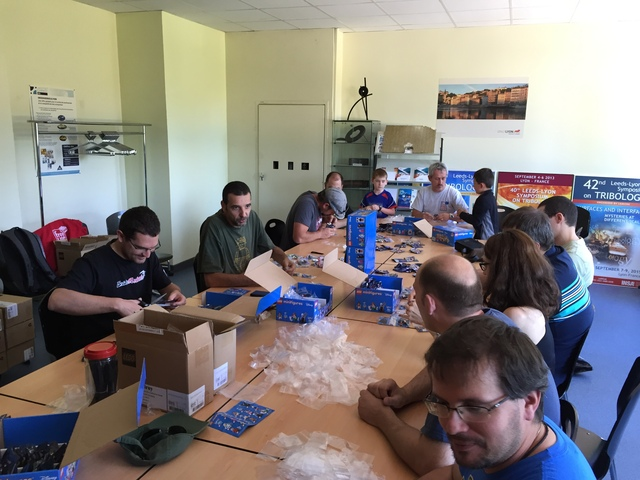

Le 15 juillet une poignée d’AFOL du CoR RA (VoldeCoR) se sont réunis dans les locaux de l’INSA (Lieu de la Briqu’ Convention) pour le tri de minifigs de la série Disney.

Fabrice était notre hôte et Xavier notre organisateur (comme toujours pour les minifigs).

Nous étions une bonne douzaine pour ouvrir les sachets, trier et préparer les 1800 figs pour nos chers adhérents.

Après notre effort, nous avons fini par un petit goûter et quelques discussions autour des briques LEGO et des futurs expositions à venir.

Voici quelques photos :

