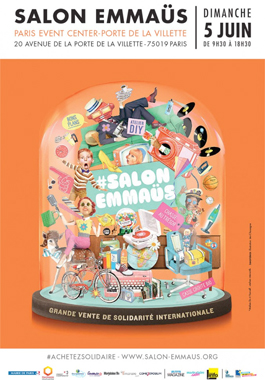

**Salon International Emmaus**

Nous avions annoncé le [Salon International Emmaüs du Dimanche 5 Juin 2016](http://freelug.org/spip.php?page=evenement&id_article=2345). Le tri de pièces organisé ce jour avec Emmaüs dans la région Lyonnaise est l’occasion de revenir sur cet événement en photos.

Suite au partenariat mis en place dans le cadre de la Briqu’Expo Diemoz entre la communauté Emmaüs de Bourgoin Jallieu, FreeLUG et le Sou des Ecoles de Diémoz, un membre de FreeLUG et un membre du Sou des Ecoles ont été invités à se joindre aux autres bénévoles pour ce grand Salon !

Vendredi 14h00, tous les compagnons et bénévoles se donnent RDV à la communauté de Bourgoin Jallieu et montent dans le bus qui va les emmener Porte de la Vilette. Après une pause casse-croute et une longue route, nous arrivons enfin.

[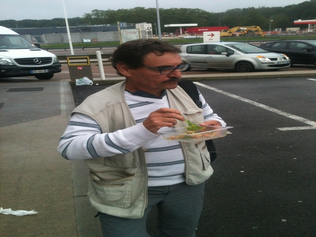](https://www.freelug.org/IMG/jpg/IMG_8534.jpg)

**Petite pause casse-croûte sur l’autoroute**

Bénévoles et compagnons sont prêts à se mettre au travail : il faut décharger les nombreux camions venant de toute l’Europe, installer les stands.

[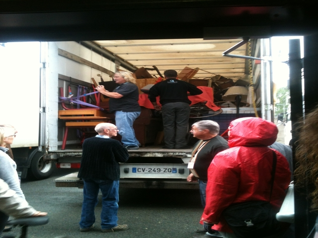](https://www.freelug.org/IMG/jpg/IMG_8547.jpg)

**De nombreux camions à décharger**

Le stand Lego sera intégré à l’allée des métiers, allée dans laquelle les compagnons feront la démonstration de leurs spécialités : sculpture sur aliments, réparation de téléphone, ébénisterie, valorisation de vieux sets et pièces LEGO, etc.

[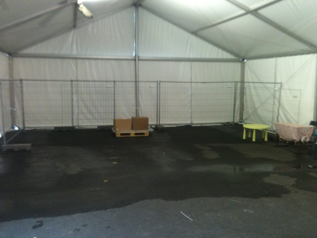](https://www.freelug.org/IMG/jpg/IMG_8553.jpg)

**Chapiteau réservé à l’allée des métiers**

Après plusieurs heures de travail acharné, les stands prennent forme :

[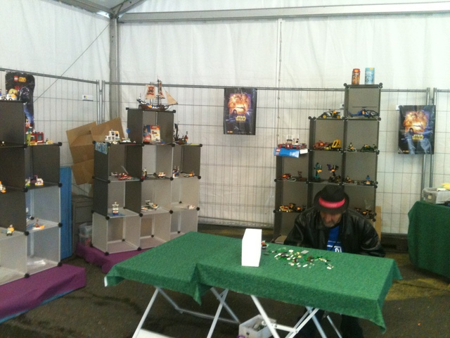](https://www.freelug.org/IMG/jpg/IMG_8596.jpg)

**Gilles en train de rassembler les sets qui seront à vendre**

Mais aussi les stands de vente dans la grande salle ou dehors :

[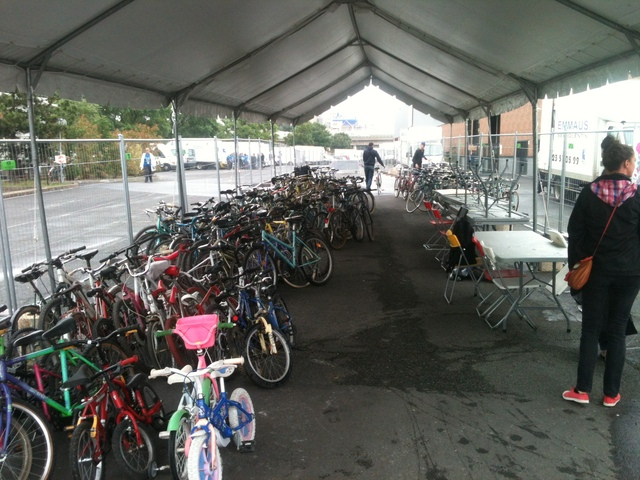](https://www.freelug.org/IMG/jpg/IMG_8549.jpg)

**Vélo, produit phare du salon !**

[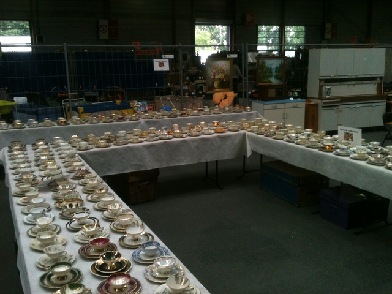](https://www.freelug.org/IMG/jpg/IMG_8563.jpg)

**Stand de tasses, beaucoup de tasses !**

Mais ce genre de salon, c’est toujours de grands moments de partage, et le repas en est forcément un. Il fallait d’ailleurs de grandes tables pour accueillir tous les compagnons et bénévoles :

[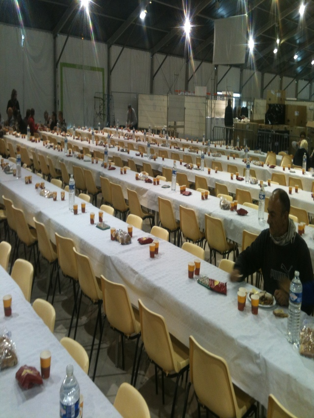](https://www.freelug.org/IMG/jpg/IMG_8582.jpg)

**Une grande table pour tous les bénévoles et compagnons !**

Enfin, le public arrive, nombreux, et sur notre stand, les animations peuvent commencer à côté de Gilles qui vend des sets reconstitués et du vrac à prix défiant toute concurrence !

[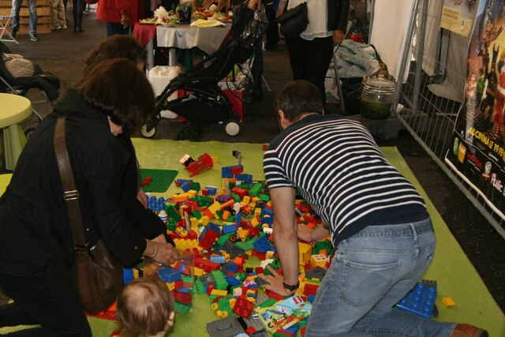](https://www.freelug.org/IMG/jpg/salon_emmaus_2016_011.jpg)

Une des animations proposées aux visiteurs : le tapis DUPLO

[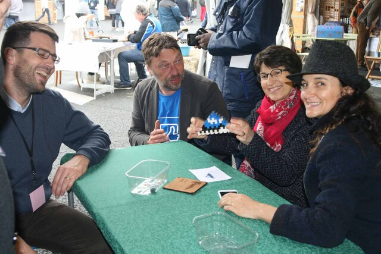](https://www.freelug.org/IMG/jpg/salon_emmaus_2016_010.jpg)

Des officiels (représentants d’Emmaüs et de la Mairie de Paris) heureux de participer à l’[animation mosaïque](http://freelug.org/spip.php?article2235).

[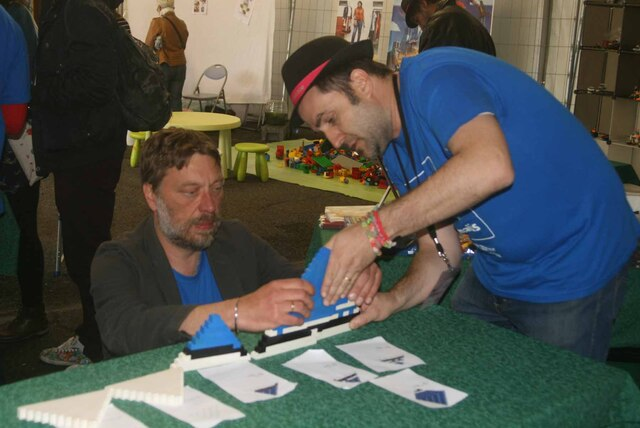](https://www.freelug.org/IMG/jpg/salon_emmaus_2016_000.jpg)

Un visiteur un peu spécial, Thierry Kuhn, Président d’Emmaüs France.

Les premiers losanges de la mosaïque :

[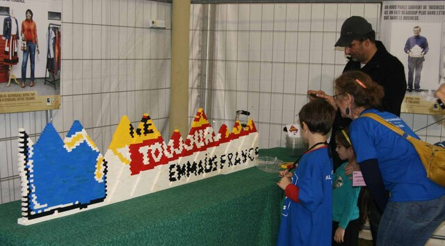](https://www.freelug.org/IMG/jpg/salon_emmaus_2016_001B.jpg)

[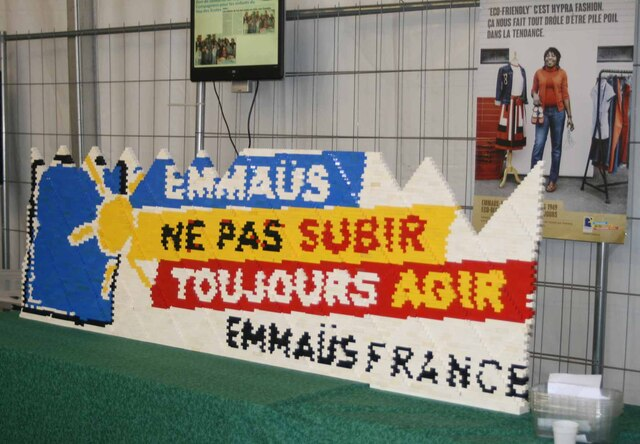](https://www.freelug.org/IMG/jpg/salon_emmaus_2016_002.jpg)

La mosaïque avance bien et vite.

[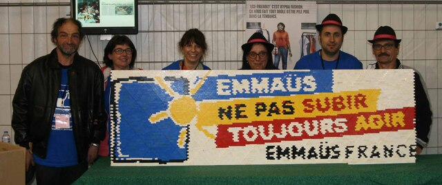](https://www.freelug.org/IMG/jpg/salon_emmaus_2016_008.jpg)

La mosaïque avec les participants - entre autres : Gilles (Lapin), Céline, Yannick, Francis

Dimanche, après démontage et rangement, nous reprenons le bus pour un retour sur Bourgoin Jallieu très tard dans la nuit, épuisés, mais enchantés de cette expérience !

Nous remercions par ailleurs Simon, auteur de l’animation mosaïque, qui prépare en amont la mosaïque, et les personnes qui ont travaillé avant le salon pour rendre la construction de cette mosaïque possible : Didier, Kévin, les compagnons et bénévoles, et tous les Afols qui ont participé aux tris de pièces avec Emmaüs ces derniers mois.
