Voici une revue des boîtes 41557, 41558 et 41559, formant les Mixels de série 7 sur une thématique médiévale.

La série 7 thématique médiévale comporte trois sets, _41557_, _41558_ et _41559_, nommés respectivement **Camillot**, **Mixadel** et **Paladum**.

Ces sets sortis en 2016 comportent 64, 64 et 63 pièces pour 3,99 €, soit environ 6 centimes par pièce.

## Le set 41557, Camillot

Le sachet contient un sac de pièces et une notice de construction.

[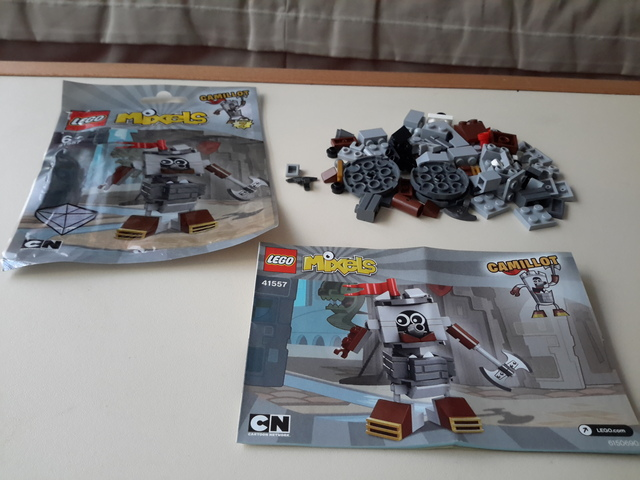](https://www.freelug.org/IMG/jpg/20161002_114538.jpg)

La base du corps comporte deux articulations latérales pour les pieds, et une à l’arrière pour la tête. Les dents sont irrégulières, comme sur de nombreux Mixels.

[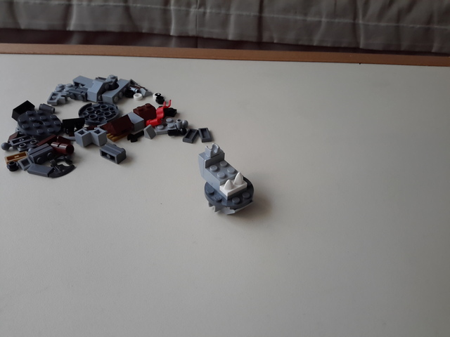](https://www.freelug.org/IMG/jpg/20161002_114845.jpg)

La tête se construit sur une pièce ronde de diamètre 4 tenons. Le nez est une pince accrochée à une barre horizontale, et peut légèrement bouger verticalement.

[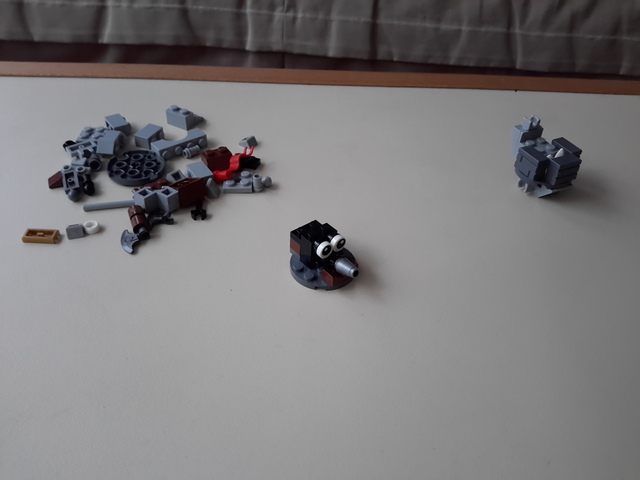](https://www.freelug.org/IMG/jpg/20161002_115203.jpg)

La tête se termine avec une arche sur le devant, donnant l’impression que les yeux sont enfoncés dans la tête, tandis qu’un drapeau flotte fièrement sur le sommet du crâne.

[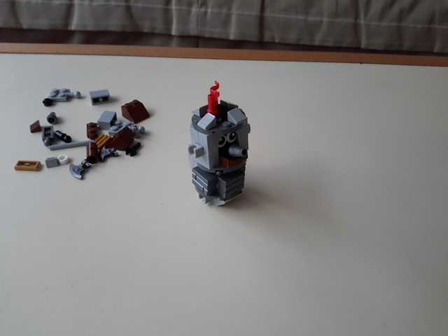](https://www.freelug.org/IMG/jpg/20161002_115510.jpg)

Camillot étant manifestement un grand guerrier, il est plus que normal qu’un de ses bras soit une belle hache, construite avec une tige et deux lames.

[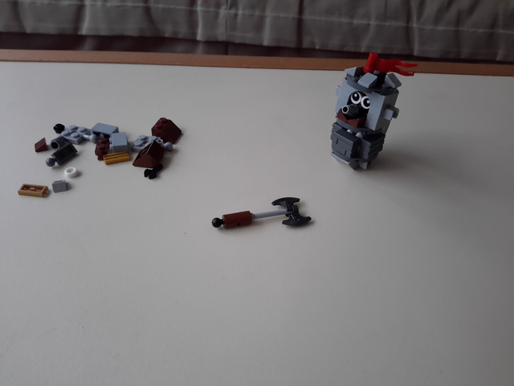](https://www.freelug.org/IMG/jpg/20161002_115621.jpg)

Le bras droit quant à lui est rabougri, avec juste une pince. Les pieds enfin sont assez basiques.

[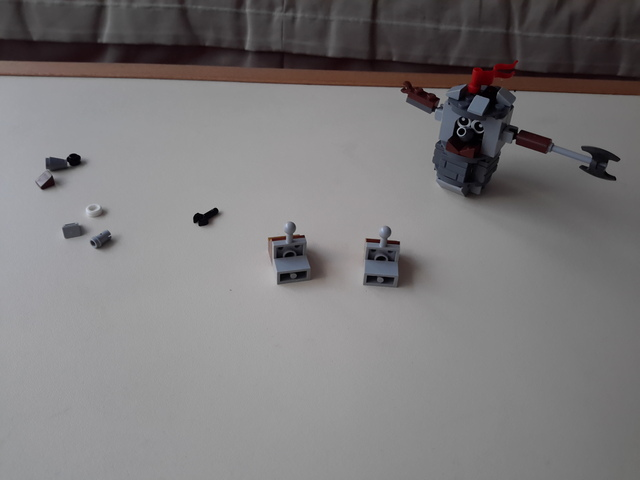](https://www.freelug.org/IMG/jpg/20161002_115756.jpg)

Et voici Camillot terminé, contemplant les pièces bonus, assez nombreuses ma foi.

[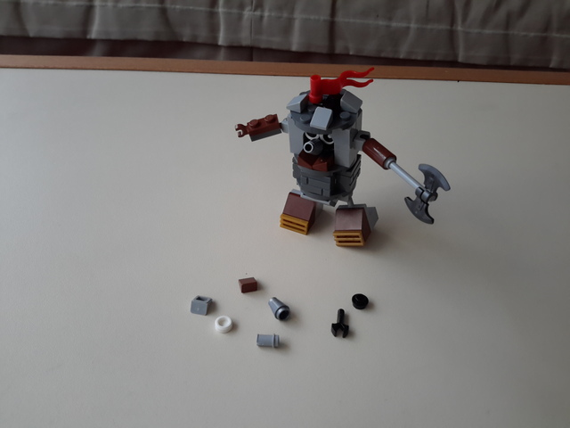](https://www.freelug.org/IMG/jpg/20161002_115853.jpg)

## Le set 41558, Mixadel

Pas de surprise, le sachet contient un sac de pièces et la notice de construction.

[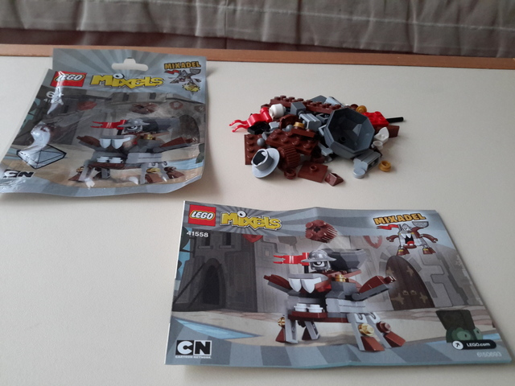](https://www.freelug.org/IMG/jpg/20161002_120413.jpg)

Le corps est assez carré, creux. Deux pièces 1x1 rondes font office de dents du bas. Une brique pivotante est montée entre deux plots afin de permettre à la catapulte de bouger. À noter les quatre articulations du bas, pour les pieds, et les quatre crochets latéraux.

[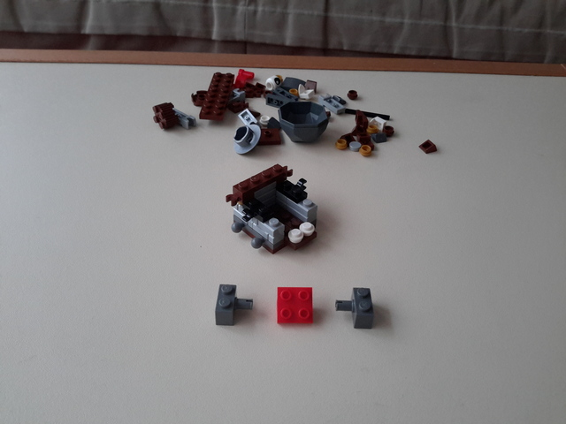](https://www.freelug.org/IMG/jpg/20161002_120739.jpg)

Les bras sont très schématiques, ne pouvant bouger que verticalement grâce au crochet.

[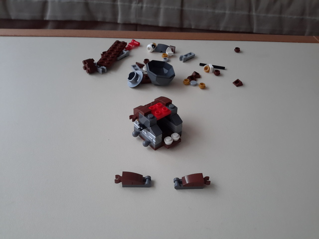](https://www.freelug.org/IMG/jpg/20161002_121004.jpg)

La tête se monte sur une plaque 2x8, sur laquelle on installe le panier de la catapulte (avec une 1x1 lisse au fond pour éviter que la brique projectile se retrouve accrochée).

[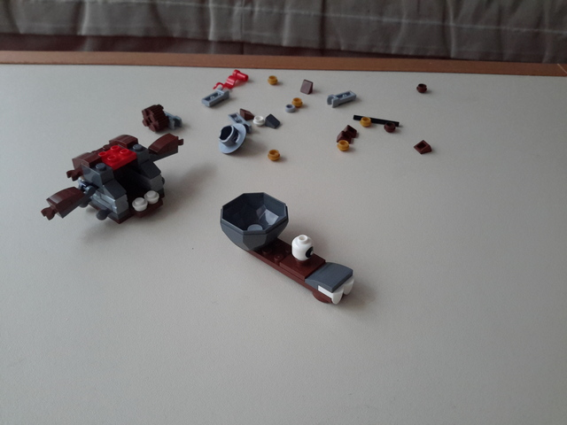](https://www.freelug.org/IMG/jpg/20161002_121135.jpg)

La bascule montée, on s’attaque aux pieds, assez schématiques. Plusieurs pièces dorées agrémentent le modèle.

[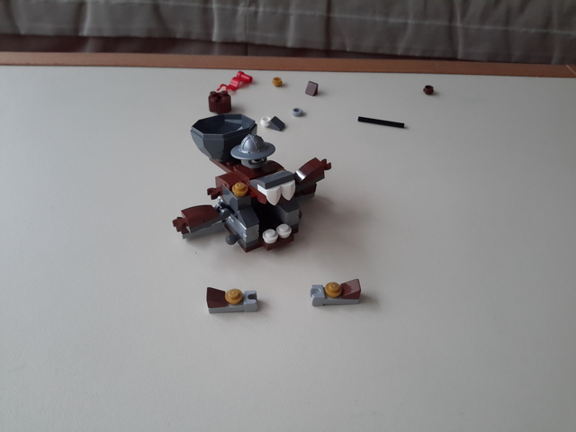](https://www.freelug.org/IMG/jpg/20161002_121345.jpg)

Et voici Mixadel terminé, bien stable sur ses quatre pieds pour mieux lancer la pièce cylindrique sur les ennemis. Tout comme Camillot, un drapeau flotte fièrement.

[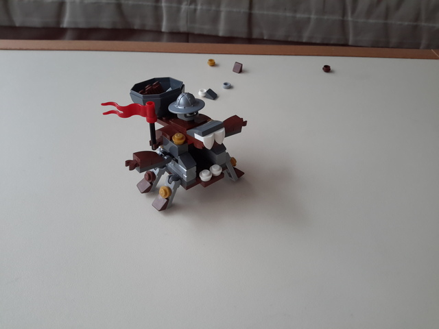](https://www.freelug.org/IMG/jpg/20161002_121433.jpg)

Le personnage terminé contemplant les pièces bonus, encore une fois plutôt nombreuses.

[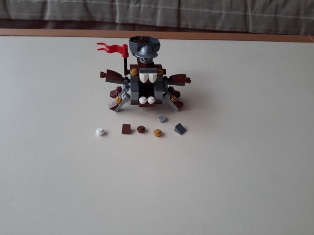](https://www.freelug.org/IMG/jpg/20161002_121521.jpg)

## Le set 41559, Paladum

Surprise, le paquet contient un sac de pièces et une notice de construction ! Ah non, ce n’est pas une surprise, désolé.

[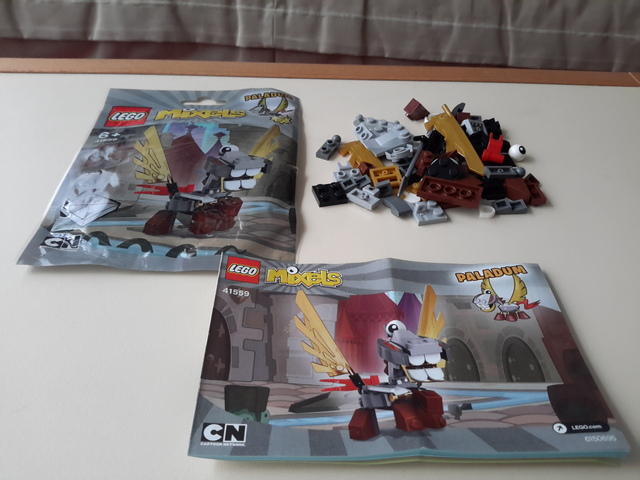](https://www.freelug.org/IMG/jpg/20161002_121652.jpg)

Le corps est assez plat, avec de nombreuses articulations, une à l’avant pour les pattes avant, une de chaque côté pour les pattes arrières, et une de chaque côté pour les ailes. Un crochet sur l’arrière pour un drapeau et deux pinces verticales complètent le tableau.

[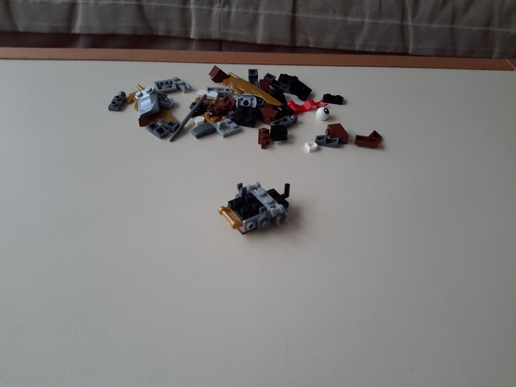](https://www.freelug.org/IMG/jpg/20161002_121830.jpg)

Et on y rajoute une articulation semi-rigide pour la tête, ainsi qu’un peu d’arrondi pour la croupe.

[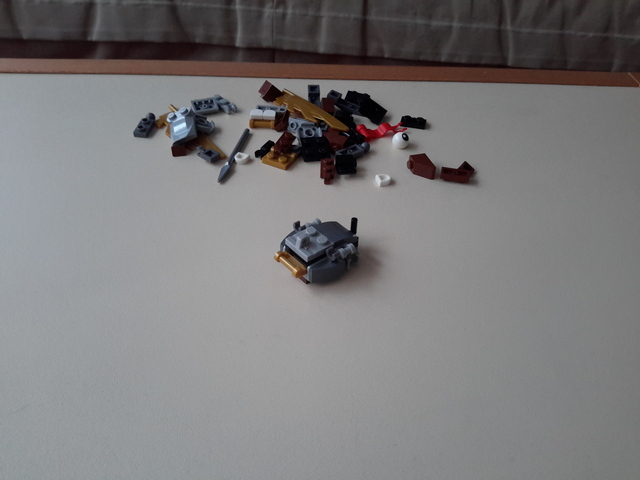](https://www.freelug.org/IMG/jpg/20161002_121903.jpg)

Les pieds sont très basiques, juste deux pièces, les fixations ne leur donnant que peu de possibilité de mouvement. Mais la queue est évidemment un drapeau, pour rester dans la lignée des personnages précédents.

[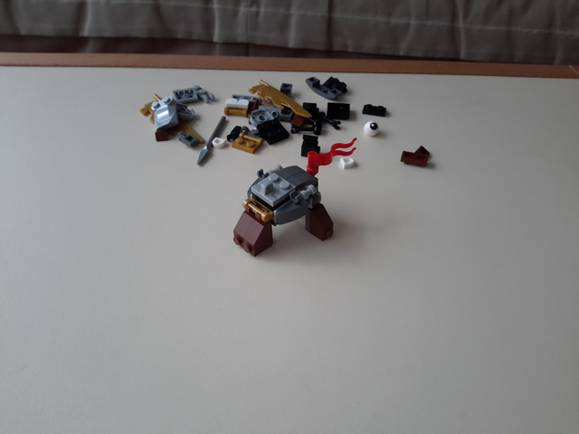](https://www.freelug.org/IMG/jpg/20161002_122040.jpg)

La tête est à mon avis excellente ! Les dents sont tout à fait celles d’un cheval, et l’œil unique a l’air moqueur, surtout avec les joues un peu gonflées.

[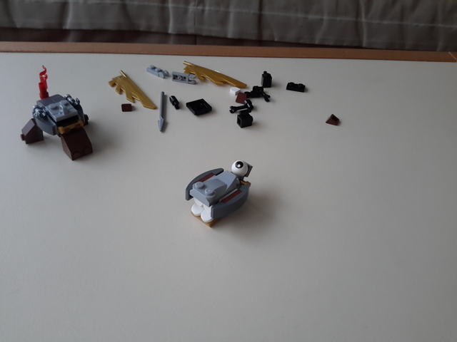](https://www.freelug.org/IMG/jpg/20161002_122426.jpg)

Voici le personnage la tête montée, avec les ailes, simplement fixées avec de petits clips.

[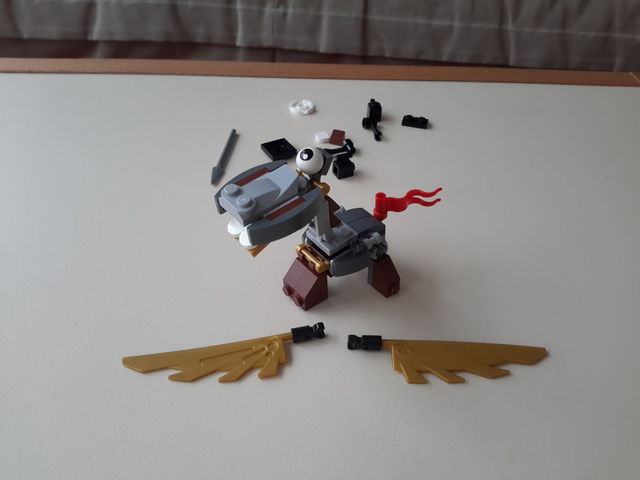](https://www.freelug.org/IMG/jpg/20161002_122601.jpg)

Et voici Paladum terminé, avec le Nixel [^1] noir qui tient une lance, contemplant les pièces bonus. À noter que l’image sur le sachet ou la notice montre la lance accrochée sur une pince verticale de Paladum.

* * *

**Avis :** seconde série de Mixels que je monte, ces personnages restent dans la lignée de la gamme, totalement excentriques et déjantés. Les différentes pièces sont intéressantes, avec pas mal de changements d’orientation.

Bref un excellent achat de mon point de vue.

**Bonus 1 :** les trois personnages réunis pour une belle photo de famille !

[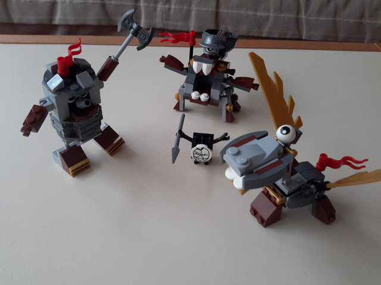](https://www.freelug.org/IMG/jpg/20161002_122806.jpg)

[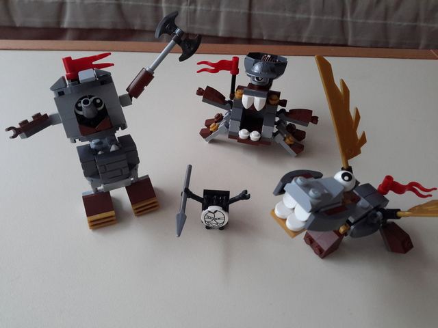](https://www.freelug.org/IMG/jpg/20161002_122842.jpg)

**Bonus 2 :** animations des différentes étapes de construction (cliquer pour lancer).

[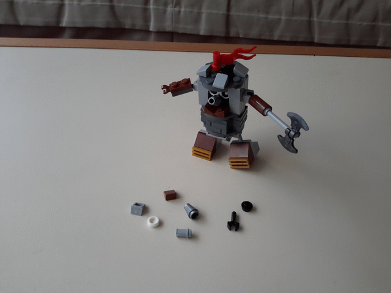](https://www.freelug.org/IMG/gif/41557-camillot.gif)

[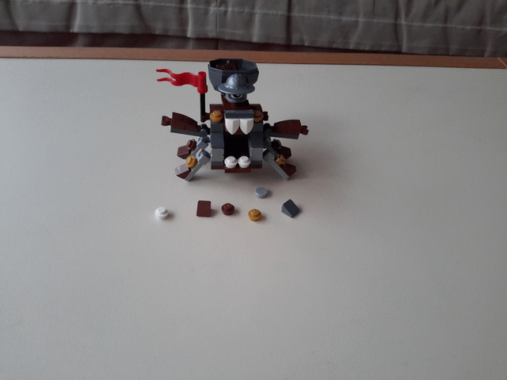](https://www.freelug.org/IMG/gif/41558-mixadel.gif)

[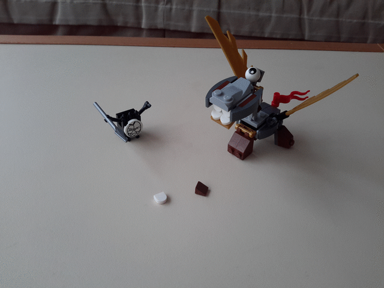](https://www.freelug.org/IMG/gif/41559-paladum.gif)

**Bonus 3** (rajouté le 14/11/2016) : combinés, ces Mixels donnent naissance à _Medieval Max_, un magnifique dragon. Les ailes de Paladum lui permettent certainement de voler, tandis que la catapulte de Mixadel assure la victoire sur les ennemis. En revanche il a perdu la hache de Camillot (un des morceaux est utilisé à l’arrière, sous la catapulte). J’aime bien le drapeau recyclé en langue.

[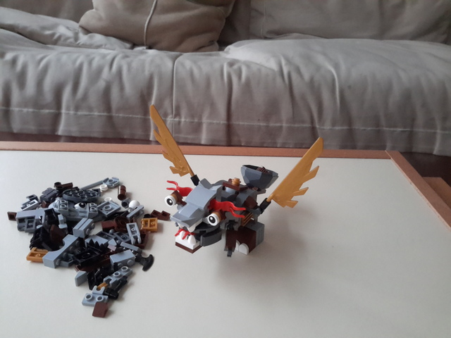](https://www.freelug.org/IMG/jpg/mediaval-max-1.jpg)

[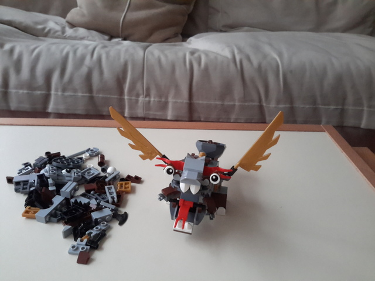](https://www.freelug.org/IMG/jpg/medieval-max-2.jpg)

[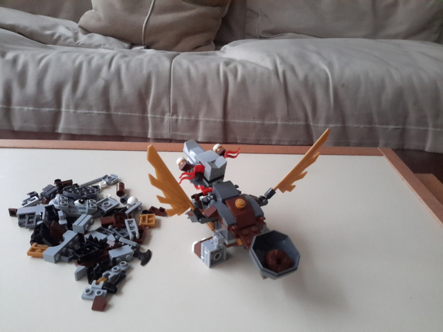](https://www.freelug.org/IMG/jpg/medieval-max-3.jpg)

[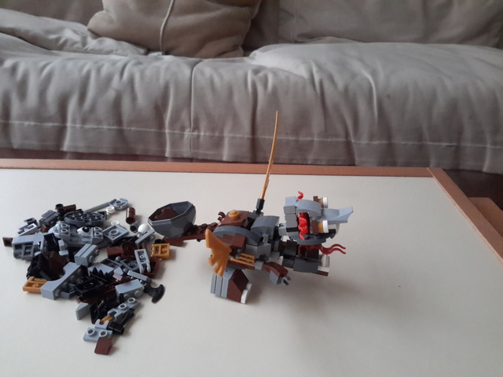](https://www.freelug.org/IMG/jpg/medieval-max-4.jpg)

[^1]: Ennemi des Mixels.
