Poursuivre sa passion des jeux LEGO® dans le domaine des jeux de société est possible grâce à ces trois jeux réalisés par la société Jumbo et estampillés LEGO® : Creator, Racer et Bionicle®.

## Présentation générale

Pour la réalisation de cet article, j’ai bénéficié de l’aide de notre mascotte "Fred", qui s’est fait un grand plaisir, en tant que spécialiste incontesté des jeux LEGO®, de _"mettre la main à la pâte pour bien vous montrer ce qu’il y a d’important dans la boîte"_. (Guiseppe Buitoni).

Commençons d’abord par une présentation de ces trois jeux :

Le jeu Creator, qui contient 72 pièces LEGO®

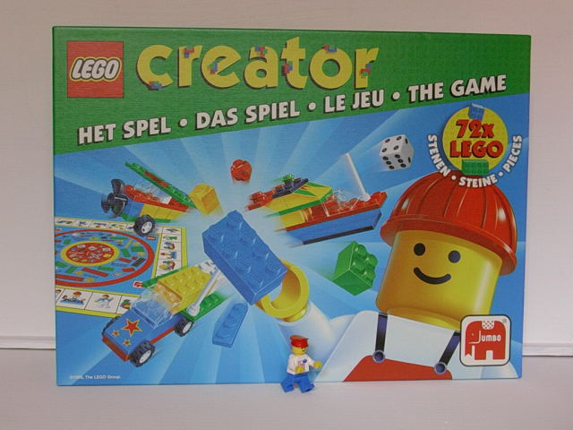

**Boîte Creator**

Le jeu Racer qui lui en contient 100 !

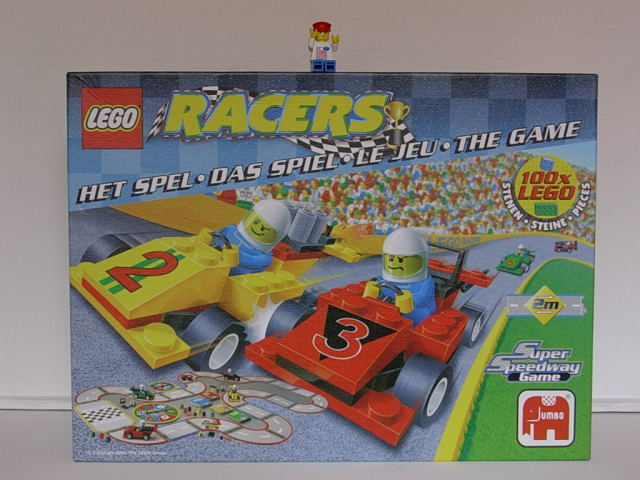

**Boîte Racer**

Et le jeu Bionicle, qui lui s’adresse aux plus grands (à partir de 8 ans) et qui hélas ne comporte pas de modèle exclusif ou d’autre brique à ajouter à sa collection.

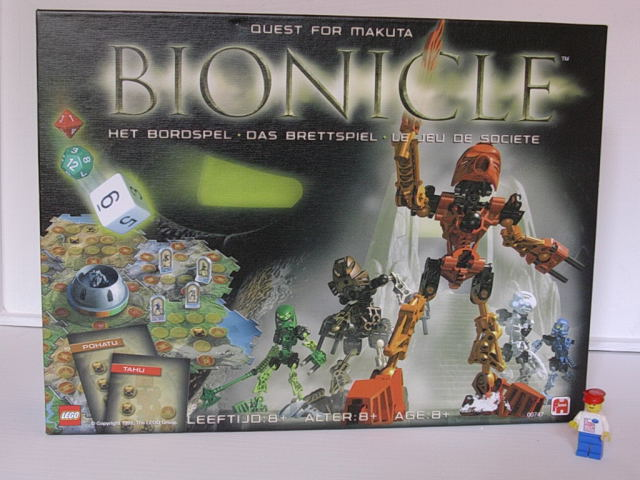

**Boîte Bionicle**

## Jeu LEGO® CREATOR

**Contenu de la boîte**

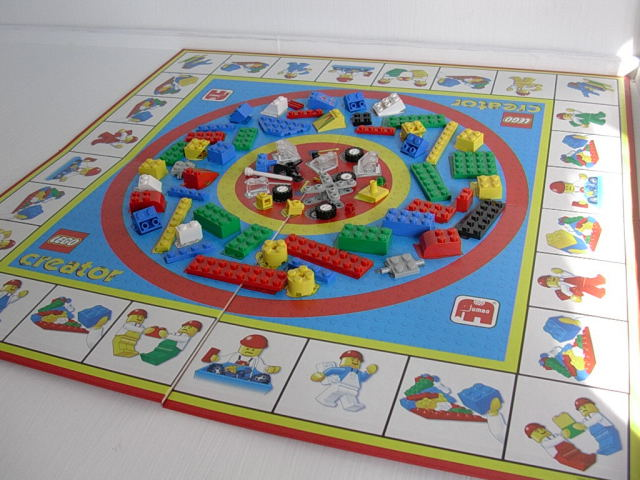

**Contenu de la boîte Creator**

Ce jeu qui est accessible aux enfants à partir de 5 ans permet de jouer de 2 à 4 joueurs.

Il comprend :  
**–** Un plateau de jeu de 28 cases, comportant 2 zones de stockage des pièces.  
**–** 20 cartes mission (modèle à construire) réparties en 5 familles de 4 cartes.  
**–** Un dé.  
**–** 4 casquettes de minifig faisant office de pion.  
**–** 68 autres pièces LEGO® réparties en 49 pièces normales et 19 pièces spéciales.

**But du jeu**

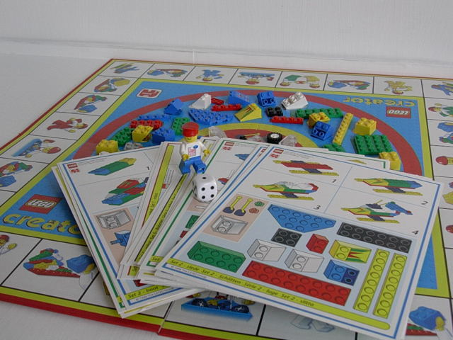

**But du jeu**

Le but du jeu, vous l’aurez compris est de choisir une carte mission dans la famille sélectionnée par les joueurs pour le déroulement de la partie. Ensuite il faut faire son marché de pièces, en lançant le dé pour qu’il nous conduise vers des cases où l’on peut prendre une ou deux pièces, voir prendre des pièces aux autres joueurs. L’objectif est d’être le premier à terminer le montage de sa carte.

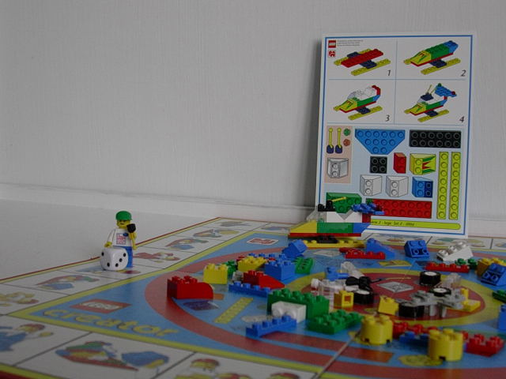

**Construction d’un modèle**

**Avis et commentaires**

Vous comprendrez que ce jeu est d’une simplicité extrème et qu’il combine un peu le jeu de l’oie avec le plaisir du montage des briques LEGO®.

Il s’adressera avant tout aux jeunes enfants et leur permettra de jouer en famille ou avec des ami(e)s afin de réaliser des montages relativement simples et très colorés.

Il constitue, à mon avis, un bon moyen d’intéresser petit à petit les plus jeunes à développer leur sens de la construction, sans les rebuter. Il n’y a pas de difficulté technique et on s’amuse aussi car les modèles sont plutôt sympas et colorés.

On pourra si on le souhaite introduire ses propres montages, à condition de disposer des pièces nécessaires et de prévoir que les 4 montages d’une même série de cartes, soient tous possibles sans que des pièces se chevauchent d’un montage à l’autre.

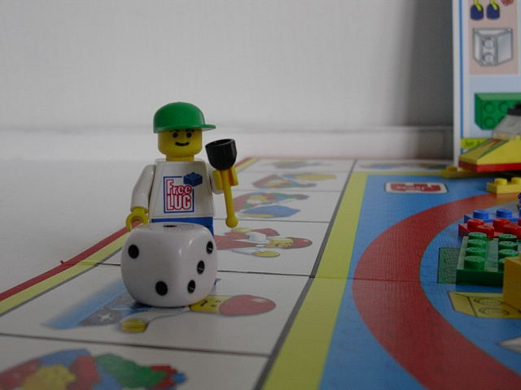

**Fred en train de jouer**

Fred s’est bien amusé, mais en parfait expert d’assemblage de briques, il s’est senti un peu hors concours sur ce coup là.

## Jeu LEGO® RACER

**Contenu de la boîte**

Ce jeu s’adresse également aux enfants à partir de 5 ans et il peut se jouer de 2 à 4 joueurs.

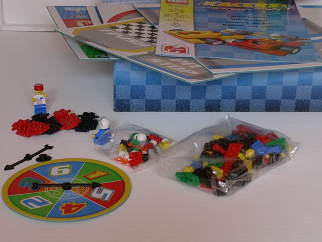

**Contenu de la boîte Racer**

Il comprend :

**–** Des pièces LEGO® permettant de construire 4 voitures de courses,  
**–** Quelques pièces supplémentaires pour réaliser les "bonus de piste" et les marqueurs de tour.  
**–** 25 éléments de circuit,  
**–** 1 disque en carton faisant office de dé.  
**–** 12 cartes podium.

**But du jeu**

Pour commencer le jeu, il est d’abord nécessaire de construire les voitures et les bonus de piste, ce qui occupe déjà un peu plus de 5 minutes.

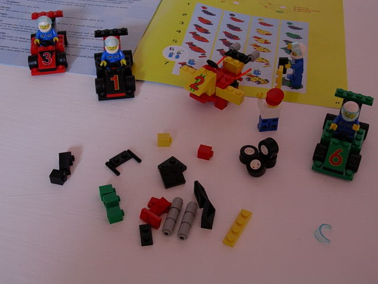

**Construction des Racers**

Une petite notice indique comment monter les voitures, même si Fred est obligé de donner un coup de mains à un concurrent qui n’a pas l’air de savoir à quoi ressemble une voiture de course.

Il est bien sûr possible d’utiliser ses propres créations.

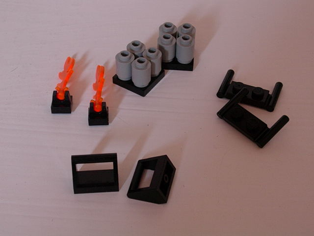

**"Bonus" de piste**

Les bonus de piste sont en fait quelques éléments qui seront disséminés sur la piste et qui permettront de gonfler un peu vos performances, ou de retarder vos adversaires.

A l’aide des éléments de circuit fournis, il est possible de réaliser plusieurs circuits et d’organiser le jeu, soit en course simple sur trois tours, soit en championnat, sur 3 courses de 3 tours.

Des pièces supplémentaires (1x1) permettent d’indiquer sur chaque voiture le nombre de tours effectués tandis que les cartes podium servent quant à elles, lors d’un championnat pour distribuer les points en fonction des résultats de chaque course.

Le cadran à aiguille permet d’indiquer le nombre de cases à parcourir. En chemin si la voiture s’arrête sur une case où se trouve un bonus de piste, elle le prend avec elle et l’utilise quand bon lui semble pour gonfler ses performances, échapper à un piège ou ralentir ses adversaires.

La piste des stands comporte également un cadran à aiguille pour pénaliser ou améliorer les performances, en fonction des avaries ou des réparations effectuées.

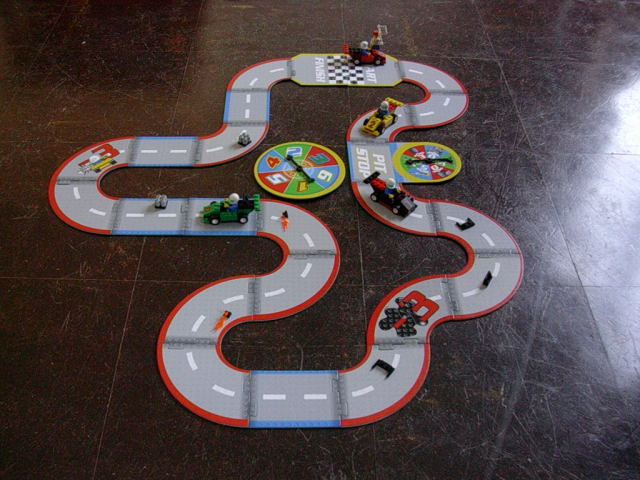

**Un des circuits**

**Avis et commentaires**

Ce jeu s’adresse donc aux jeunes, qui savoureront la construction préalable des voitures. On peut cependant pour les plus impatients conserver le modèle monté entre deux parties.

Les joueurs auront également la possibilité d’utiliser leurs propres créations et d’élaborer leurs propres circuits (la notice donne quand même plusieurs exemples).

Si l’on fait abstraction de la séance de montage initiale, ce jeu est en fait plus orienté jeu de société que le jeu Creator. Il est plus ludique et sera un complément à l’univers de construction. Rien n’empèche les plus constructeurs dans l’âme d’utiliser des plaques de route LEGO® et d’élargir le nombre des participants pour le plaisir d’évoluer dans un univers plus détaillé.

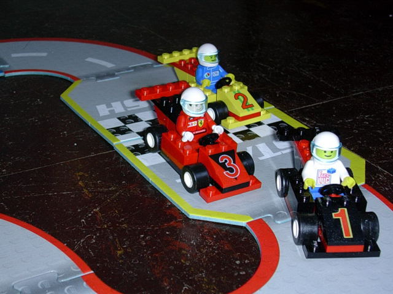

**Guest Star**

Fred en a profité pour faire une petite course et pour taxer au passage Schumacher sur un freinage.

## Jeu LEGO® BIONICLE®

**Contenu de la boîte**

Cette boîte est la plus lourde des trois et comporte de nombreux éléments qui constituent le plateau de jeu.

Il s’adresse aux plus grands, à partir de 8 ans et c’est un vrai jeu de société, qui n’a en fait de LEGO® que l’univers des Bionicle® dont il s’inspire. Il peut se jouer jusqu’à 6 joueurs.

Pour l’anecdote, le seul "élément LEGO®" présent dans la boîte est en fait un couvercle de boîte de Bionicle®, qui fait office de temple de Makuta.

En détail, la boîte comporte :

**–** 20 segments de plateau de jeu à assembler.  
**–** 6 pions TOA, avec 6 cartes associées.  
**–** 3 dés spéciaux.  
**–** 12 jetons Turaga (petits Bionicles alliés).  
**–** 24 jetons Kanohi (masques de pouvoir).  
**–** 9 jetons de serrure du temple.  
**–** 24 jetons clé du temple.  
**–** 57 jetons maléfiques Rahi.  
**–** le fameux "couvercle", temple de Makuta.

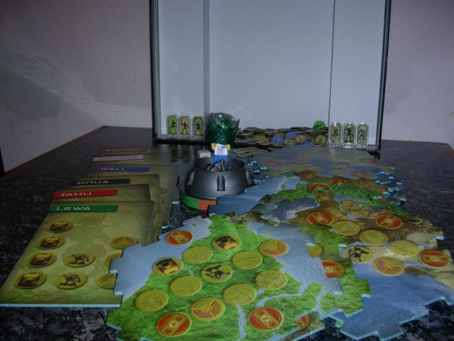

**Contenu de la boîte Bionicle®**

La règle n’est pas très claire (c’est hélas souvent le cas avec les jeux un peu complexes) et n’explicite pas assez à mon sens l’univers des Bionicle® avant d’exposer le but et les règles du jeu.

Sur ce plan là, Raphaël (11 ans), grand collectionneur de Bionicle® et qui visionne régulièrement en boucle le DVD du même nom a plus vite compris que moi...

**But du jeu**

Le but du jeu est de parcourir et découvrir le plateau au fure et à mesure du déroulement du jeu et de collecter, chemin faisant les éléments qui permettront de relever des défis et d’arriver enfin au temple de Makuta pour le vaincre.

Dans sa progression le Toa (personnage Bionicle® pour les non initiés), rencontrera des masques Kanohi qui lui confèreront certains pouvoirs (comme passer du dé blanc au dé vert en passant par le dé rouge) et des alliés, les Turaga qui pourront l’aider à relever les défis posés par les maléfiques Rahi.

Chemin faisant il trouvera également des éléments de clé, qui lui permettront d’accéder au temple de Makuta.

Le premier joueur à accéder au temple et qui vaincra Makuta sera le gagnant de la partie.

Les éléments de plateau de jeu étant assemblé au fure et à mesure de l’avancée du jeu (la pile étant battue avant d’entamer la partie et posée face cachée), chaque partie constituera en fait un nouveau jeu, avec un chemin sans arrêt renouvelé.

**Avis et commentaires**

J’avoue que ce n’est pas un jeu à démarrer tard le soir, après une dure journée de travail et qu’il faut l’esprit bien reposé avant de saisir les subtilités des règles.

Bien sûr être un pro de l’univers Bionicle® est un plus, mais il faut surtout bien aimer les jeux de société pour en apprécier le concept, basé quand même plus sur la chance que sur la stratégie.

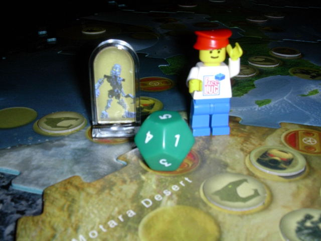

**Fred a du mal avec les Bionicle®**

Fred ne m’a pas été d’un grand secours sur ce coup là, car il n’y a pas la moindre once de construction dans ce jeu là et puis comme nous avons tout juste 8 ans d’age mental à nous deux, heureusement que Raphaël était là pour nous donner quelques explications.
