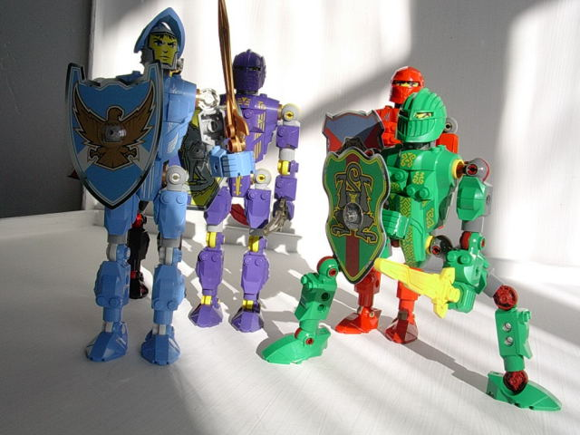
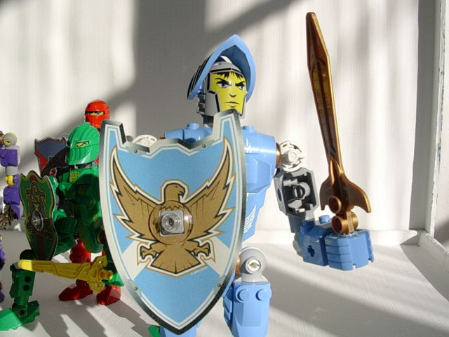
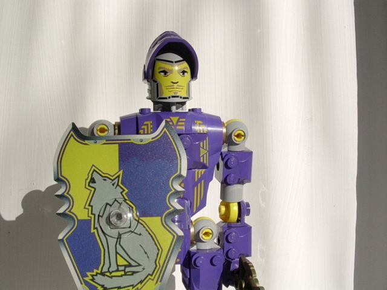
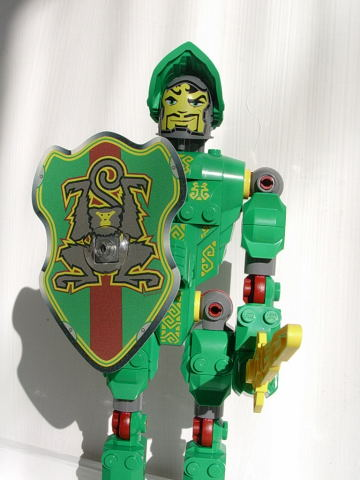
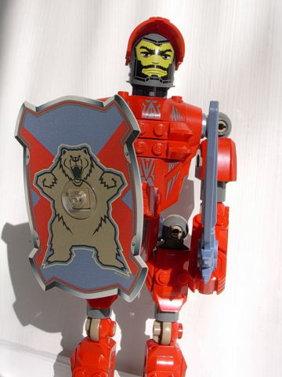
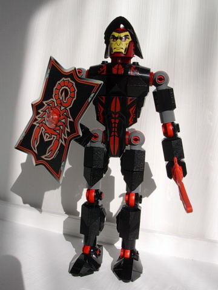
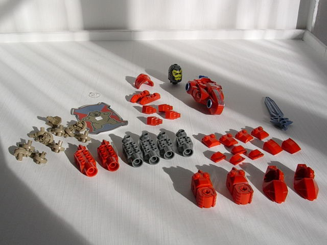
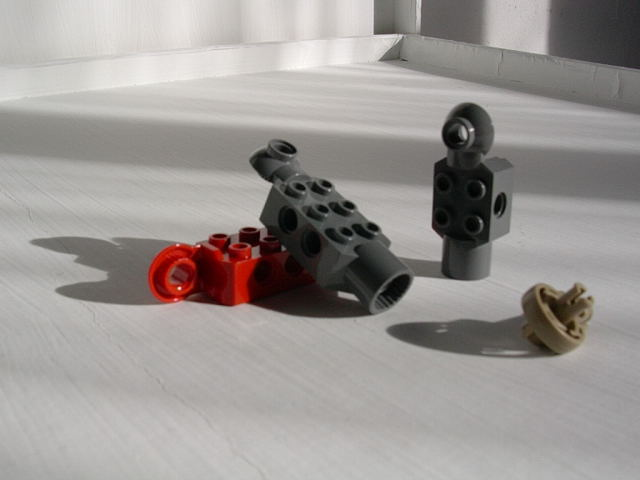
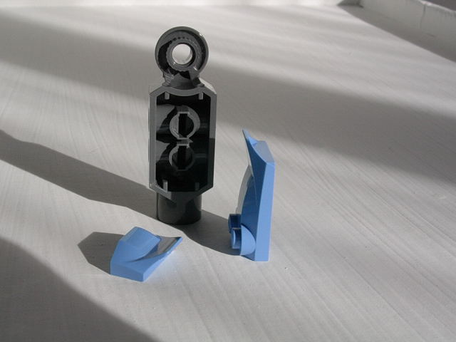

Ils viennent juste de faire leur entrée chez nos détaillants préférés, que les voici déjà présentés dans les colonnes de FreeLUG.

Oyez, oyez les enfants, voici sans nul doute les nouvelles vedettes de vos anniversaires, fêtes et autres événements joyeux, qui vous permettront de construire (un petit peu) et de jouer (beaucoup) avec ces glorieux chevaliers, riches en couleur.

## Présentation générale

Arrivés en avant première le 22 Avril 2004 chez certains détaillants, voici donc les nouveaux personnages du "Royaume des Chevaliers" (Knights Kindom)

**Toute la bande**

Sorte de mélange entre les Bionicle® et les Galidor (figurines SF non vendues en France), ils occupent le créneau (c’est le cas de le dire !) de l’époque médiévale.

Moins techniques à assembler que les Bionicle® et plus étoffés quand même que les Galidor, ce sont pour mes enfants les nouveautés les plus intéressantes de cette année 2004, avec bien sûr, les nouveautés Star Wars.

## Revue de l’effectif.

L’équipe se compose de quatre gentils...

Jayko, le chevalier bleu (réf. 8771) : C’est le plus rapide des chevaliers. Il est également parait-il, le fils du roi.

**Le chevalier bleu**

Danju, le chevalier violet (réf. 8770) : C’est le plus intelligent des chevaliers, sa sagesse et son expérience lui permettent de déjouer les pièges.

**Le chevalier violet**

Rascus, le chevalier vert (réf. 8772) : C’est le chevalier le plus agile. Il est celui qui sait franchir les obstacles et n’est pas maladroit (comme le Papa de gmi).

**Le chevalier vert**

Santis, le chevalier rouge (réf. 8773) : C’est le plus fort. Il est capable de casser des mega blocs (pas fait sans le faire exprès) de pierre.

**Le chevalier rouge**

...et d’un méchant.

Vladek, le chevalier noir (réf. 8774) : (qui à l’air vraiment méchant !)

**Le chevalier noir**

Chaque figurine est en fait livrée avec une petite histoire sur la notice illustrant les points forts de chaque personnage. Il était donc une fois... et à vous d’imaginer la suite.

## Inventaire.

Voici donc pour environ 10 euro, ce que vous aurez comme pièces.

**Composition d’un Chevalier**

Evidemment, nos nombreuses années de pratique des jeux de construction LEGO®, nous font soupirer devant la pauvreté des pièces composants chaque chevalier. Mais il faut essayer de regarder ces sets avec les yeux d’un enfant de 6 ans et de considérer qu’à cet âge, ce n’est pas la complexité du montage qui est intéressante, mais les possibilités de jeu qui s’offrent un fois le modèle monté.

De fait, une bonne dizaine de minutes est nécessaire à un enfant pour monter un Knight Kindom.

Le corps, d’une seule pièce, intègre un mécanisme de mouvement du bras (tous les chevaliers sont droitiers) et les autres éléments s’encliquètent autour d’articulations permettant un grand nombre de degrés de rotation.

C’est là que ça devient un peu plus intéressants pour les techniciens dans l’âme, car les pièces peuvent à mon sens plus facilement être réutilisées que les rotules des Bionicle® et permettent la connexion à d’autres éléments System® ou Technic®. Les faces supérieures et inférieures sont en effet au standard tenon, alors que les faces latérales permettent la fixation d’axes Technic®.

**Quelques nouvelles pièces**

De nombreuses possibilités d’exploitation s’ouvrent donc à nos mains expertes. Les rotations s’effectuent en palier, grâce à un mécanisme à cliquet autant sur l’axe flexion que sur l’axe rotation.

**Autres nouvelles pièces**

Ajoutons également quelques petites pièces nouvelles pouvant avoir tout leur intérêt pour confectionner des passages de roues, des spoilers ou autre déflecteur et les yeux de nos spécialistes véhicules et camions vont alors s’illuminer...

Par contre le retour est unanime aussi bien de la part de mes enfants que de celui des revendeurs, sur les boucliers et leur matière "cartonnée". Je pense que le choix de ce matériaux a du être imposé pour des raisons de sécurité (les boucliers présentent en effet des arrêtes vives) et nous nous consolerons en préférant épargner quelques bobos à nos rejetons, au détriment de nos considérations esthétiques.

## L’avis des enfants.

Les Knights Kindom sont moins compliqués à construire que les Bionicle®. Ils sont plus articulés avec la posibilité de hausser la visière du haume et de faire bouger leur bras droit.

Le bouclier est en carton, il tombe facilement et il arrive parfois que l’on perde la pièce translucide qui le maintient. Mais comme c’est pour, parait-il des raisons de sécurité on y fera pas trop attention.

## En conclusion.

Ne boudons pas notre plaisir, j’insiste encore une fois pour répéter que ces nouveautés sont à évaluer avec le regard d’un enfant de 6 à 10 ans.

Je pense que comme les Bionicle®, cette nouvelle série est amenée à connaître un franc succès et à inciter quelques-uns de nos jeunes amis à s’investir dans le monde des chevaliers, donjons et châteaux et à porter fièrement la bannière des fanas de médiéval...
