Présentation officielle du set 10522 Assembly Square

**10255 Assembly Square**

Ages 16+. 4,002 pièces.

US $279.99 - CA $329.99 - DE 239.99€ - UK £169.99 - DK 2099.00 DKK  
_\*Le prix en Euro peut varier selon les pays. Visitez shop.LEGO.com pour connaître le prix exact._

[Vidéo de la publication d’origine](https://www.youtube.com/embed/0N9T8bf-yw4)

**Célebrez dix ans de Modular avec le set Assembly Square !**

[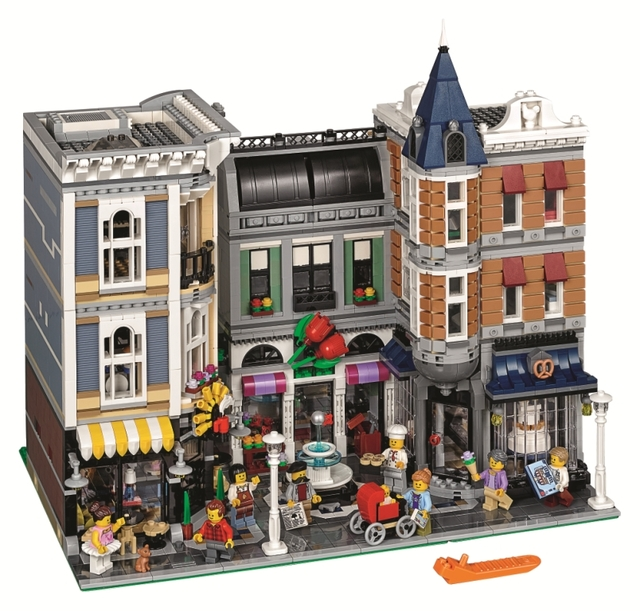](https://www.freelug.org/IMG/jpg/10255_Prod.jpg)

Rendez-vous sur l’extraordinaire Assembly Square, créé pour célébrer dix ans de bâtiments modulaires LEGO®, avec une richesse inégalée de détails complexes et des surprises cachées. La modularité des sections de construction permet d’accéder à un intérieur très détaillé, comprenant au niveau du sol : une boulangerie, un café et un fleuriste ; au premier étage : un magasin de musique, un studio photo et un cabinet dentaire ; le dernier niveau comprend un studio de danse et un appartement qui donne sur un toit-terrasse équipé d’un barbecue. L’extérieur du bâtiment dispose d’un trottoir au pavage détaillé avec mobilier de jardin pour le café, une fontaine, deux réverbères et une façade très élaborée avec des fenêtres et des portes magnifiquement détaillées. Trois enseignes à construire, une tour d’angle et une riche décoration de corniche complètent l’ensemble.  
Collectionne et construit une ville entière avec la série LEGO® Creator Building Expert Modular, 10243 Le Restaurant Parisien, 10246 Le Bureau du Détective et 10251 La Banque de Briques.

[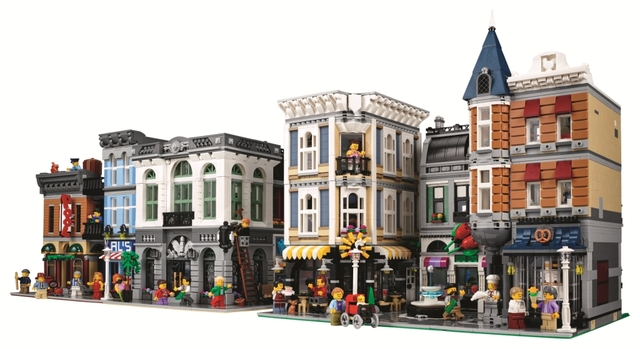](https://www.freelug.org/IMG/jpg/10255_Back_23.jpg)

Le set 10255 comprend huit figurines et une figurine de bébé.

**–** Comprend huit figurines : un dentiste, une barista, un boulanger, une fleuriste, un vendeur de musique, une danseuse, un photographe et une fan de LEGO®, ainsi qu’une figurine de bébé.

[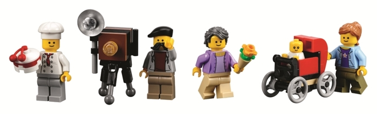](https://www.freelug.org/IMG/jpg/10255_Top_01.jpg)

[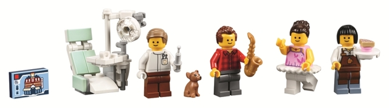](https://www.freelug.org/IMG/jpg/10255_Top_02.jpg)

**–** Les trois niveaux de l’Assembly Square disposent d’une façade élaborée authentique avec des fenêtres et des portes détaillées, trois enseignes à construire, une tour d’angle, une décoration de corniche élaborée et un toit terrasse. Le trottoir pavé est détaillé, et comprend une fontaine, du mobilier de café en plein air et deux réverbères. L’intérieur est très détaillé, il comprend une boulangerie, un fleuriste, un café, un magasin de musique, un studio photo, un cabinet dentaire, un appartement et un studio de danse.

[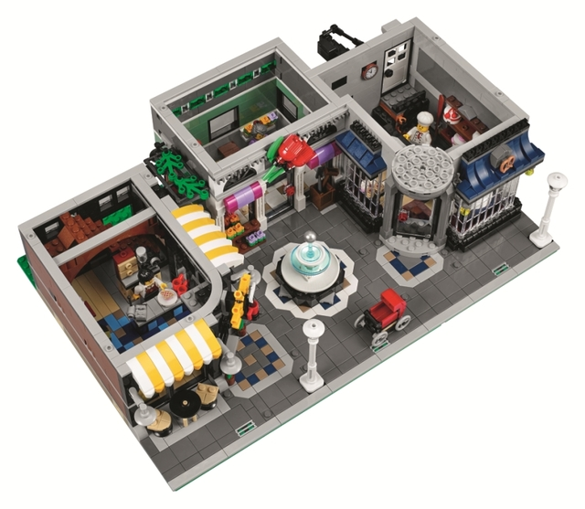](https://www.freelug.org/IMG/jpg/10255_Back_01.jpg)

**–** Le rez-de-chaussée dispose d’une boulangerie avec comptoir, une caisse enregistreuse, des étagères, un four qui s’ouvre, un gâteau de mariage et des pâtisseries et des friandises assorties ; la boutique d’un fleuriste avec comptoir, une caisse enregistreuse, des outils de jardin, des arrangements de fleurs, bouquets et un perroquet ara bleu et jaune ; et un café avec machine à expresso, un comptoir, des banquettes et des cookies.

**–** Le premier étage dispose d’un magasin de musique avec une batterie, deux guitares et un saxophone ; un studio photo avec un appareil photo classique à construire et son trépied réglable ; et un cabinet dentaire avec sa chaise inclinable, une salle d’attente, un téléphone et un évier.

[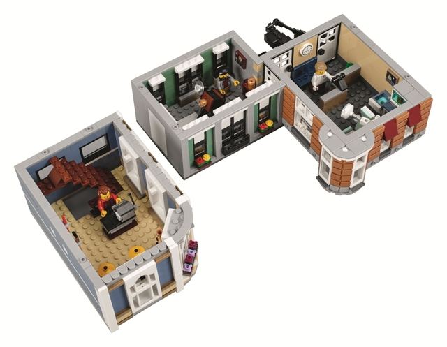](https://www.freelug.org/IMG/jpg/10255_Back_02.jpg)

**–** Le niveau supérieur met en scène un studio de danse avec un piano à monter et un miroir ; un appartement avec un canapé convertible, une cuisine détaillée, des WC, un train LEGO® ainsi que des petits bâtiments modulaires et une Tour Eiffel miniatures, et un accès au toit avec un barbecue à construire, une table et une plante en piteux état.

[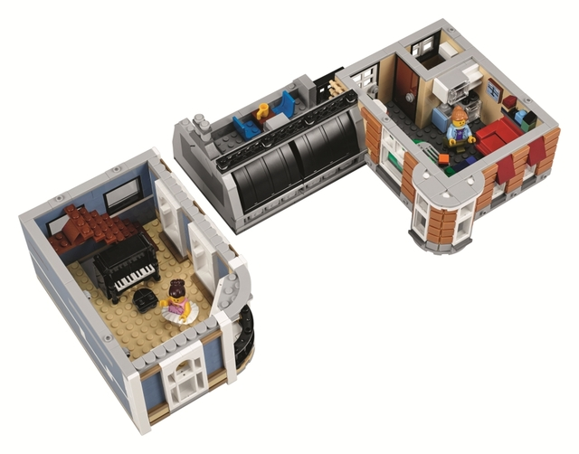](https://www.freelug.org/IMG/jpg/10255_Back_03.jpg)

**–** Plusieurs accessoires tels qu’un tutu de ballerine, un Chihuahua, un bretzel, un poulet décoratif et des sucreries. Le set comprend également un téléphone, un grill, une poussette et des lampes à construire.  
**–** Enlevez les différents étages pour accéder aux intérieurs détaillés.  
**–** Ajustez le trépied de l’appareil photo et prenez des photos dans tout le quartier.  
**–** Inclinez le fauteuil du dentiste et montrez vos belles dents blanches !  
**–** Ouvrez les portes du four pour en sortir vos pâtisseries cuites à point.  
**–** Dépliez le canapé-lit et relaxez-vous en admirant votre collection de bâtiments modulaires !  
**–** Célébrez le 10ème anniversaire des constructions Modulaires avec cet incroyable Set LEGO® Creator Expert !  
**–** Ce set est approprié à des utilisateurs de 16 ans et plus.  
**–** Contient de nouveaux éléments décorés tels que le torse du dentiste, la fenêtre du dentiste, et une tile de 2x3 présentant la boîte du set 10182 Café Corner.  
**–** Inclut plusieurs tiles incurvées ou d’angle, des portes de garage utilisées comme fenêtres en arc et des pelles de pelleteuse LEGO® Technic utilisées comme éléments de toit.  
**–** Collectionnez et construisez une ville entière avec les autres sets de la gamme LEGO® Creator Expert : 10243 Le Restaurant Parisien, 10246 Le Bureau du Détective et 10251 La Banque de briques.  
**–** Mesure environ 35 cm de haut, 38 cm de large et 25 cm de profondeur.

**Le set 10255 Assembly Square propose de nombreuses références aux précédents Modulars**

10182 Café Corner  
**–**  Café d’angle sur la place avec une tasse en enseigne,  
**–**  Auvents jaunes et blancs,  
**–**  Micro version du CC sur l’étagère de l’appartement,  
**–**  Une tile 2x3 sérigraphiée représentant la boite du CC,  
**–**  Porte d’angle construite avec des turntables,  
**–**  Cerises dans la poubelle,  
**–**  Plaques de base vertes.

10190 Market Street  
**–**  Micro version du MS sur l’étagère de l’appartement,  
**–**  Le signe du croissant vers la boulangerie.

10185 Green Grocer  
**–**  Micro version du GG sur l’étagère de l’appartement,  
**–**  Barbecue sur le toit,  
**–**  Couleur sand green sur la partie haute du bâtiment,  
**–**  Landeau amélioré (maintenant avec un bébé !).

10197 Fire Brigade  
**–**  Porte d’accès au toit,  
**–**  Cuisine de l’appartement.

10211 Grand Emporium  
**–**  La corniche au-dessus du studio de danse,  
**–**  Le gateau de marriage qui s’assemble avec les accessoires de marriage dans la vitrine du GE.

10218 Pet Shop  
**–**  Le perroquet et le Chihuahua chez le fleuriste,  
**–**  La couleur sand blue du magasin de musique/studio de danse,  
**–**  Les fenêtres du magasin de musique et du studio de danse.

10224 Town Hall  
**–**  Style de toiture de la tour identique à celui du TH,  
**–**  Gateau de mariage pour le couple de mariés du TH,  
**–**  Fleuriste pour le couple de mariés du TH.

10232 Palace Cinema  
**–**  Design central du pavage devant le café similaire à celui du PC,  
**–**  Texture vertical des briques du PC reprise à l’intérieur du studio de danse.

10243 Parisian Restaurant  
**–**  Le toit du bâtiment central est similaire à celui du PR,  
**–**  Le croissant blanc de la boulangerie,  
**–**  Canapé convertible, renvoyant au lit convertible .  
**–**  Verdure et pergola entre le café et le fleuriste.

10264 Detective’s Office  
**–**  Le miroir  
**–**  L’origine des bonbons et des cookies est la patisserie.  
**–**  La couleur nougat du cabinet dentaire.

10251 Brick Bank  
**–**  Portrait du directeur de la banque dans le studio photo,  
**–**  Les fenêtres en trans-green et trans-clear chez le fleuriste.

[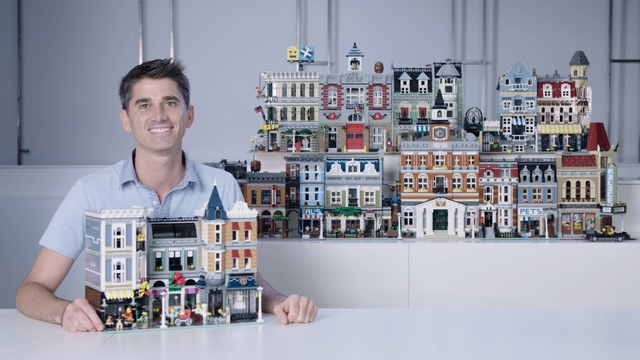](https://www.freelug.org/IMG/jpg/LEGO_Designer_Videos_2017_Jamie_v1__Still.jpg)

Jamie, concepteur de ce set.

**Note des rédacteurs**  
Un gros set pour célébrer 10 ans de Modulaires... Et quel set ! Les détails sont au rendez-vous et je ne doute pas que les concepteurs se sont creusé la tête pour nous offrir quelques éléments de construction intéressants.

Les clins d’œil aux différents sets passés sont sympas et la présence de quelques éléments nouveaux (sans oublier le bébé LEGO) apporte un petit intérêt supplémentaire à cette grosse boîte.

Etant fans de la gamme Creator Expert, nous ne sommes pas très objectifs mais tout ce que nous pouvons dire c’est que ce set de 4002 pièces viendra s’ajouter sans aucun doute à nos collections !!!

**Photos**

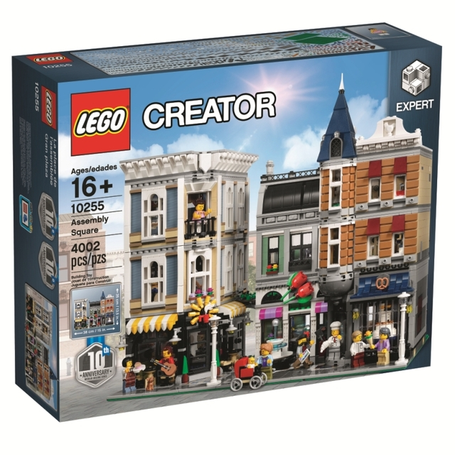

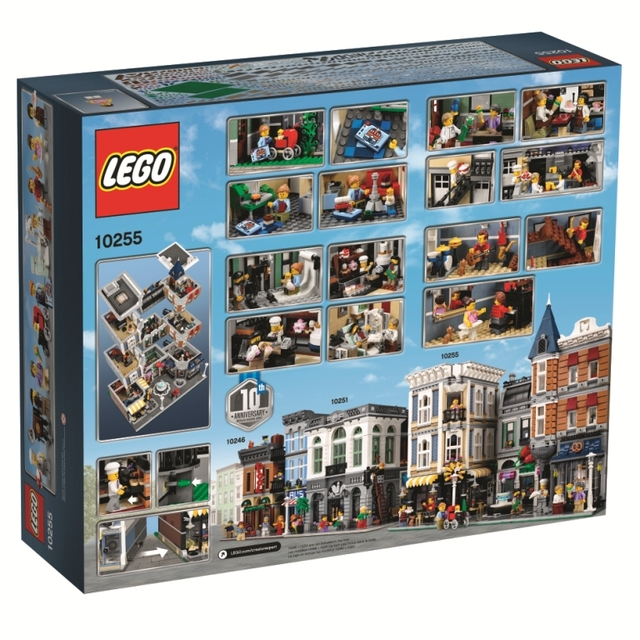

[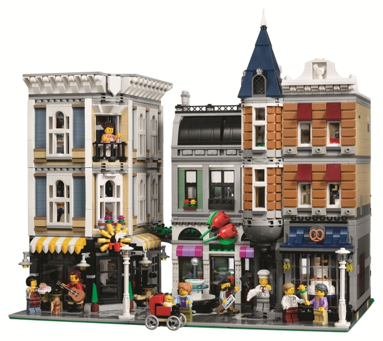](https://www.freelug.org/IMG/jpg/10255_Front_01.jpg)

[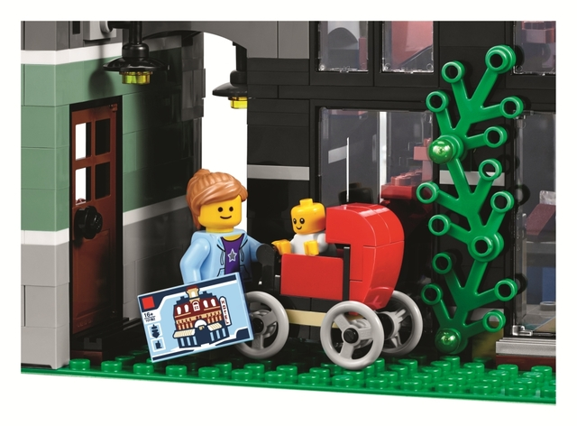](https://www.freelug.org/IMG/jpg/10255_Back_05.jpg)

[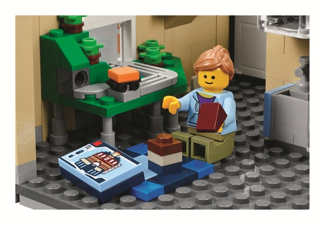](https://www.freelug.org/IMG/jpg/10255_Back_07.jpg)

[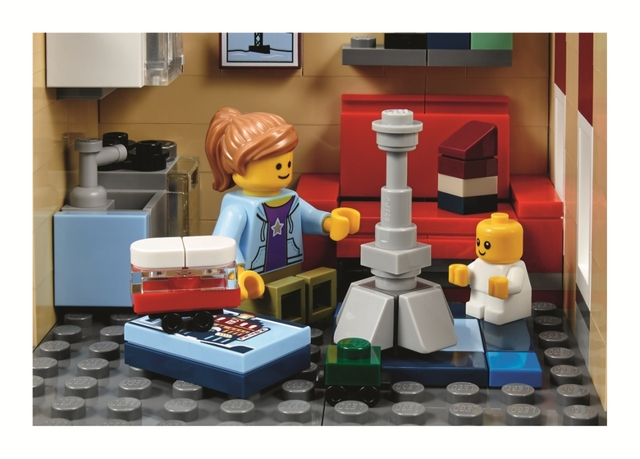](https://www.freelug.org/IMG/jpg/10255_Back_08.jpg)

[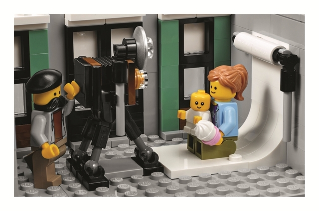](https://www.freelug.org/IMG/jpg/10255_Back_09.jpg)

[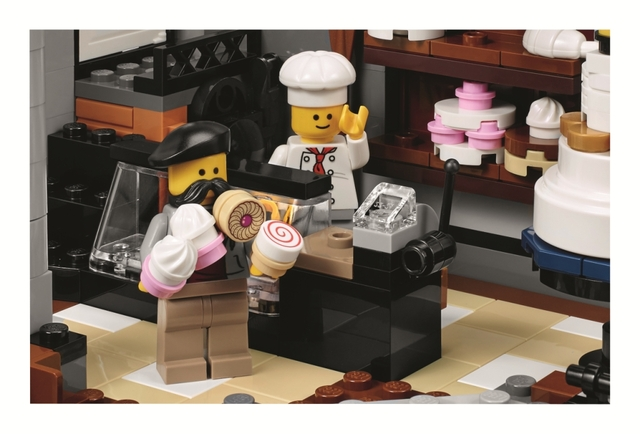](https://www.freelug.org/IMG/jpg/10255_Back_11.jpg)

[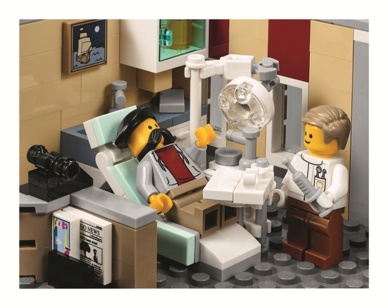](https://www.freelug.org/IMG/jpg/10255_Back_12.jpg)

[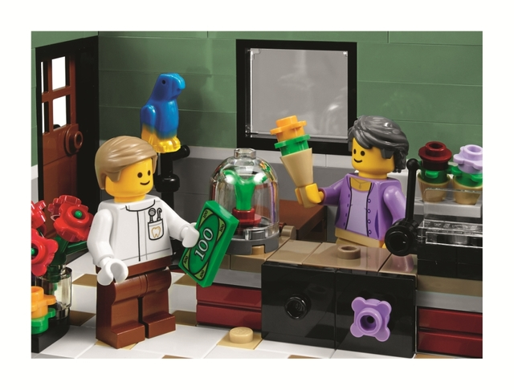](https://www.freelug.org/IMG/jpg/10255_Back_13.jpg)

[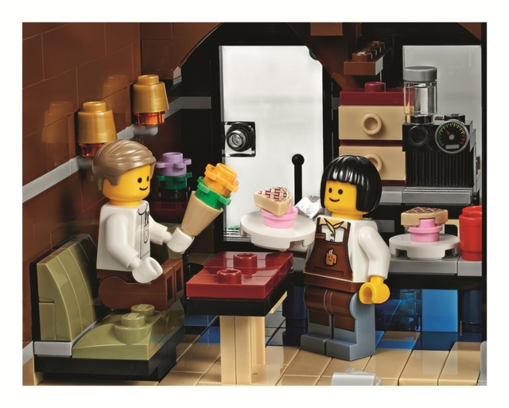](https://www.freelug.org/IMG/jpg/10255_Back_14.jpg)

[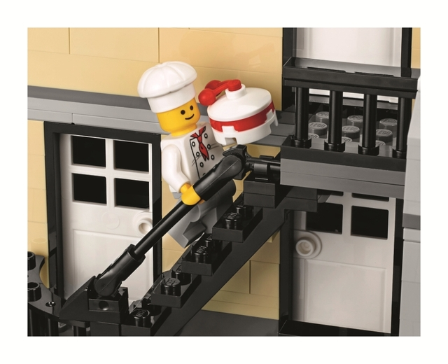](https://www.freelug.org/IMG/jpg/10255_Back_15.jpg)

[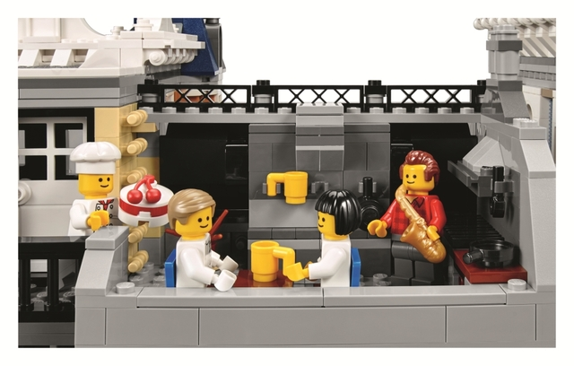](https://www.freelug.org/IMG/jpg/10255_Back_16.jpg)

[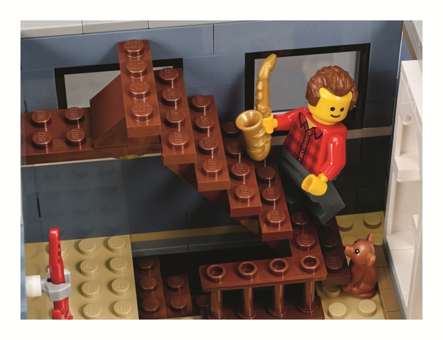](https://www.freelug.org/IMG/jpg/10255_Back_17.jpg)

[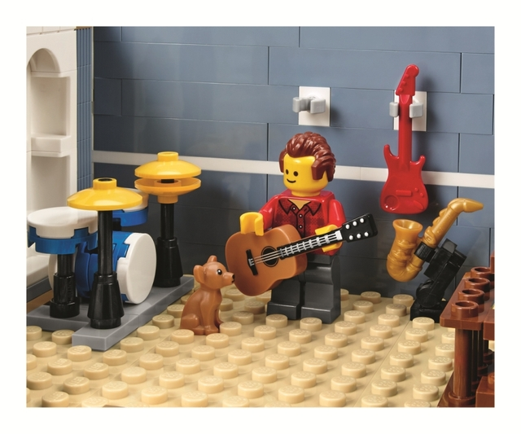](https://www.freelug.org/IMG/jpg/10255_Back_18.jpg)

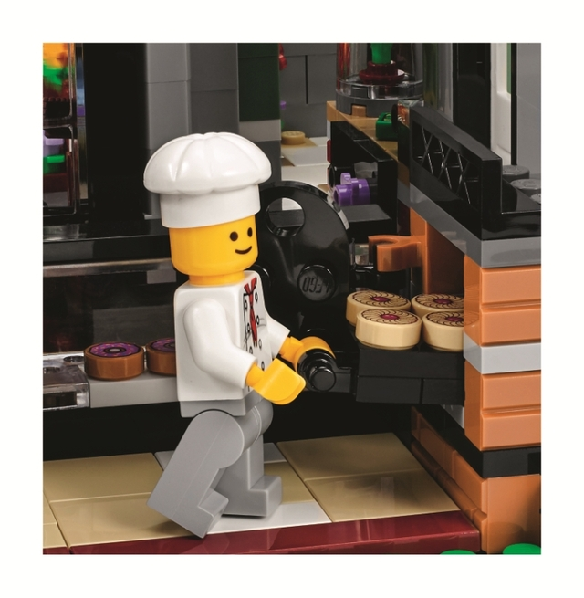

## L’annonce officielle en anglais :

**10255 Assembly Square**

Ages 16+. 4,002 pieces.

US $279.99 - CA $329.99 - DE 239.99€ - UK £169.99 - DK 2099.00 DKK  
_\*Euro pricing varies by country. Please visit shop.LEGO.com for regional pricing._

Celebrate ten years of Modular Building with the Assembly Square !

Take a trip to the amazing Assembly Square, developed to celebrate ten years of LEGO® Modular Buildings, featuring a wealth of unsurpassed, intricate details and hidden surprises. Easy-to-remove building sections provide access to the highly detailed interior, comprising a ground level with a bakery, florist’s shop and café, a middle level with a music store, photo studio and dental office, and an upper-level dance studio and apartment with access to a rooftop terrace with barbecue. The exterior of the building features a detailed sidewalk with outdoor café furniture, fountain, streetlamps and a highly elaborate facade with beautifully detailed windows and doors, three buildable shop signs, spired tower and a decorative roofline. Collect and build an entire town with the LEGO Creator Expert Modular Building series 10243 Parisian Restaurant, 10246 Detective’s Office and 10251 Brick Bank. Includes eight minifigures and a baby figure.  
**–** Includes eight minifigures : a dentist, barista, baker, florist, music store assistant, dancer, photographer and a LEGO® fan, plus a baby figure.  
**–** The three-level Assembly Square features an authentic, elaborate facade with detailed windows and doors, three buildable shop signs, spired tower, decorative roofline and a rooftop terrace, plus a detailed tiled sidewalk with a fountain, outdoor café furniture and two streetlamps. The highly detailed interior includes a bakery, florist’s shop, café, music store, photo studio, dental office, apartment and a dance studio.  
**–** Ground level features a bakery with counter, cash register, shelves, opening oven, wedding cake and assorted buildable pastries and treats ; a florist’s shop with counter, cash register, garden tools, flower arrangements, bouquets and a blue and yellow macaw parrot element ; and a café with espresso machine, counter, bench seating and pie elements.  
**–** Middle level features a music store with a buildable drum set, two guitars and saxophone element ; photo studio with buildable classic camera and adjustable tripod ; and a dental office with buildable reclining chair, waiting area, telephone and a sink.  
**–** Upper level features a dance studio with buildable piano and reflective mirror element ; an apartment with buildable foldout sofa bed, detailed kitchen, toilet, micro LEGO® train, modular buildings and Eiffel Tower, and access to a rooftop terrace with buildable barbecue, table and a neglected plant.  
**–** Accessory elements include a ballerina skirt, Chihuahua, pretzel, ornamental chicken and candy. Also includes a buildable telephone, grill, baby carriage and buildable lamps.  
**–** Remove the building sections to access the detailed interior.  
**–** Adjust the camera tripod and take photos all around the square.  
**–** Recline the dentist chair and reveal those pearly whites !  
**–** Open the oven door to remove your freshly-baked pastries.  
**–** Fold out the sofa bed and relax while you admire your modular buildings collection !  
**–** Celebrate Modular Buildings with this awesome 10th anniversary LEGO® Creator Expert set !  
**–** This set offers an age-appropriate build and play experience for ages 16+.  
**–** New decorated elements include a dentist torso, dentist window and 2x3 tile with the 10182 Café Corner box front.  
**–** Includes lots of curved and corner angle tiles, garage doors used as box windows and LEGO® Technic excavator scoops used as roofing elements.  
**–** Collect and build an entire town with the LEGO® Creator Expert Modular Building series 10243 Parisian Restaurant, 10246 Detective’s Office and 10251 Brick Bank.  
**–** Measures over 13” (35cm) high, 14” (38cm) wide and 9” (25cm) deep.
