Pour changer un peu des Mixels, je vous propose aujourd’hui une revue du set 60090, **L’explorateur sous-marin**.

Ce set, sorti en 2016 au prix de 5,99 €, comporte 42 pièces, dont une figurine et une pieuvre, soit un ratio de 14 centimes par pièce.

* * *

L’envers de la boîte comporte le logo _CITY_ — même si nous sommes sous l’eau, c’est clairement un set « réaliste ». L’image présente le véhicule sous-marin, le plongeur et la pieuvre ayant un magnifique diamant dans un tentacule.

[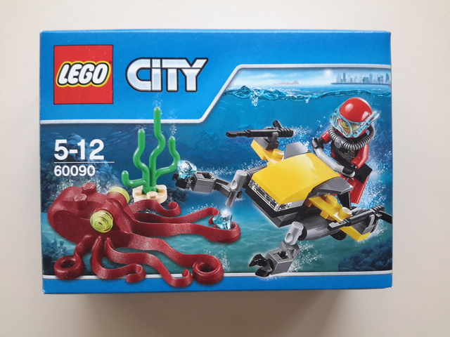](https://www.freelug.org/IMG/jpg/20161015_110850.jpg)

Le dos de la boîte montre au dos la pieuvre se reposant auprès de son trésor et, en bas, le plongeur qui s’enfuit après l’avoir dévalisée — un vrai scandale, heureusement il ne semble pas avoir utilisé ses harpons.

[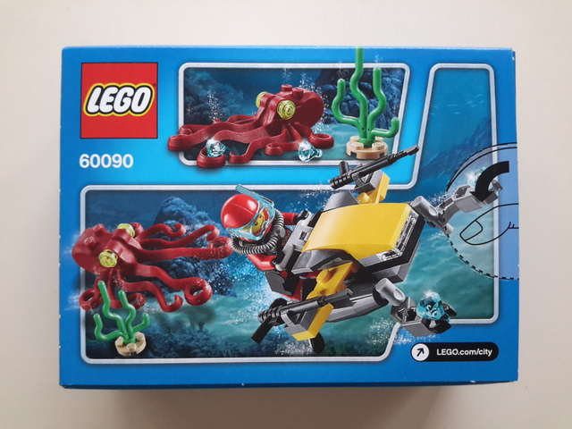](https://www.freelug.org/IMG/jpg/20161015_110927.jpg)

La boîte contient, outre le manuel, un sachet de pièces et la pieuvre à part.

[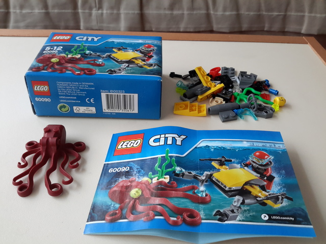](https://www.freelug.org/IMG/jpg/20161015_111456.jpg)

Le personnage du plongeur présente sur l’avant du torse une sérigraphie adaptée à son rôle, avec des cadrans, sangles, etc., tandis que les jambes ont une marque laissant imaginer une combinaison. À noter le sourire presque narquois, voire cruel.

[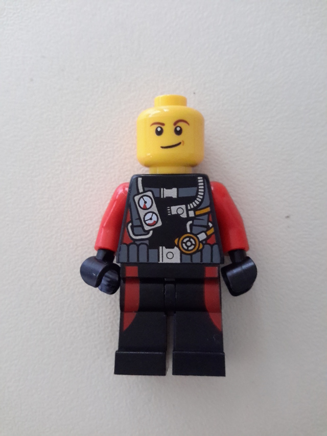](https://www.freelug.org/IMG/jpg/20161015_111137.jpg)

Le dos, qui sera caché en partie par les bouteilles, présente le même motif sur le torse, avec la suite des sangles, mais les jambes elles sont uniformes.

[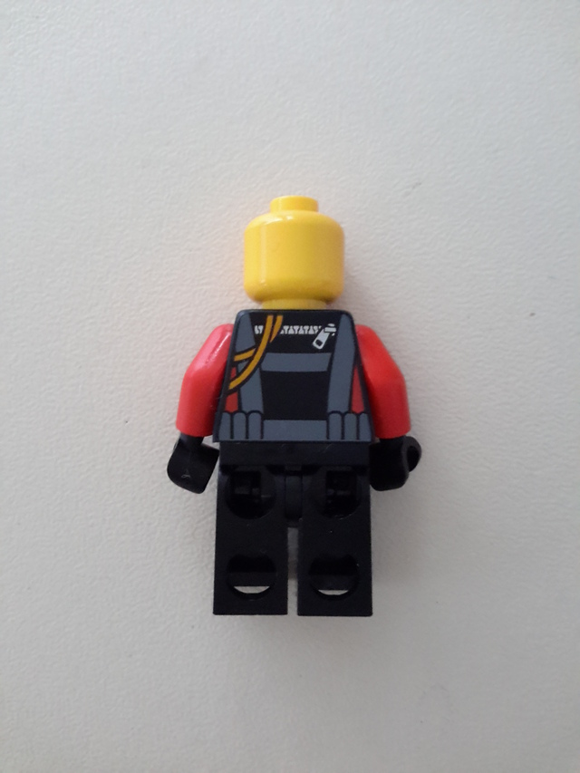](https://www.freelug.org/IMG/jpg/20161015_111156.jpg)

Et voici le plongeur monté, avec ses bouteilles sur le dos, ses palmes d’un beau rouge, et son masque bleu transparent.

[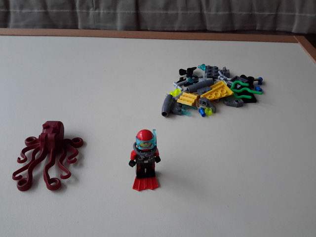](https://www.freelug.org/IMG/jpg/20161015_111414.jpg)

La pieuvre n’est pas en reste, avec deux yeux jaunes transparent, et un diamant bleu dans un tentacule. On remarquera que les tentacules, même s’ils ne tiennent pas suffisamment le diamant pour par exemple le pendre à l’envers, peuvent s’accrocher par le dessus sur un tenon. On construit également une magnifique algue, en deux pièces.

[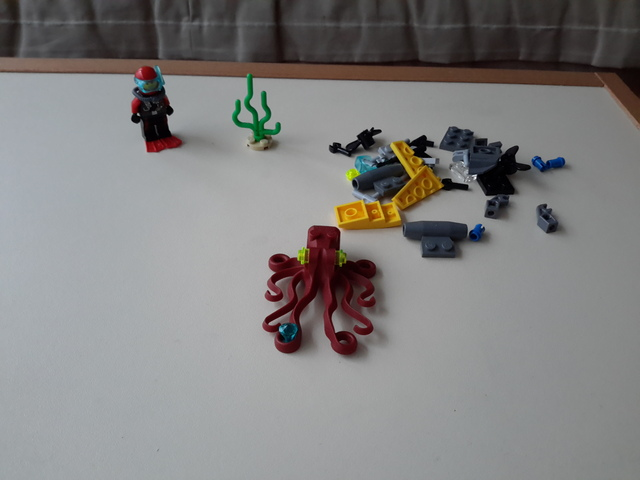](https://www.freelug.org/IMG/jpg/20161015_111639.jpg)

Commence ensuite la construction du véhicule sous-marin, qui sera totalement symétrique. La base comporte simplement deux propulseurs, qui ne serviront — surprise ! — pas à propulser l’engin.

[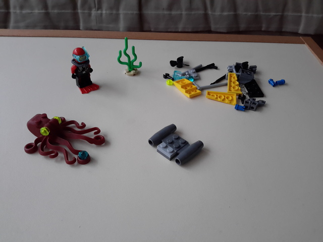](https://www.freelug.org/IMG/jpg/20161015_111736.jpg)

On rajoute ensuite des ailerons sur le côté, pour stabiliser, ainsi qu’une pièce transparente pour simuler les lampes avant — c’est qu’il peut faire sombre dans les profondeurs !

[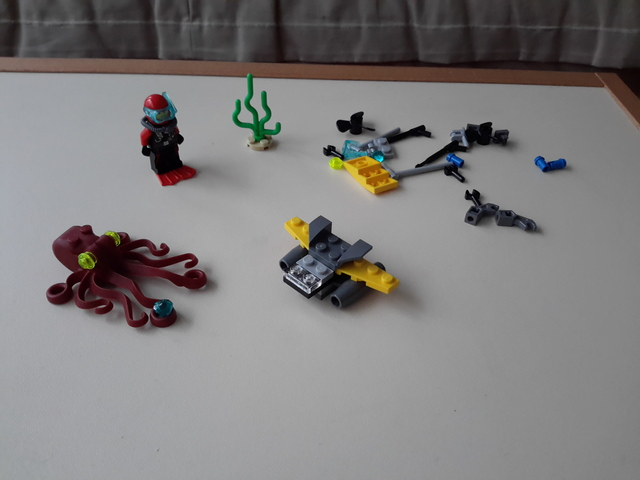](https://www.freelug.org/IMG/jpg/20161015_111823.jpg)

Après avoir ajouté le « capot », ainsi que le volant sur l’arrière, on arme le véhicule de deux harpons, pour se défendre (ou attaquer ?). On insère dans chaque propulseur une sorte de piolet, qui traverse de part en part et servira de point d’attache.

[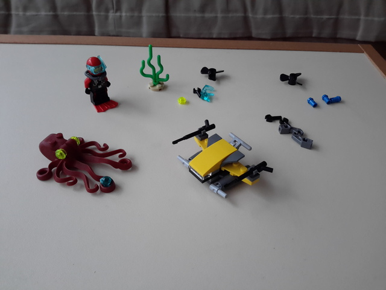](https://www.freelug.org/IMG/jpg/20161015_112001.jpg)

Sur l’avant des dits piolets on accroche des pinces, pouvant pivoter verticalement et autour de l’axe du propulseur, tandis que sur l’arrière on ajoute des hélices qui propulseront le véhicule.

[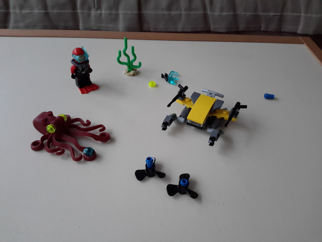](https://www.freelug.org/IMG/jpg/20161015_112134.jpg)

Enfin on accroche le plongeur au véhicule, on ajoute un diamant dans une pince, et la construction est terminée. Voici le plongeur attaquant la pauvre pieuvre, avec sur le côté les pièces en bonus, dont un masque de plongée.

[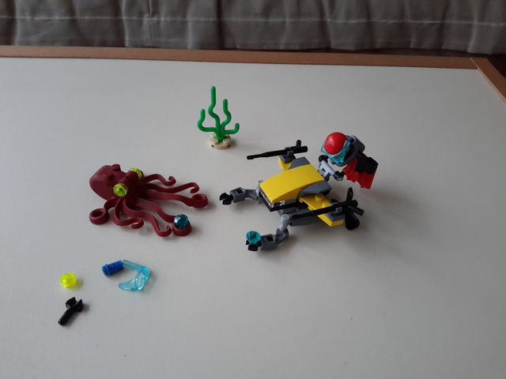](https://www.freelug.org/IMG/jpg/20161015_112301.jpg)

* * *

**Avis :** sans technique de construction particulière, ce petit set est amusant pour la pieuvre, pièce que je n’ai pour ma part pas tellement vue ailleurs. Le personnage équipé est par ailleurs un bon ajout à une collection.

Bref, même s’il ne contient aucune pièce vraiment spéciale, un petit set est sympathique.

**Bonus :** animation de la construction (cliquer pour lancer).

[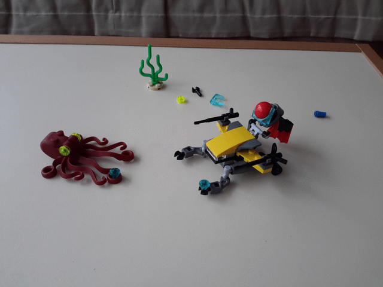](https://www.freelug.org/IMG/gif/60090-l-explorateur-sous-marin.gif)
