Après la revue des Mixels série 8 « [pompiers](/articles/2471/) », je vous propose la revue des sets de la même série sur la thématique « pirates », les boîtes _41566_, _41567_ et _41568_, à savoir **Sharx**, **Skulzy** et **Lewt**.

Ces Mixels, sortis en 2016, coûtent 3,99 €, et comportent 55, 66 et 62 pièces respectivement, soit un ratio entre 6 et 7 centimes.

## Le set 41566, Sharx

Le sachet contient un sac de pièces et une notice de construction, comme tout sachet Mixel. Sharx, qui ressemble à un requin, d’où son nom, est clairement un capitaine pirate, avec son chapeau magnifique noir.

[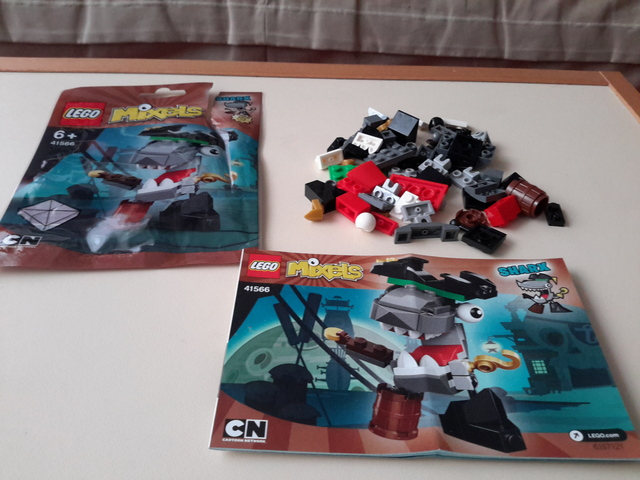](https://www.freelug.org/IMG/jpg/20161002_153818.jpg)

La construction commence par la mâchoire supérieure, qui a de belles dents, sur les côtés et devant, et un nez pyramidal. Le rouge sera quasiment invisible, sauf sur le dessous.

[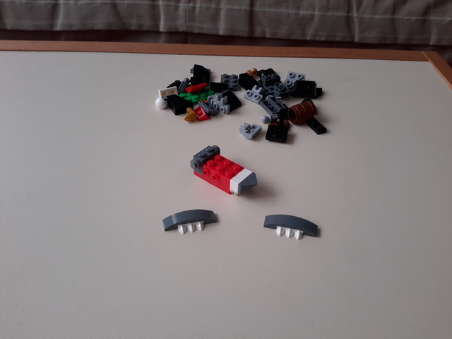](https://www.freelug.org/IMG/jpg/20161002_154033.jpg)

On termine la tête en plaçant les yeux, dont l’un noir pour simuler un bandeau, et ensuite on monte le chapeau noir, indispensable à tout bon pirate. Une petite boucle d’oreille dorée vient mettre une touche de couleur.

[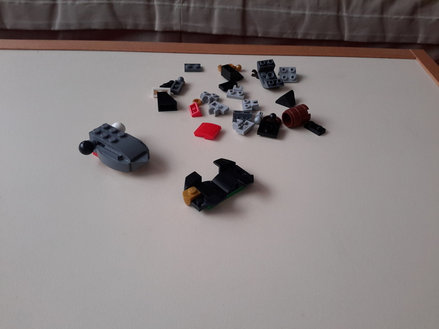](https://www.freelug.org/IMG/jpg/20161002_154212.jpg)

L’étape suivante consiste à monter la mâchoire inférieure, qui a comme il se doit de belles dents également, et une langue rouge. Quatre articulations serviront à placer les jambes et les bras, la tête se plaçant sur l’arrière.

[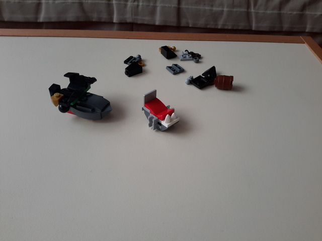](https://www.freelug.org/IMG/jpg/20161002_154341.jpg)

Et voilà la tête montée, la bouche donnant vraiment l’impression de pouvoir s’ouvrir en grand pour avaler des trésors ou des imprudents cherchant à le voler.

[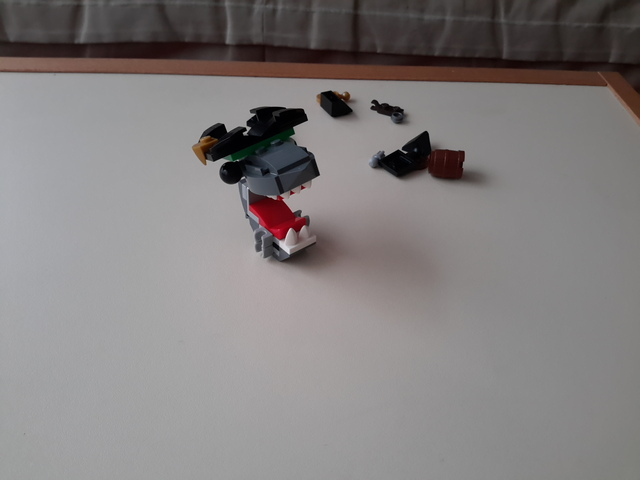](https://www.freelug.org/IMG/jpg/20161002_154405.jpg)

Pour compléter l’œil noir, l’un des bras est une pince, ce capitaine a certainement vécu de nombreuses aventures ! Et l’un des pieds est déformé.

[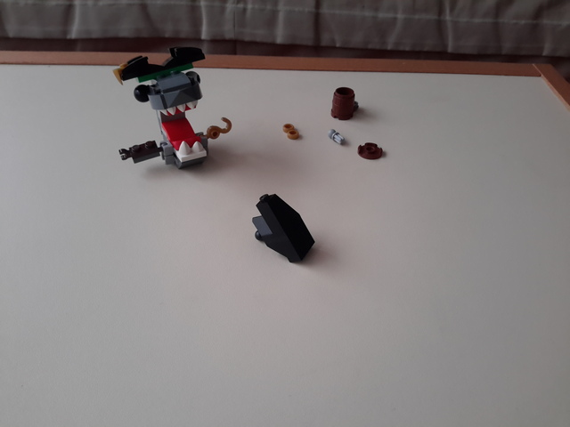](https://www.freelug.org/IMG/jpg/20161002_154534.jpg)

En guise de second pied, un tonneau, et voici Sharx terminé, contemplant les deux pièces bonus (dont une dorée). Et surprise, dans le tonneau s’est glissée une pièce ! Donc quand le personnage se déplace, cela fait un petit bruit de crécelle amusant. À noter que sur l’image du sachet, la pièce est dans le bras droit, il est prudent et préfère la cacher.

[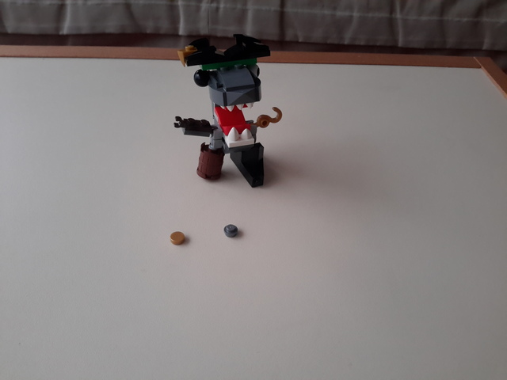](https://www.freelug.org/IMG/jpg/20161002_154639.jpg)

## Le set 41567, Skulzy

Skulzy, pour sa part, est probablement un matelot, qui en a vu de dures, avec un bandeau sur un œil — qui réserve une surprise. Le sachet contient les pièces dans un sac et la notice.

[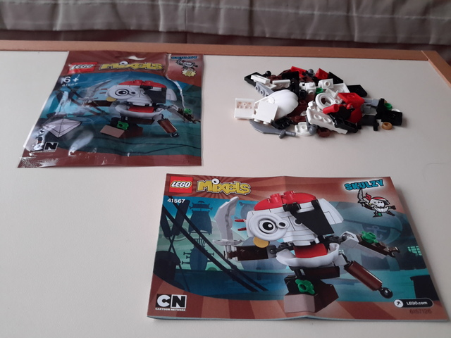](https://www.freelug.org/IMG/jpg/20161002_154730.jpg)

La construction commence par la partie inférieure du corps, qui utilise un coquillage comme mâchoire inférieure, pour un excellent rendu. Quatre articulations permettront d’accrocher les membres, la tête allant sur l’arrière.

[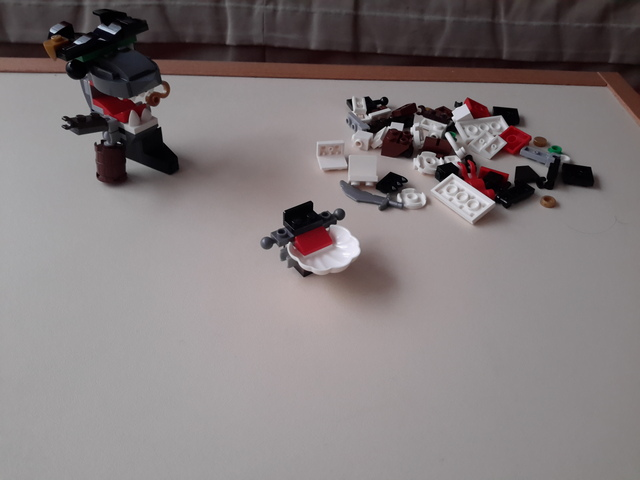](https://www.freelug.org/IMG/jpg/20161002_154931.jpg)

Une pièce plate à crochets sur l’arrière permettra d’accrocher la tête. L’étape suivante est de construire les bras, qui sont plutôt symétriques même si l’un tient un sabre tandis que l’autre comporte une fleur verte du plus bel effet.

[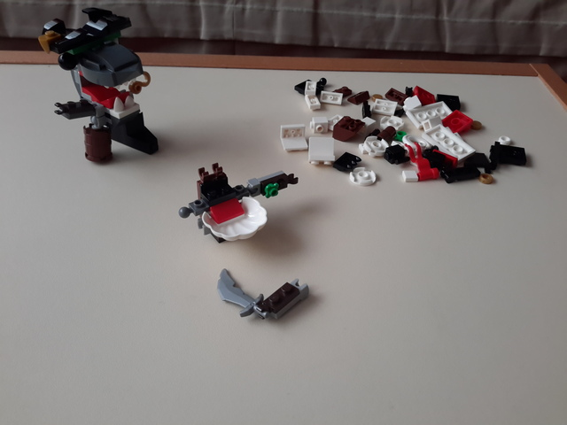](https://www.freelug.org/IMG/jpg/20161002_155101.jpg)

La tête est la partie suivante à construire. Un fanion est incrusté afin de simuler un foulard, tandis que 4 pièces à tenon vertical sont posées sur l’avant, l’une en retrait.

[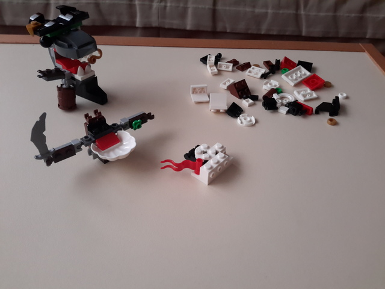](https://www.freelug.org/IMG/jpg/20161002_155229.jpg)

Deux des pièces servent à faire l’œil droit, tandis qu’un drapeau noir ferme la cavité de l’œil gauche dans laquelle est introduite une pièce dorée — encore un pirate protégeant son trésor ! Les deux pièces centrales simulent également en partie des narines.

[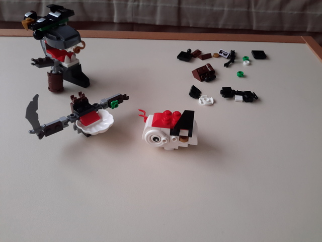](https://www.freelug.org/IMG/jpg/20161002_155529.jpg)

La tête montée sur le corps, et dévoilant la boucle d’oreille sur le côté droit, reste à faire les jambes. L’une est assez standard, mais comporte, comme le bras gauche, une fleur verte.

[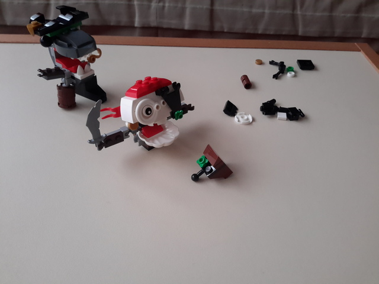](https://www.freelug.org/IMG/jpg/20161002_155646.jpg)

Enfin la jambe gauche est un moignon de bois, encore un pirate qui a bourlingué dans des endroits dangereux ! Le Nixel est à l’avenant, avec un œil bandé. Et il reste quelques petites pièces dont encore une dorée.

[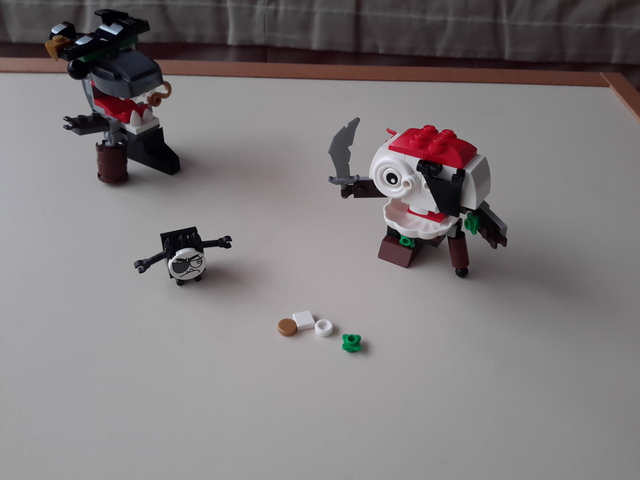](https://www.freelug.org/IMG/jpg/20161002_155852.jpg)

## Le set 41568, Lewt

Pour terminer la série, quoi de plus normal pour des pirates que d’avoir un coffre au trésor ? C’est le rôle joué par Lewt, qui combine trésor et crabe (aux pinces d’or, en plus !) [^1].

[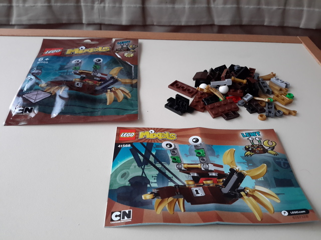](https://www.freelug.org/IMG/jpg/20161015_112636.jpg)

Le corps est assez parallélépipédique, avec des bords remontant et des crochets qui permettront de fixer des pieds.

[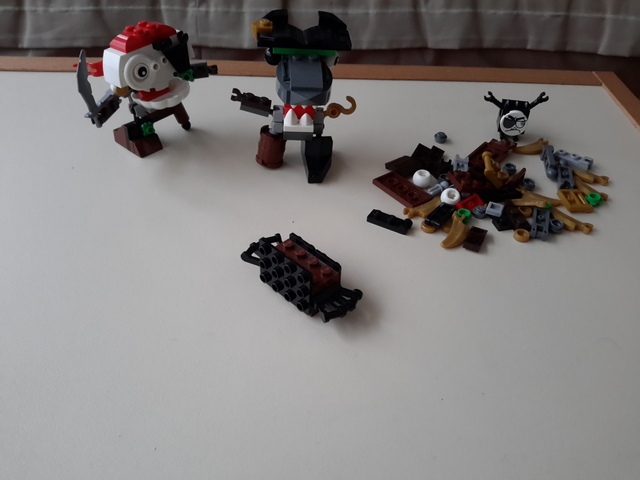](https://www.freelug.org/IMG/jpg/20161015_113012.jpg)

Que serait un coffre au trésor sans trésor à l’intérieur ? Enfin, il y a une langue rouge, c’est quand même l’intérieur d’une bouche !

[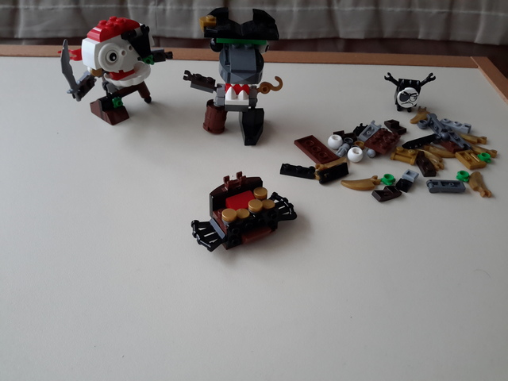](https://www.freelug.org/IMG/jpg/20161015_113201.jpg)

De même, il est indispensable d’avoir une serrure, que l’on place donc sur le devant comme il se doit. Et comme c’est un personnage en thème de crabe, il lui faut des pinces dorées pour faire les pieds. Et, heu, mais le Nixel a volé une pièce !

[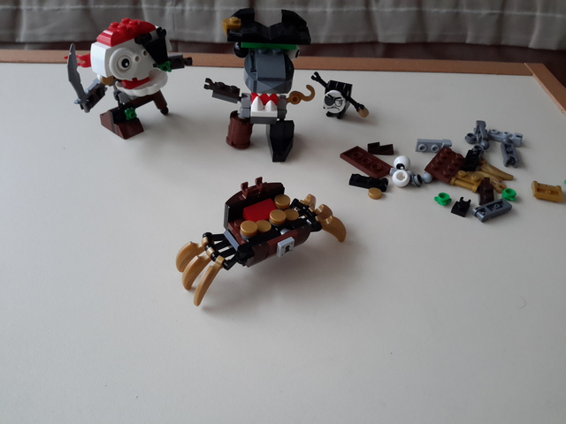](https://www.freelug.org/IMG/jpg/20161015_113416.jpg)

Pour compléter la panoplie, rien de tel qu’une tête avec deux yeux articulés, qui malheureusement ne permettent pas de surveiller le Nixel qui s’approche à nouveau du tas de pièces après avoir donné son butin à Sharx.

[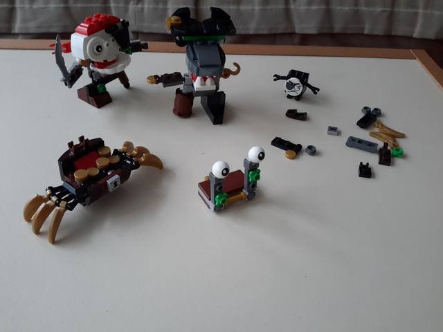](https://www.freelug.org/IMG/jpg/20161015_113703.jpg)

Heureusement Lewt va être équipé d’un bras agrippant une pièce, l’autre étant une magnifique pince dorée, qu’il lorgne avec intérêt.

[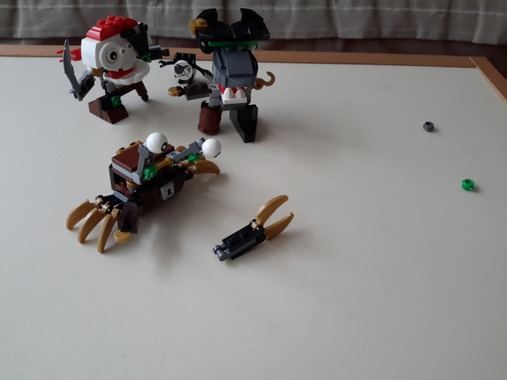](https://www.freelug.org/IMG/jpg/20161015_113950.jpg)

Et voici Lewt complété, et il a même récupéré les pièces bonus volées par le Nixel ! Encore une dorée, et une serrure. Les pieds articulés permettent de nombreuses positions verticalement, avec une bonne stabilité — c’est un crabe, pas de doute. Et les yeux sont excellents, très articulés et bougeant dans tous les sens.

[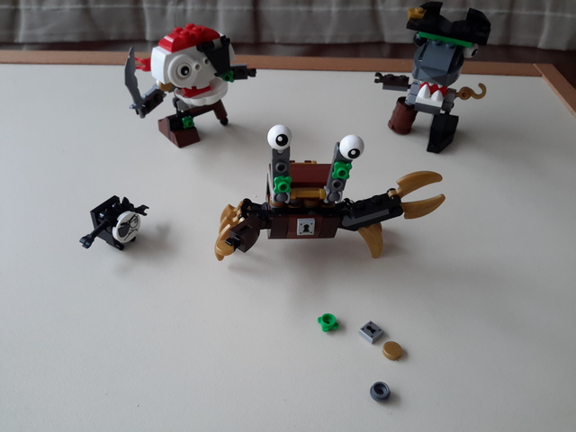](https://www.freelug.org/IMG/jpg/20161015_114056.jpg)

* * *

**Avis :** je me suis vraiment amusé à monter ces personnages, qui sont à la fois délirants et parfaitement cohérents avec leur rôle. La thématique « pirate » est bien exploitée, avec tous les ingrédients requis, et les différentes pièces sont bien sympathiques.

Bref de bons sets amusants.

**Bonus 1 :** photos de groupe, et un, et deux...

[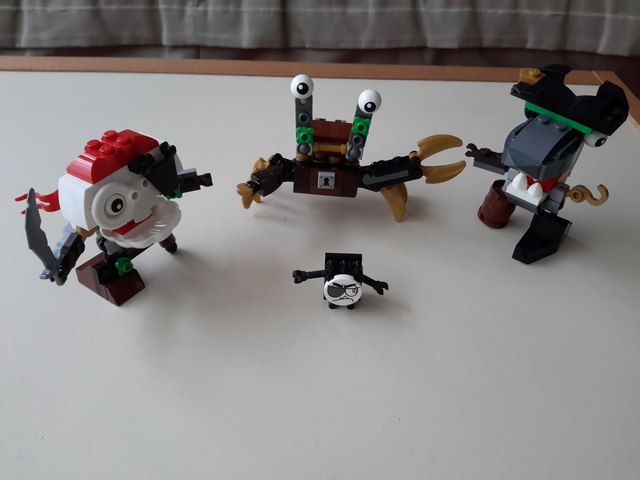](https://www.freelug.org/IMG/jpg/20161015_114126.jpg)

et trois !

[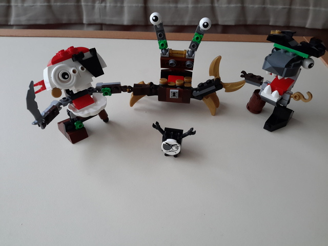](https://www.freelug.org/IMG/jpg/20161015_114155.jpg)

**Bonus 2 :** animations de toutes les étapes (cliquer pour lancer).

_Sharx_

[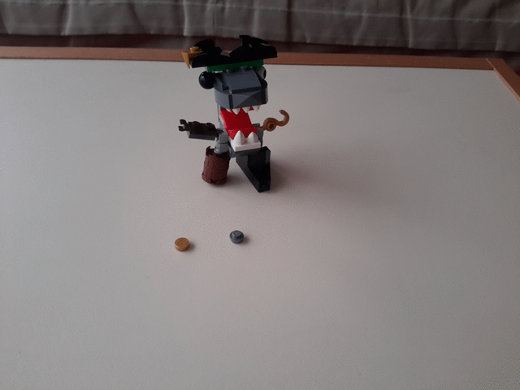](https://www.freelug.org/IMG/gif/41566-sharx.gif)

_Skulzy_

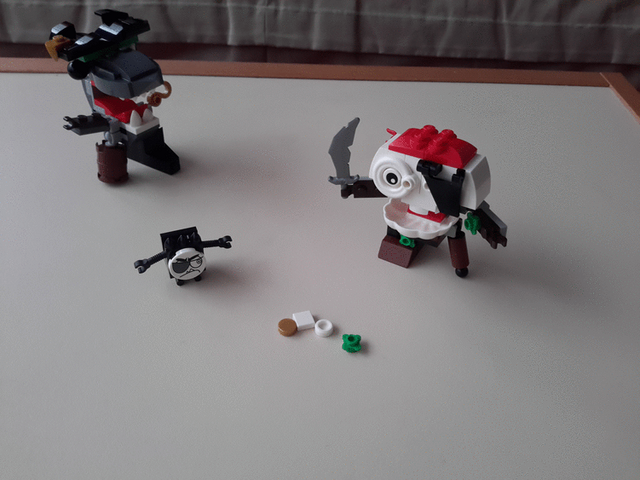

_Lewt_

**Bonus 3 :** « Argh, moussaillon, l’ennemi est trop fort, combinons nos forces en _Pyrratz Max_ pour le vaincre ! Avec ces belles griffes (recyclage des pattes de Lewt) et notre grande bouche, rien ne nous résistera ! Même si notre look en prend un sérieux coup... »

Je dois avouer trouver le personnage moins amusant que les trois individuels, la tête en particulier me paraît déséquilibrée.

[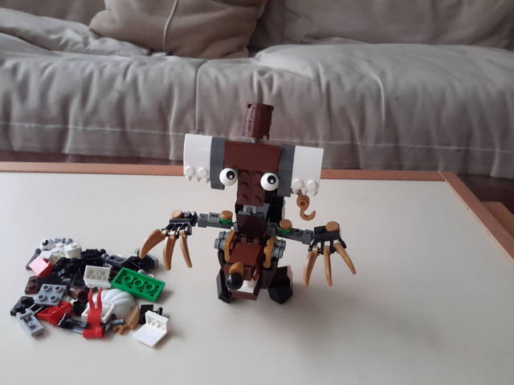](https://www.freelug.org/IMG/jpg/pyrratz-max-1.jpg)

[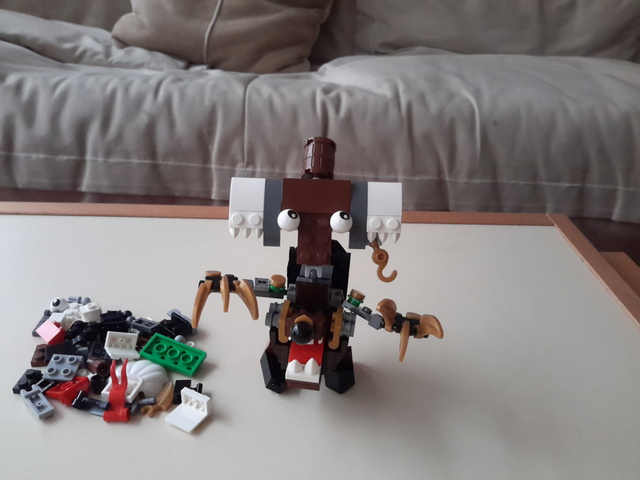](https://www.freelug.org/IMG/jpg/pyrratz-max-2.jpg)

[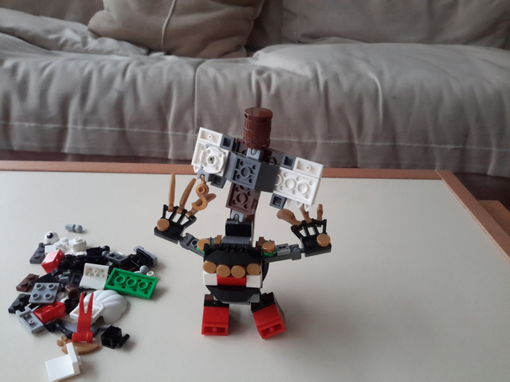](https://www.freelug.org/IMG/jpg/pyrratz-max-3.jpg)

[^1]: On pourrait même penser au Bagage du Disque-Monde s’il n’avait pas d’yeux.
