Pour continuer dans les petites boîtes, après [les véhicules de chantier](/articles/2463/), je vous propose la revue de la boîte 31028, **l’hydravion**.

Cet ensemble sorti en 2016 comporte 53 pièces pour un coût de 4,99 €, soit environ 9 centimes par pièce.

* * *

Cohérent avec la gamme, la boîte présente, outre le logo CREATOR, la mention « 3-in-1 », l’image de l’hydravion et des deux bateaux alternatifs, de couleur blanc, noir et orange.

[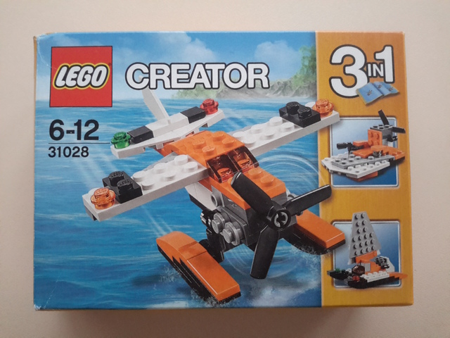](https://www.freelug.org/IMG/jpg/20161113_123132.jpg)

L’envers présente les trois véhicules sur la mer.

[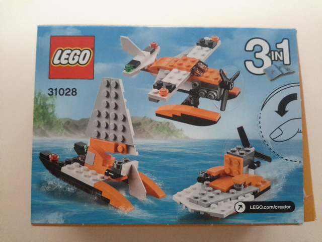](https://www.freelug.org/IMG/jpg/20161113_123148.jpg)

Sans surprise, la boîte contient un sachet de pièces et une notice.

[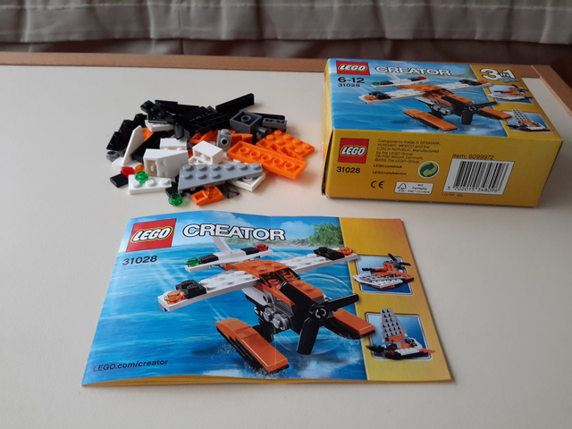](https://www.freelug.org/IMG/jpg/20161015_114705.jpg)

* * *

La construction commence par le corps de l’hydravion, sur une plaque noire de 2x6 sur laquelle s’accroche un double crochet 2x1 qui servira à tenir les flotteurs, et deux pièces 1x1 à tenon pour la décoration.

[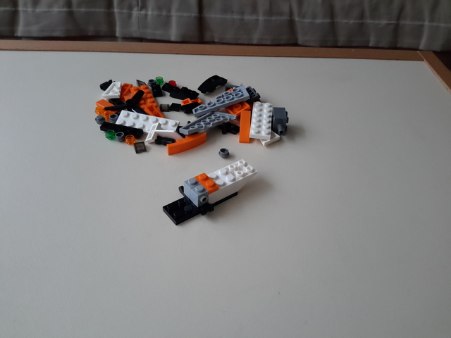](https://www.freelug.org/IMG/jpg/20161015_115924.jpg)

On rajoute la pièce de fixation de l’hélice, et on fait un détour par la queue, qui a pour base deux ailes de 3x2.

[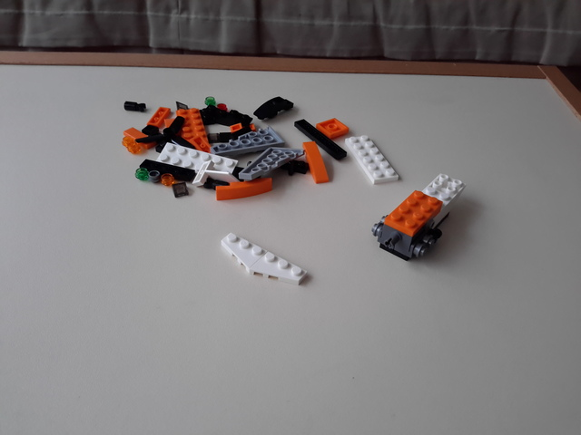](https://www.freelug.org/IMG/jpg/20161015_120024.jpg)

On pose le tout sur une plaque 2x6 orange, quelques feux de position, l’aileron arrière, et on monte sur le corps.

[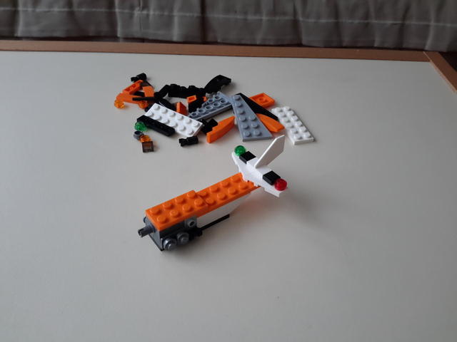](https://www.freelug.org/IMG/jpg/20161015_120127.jpg)

Parce qu’un hydravion est quand même un avion, il lui faut des ailes et une hélice, que l’on ajoute dans les étapes qui suivent. Sous cette forme c’est déjà un bel avion, mais la construction n’est pas terminée.

[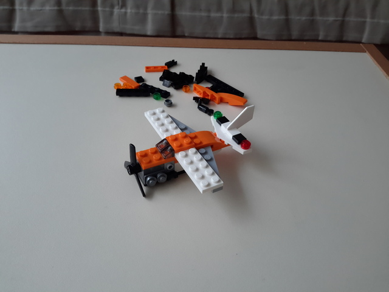](https://www.freelug.org/IMG/jpg/20161015_120246.jpg)

Les flotteurs sont basés sur des plaques 1x6 noires, croisées, avec des pentes inversées pour l’avant. Le crochet noir (mieux visible sur l’image suivante) servira à accrocher le tout au corps de l’avion.

[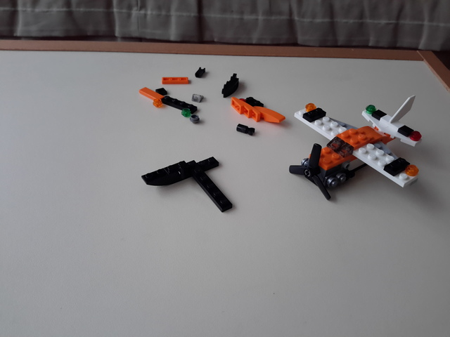](https://www.freelug.org/IMG/jpg/20161015_120406.jpg)

Voici le flotteur de droite terminé, avec celui de gauche bien avancé. En arrière-plan les pinces noires qui permettront de lier flotteurs et corps.

[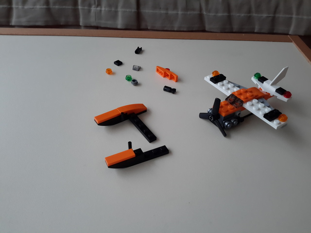](https://www.freelug.org/IMG/jpg/20161015_120447.jpg)

On met une pince de chaque côté, et on accroche sur le double crochet sortant du corps de l’avion, terminant la construction. Le rendu est sympathique, avec un joli compte de pièces bonus, 6 au total.

* * *

**Avis :** petite boîte sans prétention mais qui remplit son rôle, avec un beau rendu des différentes constructions, suggérées avec quelques détails amusants.

Bref une boîte sympathique.

**Bonus :** les deux autres constructions proposées, le catamaran...

[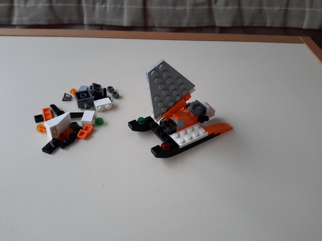](https://www.freelug.org/IMG/jpg/20161015_115057.jpg)

... et le bateau des marais.

[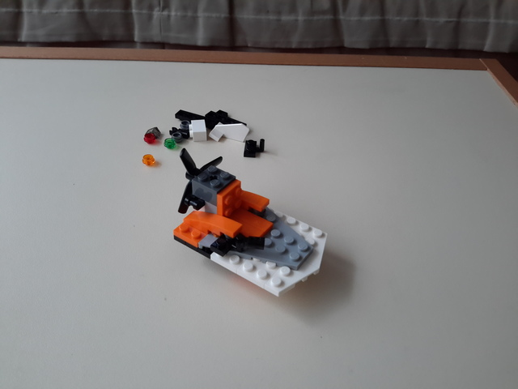](https://www.freelug.org/IMG/jpg/20161015_115628.jpg)

[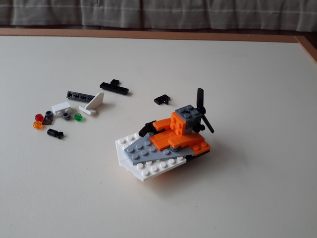](https://www.freelug.org/IMG/jpg/20161015_115612.jpg)

**Bonus :** animation de la construction de l’hydravion (cliquer pour lancer).

[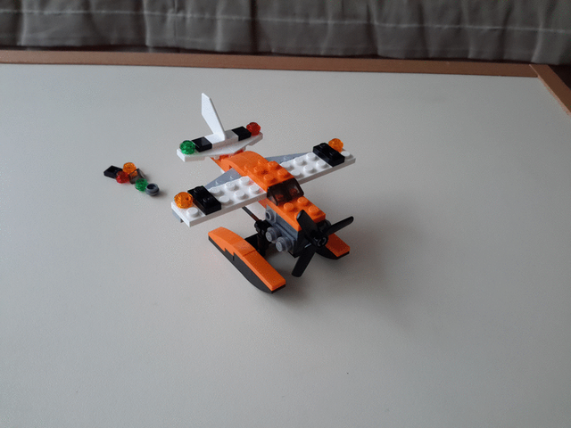](https://www.freelug.org/IMG/gif/31028-l-hydravion.gif)
