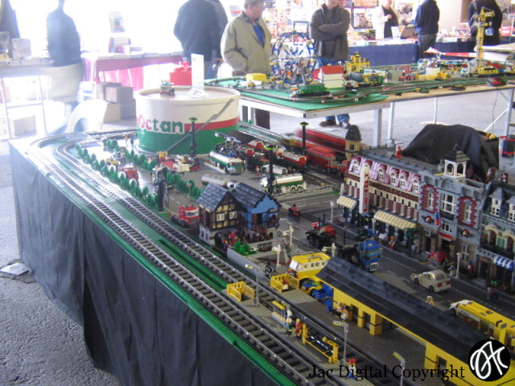
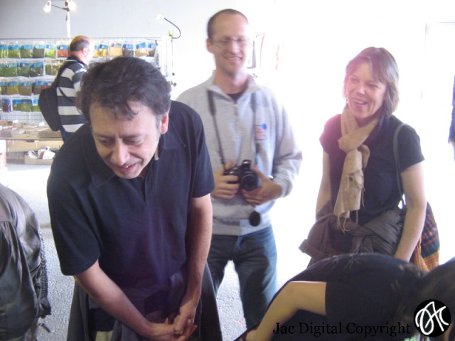
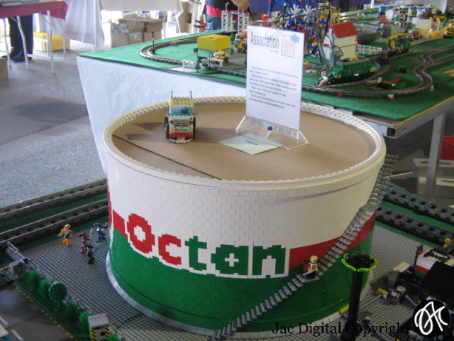
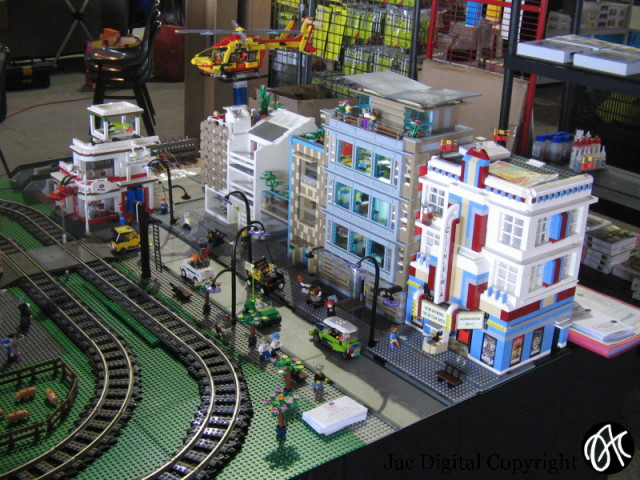

Quand on pense au sud, on pense au soleil hors là, ce fût brouillard et grisaille tous le week-end. Ce qui, le cas échéant, ne fût pas bien grave car nous avons passé ces deux jours dans le grand hall du parc des exposition d’Avignon.

L’exposition au parc des expostions d’Avignon, je la connais, j’y étais allé en visiteur quand j’étais au lycée. Je ne me souviens plus en qu’elle année c’était et puis aussi je n’en ai pas l’envie. Toujours est-il qu’il a fallut patienter jusqu’à la 24e pour pouvoir y participer.

Le 24e Model Show d’Avignon en quelque chiffres :  
**–** Surface du hall d’exposition 7000m²  
**–** 50 stands, sans compter les boursiers  
**–** 6000 visiteurs pour cette session 2010

Le voyage s’est très bien passé. Il faut dire que c’est un itinéraire que je commence à connaître. L’installation débute dés le vendredi par le montage des tables BaB. Comme d’habitude, j’ai oublié une des pièces pour mon tourne vis et j’ai encore tout du faire à la main. Mais ça c’est tout de même bien passé.

Puis c’est l’arrivée de Pierre Laurenge, de Pierrick et de Jean-Yves. Je ne me souviens plus très bien de l’ordre mais je sais que Pierrick est arrivé en dernier.

Le salon occupe seulement la grande salle circulaire, qui fait tout de même 7000m². Le plafond très haut permet de faire des démonstrations de vol. Il y a eu plusieurs fois dans le week-end des montgolfières miniatures.

Grâce à notre entente par internet nous avons encore pu présenter un joli petit réseau qui a beaucoup plu aux nombreux visiteurs. Certains que nous connaissons bien dans le coin nous ont rendu visite d’ailleurs : Patrick Jacob et sa femme, et Sylvain and Family.

**Le stand avec une vue sur nos voisins.**

**Sylvain’s family...**

Le grand réservoir de Pierrick a fait sensation. J’espère que l’on pourra en présenter deux le prochain coup. Les immeubles de Jean-Yves sont vraiment magnifiques.

**Le réservoir et sa mosïque OCTAN.**

**Magnifique petite rue.**

Comme d’habitude, le jeu sérieux a pris fin en fin de soirée du dimanche. Il n’y a pas eu beaucoup de photos, mais certains éléments du décors ont été plus faciles à ranger ensuite !

On retiendra aussi qu’il est très dur de faire sauter les moteurs 9V pour détruire les citernes à carburant !

_Jérôme/JAC_

* * *

Une sympathique expo de modéliste comme on les aime. De plus avec la bande de copains ! Nous avons présenté sur une petite surface mais ce fut bien remplie. J’y retournerai avec plaisir !

_Pierre L./Pierrolego_

* * *

## Galerie des photos

**–** [JAC](http://photos.freelug.org/main.php/v/JAC/Exposition/Expositions2010/24eModelShow/)  
**–** [Pierrolego](http://photos.freelug.org/main.php/v/pierrel/exposition/2010/avignon2010/)
