Toujours attiré par les engins tout terrain et les boites LEGO à bon prix, j’ai pu me prendre cette nouvelle référence. Je vous fait part ici de son montage.

**–** Référence 60122 sortie en 2016  
**–** Prix de la boite sur le shop : 29,99 Euros  
**–** Nombre de pièces : 324  
**–** Minifigs : 3  
**–** Véhicules : 2  
**–** Ratio 0,09 Euros/pièces  
**–** Environ 1h de montage pour l’ensemble.

Déjà en possession du 4X4 tout terrain référence 60121, j’ai complété ma petite collection avec cette nouvelle boite. Un bel engin sur chenille qui rappelle les dameuses de piste de ski, utilisé ici pour accéder au plus près des coulées de lave des volcans......

Cette gamme est une nouveauté 2016, avec des couleurs qui correspondent à tous les engins permettant de se constituer une flotte uniforme avec véhicules, hélicoptères et personnages... On est à la recherche de cristaux bleus cachés dans des blocs de lave orange transparente. Cela donne lieu à une batterie d’engins équipés d’outils divers.

Le ratio prix pièce est convenable pour une boite de cette gamme. Si comme moi vous l’avez trouvée encore moins cher c’est toujours mieux.

La boite est bien représentative de ce que l’on va assembler. Comme toujours chez LEGO toutes les briques en photo sur l’emballage sont dans la boite. On aura donc bien deux véhicules, trois minifigs et un bloc de lave avec un support de transport.

La boite avec une belle photo de ce qu’elle contient.

[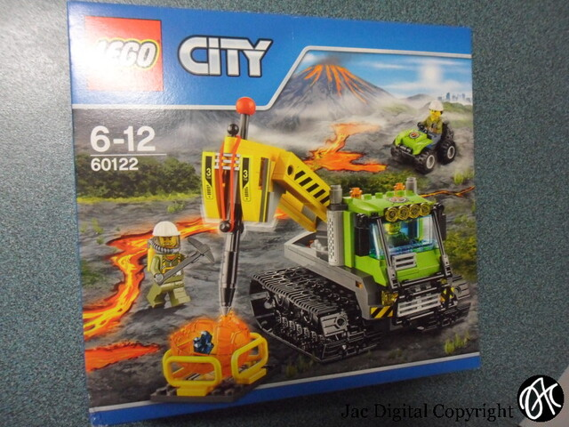](https://www.freelug.org/IMG/jpg/Photo_1_.jpg)

Au dos, quelques photos des différents modèles que contient cette boite mis en situation. Attention, vous allez transpirer pour ouvrir cette boite. Ah non, ce n’est que le personnage qui travaille au pied d’un volcan en activité...

[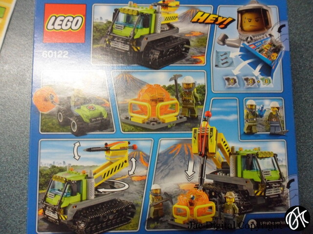](https://www.freelug.org/IMG/jpg/Photo_2_.jpg)

Voilà le contenu avant assemblage : 4 sachets, 3 notices et une petite planche d’autocollants. Chouette, comme dans la boite du 4X4 nous avons droit à une pièce sérigraphiée. Elle prendra place à l’avant du petit quad.

[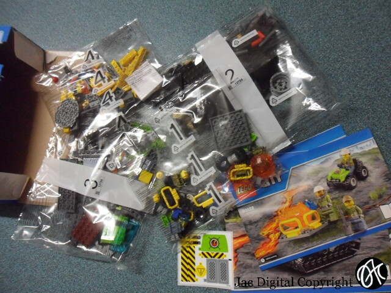](https://www.freelug.org/IMG/jpg/Photo_3_.jpg)

Ouverture du premier sachet. Rien de vraiment extraordinaire pour l’instant.

[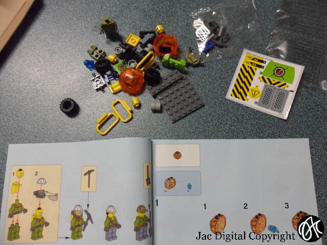](https://www.freelug.org/IMG/jpg/Photo_4_.jpg)

On va commencer par le montage des trois minifigs. D’ailleurs vous trouverez une femme et deux hommes. C’est bien sympa je trouve de mélanger un peu les genres sur toutes les gammes.

[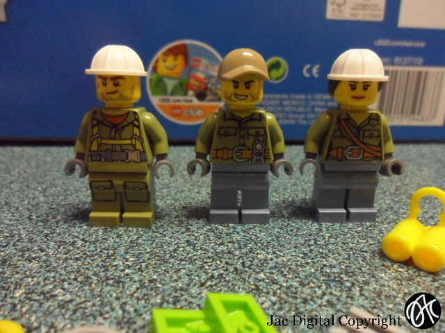](https://www.freelug.org/IMG/jpg/Photo_5_.jpg)

[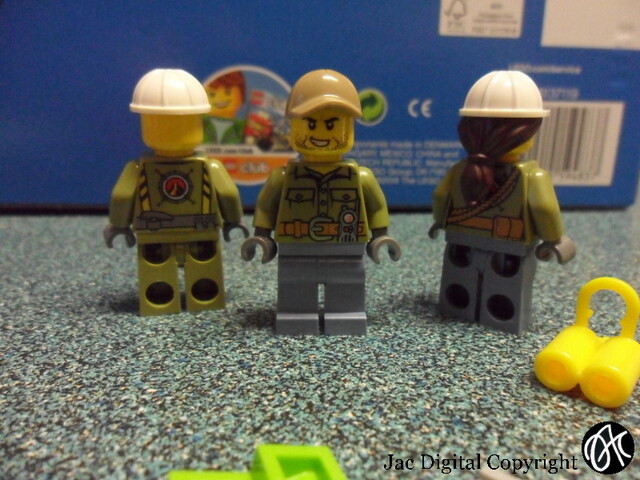](https://www.freelug.org/IMG/jpg/Photo_6_.jpg)

Désolé toutes les minifigs n’ont pas voulu se tourner. Mais au moins vous constaterez sur les plus obéissantes que le dos est aussi très bien décoré...

Le quad est un peu différent de ce que l’on rencontre habituellement, quoique. Non mais qui t’a dit de monter là-dessus toi, j’ai pas encore fini de tout expliquer aux "AFOLs" ?

[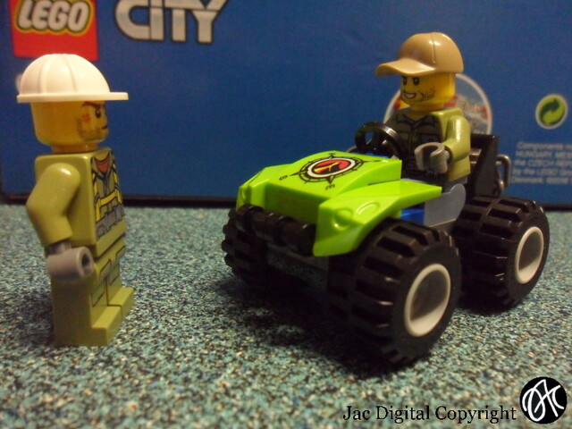](https://www.freelug.org/IMG/jpg/Photo_7_.jpg)

Ouverture du sachet 2 pour le montage du châssis. On y trouve un très gros pneu. C’est un peu perturbant pour un engin à chenilles, surtout qu’il y en a qu’un, si si, vous pouvez chercher ! Mais vous allez comprendre à quoi il sert, à moins que ce ne soit déjà fait.

[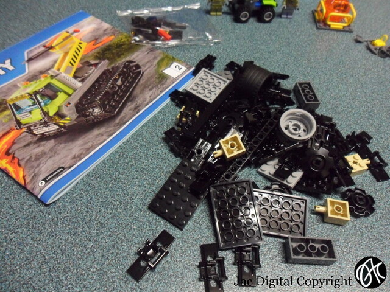](https://www.freelug.org/IMG/jpg/Photo_9_.jpg)

Comme vous le montre le pilote qui se permet d’intervenir sur un engin en construction, non mais, le pneu sert à entraîner les chenilles. Bin oui ! Quand on joue avec ce véhicule ce n’est pas souvent sur un sol adhérent comme de la terre ou de la lave, euh !! Donc grâce au pneu on peut faire "rouler" le char sur toute les surfaces, carrelage, parquet et même table de la cuisine, j’ai essayé. Alors merci monsieur le designer LEGO pour avoir eu cette idée géniale.

[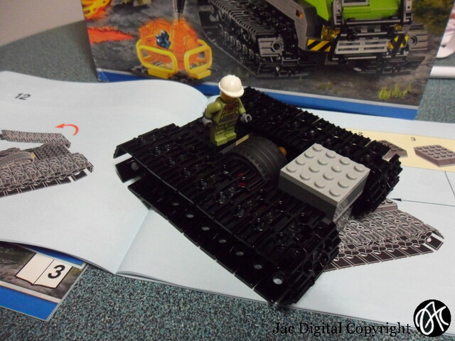](https://www.freelug.org/IMG/jpg/Photo_16_.jpg)

L’ouverture du troisième sachet se fait comme pour les autres et on y trouvera à l’intérieur des nouvelles pièces intéressantes, comme cette brique avec des tenons sur le côté ou le devant comme vous voulez et le nouveau "push bar", que je trouve très bien fait. Grâce à ce nouveau sachet nous allons pouvoir assembler la cabine et les gardes boue de la foreuse.

[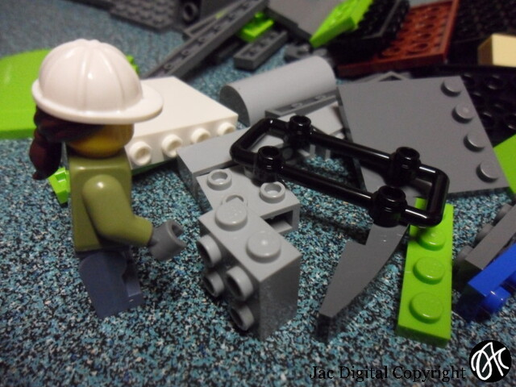](https://www.freelug.org/IMG/jpg/Photo_15_.jpg)

Le montage de la cabine se fait sans encombre mais une chose m’a choqué. On pilote des engins à chenilles avec un volant ? Il me semblait que ça se faisait avec des leviers. Mais bon, je m’égare sur une partie reproduction fidèle à l’original alors que nous sommes en possession d’un jouet, inventé pour une gamme LEGO.

[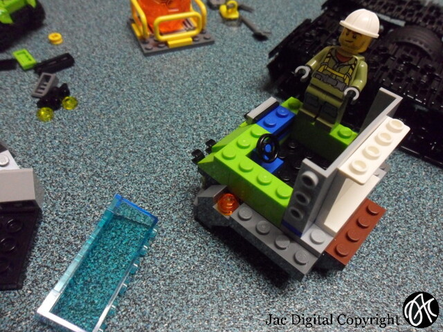](https://www.freelug.org/IMG/jpg/Photo_18_.jpg)

Dans le quatrième sachet vous trouverez toutes les pièces nécessaires pour le montage de la foreuse embarquée.

[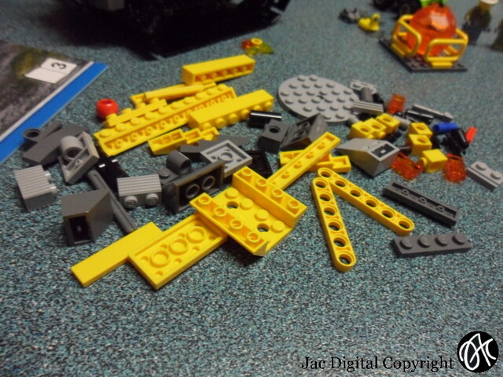](https://www.freelug.org/IMG/jpg/Photo_21_.jpg)

C’est indéniable, cette dernière partie rajoute de la jouabilité à l’engin. D’ailleurs une fois que tout est assemblé on a qu’une envie c’est de trouver les cristaux bleus. Enfin c’était mon cas, pas vous ? Les autocollants ont été collés plus tard, mais déjà la foreuse a fière allure.  
J’aime bien le côté asymétrique avec la petite grille sur le capot.

[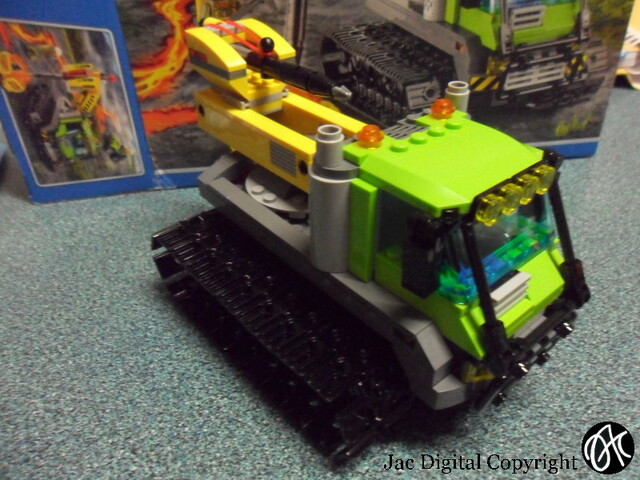](https://www.freelug.org/IMG/jpg/Photo_25_-2.jpg)

Cette nouvelle gamme fait partie des sujets traités par LEGO pour la partie "City". On aime ou pas. Mais je trouve sympa d’apporter à chaque fois des engins un peu insolites avec des couleurs spéciales. Et ce thème là est bien trouvé à mon sens. Après on peut en avoir assez des hélicoptères et des tout terrains, c’est un peu mon cas d’ailleurs. Avec la foreuse sur chenilles on sort un peu du lot. Et puis l’idée du pneu intégré est excellente.  
Par contre, je regrette vraiment le temps des pièces sérigraphiées...

[Ici vous trouverez toutes les photos du montage.](http://photos.freelug.org/main.php/v/JAC/review/60122/)
